# Exact factor two for one-value allocation with arbitrary assignment costs

With one common positive resource value, the budgeted fractional
service region supports a stronger corank theorem than general
largest-unit additive rounding. The returned integer quota can be
recovered without any unit loss: for a fixed selected player set,
minimum-cost integral polymatroid intersection realizes that quota
within the fractional witness's cost.

The resulting deterministic approximation factor is exactly two,
with arbitrary nonnegative player-type assignment costs and one
exact budget. The selected players form an actual basis of an
arbitrary original matroid. No price-diversity parameter, small-unit
hypothesis, resource-unit expansion or unpriced completion is used.

The [native reference and realization proof](reference-realization.md) give
actual complete-table count separation, exact fixed-quota recovery and
original-input target optimization, including the shared-setup companion.
The finite Bland-simplex LP cost is separate from this theorem's paid
polynomial LP primitives.

## 1. Model and theorem

Let M be a rank-r player matroid, with r>=1. Delete its loops and
restrict all recipient ranks to the remaining player ground P.
Put q=|P| and c=q-r. Every type j has a normalized monotone integral
submodular recipient rank f_j on P. An integer allocation uses

<!-- math-display: 7f36894db1bfcd9cef5948a8
n_j\in P(f_j)\cap\mathbb Z_{\ge0}^{P}.
 \tag{O1}
-->
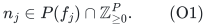

Unused resource capacity is allowed. All units have one common
positive rational value v. For every player-type pair prescribe
an arbitrary nonnegative rational cost c_pj, and require the one
combined assignment budget

<!-- math-display: 0ac68bc0cc1e250c4f417953
\sum_{p,j}c_{pj}n_j(p)\le C,
                          \qquad C\ge0.
 \tag{O2}
-->
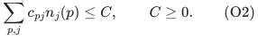

The chosen set I must be an actual M-basis. Let K* be the optimal
integer minimum number of units received by a selected player.
The utility optimum is OPT_C=v*K*. Define

<!-- math-display: 1e2087c6669a59acf5f45532
\Gamma(R)=\frac{R^R}{(R-1)^{R-1}}
                         \quad(R>1).
 \tag{O3}
-->
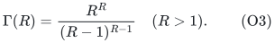

**Theorem O.** There is a deterministic algorithm returning an
M-basis and an integer allocation of total cost at most C, with
at least ceil(K*/2) units at every selected player, in time

<!-- math-display: 0349f43111a59201d42d1a0f
(27/4)^c\mathrm{poly}(H)
 \tag{O4}
-->
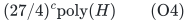

and polynomial workspace. In particular its minimum utility is
at least OPT_C/2. H includes the complete binary encoding and
the paid polynomial recipient-rank, matroid, submodular minimization,
exact rational LP and weighted intersection primitives.

For a prescribed selected basis, the optimum K* under arbitrary
assignment costs is computable exactly in polynomial oracle time.
Thus the c=0 case can be solved exactly. This fixed-set fact is
not the claimed new combinatorial ingredient: the parameterized
theorem chooses a basis when its identity is unknown.

The empty player-rank case is handled separately by returning an
empty selection and zero counts, without assigning a finite minimum
utility to an empty set. The theorem concerns r>=1. If there are no
positive-capacity resources, K*=0 and zero counts suffice.

## 2. Why original loop deletion and free disposal are safe

No original player basis contains a player-matroid loop. Discarding
all counts at such a player preserves every downward recipient
constraint and cannot raise cost. Resource restriction to the
remaining ground therefore preserves the optimum. Zero insertion
back into the original ground recovers a legal original allocation.

The same reasoning lets us discard any counts outside a subsequently
chosen basis. The nonnegative assignment costs in the model are
used here and in the quota trimming below. Mandatory allocation
of full resource bases is not assumed.

## 3. The fixed budgeted count-service region

Define a compact fractional allocation region

<!-- math-display: 002811312fd35fdd4f91ae8c
\mathcal X_C=\{(x_j)_j:
      x_j\in P(f_j)\ (j),\quad
      \sum_{p,j}c_{pj}x_j(p)\le C\}.
 \tag{O5}
-->
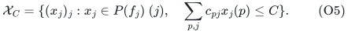

It is nonempty because it contains zero. Its lower count projection is

<!-- math-display: 5cf314c731cc4c76d95a8c28
\mathcal U_C=\{z\ge0:
       \exists x\in\mathcal X_C,\quad
       z_p\le\sum_jx_j(p)\text{ for every }p\}.
 \tag{O6}
-->
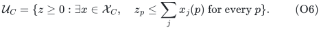

This is a bounded convex downward rational polytope. The original
region stays fixed for every omission branch and every target.
At a candidate player ground Q, the query vector is b*1_Q with
zeros in the other original coordinates.

We use the exact nonnegative separator already proved for the
budgeted unrelated-value region, but spell out its count version
to make its implementation and bit bounds explicit. For a>=0 set

<!-- math-display: 3c719984c0237fb97cbde5a4
h_C(a)=\max_{x\in\mathcal X_C}\sum_{p,j}a_px_j(p).
 \tag{O7}
-->
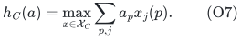

The support LP has polynomially many variables. Each resource is
separated by minimizing f_j(S)-x_j(S), and the one cost row is
explicit. Exact rational LP therefore computes h_C(a) and an
attaining extreme point in polynomial oracle time. The resource
rows have zero-one coefficients and encoded integer right sides;
the cost row has original rational coefficients. Cramer's rule
gives a uniform polynomial-bit bound for all vertices of X_C,
independent of how many subset rows are present.

Let S_tot=sum_j f_j(P). For a proposed z>=0 solve the outer LP

<!-- math-display: cb0ab6ef6b57b1009ac251d5
\begin{array}{ll}
 \text{maximize}&a\cdot z-h,\\
 \text{subject to}&a\ge0,\quad a(P)=1,\quad 0\le h\le S_{\rm tot},\\
                 &h\ge\sum_{p,j}a_p x_j(p)
                         \quad(x\text{ a vertex of }\mathcal X_C).
 \end{array}
 \tag{O8}
-->
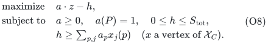

Separation of its last rows is the inner support LP. Every returned
row has polynomial encoding by the preceding vertex bound, and the
outer dimension is q+1. Its explicit upper bound is valid because
the total allocated count is at most S_tot. Exact rational LP hence
solves O8 without enumerating vertices.

If the optimum is positive, recompute h_C(a) and return the valid
nonnegative packing row

<!-- math-display: dddfb3edb4b02e7c8a69d18a
a\cdot y\le h_C(a).
 \tag{O9}
-->
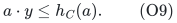

It is strictly violated by z, and its capacity is nonnegative.
If the optimum is nonpositive, z belongs to U_C. To verify the latter
claim, a signed strict separator of a nonnegative point outside a
compact downward region can be replaced by its positive part:
negative-coordinate service can be set to zero in the region, so
the support is unchanged, while the queried point's scalar product
does not decrease. Normalizing the resulting nonzero nonnegative
normal gives a positive objective in O8, a contradiction.

Given a feasible queried service vector, the direct feasibility LP
in O5--O6 reconstructs its fractional allocation. These LPs include
the original cost row; separate affordable pieces are never combined
without testing their sum. C=0 and S_tot=0 are both allowed in the
same formulations, with no division by a budget or capacity.

## 4. The integer-target service gap

For a target integer K>=2 put

<!-- math-display: f56b1d992a250154662d7251
t=K,\qquad b=\lceil K/2\rceil.
 \tag{O10}
-->
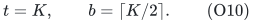

Then t>b>0. A budget-feasible integer allocation giving at least K
units to every player of an M-basis I* is in particular a fractional
witness that t*1_(I*) belongs to U_C.

Use the original M restriction selector and the separator O8--O9
in the weighted prefix-free omission theorem. It returns a genuine
M-basis I with b*1_I in U_C, or soundly excludes every full t-service
basis in the fractional region. Its time is

<!-- math-display: cbdc8aa33ac34857b0b1c5e7
\Gamma\!\left(\frac{K}{K-\lceil K/2\rceil}\right)^c
                           \mathrm{poly}(H).
 \tag{O11}
-->
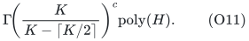

The maximum ratio for K>=2 is three, attained at K=3. Since
Gamma is increasing, O11 is at most (27/4)^c times polynomial work.
This bound includes targets without the stronger promise and all
failed selector attempts. No cost-dependent parameter appears in
the omission measure.

If membership was established on b*1_Q for a larger terminal ground,
the selector returns I subseteq Q. Downward closure gives b*1_I
in the same U_C. Reconstruct its fractional allocation by O5--O6
before applying the next section.

## 5. No-loss quota recovery with the exact cost budget

Fix a returned basis I and its fractional allocation x. First
discard all counts outside I. At each p in I, reduce its type
coordinates until their sum is exactly b. Coordinatewise reduction
preserves every P(f_j), and nonnegative costs ensure the budget
is not increased. Thus there is a fractional point satisfying

<!-- math-display: 13d5aa9ccf08bcaf14a6fa14
x_j\in P(f_j|I),\qquad
             \sum_jx_j(p)=b\ (p\in I),\qquad
             \sum_{p\in I,j}c_{pj}x_j(p)\le C.
 \tag{O12}
-->
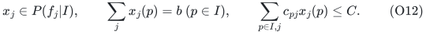

On the product ground E=I times the type set, define the integral
direct-sum resource rank

<!-- math-display: f5141eaab9b13ad4bbd56ad3
A(S)=\sum_j f_j(\{p\in I:(p,j)\in S\})
 \tag{O13}
-->
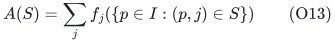

and the integral partition-polymatroid rank

<!-- math-display: 03af6579e25b4a9a10bcd87f
B(S)=b\,|\{p\in I:\exists j\ (p,j)\in S\}|.
 \tag{O14}
-->
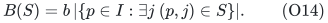

The latter imposes at most b total units at each selected player.
The intersection P(A) intersect P(B) is integral. Point O12 lies
in it and has total br, while B(E)=br is an upper bound on every
point's total. Consequently its maximum-total face of total br
is nonempty and integral.

Minimize the actual assignment-cost objective on this maximum-total
face. The fractional point O12 is feasible there, so the minimum
cost is at most C. Choose an integer optimum, using weighted
integral polymatroid intersection or exact LP optimization followed
by an optimal vertex. Its br total and the r per-player upper
bounds b force exactly b units at every selected player. Its
resource components remain feasible original independent vectors.

This operation has no additive rounding loss. The budget is
preserved because one objective is minimized over an integral face.
We do not intersect that face with a cost inequality and assume
the resulting polytope is integral; that inference would be false
in general. The existence of an integer minimizer of no greater
cost is the required argument.

The total br can be numerically large, but it is stored in binary.
The product ground has only r times the number of types elements.
The ranks, total equation, objective coefficients and separators
all have polynomial encoding. No unit-copy expansion is needed.

The same fixed-I minimum-cost quota test works for every integer
b>=0, independently of an earlier gap witness. It is an exact
feasibility test by comparing its minimum cost with C. Feasibility
is downward in b, so an ordinary binary search optimizes a fixed
selected basis exactly.

## 6. The K=1 gate uses minimum-cost matroid intersection

The positive-gap theorem cannot be invoked with t=b=1. Instead
form one pair (p,j) for every eligible player-type assignment,
where f_j({p})>=1. For each type take the Boolean-cap matroid of
f_j; their direct sum is a matroid D on this pair ground.

Let A_M be the parallel extension of M that replaces each player
p by its eligible type copies. An independent set in A_M uses
at most one copy of each player and its underlying players are
M-independent. A common independent set of size r in A_M and D
therefore assigns one feasible resource unit to each player of
an actual M-basis. Conversely, every such one-unit assignment
is represented by a size-r common independent set.

Give pair (p,j) weight c_pj. Weighted matroid intersection finds
the minimum-cost common independent set of size r or certifies
none exists. Accept exactly when its cost is at most C. This is
an exact test for a positive integer quota of one: any allocation
with at least one unit per selected player can be trimmed to one
without increasing cost.

The ground contains at most q times the number of types pairs,
regardless of binary resource supplies. This gate also handles
players that have no affordable or eligible unit. Zero costs and
zero budget require no special approximation argument.

## 7. Complete one-sided integer optimization

Let

<!-- math-display: fc7e3a047b021c92101a4c11
U_0=\left\lfloor\frac{\sum_jf_j(P)}r\right\rfloor.
 \tag{O15}
-->
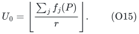

Every feasible minimum integer quota is at most U_0. Initialize
L=0 with any M-basis and zero counts, and use U=U_0+1 as an
externally certified impossible target. It need not be queried.
For integer midpoint targets, use the exact Section 6 test at
K=1 and Sections 4--5 at K>=2. A success saves its actual integer
b-quota allocation and moves L to K. A failure moves U to K.

Every failure certifies that the original integer optimum K* is
strictly smaller than its target. For K>=2 this follows from the
stronger fractional infeasibility conclusion of the gap; for K=1
it follows from the exact unit test. Therefore U>K* is invariant.
Success need only attain ceil(K/2), and successes need not be
monotone or attain the nominal full K.

At adjacent integer endpoints, U=L+1 and U>K* imply L>=K*.
The saved integer allocation has at least ceil(L/2)>=ceil(K*/2)
units per player. If L=0, adjacency and the same invariant imply
K*=0, so the initialized zero allocation suffices.

There are O(log(U_0+2)) calls, polynomial in the binary rank
encoding. Every K and b has polynomial bit length. Multiplying
counts by the one common value v converts the quota statement
to the claimed exact factor-two utility guarantee, without any
additional rational utility search.

## 8. Complexity and scope

The projected count separator is polynomial oracle work with a
uniform polynomial-bit description. The weighted omission routine
therefore has the bound O11 and polynomial workspace. Exact quota
recovery uses a polynomial product ground and an integral
maximum-total intersection face; the K=1 gate uses two explicit
matroids on eligible pairs. Integer target search adds only a
polynomial factor. Together these prove O4.

The assignment costs may vary arbitrarily with both type and
player. A player need not have a common unit charge or a bounded
number of distinct prices. This distinguishes the present one-value
result from the structured-cost two-value and price-copy transfers.

The theorem preserves one assignment-cost budget. Minimizing one
linear objective on the recovery face does not preserve several
independent budgets simultaneously. No such extension is claimed.

The selected player constraint here is one matroid. Replacing it
by an arbitrary fixed-cardinality restriction selector works for
the positive K>=2 gap, but does not automatically supply the exact
K=1 cost gate. In particular, adding another exact player matroid
would not be justified merely by reusing Section 6's two-matroid
intersection. The stated theorem does not make that extension.

For compulsory players the selected set is fixed. Section 5 then
optimizes the entire one-value budgeted instance exactly in
polynomial time. The approximation theorem is for optional basis
selection and does not claim to improve that simpler baseline.

## 9. A matching oracle approximation threshold

The zero-cost subclass already prevents any uniform deterministic
factor strictly smaller than two in F(c) poly(H) value-oracle time.
For completeness, choose q>r>=2, c=q-r, the player matroid U_(r,q),
one unit-valued resource and a hidden r-set A. Set

<!-- math-display: 26baed21bf049a748b4ad418
f_A(S)=\min\{2|S|,2r\}-{\bf1}[|S|=r]+{\bf1}[S=A].
 \tag{O16}
-->
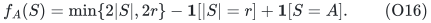

This is the normalized monotone integral submodular rank proved
in [A value-oracle barrier below factor two for rank-parameterized allocation](../allocation-lower-bounds/proof.md) and repeated
in [Optional active machine bases: an oracle obstruction before approximation](../../manuscripts/mechanism-boundaries/optional-active-machine-basis-oracle-obstruction.md). The
all-cardinality baseline has nonincreasing increments
2,...,2,1,1,0,...; raising only A by one consumes exactly the
available submodular slack when A is a union or intersection.

The vector 2*1_A is feasible and the total rank is 2r, so K*=2.
If an integer output has minimum quota greater than one on an
r-element basis I, then f_A(I)>=2r, forcing I=A. Every factor
strictly below two must therefore identify A. All assignment
costs may be zero and C=0.

The oracle differs from its common baseline only at the query A.
With two unqueried r-sets remaining, one transcript is consistent
with either hidden set and a single output cannot be correct for
both. Thus at least binom(q,r)-1=binom(q,c)-1 value queries are
necessary in the worst case. Choosing a fixed c larger than any
proposed uniform polynomial degree and then increasing q excludes
F(c) poly(H). Oracle values have only O(log q) bits.

This establishes an approximation threshold in the full
recipient-polymatroid value-oracle model, not optimality of the
exponential base 27/4. It is not a hardness theorem for explicitly
represented ordinary allowed-recipient lists. It is consistent
with the present exact factor-two algorithm and with the exact
polynomial fixed-basis subproblem.

## 10. Relation to prior work

Rohwedder, Rouhani and Wennmann's primary
[*Cost Preserving Dependent Rounding for Allocation Problems*,
ICALP 2025](https://drops.dagstuhl.de/storage/00lipics/lipics-vol334-icalp2025/html/LIPIcs.ICALP.2025.127/LIPIcs.ICALP.2025.127.html),
Theorem 3, gives a randomized logarithmic approximation for the
ordinary-item Budgeted Santa Claus problem with intrinsic values.
Its cost-preserving largest-unit additive rounding is established
background. The present one-value theorem instead uses an exact
fixed-quota intersection to avoid that additive loss and pays
corank-exponential time for optional matroid-basis selection.

The proof's substantive new composition is the budgeted count
projection, the weighted omission gap, and exact quota recovery,
together with a separately verified one-unit selector gate. The
model and parameter restrictions are part of the statement. No
exhaustive publication-priority claim, formal verification or
external peer review is asserted.

---

**Attribution:** icekylinx and GPT-6 Astra Pro.
