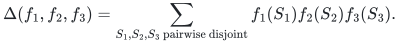
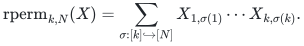
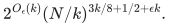

# Ordered subset contraction and rectangular permanent

A uniform, division-free subset construction computes arbitrary weighted
disjoint triples and the row-ordered rectangular permanent over associative
rings, including growing subset sizes and row counts. Its explicit
`2**O(k)` overhead replaces position-partition enumeration. The construction
uses a five-choice identity, trimmed upper transforms and ordered matrix
contraction; the numerical matrix exponent is a separate input.

[Proof](proof.md) · [Sources and dependencies](sources.md) · [Runnable verification](verify/README.md)

**Objective and output**

For three explicit tables on the `hi`-subsets of an `N`-element universe,
return the ordered ring element

<!-- math-display: 355f82a60e546e974289f49a
\Delta(f_1,f_2,f_3)=\sum_{S_1,S_2,S_3\text{ pairwise disjoint}}
f_1(S_1)f_2(S_2)f_3(S_3).
-->

For a `k` by `N` matrix, the corresponding output is

<!-- math-display: 297a8fe8fba55cc8c59a7533
\mathrm{rperm}_{k,N}(X)=
\sum_{\sigma:[k]\hookrightarrow[N]}X_{1,\sigma(1)}\cdots X_{k,\sigma(k)}.
-->

The product order is part of both problems. If `k>N`, return zero; the
rectangular case `k=2` has a separate linear formula.

**Randomness**

Deterministic arithmetic circuit construction and exact evaluation, with no probability of error. Matrix engines are named source dependencies; finite checks establish identities and cost certificates, not those external theorems.

**Time**

For balanced consecutive row blocks and every fixed positive `epsilon`,
the uniform arithmetic circuit bound is

<!-- math-display: 938f7c1335d6b8f7120a438b
2^{O_\epsilon(k)}(N/k)^{3k/8+1/2+\epsilon k}.
-->

The theorem applies to arbitrary growing `k` with `2<=k<=N`. Input tables,
upper transforms, profile tables, outer assignments and final products are
charged. The construction avoids position-partition enumeration and retains
multiplication order, including in rings without a multiplicative identity.
It uses the cited universal integer square matrix theorem with exponent
`9/4`; the exponent substitution is not claimed as a separate contribution.

Unequal subset sizes have the exact integer capacity envelope proved in the
main argument. The proof also records the generic square-engine interface and
incomparable fixed-degree refinements as supporting analysis. They are not
separate selected algorithms or a claim about the square permanent's
exponential base.

**Space**

Straightforward evaluation stores at most circuit-size many ring elements,
plus polynomial indexing overhead per gate. No polynomial-space bound or
bit-size bound for arbitrary ring elements is claimed. The exact reference
prototype stores explicit subset tables and uses naive matrix products.

**Parameters**

`N` is universe size, `hi>=0` are subset sizes and `k=h1+h2+h3`.
The displayed uniform bounds assume `2<=k<=N`; `epsilon>0` is fixed before
choosing the finite matrix-scheme family. For rectangular permanent,
`k>=2` is row count and the consecutive block lengths differ by at most one.
For equal-size triples, `q` is each subset size and `k=3q`. Field-only
refinements fix the field before selecting their finite matrix schemes;
constants may depend on that field.

**Model and representation**

Inputs are explicit arbitrary ring-valued tables or a rectangular matrix.
The subset construction works over every associative ring, including
nonunital rings, using addition, negation, zero and ordered multiplication.
Strassen's integer bilinear identity supplies an established universal-ring
engine. Scalar-field matrix exponents alone cannot replace this interface
for noncommutative input weights. The recent square `9/4` branch has the same universal ring model. The
stronger full rectangular, fixed odd-degree and characteristic-two
refinements are asserted only for scalar coefficients over fields. The
reusable cyclic compiler itself works over unital associative rings.

**Lower-bound scope**

No historical priority or global optimality claim is made. Specialized
crossing constructions in the source improve degrees four and five beyond
these two general methods. Earlier weighted-triple algorithms remain direct
comparators, including special small subset sizes.

When `k=N^(c+o(1))`, `0<c<1`, the recent-square Bell-free bound has base-`N`
degree coefficient `(1-c)*3/8` with arbitrary positive slack. More generally
the binomial-sensitive improvement is asserted in the regime
`log(N/k)` tending to infinity, after charging the exponential prefactor.
This does not settle an all-range binomial-tail bound. When `k` is
comparable to `N`, its unspecified exponential base gives no smaller-base
square-permanent result. The general full integer square-permanent target
remains open and is excluded here.

**Review status**

**Ready for review.** Uniform growing-parameter ordered subset aggregation and rectangular permanent, including nonunital ring inputs, upper transforms, integer capacity envelopes, balanced row construction and all exponential parameter overhead. The strongest displayed universal bound uses the cited square matrix endpoint; full rectangular and fixed-degree refinements retain the stated scalar-field scope.

**Dependencies and scope.** The universal square theorem and the field-only full rectangular theorem are named external matrix inputs. Native reference products are naive; the 7,299 exact assertions test finite ordered identities, capacity certificates and cyclic circuit interfaces, not the external theorems or an asymptotic fast engine. The improvement is uniform in growing parameters after charging exponential overhead. No superiority for every fixed degree, all-range binomial-tail theorem, smaller-base square-permanent algorithm, external review or formal verification is claimed.

The [verification note](verify/README.md) identifies executable coverage. This status does not claim external peer review or proof-assistant verification.

**Source**

Curated from the supplied SAT checkpoint's completed subset-zeta and balanced
ordered-circuit results. The established main branch uses Strassen's integer
identity. The substantive selected result is the explicit uniform
growing-parameter construction and its division-free ordered-ring model;
substituting a newer matrix exponent is not a separate novelty claim. The recent universal ring improvement uses only Zhou–Wang's public
square `9/4` endpoint. The full rectangular and associated refinements use
Amanov–van den Berg–Zuiddam's theorem over every field, with that scalar
coefficient model stated explicitly. This package needs only the public square endpoint. The stronger
[local integral three-shape composition](../noncommutative-crossing/) is
curated separately with its own explicit source premises; it is not a
dependency of this bound. Its formal artifacts are not imported or certified.
See [sources.md](sources.md) for exact attribution and dependency boundaries.

Curated derivations and code: **icekylinx and GPT-6 Astra Pro**. Apache-2.0;
external results retain their source attribution.
