# Proof of the ordered subset algorithms

**Attribution:** Yilin Liu and GPT-6 Astra Pro. Apache-2.0 under the
repository [license](../../LICENSE); external mathematical sources retain
their attribution in [sources.md](sources.md).

The coefficient ring is associative and its additive group permits subtraction. A unit is unnecessary for the subset construction. All integer scalars below act by repeated addition and negation. The results are arithmetic operation bounds. Strassen and the recent universal square matrix theorem supply ring-valued branches; the stronger full rectangular curve and its refinements below are restricted to scalar coefficients in a field. No field algorithm is applied to noncommutative ring inputs.

## The exact identity and algorithm

Define the upper transform of a table on the `hi`-subsets by

<!-- math-display: 09ae489b615ea49aed73df37
\widehat f_i(R)=\sum_{S\supseteq R,\ |S|=h_i}f_i(S).
-->
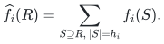

The five-choice identity is

<!-- math-display: e4fbe110c224beed8072f7ef
\Delta=\sum_{A,B,C,G\text{ pairwise disjoint}}
(-1)^{|A|+|B|+|C|}2^{|G|}
\widehat f_1(A\cup B\cup G)
\widehat f_2(A\cup C\cup G)
\widehat f_3(B\cup C\cup G).
-->
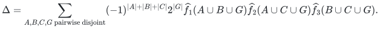

To prove it, expand the three transforms and fix the original sets. For each universe element let `x,y,z` be its three membership indicators. Its five possible marker roles contribute the scalar

<!-- math-display: e885be915a51233f3359c6a0
1-xy-xz-yz+2xyz.
-->
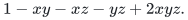

This is one for membership in at most one set, zero for membership in two sets, and zero for membership in all three. Multiplying these independent scalar indicators selects precisely disjoint triples. The input factors stay in order throughout; the scalar one is a counting multiplicity, not a ring-unit gate.

Compute each transform on subsets of size at most `hi`: initialize with the level-`hi` input, zero elsewhere, and, for each element `j`, add `v(T)` into `v(T\{j})` for every `T` containing `j`. Within a pass the targets omit `j`, so updates are safe in place. Each superset contribution reaches each subset exactly once. The number of additions is

<!-- math-display: 659d0282caf1854fe4b167c8
\sum_{t=1}^{h_i}t\binom Nt.
-->
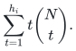

Fix a cardinality profile `(g,a,b,c)` and a particular `G`. A contributing profile satisfies

<!-- math-display: cfd80e456c3413d1d0bcf0ef
g+a+b\le h_1,\qquad g+a+c\le h_2,\qquad g+b+c\le h_3.\tag{1}
-->
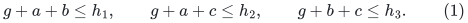

Index `L` by `(A,B)`, `M` by `(A,C)` and `W` by `(B,C)`, using subset cardinalities `a,b,c`. Put the corresponding transformed value in an entry if its two index sets and `G` are pairwise disjoint, and zero otherwise. The profile contribution before its scalar multiplier is

<!-- math-display: 1749ab4abe746bb27b60e6b6
\sum_{B,C}(L^{\mathsf T}M)_{B,C}W_{B,C}.
-->
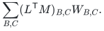

Every pair among `A,B,C,G` is tested in at least one table. The transpose only relabels indices. Every actual product is `L M W`. Apply the profile scalar after summing the assignments of `G`, using at most `g` doublings and one negation.

For the rectangular permanent, split rows into three balanced consecutive nonempty blocks when `k>=3`. For a block starting after row `s`, build its ordered subset weights using

<!-- math-display: 6275542cceb86b6316d086a3
F(\{j\})=X_{s+1,j},\qquad
F(T)=\sum_{j\in T}F(T\setminus\{j\})X_{s+|T|,j}.
-->
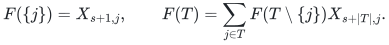

This enumerates each injective assignment inside the block exactly once and appends row factors on the right. Disjointness across the three blocks is exactly global injectivity. For `k=2`, use the linear formula consisting of the product of the two row sums minus the sum of same-column products. Setting row families equal gives the ordered distinct-index elementary polynomial as well.

## Matrix interfaces and exact integer costs

For a numerical triple sorted as `a>=b>=c`, square tiling gives

<!-- math-display: 11cd2979104afbee55dce05f
V_\omega(a,b,c)=a+b+(\omega-2)c,\qquad 2\le\omega\le3.
-->
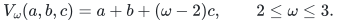

Tile all three matrix axes by their smallest dimension. There are at most `N^(a+b-2c)` square products of size `N^c`. This numerical sorting never changes the order of input factors. Strassen's seven-product integer identity provides `omega=log2(7)` over every associative ring; its bilinear forms have integer coefficients and need no unit. The recent universal integer square theorem of Zhou–Wang supplies `omega=9/4` with arbitrary positive slack, over arbitrary associative rings. This uses their public square endpoint, not a proposed full three-shape extension. For balanced row blocks its exact integer envelope is at most `3k/8+1/2`.

For the stronger rectangular interface **over a fixed scalar field only**, sort numerical coordinates as `A>=B>=C>=0` and define the symmetric function

<!-- math-display: 2ee768dbbafec9a39f3ae676
U(A,B,C)=
\begin{cases}
A+B,&C(A+B)\le AB,\\
\dfrac{(AB+AC+BC)^2}{4ABC},&C(A+B)>AB.
\end{cases}
-->
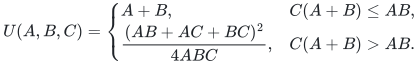

Amanov–van den Berg–Zuiddam, Theorem 1.2, supplies the full three-shape exponent `U+eta` over every field, for each positive fixed slack `eta`. For this branch fix the scalar field first; the finite matrix schemes and their constants may depend on that field. All matrix linear maps are charged. This is not a universal integer or noncommutative-ring matrix interface. The separately curated [integral three-shape composition](../noncommutative-crossing/) has its own source premises and is not needed for this package; [sources.md](sources.md) records that boundary.

Both certificates are support functions `V(x)=max p·x` for compact subsets of the cube `[0,1]^3` containing the three pair-sum vectors. For `V_omega`, use the permutations of `(1,1,omega-2)`. For `U`, use the quadratic relaxation

<!-- math-display: c8937380e87b29e43fddb5fe
\mathcal P_Q=\{p\in[0,1]^3:
4(p_1x_2x_3+p_2x_1x_3+p_3x_1x_2)
\le(x_1+x_2+x_3)^2\text{ for all }x_i\ge0\}.
-->
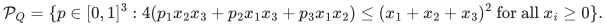

Its exact support formula is attributed to Amanov, van den Berg and Zuiddam. A quick certificate is as follows. In the flat branch, substitute `(B,A,A+B)` in the quadratic inequality; `(1,1,0)` attains the bound. In the curved branch put `z=(BC,AC,AB)` and `s=sum z`. Substitution gives the upper bound `s²/(4ABC)`. The support vector

<!-- math-display: 85c803088dec4e0830977c41
p_i=\frac{s(z_j+z_l-z_i)}{4z_jz_l}
-->
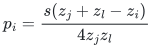

belongs to the cube because `z` is a positive triangle. Let the matrix `Q` have diagonal one and off-diagonal entry `Q_jl=1-2p_i`. Then `Qz=0`; with `u=Q12`, `X=z3*x1-z1*x3`, `Y=z3*x2-z2*x3`,

<!-- math-display: 9f9502bd17f7f1d7f80cf62c
z_3^2 x^{\mathsf T}Qx=(X+uY)^2+(1-u^2)Y^2\ge0.
-->
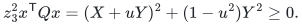

Thus the vector is feasible and attains the upper bound. This support identity proves the convexity, symmetry, monotonicity, homogeneity and coordinatewise one-Lipschitz properties needed below. It does not identify the relaxation with the actual tensor spectrum.

Define the exact integer certificate, including input-table cost, by

<!-- math-display: f6e915b5644f318b62eb67c3
D_V(h)=\max\left\{\max_i h_i,
\max_{(g,a,b,c)\in\mathbb Z_{\ge0}^4\text{ satisfying (1)}}
g+V(a,b,c)\right\}.
-->
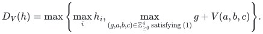

If a capacity exceeds the other two combined, `D_V=max hi`. Otherwise set

<!-- math-display: 09c01d721312def096a94854
E=\tfrac12(h_1+h_2-h_3,h_1+h_3-h_2,h_2+h_3-h_1),\qquad
\delta=(h_1+h_2+h_3)\bmod2.
-->
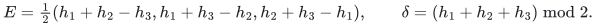

Then the exact closed form is

<!-- math-display: 2f0ced240447a6477bf8cfb7
D_V(h)=\delta+V(E-\delta(1,1,1)/2).\tag{2}
-->
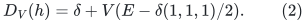

Here is a proof including the parity issue. The continuous triangle envelope is `V(E)`. For any support vector `p`, if its coordinate sum is at most two, its objective is bounded by the largest pair sum, which is at most `max hi-g`. If the sum is at least two, the multipliers `(p1+p2-p3)/2`, `(p1+p3-p2)/2`, `(p2+p3-p1)/2` are nonnegative. Multiplying (1) gives `p·(a,b,c)<=p·E-g*sum(p)/2`, hence `g+p·(a,b,c)<=V(E)`. Pair-sum supports already give `V(E)>=max hi`. In a dominant-capacity case, adding the two smaller constraints and using `V<=a+b+c` bounds every profile by the largest capacity.

Also `V(x+(1,1,1))>=V(x)+2`: a maximizing support vector with sum below two can be dominated by a vector of sum two in the convex hull of the pair-sum supports. Replacing `(g,a,b,c)` by `(g-2,a+1,b+1,c+1)` therefore does not decrease its objective. Only `g=0,1` are needed for the maximum. With even total, `(0,E)` attains the continuous bound. With odd total put `F=E-(1,1,1)/2`. The `g=1` maximum is `1+V(F)`. For `g=0`, the integer hull of the pair-capacity polytope is obtained by adding

<!-- math-display: 516cfc105421ca51ea951d28
a+b+c\le\lfloor(h_1+h_2+h_3)/2\rfloor.
-->
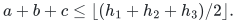

Its coordinate-plane vertices are integral; the remaining vertices are `F+ei`. This follows by intersecting the new total constraint with two pair constraints; the intersection of all three old pair constraints was precisely the excluded half-integral point `E`. At a coordinate plane the objective is the sum of the two present coordinates, at most `max hi`. At `F+ei`, the one-Lipschitz property bounds the objective by `1+V(F)`. Convexity bounds the entire hull. Pair-sum supports also give `1+V(F)>=max hi`, proving (2).

For balanced rectangular row lengths and the universal square engine `omega=9/4`, the exact certificate is at most `3k/8+1/2`. To check the constant for every degree, write `k=3m+j`. The excess above `3k/8` is zero or `-1/8` when `j=0` according as `m` is even or odd; `3/8` or `1/2` when `j=1` according as `m` is even or odd; and `1/4` or `1/8` when `j=2` according as `m` is even or odd. The excluded `k=1` is the only small dominant-capacity exception. The same substitution for `omega=log2(7)` gives the established coefficient `log2(7)/6` with an absolute bounded additive exponent.

For `h=(q,q,q)`, `q=2m+delta`, (2) yields exactly `D_Vomega=omega*m+delta` for the ring-valued square branch. The field-only rectangular branch gives `D_U=9m/4+delta` as well. These equal-size exponents agree when `omega=9/4`; unequal-capacity exponents can differ.

For the following `U` refinement assume a scalar field of characteristic two. Every term with `g>=1` vanishes before contraction. For triangle capacities of odd total the remaining envelope is `max_i U(F+ei)`. Symmetry and convexity show this maximum occurs at a largest coordinate of `F`: adding one to a smaller coordinate is a convex combination of adding to a largest coordinate and swapping those two coordinates. For even total or dominant capacities the previous value persists. This proves the characteristic-two field formula and its uniform algorithm. It is not asserted for arbitrary noncommutative characteristic-two rings using the field-only `U` engine.

## Uniform accounting without partition enumeration

Put `R=N/k>=1`. For `0<=t<=k`,

<!-- math-display: 3dfd66d483edf57a20107799
\binom Nt\le e^k R^t.
-->
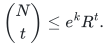

Indeed use `(eN/t)^t` and `t*log(ek/t)<=k`. Inputs, block DP, transforms and local tables across all `G` consequently cost `2^O(k)*R^(max hi)`. For example `L` requires at most `binom(N,g)binom(N,a)binom(N,b)` entries, and `g+a+b<=h1`. Only `(k+1)^4` profiles occur. Final ordered contractions cost at most `2^O(k)*R^(g+b+c)` and are covered by `D_V`.

The matrix schemes must be uniform in the growing degree. Fix `0<epsilon<=1`, choose an integer grid denominator `D>=12/epsilon`, and choose a single all-size matrix scheme for each shape on `{0,1/D,...,1}³`, with slack `eta=epsilon/2`. This finite family is independent of `k,N`. For the two universal integer square engines it is also independent of the ring; for the `U` branch fix the scalar field first. Round `(a/k,b/k,c/k)` upward, preserving exact zero coordinates, and run the selected scheme at scale

<!-- math-display: 52c414618742b75a49398c2d
n_* =\left\lceil2^{2Dk}R^k\right\rceil.
-->
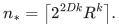

Each positive grid coordinate is at least `1/D`; padding therefore contains all corresponding subset domains since `n_*^u>=4^k*R^a>=binom(N,a)`. The support lies in the unit cube, so upward rounding changes `kV` by at most `3k/D`. For the field branch, constants in the resulting exponential prefactor may depend on the fixed field. The exponential scale and the common prefactor cost only `2^Oepsilon(k)`. Including the outer `G` assignments, the exponent of `R` is bounded by

<!-- math-display: df33d8cb5fae967c307ffa93
g+V(a,b,c)+(3/D+\eta)k\le D_V(h)+\epsilon k.
-->
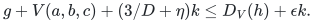

All subset indexing, unions and disjointness tests have polynomial bit overhead per enumerated entry. These are arithmetic circuit bounds; they do not bound the representation sizes of arbitrary ring elements.

The significance of this theorem is uniformity in `k`, arbitrary unrelated input weights and the ordered division-free ring model. A newer numerical square exponent is a replaceable engine, not the contribution itself. BKK's weighted-triple theorem fixes its subset size before the universe grows and permits exact integer division. Its published `q=2,3,4` specialization does not state the present all-size uniform theorem. The `2^Oepsilon(k)` prefactor here is fully retained: when `log(N/k)` tends to infinity it is negligible in the normalized leading exponent, while when `k` is comparable to `N` it prevents an all-range square-permanent base improvement. No claim of solving the literal all-range binomial-tail question follows.

## Appendix: fixed-degree alternatives over scalar fields

**This additional `U`-based result is restricted to scalar coefficients over a fixed field.** For fixed `k`, partition-lattice inversion expresses injectivity as a sum over position partitions with coefficients `prod_B (-1)^(|B|-1)(|B|-1)!`. This has a Bell factor, so it is kept only for its smaller fixed odd-degree exponents. For one partition, sum singleton labels in their original position and absorb the resulting factor into a neighbor in order. An all-singleton word is simply a product of row sums.

Set `r=floor(k/2)` and let `E1>=E2>=E3` be balanced integers summing to `r`. Use capacities `(H1,H2,H3)=(E1+E2,E1+E3,E2+E3)`. A residual word of length at most `2r` fits in consecutive blocks of these capacities. The only longer case is length `2r+1` with no singleton labels. Some label occurs at least three times, so two consecutive occurrences around the circle have gap at most `floor((2r+1)/3)<=H1`. Choose a cyclic first block of length `H1+1` containing both. Its distinct-label count is at most `H1`; the remaining lengths are `H2,H3`.

Fix labels common to all blocks and tabulate ordered block products, summing private labels locally. The resulting triangle has exactly constraints (1) with capacities `H`. The continuous envelope proof above bounds its total exponent by `U(E)=B_r`; literal table cost is at most `N^H1<=N^B_r`. Thus each fixed partition costs `O_k,epsilon(N^(B_r+epsilon))` under the field-only full rectangular matrix theorem.

To restore the original starting position, compute cyclic derivatives of the constructed ordered circuit and return the sum of each selected-row derivative times its row variable on the right. On a word `L X R` with exactly one selected-row occurrence, this gives `R L X`, with no scalar division. A reverse circuit traversal sends adjoint `d` at a product `uv` to `v*d` at `u` and `d*u` at `v`; sums, differences and negations propagate linearly. This rule follows by writing each occurrence's prefix and suffix around the unique cyclic cut. Shared subcircuits accumulate contributions; both contributions must be frozen before updating when the two children coincide. Each source node emits a constant number of operations, so the compiler and final selected-row sum cost `O(s+N)`. Position families remain distinct until the final specialization. The cyclic compiler itself works over any unital associative ring, using a unit for the reverse seed and empty-block padding. The `B_r` complexity bound in this imported branch uses the field-only `U` engine.

The reference adapter checks a sufficient syntactic exactly-one-row condition before rotation. Its measured construction bound is at most `6*m+2*t` arithmetic operations for `m` source nodes and `t` selected names, including the forward circuit. The exact integer word oracle verifies rotation direction, shared operands, characteristic-two multiplicities and malformed-input guards.

The balanced fixed-degree values are

<!-- math-display: 64fe3878245533581d7fa5e9
B_1=1,\ B_2=2,\quad B_{3m}=9m/4,\quad
B_{3m+1}=\frac{(3m+2)^2}{4(m+1)},\quad
B_{3m+2}=\frac{(3m+1)^2}{4m}\quad(m\ge1).
-->
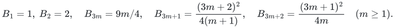

Over a fixed scalar field, taking the minimum with the field-only Bell-free `U` certificate retains the incomparable fixed-degree bounds. For arbitrary associative rings the imported complexity result is the Bell-free square-engine branch. No Bell-based growing-degree headline is needed. The `D` and `B` envelopes are upper cost certificates for these constructions, not lower bounds for general circuits or matrix multiplication.
