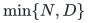
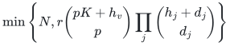
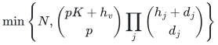
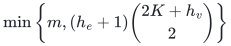
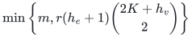
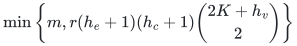

# Universal packing and matching summaries

Failure-tolerant packing restrictions with exact fixed-cost replacement in the original context.

[Proof](proof.md) · [Sources](sources.md)

**Guarantee**

Retain at most

<!-- math-display: 4da1d6f0e0f5d50a0258b88d
\min\{N,D\}
-->

 items, where <code class="math">D=r\binom{pK+h_v}{p}\prod_j\binom{h_j+d_j}{d_j}</code>. Omit <code class="math">r</code> without an extra resource matroid.

**Objective and output**

Preserve feasibility, prescribed positive cardinality up to <code class="math">K</code>, and minimum fixed positive cost for every allowed failure and every fixed quota-free background in a later extension.

**Randomness**

Deterministic uniformly polynomial construction over the supplied rational or finite-field representation; no randomized representation, hashing or isolation step is assumed.

**Time**

Uniform deterministic polynomial preprocessing, gated before feature enumeration. Gaussian elimination uses the following number of field operations:

<!-- math-display: 29265a374f330d77fecab66d
O(ND^2)
-->

Padding, determinant features, label features, and rank compression are additional polynomial work.

**Space**

At most

<!-- math-display: 4da1d6f0e0f5d50a0258b88d
\min\{N,D\}
-->

 original item IDs. Tensor/exterior features and elimination workspace are separate. No solver runtime for an unspecified later extension is claimed.

**Parameters**

<code class="math">p</code> is actual item-support bound after normalization; <code class="math">K</code> is positive cardinality; <code class="math">h_v</code> is failed universe count; <code class="math">h_j,d_j</code> are label budgets/degrees; <code class="math">r</code> is the full represented resource rank.

**Model and representation**

Explicit packing sets, signed rational costs, and optional rational or finite-field represented resource columns. Later extensions may be arbitrary but must restrict to the original positive resource.

**Lower-bound scope**

Comparison with arbitrary-oracle packing bounds uses the stronger represented-resource input model. This is a size/replacement theorem, not a faster unrestricted matching algorithm.

**Review status**

The [verification note](verify/README.md) records the proof scope, executable evidence and remaining conditions. No proof-assistant verification or external peer review is claimed.

**Source**

[Complete proof](proof.md) and [canonical manuscript map](sources.md).

## Results

**Packing with represented resource**

<!-- math-display: 15998acb3004922e2650e982
\min\left\{N,r\binom{pK+h_v}{p}\prod_j\binom{h_j+d_j}{d_j}\right\}
-->

**Packing without resource constraint**

<!-- math-display: 4d1993b25562770da6035818
\min\left\{N,\binom{pK+h_v}{p}\prod_j\binom{h_j+d_j}{d_j}\right\}
-->

**General multigraph matching, <code class="math">h_v</code> vertex and <code class="math">h_e</code> edge-ID failures**

<!-- math-display: b2c954fdba19d575a223e0f7
\min\left\{m,(h_e+1)\binom{2K+h_v}{2}\right\}
-->

**Matching with an additional represented resource**

<!-- math-display: b45302ea62c19ca58eefdaa4
\min\left\{m,r(h_e+1)\binom{2K+h_v}{2}\right\}
-->

**Matching with <code class="math">h_c</code> additional single-color risk groups**

<!-- math-display: 0976162f38a239cd9c7c2061
\min\left\{m,r(h_e+1)(h_c+1)\binom{2K+h_v}{2}\right\}
-->

Omit <code class="math">r</code> when no represented resource is present.

Private dummy padding keeps empty packing sets distinct. Original edge IDs remain distinct when individual failures are allowed. Rational bit accounting includes the Vandermonde ambient degree <code class="math">pK+h_v</code>.

**Attribution:** Yilin Liu and GPT-6 Astra Pro.
