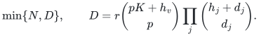
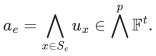
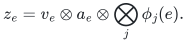
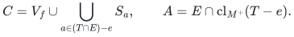
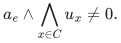
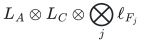
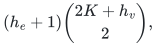
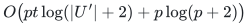

# Universal packing summaries under failures

## 1. Theorem

Each explicit item <code class="math">e</code> has a packing set <code class="math">S_e</code> of size at most <code class="math">p</code>, fixed signed rational cost, and at most <code class="math">d_j</code> labels in each failure system <code class="math">j</code>. Positive solutions contain at most <code class="math">K</code> items with pairwise disjoint packing sets. A query fails at most <code class="math">h_v</code> universe elements and <code class="math">h_j</code> labels in system <code class="math">j</code>. An optional resource matroid is supplied by a rational or finite-field representation of full rank <code class="math">r</code>.

There is a deterministic uniformly polynomial restriction of size at most
<!-- math-display: 693ead1962e06c535a7a7d6d
\min\{N,D\},\qquad
D=r\binom{pK+h_v}{p}\prod_j\binom{h_j+d_j}{d_j}.
-->

Omit <code class="math">r</code> when no resource is present. It preserves minimum fixed positive cost for every prescribed positive cardinality up to <code class="math">K</code>, all allowed failures, and every fixed quota-free background in a later matroid extension. The extension must restrict to the original positive matroid; it need not be represented.

## 2. Construction

Normalize <code class="math">p</code> to <code class="math">\max\{1,\max_e&#124;S_e&#124;\}</code>, then pad every set to size <code class="math">p</code> using private never-failing dummies. This keeps padding polynomial and prevents duplicate use of initially empty items.

Put <code class="math">t=pK+h_v</code>. Represent padded universe elements by Vandermonde columns <code class="math">u_x\in\mathbb F^t</code> at distinct field points. Any at most <code class="math">t</code> distinct columns are independent. Define
<!-- math-display: a45b97ed598b978afa276994
a_e=\bigwedge_{x\in S_e}u_x\in\bigwedge^p\mathbb F^t.
-->

For each failure system, use the coefficient feature <code class="math">\phi_j(e)</code> of dimension <code class="math">\binom{h_j+d_j}{d_j}</code>, with query functional zero exactly on failed items. Retain a cost-ordered greedy basis of
<!-- math-display: dea0c6beb4f69889a3fb0f08
z_e=v_e\otimes a_e\otimes\bigotimes_j\phi_j(e).
-->

Without a resource, omit <code class="math">v_e</code>. The dimension is <code class="math">D</code>.

## 3. Replacement proof

Fix a later extension <code class="math">M^+</code>, an independent context <code class="math">T</code>, and a protected live positive item <code class="math">e\in T</code>. Keep its background fixed. Set
<!-- math-display: 9c0dbd2e5d932b315293d9e3
C=V_f\cup\bigcup_{a\in(T\cap E)-e}S_a,\qquad
A=E\cap\mathrm{cl}_{M^+}(T-e).
-->

The set <code class="math">A</code> is an original-matroid flat excluding <code class="math">e</code>. Therefore the original representation supplies a functional <code class="math">L_A</code> zero on <code class="math">A</code> and nonzero on <code class="math">v_e</code>; no representation of <code class="math">M^+</code> is required.

The sets <code class="math">S_e,C</code> are disjoint, and <code class="math">&#124;C&#124;\le p(K-1)+h_v</code>. Hence
<!-- math-display: 274883475802db2d570cff46
a_e\wedge\bigwedge_{x\in C}u_x\ne0.
-->

A coordinate functional of that exterior product defines <code class="math">L_C</code>, nonzero on the protected item and zero on every packing conflict or failed-universe item.

Apply
<!-- math-display: a80d0048801de285c1bd22d9
L_A\otimes L_C\otimes\bigotimes_j\ell_{F_j}
-->

to the greedy relation expressing <code class="math">z_e</code> through no-more-expensive retained columns. Its left side is nonzero, so a retained <code class="math">f</code> has all factors nonzero. It is outside the closure of <code class="math">T-e</code>, avoids its packing conflicts and all failures, and costs at most <code class="math">e</code>. It therefore replaces <code class="math">e</code>, preserving background and positive cardinality.

Without a resource, private padding ensures that an already selected item conflicts with <code class="math">C</code>. Thus the same argument avoids duplicates. Replacing omitted items one at a time terminates because every step reduces their number. This proves the theorem. <code class="math">\square</code>

## 4. Matching and representation accounting

For graph matching, use endpoint sets and <code class="math">p=2</code>. Individual edge IDs form a degree-one failure system. The no-resource bound is
<!-- math-display: 149b048130f5d74265509cd0
(h_e+1)\binom{2K+h_v}{2},
-->

capped by the edge count; multiply by <code class="math">r</code> when a represented resource is present. Whole risk-label systems contribute their separate binomial factors. Parallel edge IDs remain distinct.

The dimension gate precedes all feature enumeration. If <code class="math">D\ge N</code>, return the original items. Otherwise the lift and <code class="math">O(ND^2)</code> Gaussian elimination are polynomial in the explicit input. Resource rank is not recomputed after a future context.

For rational arithmetic, a Vandermonde coordinate has degree at most <code class="math">t-1</code>, so a <code class="math">p</code>-minor requires
<!-- math-display: 6dd0475749a787e04ea2794d
O\bigl(pt\log(|U'|+2)+p\log(p+2)\bigr)
-->

bits, in addition to resource and label-feature terms. This ambient-degree factor is essential. The output size counts original IDs, separately from tensor and elimination workspace.

## Complete proof

[Resource-packing theorem, bit accounting, and representative-family sources](manuscripts/represented-resource-packing-transfer.md).

**Attribution:** Yilin Liu and GPT-6 Astra Pro.
