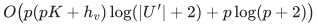
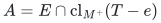

# Verification and scope

[Main proof](../proof.md) · [Source dependencies](../sources.md)

## Evidence status

The support and replacement claims are proved through exterior algebra and the original resource representation. No dedicated executable currently checks this product-feature construction or its universal extension-context guarantee. The bipartite exchange replay used by other families concerns a different mechanism and is not evidence for this theorem.

## Feature dimension and bit complexity

At most <code class="math">p(K-1)+h_v</code> context coordinates must coexist with the <code class="math">p</code> coordinates of a protected item. Hence a Vandermonde ambient dimension of <code class="math">pK+h_v</code> is sufficient. Private never-failing padding keeps originally empty items distinct and prevents duplicate use. An oversized encoded upper bound <code class="math">p</code> is normalized to the actual maximum item size before padding.

For a padded universe <code class="math">U'</code>, a rational <code class="math">p</code>-minor has the conservative bit bound
<!-- math-display: 6d925f4c941a1f30eb05200f
O\!\left(p(pK+h_v)\log(|U'|+2)+p\log(p+2)\right)
-->

before the resource and label factors are included. The Vandermonde degree is part of this accounting. The retained-item dimension and the bit length of its entries are separate bounds.

## Original resource and later extensions

For an independent extension context <code class="math">T</code> and protected item <code class="math">e</code>, the set
<!-- math-display: 9c26d2158caed979c3c77590
A=E\cap\mathrm{cl}_{M^+}(T-e)
-->

is a flat of the original matroid and excludes <code class="math">e</code>. The supplied original linear representation yields a functional vanishing on that flat and nonzero on <code class="math">e</code>. Combining it with the packing and failure functionals yields a retained replacement outside the context closure.

The proof retains the full original resource rank and performs no context-dependent truncation. A later extension need not be represented, but its restriction to <code class="math">E</code> must equal the supplied resource matroid. Costs and their tie-breaking order are fixed at preprocessing. Original item or edge identities are retained whenever individual-identity failures are allowed.

**Attribution:** Yilin Liu and GPT-6 Astra Pro.
