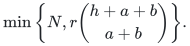
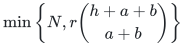
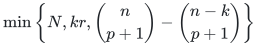
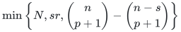
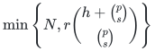

# Exact persistence certificates under correlated failures

A retained set of original top simplices preserves lower-dimensional persistence modules for one supplied filtration, after every allowed correlated failure.

[Proof](proof.md) · [Sources](sources.md)

**Guarantee**

The retained top-simplex count is bounded by

<!-- math-display: 5c6d73e6dda51539cb6f0438
\min\left\{N,r\binom{h+a+b}{a+b}\right\}.
-->

These original simplices preserve every surviving boundary space at every filtration threshold, hence persistence modules in degrees at most <code class="math">p-1</code>.

**Objective and output**

An original-top-simplex restriction plus the full original lower skeleton. A separate cost-ordered construction contains the canonical minimum-cost surviving boundary basis.

**Randomness**

Deterministic uniformly polynomial construction for the explicit complex and supplied coefficient-field representation, valid simultaneously after every allowed failure.

**Time**

Uniform deterministic polynomial preprocessing in the explicit complex and chosen field representation. With <code class="math">C=\binom{h+a+b}{a+b}</code> and <code class="math">rC&lt;N</code>, a direct lifted elimination uses

<!-- math-display: 4bc22c032272da4b4266ab06
O(N(rC)^2)
-->

Field operations plus original row selection and feature generation.

With no additional top-simplex labels, the
[actual-feature-rank construction](manuscripts/feature-rank-construction.md)
computes the vertex-feature rank <code class="math">s</code> without enumerating formal monomials.
After coefficient generation and original-row selection, it uses

<!-- math-display: 6f26af69ffe6774233c0f7a6
O(n+ans^2+Ns(p+1)+Nsr\rho)
-->

Field operations, where <code class="math">\rho</code> is the
actual stacked contraction rank. Shift comparisons and exact bit arithmetic
are charged separately. Both boundary-row selection and final lift reduction
generate one column at a time.

**Space**

The bound counts retained top simplices, not all lower faces, total encoded bits, or elimination workspace.

The actual-rank construction uses <code class="math">O(n(a+s)+sr\rho+sr)</code> additional
field elements, plus <code class="math">O(m(r+1))</code> workspace for original-row selection
when the boundary has <code class="math">m</code> possible nonzero rows, and the explicit
input/output and facet index. It does not materialize an <code class="math">sr\times N</code> lift.

**Parameters**

<code class="math">N</code> counts <code class="math">p</code>-simplices; <code class="math">r</code> is top-boundary rank; <code class="math">a</code> is vertex-label degree; <code class="math">b</code> is additional top-simplex label degree; <code class="math">h</code> is failure budget; <code class="math">n</code> is vertex count; <code class="math">\ell</code> is color count.

**Model and representation**

Fixed rational or explicit finite-field coefficients and one fixed supplied filtration. Field extensions used for construction preserve the original-field ranks. Filtration and independent cost orders require separate constructions.

**Lower-bound scope**

The one-color complete-universe envelope is exact. The general binomial coefficient is asymptotically necessary. No preservation of top-degree homology, integral torsion, or homotopy type is claimed.

**Review status**

**Ready for review.** The full exact persistence family: general row/column incidence-label construction, additional top-simplex labels, surviving prefix spans and canonical signed-cost boundary bases with rank drops, natural lower-homology persistence and compatible relative/zigzag identifications, sharp one-color exterior envelope and its complete-complex lower construction, actual-feature-rank refinement and labeled-cone asymptotic lower bound. The native general-incidence backend preserves original row labels while generating row-specific evaluation modules and merging actual lifted row spaces. The previous feature-rank companion completes degree-bounded closure, shared row compression, streamed contractions and exact representation costs.

**Dependencies and scope.** The full original lower skeleton is retained, with one supplied original top-column order and one chosen coefficient field. Independent filtration and cost orders require separate summaries. Top-degree homology, integral torsion, homotopy type, dynamic update bounds and optimizing unknown worst failures are not claimed. Executable arithmetic is rational or over a caller-supplied prime field large enough for the explicit nonzero label points. Finite-field extensions and scalar descent are proved mathematical components, not an implemented extension constructor. The general-incidence adapter materializes the original boundary and charges polynomial dense storage and exact elimination separately; the vertex-only adapter retains its streamed resource contract. The exact one-color envelope and asymptotic general coefficient are original-top-cell restriction lower bounds with the full lower skeleton fixed. Historical comparison and publication-priority claims are not certified by this internal proof review. Finite original-input checks supplement the arbitrary-size proofs and are neither external peer review nor proof-assistant verification.

The [verification note](verify/README.md) identifies executable coverage. This status does not claim external peer review or proof-assistant verification.

**Source**

[Complete proof](proof.md) and [canonical manuscript map](sources.md).

## Results

**General vertex and top labels**

<!-- math-display: daba436f50f82819ff31d39e
\min\left\{N,r\binom{h+a+b}{a+b}\right\}
-->

**One color per vertex, no extra top labels**

<!-- math-display: 5272566edae6239b7906dcda
\min\left\{N,kr,\binom{n}{p+1}-\binom{n-k}{p+1}\right\}
-->

Here <code class="math">k=\min\{h+1,\ell\}</code>.

**Overlapping vertex labels, no extra top labels**

<!-- math-display: f55c5ac135829fec0d237355
\min\left\{N,sr,\binom{n}{p+1}-\binom{n-s}{p+1}\right\}
-->

Here <code class="math">s</code> is the rank of vertex coefficient features.

The [complete construction](manuscripts/feature-rank-construction.md)
finds the exact lift rank <code class="math">\rho</code> within this bound, even when the formal
feature count is larger than the explicit input. Its
[reference implementation](reference/README.md) supports exact rational
and supplied prime-field arithmetic, and preserves original simplex IDs.

**Failure of labeled <code class="math">s</code>-faces and all cofaces**

<!-- math-display: cd6207d3b1a3e2b03846357a
\min\left\{N,r\binom{h+\binom{p}{s}}{\binom{p}{s}}\right\}
-->

**Compatible relative homology and zigzag sequences of allowed states**

Same retained set; natural coordinate identifications commute with all supplied inclusions

**Fixed signed cost order**

Canonical minimum-cost basis for every surviving boundary matroid, including rank drops

Safe vertices are represented by an extra never-failing color when using the one-color envelope. This exact prefix theorem is separate from the fixed-weight real spectral theorem in the [spectral family](../correlated-spectral-regression/).

## Native construction with additional top labels

The [general-incidence backend](reference/incidence.py) now handles arbitrary
original row/column label sets satisfying incidence containment, and vertex
labels together with additional top-simplex labels. It computes actual lifted
rank without enumerating the formal monomial universe and retains original
columns in one supplied order. The [complete local proof](incidence-realization.md)
charges dense original boundary storage separately from the vertex-only
streaming construction.

**Attribution:** icekylinx and GPT-6 Astra Pro.
