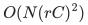
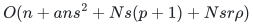

# Exact persistence certificates under correlated failures

A retained set of original top simplices preserves lower-dimensional persistence modules for one supplied filtration, after every allowed correlated failure.

[Proof](proof.md) · [Sources](sources.md)

**Guarantee**

At most <code class="math">\min\left\{N,r\binom{h+a+b}{a+b}\right\}</code> top simplices preserve every surviving boundary space at every filtration threshold, hence persistence modules in degrees at most <code class="math">p-1</code>.

**Objective and output**

An original-top-simplex restriction plus the full original lower skeleton. A separate cost-ordered construction contains the canonical minimum-cost surviving boundary basis.

**Randomness**

Deterministic uniformly polynomial construction for the explicit complex and supplied coefficient-field representation, valid simultaneously after every allowed failure.

**Time**

Uniform deterministic polynomial preprocessing in the explicit complex and chosen field representation. With <code class="math">C=\binom{h+a+b}{a+b}</code> and <code class="math">rC&lt;N</code>, a direct lifted elimination uses

<!-- math-display: 4bc22c032272da4b4266ab06
O(N(rC)^2)
-->

Field operations plus original row selection and feature generation.

With no additional top-simplex labels, the
[actual-feature-rank construction](manuscripts/feature-rank-construction.md)
computes the vertex-feature rank <code class="math">s</code> without enumerating formal monomials.
After coefficient generation and original-row selection, it uses

<!-- math-display: 6f26af69ffe6774233c0f7a6
O(n+ans^2+Ns(p+1)+Nsr\rho)
-->

Field operations, where <code class="math">\rho</code> is the
actual stacked contraction rank. Shift comparisons and exact bit arithmetic
are charged separately. Both boundary-row selection and final lift reduction
generate one column at a time.

**Space**

The bound counts retained top simplices, not all lower faces, total encoded bits, or elimination workspace.

The actual-rank construction uses <code class="math">O(n(a+s)+sr\rho+sr)</code> additional
field elements, plus <code class="math">O(m(r+1))</code> workspace for original-row selection
when the boundary has <code class="math">m</code> possible nonzero rows, and the explicit
input/output and facet index. It does not materialize an <code class="math">sr</code> by <code class="math">N</code> lift.

**Parameters**

<code class="math">N</code> counts <code class="math">p</code>-simplices; <code class="math">r</code> is top-boundary rank; <code class="math">a</code> is vertex-label degree; <code class="math">b</code> is additional top-simplex label degree; <code class="math">h</code> is failure budget; <code class="math">n</code> is vertex count; <code class="math">\ell</code> is color count.

**Model and representation**

Fixed rational or explicit finite-field coefficients and one fixed supplied filtration. Field extensions used for construction preserve the original-field ranks. Filtration and independent cost orders require separate constructions.

**Lower-bound scope**

The one-color complete-universe envelope is exact. The general binomial coefficient is asymptotically necessary. No preservation of top-degree homology, integral torsion, or homotopy type is claimed.

**Review status**

**Ready for review in the stated scope.** Complete actual-feature-rank construction for represented failure lifts and the vertex-label persistence specialization with no extra top-simplex labels. Includes the degree-bounded evaluation module, canonical column pivots, nonzero shifts, shared original boundary-row compression, streamed column generation, surviving prefix spans and naturality, with exact arithmetic and storage ledgers.

**Dependencies and scope.** The reviewed persistence construction keeps the full lower skeleton and one supplied order over the stated field. Additional top labels retain the separate general incidence theorem. Top-degree homology, integral torsion, dynamic labels and a common solution for unrelated filtration/cost orders are not asserted. Executable checks use rationals and supplied prime fields. The general finite-field extension and rational bit analysis are explicit mathematical components. Finite span checks supplement the naturality proof; they are not proof-assistant verification.

The [verification note](verify/README.md) identifies executable coverage. This status does not claim external peer review or proof-assistant verification.

**Source**

[Complete proof](proof.md) and [canonical manuscript map](sources.md).

## Results

**General vertex and top labels**

<code class="math">\min\left\{N,r\binom{h+a+b}{a+b}\right\}</code>

**One color per vertex, no extra top labels**

<code class="math">\min\left\{N,kr,\binom{n}{p+1}-\binom{n-k}{p+1}\right\}</code>, <code class="math">k=\min\{h+1,\ell\}</code>

**Overlapping vertex labels, no extra top labels**

<code class="math">\min\left\{N,sr,\binom{n}{p+1}-\binom{n-s}{p+1}\right\}</code>, <code class="math">s=</code> rank of vertex coefficient features

The [complete construction](manuscripts/feature-rank-construction.md)
finds the exact lift rank <code class="math">\rho</code> within this bound, even when the formal
feature count is larger than the explicit input. Its
[reference implementation](reference/README.md) supports exact rational
and supplied prime-field arithmetic, and preserves original simplex IDs.

**Failure of labeled <code class="math">s</code>-faces and all cofaces**

<code class="math">\min\left\{N,r\binom{h+\binom{p}{s}}{\binom{p}{s}}\right\}</code>

**Compatible relative homology and zigzag sequences of allowed states**

Same retained set; natural coordinate identifications commute with all supplied inclusions

**Fixed signed cost order**

Canonical minimum-cost basis for every surviving boundary matroid, including rank drops

Safe vertices are represented by an extra never-failing color when using the one-color envelope. This exact prefix theorem is separate from the fixed-weight real spectral theorem in the [spectral family](../correlated-spectral-regression/).

**Attribution:** Yilin Liu and GPT-6 Astra Pro.
