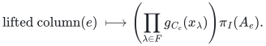
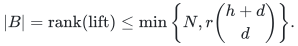

# Native general-incidence and top-label failure construction

The [reference backend](reference/incidence.py) implements the general incidence
lemma and the additional-top-label persistence client in Sections 2–4 of the
[canonical manuscript](manuscripts/correlated-fault-boundary-and-persistence-sparsifiers.md).
It preserves original column IDs in one supplied order and uses exact rational
arithmetic or a caller-supplied prime field. It expands neither the failure
family nor the potentially much larger formal monomial space.

## Original rows and query identity

Each original matrix row and column has an explicit label set. On every
nonzero incidence the row label set must be contained in the column label
set; the maximum difference size is the incidence increment. The code checks
this hypothesis in the chosen field before compressing rows. It selects
independent **original rows**, preserving their actual label sets. Projection
to these coordinates is injective on the original column span.

Assign distinct nonzero field points to all input labels. For each selected
row, the normalized polynomial for a column's incidence difference has
constant coefficient one. Its remaining coefficients are coordinate functions
on the ordered original columns. The conceptual lifted row family is the
original matrix row multiplied coordinatewise by every monomial of total
degree at most the failure budget. Zero incidences contribute zero regardless
of the coordinate values assigned there.

For a query, evaluating these monomials against the product of failed-label
factors and multiplying by the row-label factor sends each conceptual lifted
column to its original projected column times one common scalar:

<!-- math-display: f15e1ffe716eeab55abbeb7a
\mathrm{lifted\ column}(e)\ \longmapsto
\left(\prod_{\lambda\in F}g_{C_e}(x_\lambda)\right)\pi_I(A_e).
-->

The scalar vanishes precisely on failed columns. Thus every lifted dependence
of a column on earlier retained columns projects to a dependence on earlier
surviving retained columns. Dividing by the surviving column's nonzero scalar
and using injectivity proves equality of full original surviving column spans
at every prefix. Canonical signed-cost greedy, using one fixed original-ID
tie break, consequently selects exactly the same original basis after every
failure, including failures that decrease rank.

## Generate only independent feature rows

For each selected original row, `evaluation_module` starts from that row and
processes coordinate products in nondecreasing degree. If a candidate is
already a combination of accepted rows of no larger degree, its further
coordinate products are combinations of their corresponding products. It is
therefore safe to expand only independent candidates. A degree at which the
span stops growing is invariant under every coordinate multiplication, so
all subsequent degrees have the same span. At most the original column count
many strict increases are possible. The routine caps its expansion degree at
that count; huge binary failure budgets do not cause huge iteration counts.

The independent rows produced for all selected original rows span exactly
the conceptual stacked lift. The backend merges them by exact row reduction.
Row reduction preserves all column dependencies, so earliest-coordinate
pivots are exactly the original columns accepted by canonical ordered column
greedy in the conceptual lift. There is no assumption that row-specific
coordinate functions agree between different original rows.

Writing `N` for the original column count, `r` for the original rank, `d` for
the maximum incidence increment and `h` for the clipped failure budget, the
retained set satisfies

<!-- math-display: 9ad72f9009a44dcf7bd468b6
|B|=\mathrm{rank}(\mathrm{lift})
\le \min\left\{N,r\binom{h+d}{d}\right\}.
-->

The constructor can use less space than the formal feature dimension by
finding extra dependencies; no generic-position assumption is needed.

## Extra top-simplex labels and persistence

The simplicial adapter constructs original oriented boundary entries. A facet's
label set is the union of its vertex labels; a top simplex's set also includes
its explicitly supplied additional labels. For an incident facet, only the
missing vertex's labels and the extra top labels can increase this set. Thus
with at most `a` labels per vertex and `b` additional labels per top simplex,
`d <= a+b`. Overlaps only reduce the actual increment.

The full original lower skeleton is retained implicitly. After a supplied
failure, every surviving top boundary is supported on surviving lower faces.
The incidence theorem gives equality of its image at every supplied top-order
prefix. Lower chain spaces and lower boundary maps coincide, so the homology
quotients through one less than top dimension coincide. These identifications
use unchanged original lower-face coordinates and therefore commute with
filtration inclusions. The adapter is not a top-degree homology or integral
torsion algorithm. A cost order and an unrelated filtration order require
separate summaries.

## Executable resource and representation boundaries

The original dense matrix is explicit input; the simplicial adapter constructs
that matrix. This is a separately charged polynomial-space reference, not the
streaming boundary generator used by the vertex-only feature-rank client.
At most `r` row modules are generated, each accepting at most `N` independent
rows and expanding at most `d*N` products. The reference Gaussian elimination
therefore takes at most `O(r*(d+1)*N^3)` field operations after incidence
coefficient construction and original row selection. Only one row module and
one global echelon basis are needed at a time. In addition to the explicit
input matrix and label sets, this uses `O(N^2+d*N)` field elements. The code's
reported formal dimension is an exact integer, not an allocated array length.

All coefficients use products over explicitly present labels. Expanded
feature degree is at most `N`; rational coefficient bit lengths are polynomial
in the explicit input. Exact elimination has polynomial rational bit cost.
The finite-field API assumes the supplied modulus is prime and requires more
field elements than distinct input labels. It does not construct extension
fields; the canonical manuscript's extension and descent argument remains a
mathematical component with a separate software boundary.

The [independent checker](verify/check_incidence.py) derives original surviving
prefix ranks without the producer's elimination or polynomial features. It
covers signed entries, row-dependent incidence differences, dependent original
rows, characteristic-specific zero entries, large shared row-label sets,
additional top labels and huge binary failure budgets. These finite checks
supplement the arbitrary-size argument above.

**Attribution:** Yilin Liu and GPT-6 Astra Pro.
