# Exact persistent-homology certificates under correlated failures

**Abstract.** We construct exact certificates for boundary spaces and persistent homology under correlated label failures. A rank-compressed polynomial incidence lift preserves all surviving prefixes of a fixed order. The construction gives sharp retained-cell bounds and an exterior-algebra refinement for one color per vertex.

**Authors:** Yilin Liu and GPT-6 Astra Pro.

## 1. Main result and the quantity being reduced

Fix a coefficient field F, either the rationals or an explicitly represented
finite field. Let K be a finite, explicitly given simplicial complex of
dimension at most p, where p>=1. Its full (p-1)-skeleton will be retained. Let N
be the number of p-simplices and let

<!-- math-display: 48609ed487ecd0b6b1ccced2
A=\partial_p(K;F),\qquad r=\mathrm{rank}_F A.
 \tag{T1}
-->
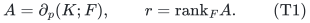

Give each vertex at most a failure labels, and give each p-simplex at most b
additional labels. A query F_0 contains at most h labels. A failed vertex and
all its cofaces are removed; a p-simplex is also removed when one of its own
additional labels fails. Thus a query always leaves a subcomplex. The labels
may overlap arbitrarily, and a single failed label may remove arbitrarily
many vertices or simplices.

There is a deterministic uniform polynomial-time algorithm retaining a set B
of original p-simplices with

<!-- math-display: e6a132642c5085d6c33ae97b
|B|\le \min\left\{N,\ r\binom{h+a+b}{a+b}\right\}.
 \tag{T2}
-->
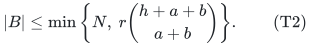

Let H contain B and **all original faces of dimensions at most p-1**. For any
fixed input filtration (face birth precedes coface birth), the construction
can ensure that the inclusions

<!-- math-display: 84296129b2657dad55ba0f5d
H_t-F_0\hookrightarrow K_t-F_0
 \tag{T3}
-->
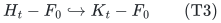

induce isomorphisms in every homological degree j<=p-1, simultaneously for
every t and every allowed F_0. These isomorphisms commute with the filtration
maps: they preserve the persistence modules, not merely individual Betti
numbers. In fact the surviving p-boundary subspaces are exactly equal at
every threshold.

Alternatively, given one fixed signed rational cost order on p-simplices,
the same construction contains the canonical minimum-cost basis of the
surviving boundary matrix after every query, including queries that decrease
rank. This is a minimum-cost boundary-basis statement. Calling it a spanning
acycle requires the additional homological conditions in the definition of
that term.

**One order at a time.** The filtration order and an independently specified
cost order cannot silently be combined in one bound (T2). A filtration-ordered
construction proves the persistence assertion. A cost-ordered construction
proves the cost assertion. If the two orders coincide, both hold together.

The count (T2) concerns retained **top simplices**. It is not a bound on all
faces, total encoded bits, or Gaussian-elimination workspace. It does not
preserve H_p, integral torsion, or homotopy type. The selected B can depend on
the chosen coefficient field.

### Particularly simple case

If each vertex has one color and there are no extra top-simplex labels, then

<!-- math-display: 579afa1b37ce25a38776f5cf
|B|\le (h+1)r.
 \tag{T4}
-->
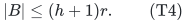

This is independent of the dimension p. Applying the generic element-label
construction directly to each p-simplex would count up to p+1 vertex colors
on that simplex and give r*binomial(h+p+1,p+1). The incidence construction
removes that dimension-dependent degree in h. Section 5 gives a sharper exact
envelope and its matching worst-case example.

## 2. An incidence lemma for arbitrary matrices

The useful principle is more general than simplicial homology.

Let A be an m by N matrix over F. Give row i a label set R_i and column e a
label set C_e. Assume that every nonzero incidence satisfies

<!-- math-display: 71a3d662b6f73a9c235e760c
R_i\subseteq C_e,
       \qquad |C_e\setminus R_i|\le d
       \quad\text{whenever } A_{ie}\ne0.
 \tag{T5}
-->
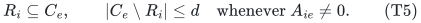

A failed label deletes a column if it lies in C_e. There is a deterministic
restriction to at most

<!-- math-display: 8d84494be19417e1012aa966
r\binom{h+d}{d}
 \tag{T6}
-->
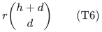

columns preserving every surviving column span at every prefix of one fixed
column order. The bound is capped by N. The size of C_e itself need not be
bounded: only its increment beyond an incident row's labels is bounded.

### Polynomial features

Assign each of the L input labels a different nonzero field point x_lambda,
passing to an effective finite extension if necessary. For a label set S let

<!-- math-display: a88c20786aa80537901d4887
g_S(T)=\prod_{\lambda\in S}(1-T/x_\lambda).
 \tag{T7}
-->
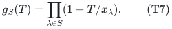

For an incidence difference Delta=C_e minus R_i, write

<!-- math-display: 2f7dc284acadfba5ff9fb98d
g_\Delta(T)=1+\sum_{j=1}^d b_j(\Delta)T^j,
 \tag{T8}
-->
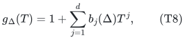

padding unused coefficients with zeros. Let Phi(Delta) be all monomials of
total degree at most h in b_1,...,b_d, including 1. Write
Q=binomial(h+d,d) for the feature dimension.

For a failed-label set F_0, the polynomial

<!-- math-display: 759ff671d7fb8063332323d9
Q_{F_0}(b_1,\ldots,b_d)
   =\prod_{\lambda\in F_0}
       \left(1+\sum_{j=1}^d b_j x_\lambda^j\right)
 \tag{T9}
-->
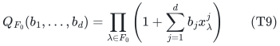

has total degree at most h. Therefore it is a linear functional ell_F on
the feature vector. Its value is product_{lambda in F_0} g_Delta(x_lambda),
and it vanishes precisely when Delta intersects F_0. Failure sets are not
enumerated to construct the features.

### Retain original independent rows, then lift

Choose an index set I of r independent **original rows** of A. Do not replace
these rows by arbitrary linear combinations while retaining their old label
sets. Projection pi_I is injective on the full column span of A, since all
other rows are linear combinations of the selected rows.

For column e, make an r-block vector w_e. Its block at i in I is

<!-- math-display: 32f23487538f88e446966ec6
(w_e)_i=A_{ie}\Phi(C_e\setminus R_i)
 \tag{T10}
-->
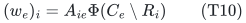

when A_ie is nonzero, and is zero otherwise. Scan columns in the fixed order
and keep exactly the columns that increase the lifted span. The retained
columns form a basis in a space of dimension rQ, and every omitted column is
a linear combination of earlier retained columns.

For query F_0, multiply block i's evaluation under ell_F by

<!-- math-display: 92c8fb38c796905b79326983
\gamma_i(F_0)=\prod_{\lambda\in F_0}g_{R_i}(x_\lambda).
 \tag{T11}
-->
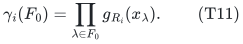

Because g_{R_i}g_{C_e minus R_i}=g_{C_e}, the resulting linear map sends

<!-- math-display: b8e60060e64c2dc27211d424
w_e\longmapsto
       \left(\prod_{\lambda\in F_0}g_{C_e}(x_\lambda)\right)\pi_I(A_e).
 \tag{T12}
-->
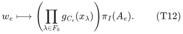

The scalar is zero exactly on failed columns and is nonzero on every surviving
column. Apply this map to each lifted prefix-span relation and divide by the
protected column's nonzero scalar. It follows that every surviving original
column is spanned by earlier surviving retained columns. Injectivity of pi_I
on the original column span turns this into equality in the full row space.
This proves (T6) at every prefix, including prefixes inside a cost tie after
one fixed ID tie break.

Ordinary matroid greedy now proves the minimum-cost-basis assertion. An
original column accepted by canonical greedy after a failure cannot be an
omitted column: the latter is already spanned by earlier retained survivors.
Thus the entire canonical basis is contained in B, not just another basis of
the same value. Signed costs and surviving rank drops cause no issue.

## 3. Application to a filtered simplicial complex

For a (p-1)-face tau, let R_tau be the union of the labels of its vertices.
For a p-simplex sigma, let C_sigma be the union of its vertex labels and its
own additional labels. If tau is a facet of sigma, exactly one vertex v is
missing, so

<!-- math-display: a0695c60a9caa79298946e82
R_\tau\subseteq C_\sigma,
                  |C_\sigma\setminus R_\tau|\le a+b.
 \tag{T13}
-->
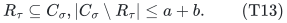

The signs in the simplicial boundary are just the entries A_tau,sigma in
(T10). The incidence lemma gives (T2), preserving every surviving boundary
span at every filtration threshold.

The lower chain groups of H_t-F_0 and K_t-F_0 are identical in dimensions at
most p-1, with the same coordinate bases and the same lower boundary maps. In
degree p-1 their cycle spaces are therefore identical, and the image of
partial_p is identical by the lemma. Hence their homology quotients are
identical. In lower degrees even the adjacent chain maps are unchanged. Since
all these identifications use the same lower-chain coordinates, every square
induced by an inclusion of states commutes. This proves equality of
persistence modules.

The same naturality proves two optional extensions without increasing B:

- relative homology against any later specified compatible subcomplex,
  using H intersect that subcomplex on the retained side;
- zigzag persistence for any sequence of allowed states K_t-F_0 whose arrows
  are inclusions in either direction.

These are algebraic consequences, not new claims about fast dynamic updates.
For a general complex one may first pass to its p-skeleton when the goal is
homology in degrees at most p-1.

### Failures of higher-dimensional faces

Assign one label to each s-face, or use one common label for a class of
s-faces, and let its failure delete those faces and all cofaces. Give a face
eta the set of labels of its contained s-faces. The label sets are monotone
under containment. A p-simplex has at most binomial(p,s) s-faces not contained
in a specified facet, because these are the s-faces containing its missing
vertex. Thus the same proof gives

<!-- math-display: 5e27b30835a6b863f9b2716b
|B|\le r\binom{h+\binom{p}{s}}{\binom{p}{s}}.
 \tag{T14}
-->
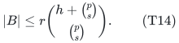

More generally (T6) applies whenever the label assignment on faces is
monotone and has incidence increment d. This preserves answers to supplied
failures; it does not optimize over the unknown worst failure set or solve
the minimum homological-cut problem.

## 4. Uniform construction and representation details

Clip h to the number of actual labels. Compute r by exact linear algebra. If
r=0 return no top columns. Otherwise compute the feature dimension
Q=binomial(h+d,d) only up to the threshold ceil(N/r). If rQ>=N return every
original top column. Otherwise rQ<N, and only then enumerate the features and
the lift.
All incidence differences are explicit; their polynomial coefficients and all
Q monomials can be generated in
polynomial time. Standard elimination uses O(N(rQ)^2) field operations after
feature construction and row selection. The latter costs are paid
separately and are polynomial in the explicit input and generated features.
This is a uniform polynomial algorithm even when h,d,p are input parameters.

Over Q, choose x_lambda in {1,...,L}. Coefficients in (T7)--(T9) have
polynomial bit length, and exact fraction-free elimination gives polynomial
bit complexity. Over a finite field of size Q_F, if Q_F>=L+1 no extension is
needed. Otherwise choose the smallest s with Q_F^s>=L+1. Then
Q_F^s<Q_F(L+1)<(L+1)^2. Enumerating monic
degree-s polynomials and testing irreducibility constructs a suitable
extension deterministically in time polynomial in the explicitly present L.
Original ranks are unchanged by extending scalars. Equality of spans of the
original F-columns over the extension implies equality over F, by rank
invariance; the homology conclusion is therefore over the original chosen
coefficient field.

There is no generic-position search or unproved polynomial-identity-testing
assumption. The explicit specialization may have more dependencies than a
generic representation, and that does not harm the query-projection proof.

## 5. A sharp exterior envelope for one color per vertex

Assume now that every vertex has exactly one failable color and that b=0.
Write n=|V|, let ell be the number of vertex colors, and put

<!-- math-display: f17cb6193f135d1a42aa2c90
k=\min(h+1,\ell),\qquad
 E(n,p,k)=\binom n{p+1}-\binom{n-k}{p+1}.
 \tag{T15}
-->
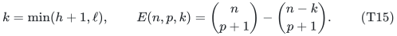

There is a single retained set satisfying the sharper bound

<!-- math-display: dbbb94c21f0493ad3e560c4c
|B|\le\min\{N,kr,E(n,p,k)\}.
 \tag{T16}
-->
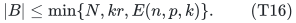

Here and below a binomial coefficient is zero when its upper argument is
smaller than the nonnegative lower argument. If safe/uncolored vertices are
allowed, represent them by one extra formal never-failing color when forming
the color count. Otherwise the all-real-colors-failed case would be
incorrectly called empty.

### Explicit contractions and the query map

Give the colors distinct nonzero points a_c. Over the working field extension
E, in V=E^n, define covectors

<!-- math-display: 08a7ebe4fdc7bf1a67b480fc
\ell_j(e_v)=a_{c(v)}^j,\qquad 0\le j<k.
 \tag{T17}
-->
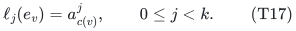

For a p-simplex sigma, stack the contractions
iota_{ell_j}(e_sigma), with the usual oriented exterior basis. In the row
block indexed by a facet tau=sigma minus v, its vector is the boundary sign
times (1,a_{c(v)},...,a_{c(v)}^{k-1}).

For a failure set F_0 that does not delete all colors, use
P_F(T)=product_{c in F_0}(T-a_c), after removing colors absent from K.
Its degree is at most k-1. At row tau, evaluate the feature vector against
the coefficients of P_F and multiply by product_{u in tau}P_F(a_{c(u)}).
The entire column maps to

<!-- math-display: 7ba7229b466ad5f350465822
\left(\prod_{u\in\sigma}P_F(a_{c(u)})\right)A_\sigma.
 \tag{T18}
-->
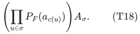

This vanishes exactly on failed simplices. If every color fails, there are
no surviving positive-dimensional simplices and the claim is immediate.
The cost-ordered lifted basis therefore has the required prefix property.

### Two rank bounds for the same lift

For each j, the corresponding weighted boundary block A_j satisfies

<!-- math-display: bf2b4742fe6ef4730e2ba270
A_j=D_{p-1,j}^{-1} A D_{p,j},\qquad
 (D_{i,j})_{\eta\eta}=\prod_{v\in\eta}a_{c(v)}^j.
 \tag{T19}
-->
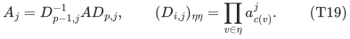

Every diagonal entry is nonzero, so rank(A_j)=r. Stacking k blocks gives
rank at most kr.

The covectors ell_0,...,ell_{k-1} are independent by the Vandermonde property.
Let W be their common kernel, of dimension n-k. On the complete universe
Lambda^{p+1}V, the simultaneous contraction map L satisfies

<!-- math-display: 9194ff6dbbe0285210ee519c
\ker L=\Lambda^{p+1}W.
 \tag{T20}
-->
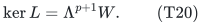

To see this, choose a basis dual to the k independent covectors. A wedge
monomial containing any of the first k basis vectors has a nonzero,
uniquely indexed coefficient in its contraction by the corresponding
covector. Therefore a vector in all contraction kernels uses only the last
n-k basis vectors. The converse is immediate. This argument works in every
characteristic. The rank on the complete universe is E(n,p,k); restricting
columns to K cannot increase it. This proves (T16).

### Exact worst-case lower bound

Take the complete p-dimensional complex on vertices 1,...,n, give every
lower-dimensional face birth time 0, and give a top simplex sigma birth time
min(sigma). The first k-1 vertices have distinct singleton colors. Partition
the remaining vertices into the remaining ell-k+1 nonempty color classes.
These assignments are possible because k<=ell<=n.

For each j<=k, fail the singleton colors of 1,...,j-1. At time j, the
surviving top simplices that have appeared are exactly the p-simplices on the
remaining vertices whose minimum vertex is j (equivalently, the remaining
simplices containing j). Each has a unique facet not containing j, so their
boundary columns are independent. They span the boundary space of the full remaining complete
complex: this is the usual cone basis. Thus omitting any of these top
simplices changes H_{p-1} at this allowed state. Taking the union over j<=k
forces every top simplex meeting {1,...,k}, namely exactly E(n,p,k) simplices.

The same construction forces those top simplices into the minimum-cost
boundary basis for some failure query: assign each star a cost range below
all later stars. Distinct positive perturbations within the ranges are
permitted. Consequently the complete-universe envelope in (T16) is exact,
for the original-top-simplex restriction model, not just order-optimal.

When p=1 this envelope is nk-binomial(k+1,2). Its ordinary individual-vertex
failure version and the extremal graph example are established results of
Sorkin--Steger--Zenklusen. The application here is to arbitrary
correlated color classes and to higher-dimensional failure-preserving
persistence. The exterior rank identity is part of established algebraic
shifting/hyperconnectivity theory; it is not being claimed as a new identity.

## 6. Intrinsic feature rank for overlapping vertex labels

Suppose b=0, but allow up to a labels at each vertex. Write g_{Lambda(v)}(T)
from (T7) as 1+sum_{j=1}^a b_j(v)T^j, padding missing coefficients with zeros.
Encode vertex v by psi(v), the vector of all degree-at-most-h monomials in
these a nonconstant coefficients, including the constant monomial 1. Let

<!-- math-display: 0c8e252d7926dbeb12efd7ee
s=\mathrm{rank}[\psi(v)]_{v\in V}
       \le \min\left\{n,\binom{h+a}{a}\right\}.
 \tag{T21}
-->
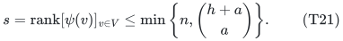

Each failure query is a linear functional on psi whose evaluation is zero
exactly at failed vertices. Choose s independent coordinate functions spanning
all coordinates of the feature vectors psi(v); every query functional then has
an equivalent linear form in these s coordinates. Use the stacked contraction
construction above. It gives

<!-- math-display: 4d5fa2d35bc00833b95e3291
|B|\le\min\left\{N,sr,
         \binom n{p+1}-\binom{n-s}{p+1}\right\}.
 \tag{T22}
-->
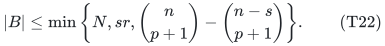

The common-kernel proof is unchanged. For the sr bound, a coordinate function
w(v) may vanish on some vertices. Replace it by w(v)+z over F(z). The
corresponding weighted boundary block then has rank r by the diagonal
factorization. Every (r+1)-minor is the zero polynomial in z, hence is still
zero at z=0, so the original block has rank at most r. Stacking the s blocks
proves (T22).
This is an actual feature-rank refinement; exact fixed-n sharpness is only
asserted above for the one-color model.

## 7. The general coefficient in (T2) is asymptotically necessary

Let d=a+b and q=binomial(h+d,d). Take a universe U of h+d labels and one cone
apex v_S for each d-subset S of U. Split S into A_S of size a and B_S of size
b. Give v_S the vertex labels A_S, and give every top simplex in its cone
the extra labels B_S. The base vertices have no labels.

Let t>=p and let the base contain t vertices with its complete
(p-1)-skeleton. For each
apex add every top simplex {v_S} union tau, where tau is a p-element subset
of the base; include all lower faces, and no top simplex containing two
apices. The number of top simplices and the original boundary rank are

<!-- math-display: 60230b63be76ef92416e19bf
M=q\binom tp,\qquad
 r=\binom tp+(q-1)\binom{t-1}{p-1}.
 \tag{T23}
-->
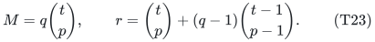

For completeness, write a top chain as sum_S v_S*C_S, where C_S is a
(p-1)-chain on the base skeleton. Its boundary vanishes exactly when every
C_S is a cycle and sum_S C_S=0. The base cycle-space dimension is
binomial(t-1,p), using the augmented boundary for p=1. Thus the top kernel
has dimension (q-1)binomial(t-1,p), giving (T23).

Fail F_0=U minus S. This uses exactly h labels. The top cells of cone S
survive, and every other cone's top cells fail through its apex labels or
its own labels. Each surviving top column has its unique base-face row.
Therefore omitting any one of them decreases boundary rank and changes
H_{p-1}, even though other cones' lower faces may remain. Every universal
restriction must retain all M top cells. Hence

<!-- math-display: e686fbb418bb5e5f3785408e
\frac Mr=
          \frac{q}{1+(q-1)p/t}\longrightarrow q.
 \tag{T24}
-->
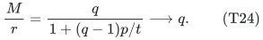

This works over every coefficient field and for all a,b, including a=0 or
b=0. It is a retained-original-cell lower bound with the lower skeleton
fixed. For p=1 it is a simple complete bipartite graph construction, yielding
the same leading coefficient for mixed overlapping vertex/edge labels.

## 8. Related work and scope

The meaningful comparison is as follows.

- A single no-failure boundary basis is classical. Minimum spanning
  higher-dimensional trees/forests and persistent skeletons are developed by
  Kalisnik Verovsek--Kurlin--Lesnik. Their richer persistent skeleton also
  addresses top-dimensional features by retaining critical faces; (T2) only
  promises the lower-dimensional modules with the lower skeleton fixed.
- Sorkin--Steger--Zenklusen give the sharp graph bound for individual-vertex
  failures. Arbitrary correlated vertex-color failures are a different
  quantifier: one color can delete many vertices.
- Kalai's exterior shifting and hyperconnectivity framework supplies the
  matrix/rank antecedents. The construction here uses explicit repeated
  color points and a query-annihilating map; it does not derandomize the
  generic independence problem for all algebraic-shifting matroids.
- Roos Hoefgeest--Slot study adversarial robustness of persistent features
  and minimum homological cuts, including hardness. A certificate preserving
  all supplied failure queries does not solve their worst-failure search.
- No identical all-color-failure persistence certificate was located in the
  bounded primary-source search. This is not a proof of novelty. The sharp
  explicit query theorem, its relation to the older exterior framework, and
  any earlier equivalent formulation are the principal external-review
  targets.

### Primary references

1. Sara Kalisnik Verovsek, Vitaliy Kurlin, Davorin Lesnik,
   *A Higher-Dimensional Homologically Persistent Skeleton*.
   https://arxiv.org/pdf/1701.08395
2. Gregory B. Sorkin, Angelika Steger, Rico Zenklusen,
   *A tight bound on the collection of edges in MSTs of induced subgraphs*,
   JCTB 2009; preprint 2007. https://arxiv.org/pdf/0705.2439
3. Gil Kalai, *Hyperconnectivity of graphs*, Graphs and Combinatorics 1
   (1985), 65--79. https://doi.org/10.1007/BF02582930
4. Lazar Guterman and Eran Nevo, *Matroids arising from algebraic shifting*.
   https://arxiv.org/html/2512.03294v1
5. Pepijn Roos Hoefgeest and Lucas Slot, *Robustness of Persistent
   Topological Features and Minimum Homological Cuts*.
   https://arxiv.org/html/2602.23154v1

The theorem depends on the chosen coefficient field, retains the full lower skeleton, and uses one specified order. These hypotheses are part of its statement.
