# Constructing failure summaries from their actual feature rank

**Abstract.** Polynomial failure features can have exponentially many formal
coordinates but only a small evaluation rank on the explicit input. We give
a deterministic construction that finds this rank without enumerating the
coordinates. For a represented matroid, it constructs the exact ordered
basis of the formal failure lift using only linearly independent rows of a
degree-bounded evaluation module. For simplicial persistence, it computes
the actual vertex-feature rank and compresses all contraction blocks using
the same original boundary rows. Both algorithms preserve every surviving
prefix of one supplied order. Their arithmetic and storage costs charge
the construction of the features themselves.

## 1. A finite evaluation module

Let <code class="math">K</code> be a field with exact arithmetic. Let <code class="math">V</code> be an <code class="math">r</code> by <code class="math">M</code> matrix
of row rank <code class="math">r</code>, with rows <code class="math">v_1,\ldots,v_r</code>. Let
<code class="math">x_1,\ldots,x_d\in K^M</code> be explicit coordinate rows, and let <code class="math">h\ge0</code>.
Coordinatewise multiplication is denoted by <code class="math">\odot</code>. For <code class="math">t\ge0</code> put

<!-- math-display: 887d1e66cd7ef3cdd70feabe
\mathcal W_t=\mathrm{span}_K\left\{
 v_i\odot x_1^{\alpha_1}\odot\cdots\odot x_d^{\alpha_d}:
 i\in[r],\ \alpha\in\mathbb N^d,\ |\alpha|\le t\right\}.
\tag{1}
-->
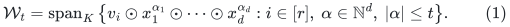

Let <code class="math">\rho=\dim\mathcal W_h</code>. The columns have one fixed input order;
renumber them in that order. The conceptual matrix whose rows occur in
(1) has <code class="math">r\binom{h+d}{d}</code> rows. This matrix is used in the statement,
and need not be formed.

**Theorem 1 (construction in the evaluation rank).** A deterministic
algorithm computes a basis of <code class="math">\mathcal W_h</code> and the canonical ordered
column basis of this conceptual matrix using at most

<!-- math-display: 23a9aa9a57356bdf5c785674
r+d\dim\mathcal W_{h-1}\le r+d\rho
\tag{2}
-->
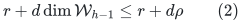

candidate rows when <code class="math">h\ge1</code>. When <code class="math">h=0</code>, it processes the <code class="math">r</code> input rows.
It uses

<!-- math-display: d409a827f9a7b410583ba118
O\bigl(M\rho(r+d\rho)\bigr)
 \quad\hbox{field operations},\qquad
 O\bigl(M(\rho+d)\bigr)
 \quad\hbox{stored field elements},
\tag{3}
-->
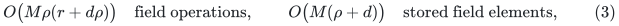

including the coordinate rows and the independent input rows. Zero rank
returns the empty set immediately. No rank oracle for an implicit matrix,
polynomial-identity test, or enumeration of failure sets is used.

### Algorithm

Keep two versions of each accepted row: its actual product vector and an
echelon representation used for independence tests. Keep a first-in,
first-out queue of accepted product vectors, with their degrees.

1. Insert the independent rows of <code class="math">V</code>, all at degree zero.
2. Pop an accepted product vector <code class="math">u</code> of degree <code class="math">t</code>. If <code class="math">t=h</code>, do not
   expand it. Otherwise, for each <code class="math">j\in[d]</code>, form <code class="math">u\odot x_j</code>.
3. Reduce the candidate against the current echelon rows. Discard it if
   the remainder is zero. Otherwise, insert the remainder into the echelon
   structure and append the actual product vector at degree <code class="math">t+1</code>.
4. Return the earliest nonzero-coordinate indices of the final echelon
   rows. These are original column IDs in the supplied order.

Independent rows are never replaced by arbitrary products of their
reduced remainders: the queue stores the original generated vectors. The
echelon structure may be updated independently. This convention also makes
the rational bit accounting below direct.

### Proof

The queue processes candidates in nondecreasing degree. Let <code class="math">B_t</code> be the
accepted product vectors of degree at most <code class="math">t</code>. We prove by induction that
<code class="math">\mathrm{span}(B_t)=\mathcal W_t</code> for every <code class="math">t\le h</code>.
The claim at zero is the independence of the input rows. The spaces obey

<!-- math-display: ad31381d8dbe31ea520c28cb
\mathcal W_t=\mathcal W_{t-1}
       +\sum_{j=1}^d x_j\odot\mathcal W_{t-1}.
\tag{4}
-->
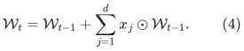

Every vector in <code class="math">B_{t-1}</code> is expanded unless its degree is already <code class="math">h</code>.
Its products have degree at most <code class="math">t</code> and have been considered before any
candidate of degree larger than <code class="math">t</code>. Rejected candidates lie in the span
of previously accepted vectors of no larger degree. Thus the processed
candidates span the right-hand side of (4), while every accepted vector
belongs to <code class="math">\mathcal W_t</code>. This proves the induction. It also explains why
discarding a dependent vector does not require expanding its children:
its products are combinations of products of accepted vectors of no
larger degree.

There are exactly <code class="math">\dim\mathcal W_{h-1}</code> accepted vectors eligible for
expansion when <code class="math">h\ge1</code>. Each produces <code class="math">d</code> candidates once, establishing
(2). Creating and reducing a candidate costs <code class="math">O(M\rho)</code> field operations.
The accepted product vectors and their echelon copies occupy
<code class="math">O(M\rho)</code> field elements; coordinates occupy <code class="math">dM</code>. Queue metadata has
<code class="math">O(\rho)</code> entries. This proves (3).

Finally, order the echelon rows by their earliest nonzero coordinates.
In every initial column segment, the rank is exactly the number of these
pivots in that segment. A column therefore increases the prefix rank
exactly when it is a pivot. The pivot IDs are the canonical ordered column
basis of the full conceptual matrix, since the two matrices have the same
row space. <code class="math">\square</code>

**Degree bound.** If <code class="math">\mathcal W_t=\mathcal W_{t-1}</code>, equation (4) shows
that this space is closed under every coordinate multiplication, so all
later spaces are equal. Starting from dimension <code class="math">r</code>, every nonstationary
degree increases dimension by at least one. Accepted product vectors have
degree at most <code class="math">\min\{h,\rho-r\}</code>, and every candidate has degree at most
<code class="math">\min\{h,\rho-r+1\}</code>. In particular, a large binary-encoded <code class="math">h</code> does not
cause an equally long run. One may first cap <code class="math">h</code> at <code class="math">M</code> without changing
the answer; this only decreases the candidate count. After reading the
budget, queue degrees and parent/coordinate records use
<code class="math">O(\rho\log(M+d+2))</code> bits, and their bookkeeping takes
<code class="math">O((r+d\rho)\log(M+d+2))</code> elementary bit operations. Keeping a parent and
coordinate index suffices: full exponent vectors need not be copied.

The one-generator specialization <code class="math">v_1=(1,\ldots,1)</code> computes the entire
degree-at-most-<code class="math">h</code> feature evaluation space on <code class="math">M</code> points. If its rank is
<code class="math">s</code>, the cost is <code class="math">O(M+aMs^2)</code> for <code class="math">a</code> coordinate rows. This is the
finite-point linear algebra underlying Buchberger--Möller methods; the
elementary module construction and its proof are included to make the
failure-summary application explicit. No new claim about general
polynomial-identity testing or Gröbner-basis complexity is made.

## 2. Represented-matroid summaries without a tensor expansion

Let <code class="math">M_0</code> be a matroid represented by an explicit matrix on <code class="math">N</code> columns,
of rank <code class="math">r</code>. Each column has at most <code class="math">d</code> labels, and at most <code class="math">h</code> labels
may fail. Clip <code class="math">h</code> to the number of actual labels, as in the underlying
failure-summary theorem. Fix one total order, for example signed costs
followed by IDs.
Choose the label-polynomial coefficient rows <code class="math">b_0,\ldots,b_{d-1}</code> from
Section 2 of the
[represented-matroid proof](../../matroid-failure-summaries/manuscripts/sharp-represented-matroid-failure-summaries.md).
They include the same nonfailing dummy padding and the same explicit field
extension. Select <code class="math">r</code> independent original representation rows.

The formal tensor lift has rows

<!-- math-display: 25c99e6eb186a1d58ec10495
v_i\odot b_0^{\alpha_0}\odot\cdots\odot b_{d-1}^{\alpha_{d-1}},
 \qquad |\alpha|\le h.
\tag{5}
-->
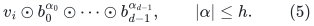

**Corollary 2.** Let <code class="math">\rho</code> be the rank of (5). There is a deterministic
construction retaining exactly <code class="math">\rho</code> original columns, with

<!-- math-display: 3c82e1170c68a27eb41f631d
\rho\le\min\left\{N,r\binom{h+d}{d}\right\},
\tag{6}
-->
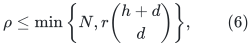

that preserves every surviving original column span at every prefix of the
supplied order. It contains the canonical surviving greedy basis after
every allowed failure, including rank decreases. After selecting original
independent rows and constructing the <code class="math">dN</code> coefficient entries, the cost
is <code class="math">O(N\rho(r+d\rho))</code> field operations and
<code class="math">O(N(\rho+d))</code> working field elements, apart from the original explicit
input and original-row selection workspace. Computing the label polynomials by repeated
linear-factor multiplication costs <code class="math">O(Nd^2)</code> additional field operations.
If the input has <code class="math">m</code> representation rows, straightforward row selection
costs <code class="math">O(mN(r+1))</code> operations; it is charged separately. The additive one
charges reading and testing an all-zero input even when <code class="math">r=0</code>.

**Proof.** Apply Theorem 1 to (5). Its pivot columns are exactly the
columns accepted by ordered greedy on the full tensor lift. For a failure
set <code class="math">F</code>, the label-polynomial evaluation functional sends each lifted
column to <code class="math">\gamma_e(F)v_e</code>, where <code class="math">\gamma_e(F)</code> vanishes exactly on failed
columns. Apply this linear map to each lifted prefix-span relation and
divide by the nonzero scalar of the surviving target column. This proves
all prefix spans. A surviving element omitted by the construction is
spanned by earlier retained survivors, so it cannot enter the canonical
surviving greedy basis. <code class="math">\square</code>

The earlier dimension gate returns the whole input when the ambient
dimension exceeds <code class="math">N</code>. This construction can still find a much smaller
<code class="math">\rho</code> in that regime. It does not improve the worst-case retained-size
lower bound, and its explicit-ground storage is not a parameter-only bit
kernel. The faster choice between ordinary lifted elimination and (3)
depends on the actual input dimensions.

## 3. Computing the vertex-feature rank for persistence

Use the filtered-complex model of the
[complete persistence proof](correlated-fault-boundary-and-persistence-sparsifiers.md):
there are <code class="math">n</code> vertices, <code class="math">N</code> top <code class="math">p</code>-simplices, and boundary matrix <code class="math">A</code> of
rank <code class="math">r</code>, with <code class="math">p\ge1</code>. Retain the full original lower skeleton. Here each
vertex has at most <code class="math">a</code> labels and **there are no additional top-simplex
labels**. Again clip <code class="math">h</code> to the number of actual labels. Choose distinct
nonzero label points <code class="math">x_\lambda</code> and write

<!-- math-display: 1f4f098fcd189d01527c0f53
\prod_{\lambda\in\Lambda(v)}(1-T/x_\lambda)
       =1+\sum_{j=1}^a b_j(v)T^j.
\tag{7}
-->
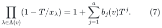

Let <code class="math">s</code> be the rank of all monomial evaluation rows of total degree at most
<code class="math">h</code> in the <code class="math">a</code> rows <code class="math">(b_j(v))_{v\in V}</code>. This is precisely the intrinsic
feature rank in Section 6 of the complete proof. Theorem 1 with the
all-ones initial row computes <code class="math">s</code> and a monomial evaluation basis
<code class="math">w_0=1,w_1,\ldots,w_{s-1}</code> in

<!-- math-display: f395526aafa2e6884f5f5120
O(na^2+n+ans^2)
\tag{8}
-->
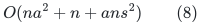

field operations, including construction of (7). It uses
<code class="math">O(n(a+s))</code> field elements. The formal feature count
<code class="math">\binom{h+a}{a}</code> is never enumerated or used as a stopping gate.
An empty vertex set is trivial; the construction below assumes <code class="math">n\ge1</code>.

### The same original rows compress every contraction block

Enlarge the working field, if necessary, to contain at least <code class="math">n+1</code>
elements. This preserves all ranks already computed. For each <code class="math">i&gt;0</code>,
choose <code class="math">c_i</code> avoiding the at most <code class="math">n</code> values <code class="math">-w_i(v)</code>, and put
<code class="math">u_i=w_i+c_iw_0</code>; keep <code class="math">u_0=w_0=1</code>. Testing a fixed list of <code class="math">n+1</code>
distinct field elements gives a deterministic choice. Equivalently, sort
the forbidden values and candidates by their exact encodings. This costs
<code class="math">O(ns\log(n+1))</code> exact comparisons and <code class="math">O(ns)</code> field operations.
Every <code class="math">u_i(v)</code> is nonzero, and the <code class="math">u_i</code> have the same row span as the
<code class="math">w_i</code> by an invertible triangular change of basis.

Choose an index set <code class="math">I</code> of <code class="math">r</code> independent **original rows** of <code class="math">A</code>.
For a top simplex <code class="math">\sigma</code> and facet <code class="math">\tau=\sigma\setminus\{v\}</code>,
the contraction block for <code class="math">u_i</code> has entry
<code class="math">A_{\tau\sigma}u_i(v)</code>. Write this block as <code class="math">A_i</code>. Then

<!-- math-display: c7bdf80fb37f3e88f9173114
A_i=D_{p-1,i}^{-1}A D_{p,i},\qquad
 (D_{q,i})_{\eta\eta}=\prod_{v\in\eta}u_i(v).
\tag{9}
-->
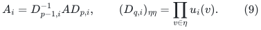

Both diagonal matrices are invertible. The rows indexed by <code class="math">I</code> remain a
row basis in every block <code class="math">A_i</code>. Consequently, retaining just those rows in
each of the <code class="math">s</code> blocks preserves **all column dependencies** of the
stacked full contraction matrix. The compressed lift has <code class="math">D=sr</code> rows.
No claim that arbitrary mixed rows retain their old face labels is needed.

### A streamed top-column construction

For each top simplex in the supplied order, form only its <code class="math">D</code>-coordinate
compressed column and reduce it against retained columns. The generated
column has at most <code class="math">s(p+1)</code> nonzero entries before elimination. Retain the
simplex exactly when it increases the span. Let <code class="math">\rho</code> be the final rank.

**Theorem 3 (constructive intrinsic-rank persistence bound).** The retained
set has exactly <code class="math">\rho</code> top simplices, where

<!-- math-display: e22b75361c0e85f028824578
\rho\le\min\left\{N,sr,
          \binom n{p+1}-\binom{n-s}{p+1}\right\}.
\tag{10}
-->
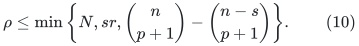

After constructing (7) and selecting <code class="math">I</code>, the remaining field-operation
bound is

<!-- math-display: d007b4a0318fa47d4ae17f51
O\bigl(n+ans^2+Ns(p+1)+Nsr\rho\bigr).
\tag{11}
-->
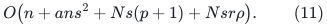

There are additionally <code class="math">O(ns\log(n+1))</code> exact comparisons for the
nonvanishing shifts, as specified above.

The additional working storage is
<code class="math">O(n(a+s)+sr\rho+sr)</code> field elements, plus the original-row selection
workspace and the explicit input/output. The final top-column pass stores
only its current column and the retained echelon columns; it does not
store an <code class="math">sr</code> by <code class="math">N</code> matrix. Original row selection can use
<code class="math">O(mN(r+1))</code> operations and <code class="math">O(m(r+1))</code> field elements for an <code class="math">m</code> by <code class="math">N</code> boundary
matrix by scanning original columns. This stage and the feature stage
precede the final pass, so the complete algorithm is not asserted to be a
single-pass streaming algorithm on the complex.
The supplied face/label index and the explicit incidence input are separate
combinatorial storage. The reference builds its facet index from the
supplied top-simplex tuples and generates both matrix passes by columns.

**Proof.** Equation (9) proves dependency equivalence with the full stack,
so the streamed algorithm returns its ordered column basis. Its rank is
at most <code class="math">sr</code>. The <code class="math">s</code> vertex covectors are independent. Their simultaneous
contraction map on the full exterior universe has common kernel
<code class="math">\bigwedge^{p+1}W</code>, where <code class="math">\dim W=n-s</code>. The exterior rank identity proved
in Section 5 of the complete proof gives the binomial-difference term in
(10); restricting to the input columns cannot increase rank.

For an allowed failure set <code class="math">F</code>, the scalar function

<!-- math-display: cebfbac4997d2fdf1b93ee4d
f_F(v)=\prod_{\lambda\in F}
       \left(1+\sum_{j=1}^a b_j(v)x_\lambda^j\right)
\tag{12}
-->
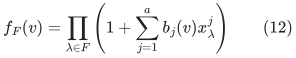

belongs to the span of the computed feature rows, hence of the shifted
rows <code class="math">u_i</code>. It vanishes exactly on failed vertices. Decode the full
contraction stack with its coefficient vector, and multiply each facet
row by the product of <code class="math">f_F</code> on its vertices. The entire top column maps to
<code class="math">\bigl(\prod_{v\in\sigma}f_F(v)\bigr)A_\sigma</code>.
Compressed relations extend to full-stack relations by (9), so applying
this decoder preserves every surviving boundary span at every prefix.

The retained lower chain coordinates and lower boundary maps are the
original ones. Equality of top-boundary images therefore gives the same
homology quotients in degrees at most <code class="math">p-1</code>, and these coordinate
identifications commute with every supplied filtration inclusion. This
is the persistence-module assertion, not only equality of Betti numbers.
A cost-ordered run instead contains every canonical minimum-cost surviving
boundary basis. The two independent orders require separate runs.

An elementary reduction of a <code class="math">D</code>-coordinate column against at most <code class="math">\rho</code>
retained columns costs <code class="math">O(D\rho)</code> operations. Generating its nonzero
entries costs <code class="math">O(s(p+1))</code>, and initializing or clearing dense workspace
costs <code class="math">O(D)</code>, absorbed when <code class="math">\rho\ge1</code>. If <code class="math">r=0</code> or <code class="math">N=0</code>, the empty output
is returned before that pass. This proves (11) and the storage ledger.
<code class="math">\square</code>

If the vertex label sets take at most <code class="math">t</code> distinct values, then <code class="math">s\le t</code>.
Thus even when <code class="math">\binom{h+a}{a}</code> exceeds the explicit input size, (8)--(11)
construct the <code class="math">tr</code> bound, together with the sharper actual-rank and exterior
bounds. This resolves the construction cost of the existing intrinsic-rank
statement; it does not assert exact worst-case sharpness for arbitrary
overlapping labels.

## 4. Exact representation and bit costs

The field-operation bounds include arithmetic on explicitly stored field
elements. They are not bit-operation bounds over the rationals.

Over <code class="math">\mathbb Q</code>, use label points <code class="math">1,\ldots,L</code> and shifts among
<code class="math">0,\ldots,n</code>. Label-polynomial coefficients in the two constructions have
<code class="math">O(1+(a+d)\log(L+1))</code> numerator/denominator bits. More generally, if the
module input entries have at most <code class="math">\beta</code> bits, its candidate product
entries have

<!-- math-display: 546e6612bdfa1b26fa53082d
\beta'=O\bigl((1+\min\{h,\rho-r+1\})\beta\bigr)
\tag{13}
-->
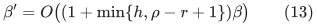

bits. The degree bound after Theorem 1 is essential here. Stored echelon
entries can be computed as ratios of minors. Clearing denominators in a
minor of order at most <code class="math">\rho+1</code> and applying the determinant expansion
bounds all such numerator/denominator lengths by
<code class="math">O((\rho+1)^2\beta'+(\rho+1)\log(\rho+2))</code>. The same argument applies to
the feature elimination and final contraction elimination separately.
Original simplicial boundary entries are <code class="math">0,1,-1</code>, and shifts add only
<code class="math">O(\log(n+1))</code> bits before the latter elimination.

Consequently fraction-free elimination, or exact reduced rational
elimination with these determinant bounds, gives polynomial bit complexity.
For a conservative explicit conversion, let <code class="math">B_*</code> bound the foregoing
minor lengths for every stage, including original row selection, as well
as the bit lengths of combinatorial indices. Let <code class="math">T</code> be the total stated
arithmetic-operation count, and let <code class="math">Q_{\mathrm{aux}}</code> count the stated
shift comparisons and queue/index operations. Schoolbook exact
integer multiplication, division and greatest-common-divisor routines
give <code class="math">O((T+Q_{\mathrm{aux}})(B_*+1)^3)</code> bit operations, in addition to
reading the encoded input. This deliberately loose bound charges
coefficient growth; it does not treat rational operations as constant cost.
All its parameters are polynomial in the explicit input length because
<code class="math">\rho\le N</code>, <code class="math">s\le n</code>, and generated degrees are rank bounded.

For an explicitly represented finite field <code class="math">\mathbb F_q</code>, choose an
effective extension large enough for the genuine label points, the dummy
when used, and the shift candidates. Put <code class="math">U=\max\{L+1,n+1,2\}</code>, omitting
<code class="math">n</code> for Corollary 2 when no shifts are needed. If <code class="math">q\ge U</code>, no extension
is required. Otherwise use the least <code class="math">e</code> with <code class="math">q^e\ge U</code>; then
<code class="math">q^e&lt;qU&lt;U^2</code>. Exhaustively testing monic degree-<code class="math">e</code> polynomials for
irreducibility is therefore polynomial in the explicit <code class="math">U</code>. Exact
arithmetic in the supplied polynomial basis and this extension has
polynomial bit cost in <code class="math">\log q</code> and <code class="math">e</code>; multiplying each operation count
by that arithmetic cost yields the bit ledger. Enlarging a field preserves
all original ranks. Span equality between original columns over the
extension descends to the original field by rank invariance.

The algorithms are deterministic, are valid in every characteristic, and
make no generic-position assumptions. The reference implementation uses
rational arithmetic and prime fields; extension-field construction is
proved above and is outside its executable scope.

## 5. Verification, provenance and scope

The [reference construction](../reference/feature_summary.py) implements
the evaluation module, represented-matroid pivot selection, and shifted
compressed contraction construction. The
[independent checker](../verify/check_feature_construction.py) compares
the module against direct monomial enumeration on small inputs. It then
enumerates all small allowed failures and every supplied-order prefix,
comparing the original and retained column spans. It includes rational and
finite-field examples, vanishing feature entries, signed boundary
orientations, repeated label patterns, rank drops, and a large formal
feature dimension with small actual rank. The checker tests the linear
algebra identities and exact boundary-space claims; the naturality argument
remains the proof given above.

The feature-evaluation idea has classical antecedents. See H. M. Möller
and B. Buchberger, *The Construction of Multivariate Polynomials with
Preassigned Zeros*, EUROCAM 1982, LNCS 144, pp. 24--31,
[author-hosted primary paper](https://www.risc.jku.at/Groebner-Bases-Bibliography/gbbib_files/publication_378.pdf),
and J. Abbott, A. Bigatti, M. Kreuzer and L. Robbiano, *Computing Ideals of
Points*, Journal of Symbolic Computation 30(4), 341--356 (2000),
[publisher version](https://doi.org/10.1006/jsco.2000.0411).
The present contribution is the explicit rank-dependent construction and
accounting for the previously stated failure-summary lift and persistence
envelope, including the shared original-row compression. Neither cited
algorithm is needed as an unproved runtime oracle in Theorems 1--3.

The lower skeleton is retained in full. The results concern one fixed
order, fixed labels and a fixed coefficient-field representation. They
preserve neither top-dimensional homology nor integral torsion, and do not
supply dynamic label updates. Additional top-simplex labels retain the
separate general incidence theorem; they are not covered by Theorem 3.

**Attribution:** icekylinx and GPT-6 Astra Pro.
