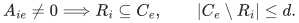
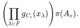
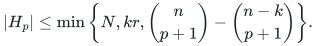

# Exact persistent homology under correlated failures

## 1. Theorem

Let a finite complex have top dimension <code class="math">p\ge1</code>, <code class="math">N</code> top simplices, and top boundary matrix <code class="math">A</code> of rank <code class="math">r</code> over the rationals or an explicitly represented finite field. Each vertex has at most <code class="math">a</code> failure labels; each top simplex has at most <code class="math">b</code> extra labels. At most <code class="math">h</code> labels fail, removing their vertices and cofaces and their labeled top simplices.

A deterministic uniformly polynomial construction retains at most
<!-- math-display: daba436f50f82819ff31d39e
\min\left\{N,r\binom{h+a+b}{a+b}\right\}
-->

original top simplices, together with the full original lower skeleton. For one supplied filtration, the inclusions induce isomorphisms of persistence modules in all degrees at most <code class="math">p-1</code>, after every allowed failure. A separate cost-ordered construction contains every canonical minimum-cost surviving boundary basis. Independent filtration and cost orders require separate constructions.

## 2. Incidence lemma

Give each row <code class="math">i</code> a label set <code class="math">R_i</code>, each column <code class="math">e</code> a label set <code class="math">C_e</code>, and assume
<!-- math-display: 83825cb43921fe402a1b0aef
A_{ie}\ne0\Longrightarrow R_i\subseteq C_e,\qquad |C_e\setminus R_i|\le d.
-->

At most <code class="math">r\binom{h+d}{d}</code> columns suffice to preserve every surviving span at every prefix of one specified order.

**Proof.** Assign distinct nonzero field points <code class="math">x_\lambda</code> and define <code class="math">g_S(T)=\prod_{\lambda\in S}(1-T/x_\lambda)</code>. For deficit <code class="math">\Delta=C_e\setminus R_i</code>, list all degree-at-most-<code class="math">h</code> monomials <code class="math">\Phi(\Delta)</code> in its at most <code class="math">d</code> nonconstant coefficients. Failure evaluation <code class="math">\prod_{\lambda\in F}g_\Delta(x_\lambda)</code> is a linear functional <code class="math">\ell_F</code> of them.

Select <code class="math">r</code> independent original rows; their projection <code class="math">\pi</code> is injective on the full column span. Lift column <code class="math">e</code> to blocks <code class="math">A_{ie}\Phi(C_e\setminus R_i)</code> and retain an ordered greedy basis. At a query, apply <code class="math">\ell_F</code> in block <code class="math">i</code>, multiplied by <code class="math">\prod_{\lambda\in F}g_{R_i}(x_\lambda)</code>. The column image is
<!-- math-display: 103575e5656c857308670584
\left(\prod_{\lambda\in F}g_{C_e}(x_\lambda)\right)\pi(A_e).
-->

It vanishes exactly on failed columns. Apply the map to prefix-span relations and use injectivity of <code class="math">\pi</code>. The dimension is <code class="math">r\binom{h+d}{d}</code>, proving the lemma. <code class="math">\square</code>

The dimension gate returns the input before a larger-than-input lift is enumerated. Rational and finite-field implementations use exact polynomial-bit arithmetic as specified in the complete proof.

## 3. Homology and naturality

For a facet <code class="math">\tau\subset\sigma</code>, use its vertex-label union as <code class="math">R_\tau</code>, and all vertex and own top labels as <code class="math">C_\sigma</code>. The deficit contains labels of only the missing vertex and the top labels, so it has size at most <code class="math">a+b</code>.

At each surviving filtration state, the lemma gives the same top-boundary image. All chain groups through dimension <code class="math">p-1</code>, lower coordinates, and lower boundary maps are literally identical. Their cycle spaces and boundary quotients therefore agree. These coordinate identifications commute with filtration inclusions, proving persistence modules rather than only Betti numbers. Compatible relative complexes and zigzag sequences of allowed inclusion states follow identically.

The lower skeleton is retained, and the chosen coefficient field matters. Top-dimensional homology, integral torsion, and homotopy type are outside the claim.

## 4. Exterior refinements and sharpness

With one color per vertex and no extra top labels, let <code class="math">\ell</code> count colors and <code class="math">k=\min\{h+1,\ell\}</code>. Count one additional never-failing color for safe vertices. Then
<!-- math-display: 425b204c06b02c68a1ec64f8
|H_p|\le\min\left\{N,kr,\binom n{p+1}-\binom{n-k}{p+1}\right\}.
-->

Use contractions by the covectors with values <code class="math">1,a_c,\ldots,a_c^{k-1}</code> at a vertex of color <code class="math">c</code>. Failure-polynomial evaluation annihilates failed columns. Each contraction block is a diagonal rescaling of the boundary and has rank <code class="math">r</code>; stacking gives <code class="math">kr</code>. Their common kernel on the complete exterior universe is <code class="math">\bigwedge^{p+1}W</code>, where <code class="math">W</code> is the common kernel of the <code class="math">k</code> independent covectors. Rank-nullity gives the binomial difference.

For sharpness, filter the complete top skeleton by the minimum vertex of each simplex, and fail the earlier singleton-colored vertices. Each surviving star at its birth is an independent cone basis. The union of these states forces exactly the top simplices meeting the first <code class="math">k</code> vertices.

For overlapping vertex labels without extra top labels, replace <code class="math">k</code> by the actual coefficient-feature rank <code class="math">s</code>. The same contraction argument gives <code class="math">sr</code> and the binomial difference at <code class="math">s</code>. A labeled-cone construction makes the general coefficient <code class="math">\binom{h+a+b}{a+b}</code> asymptotically necessary.

## Complete proofs

[Exact persistence, envelopes, and lower bounds](manuscripts/correlated-fault-boundary-and-persistence-sparsifiers.md); [separate fixed-weight real spectral theorem](../correlated-spectral-regression/manuscripts/graded-incidence-and-simplicial-spectral-sparsification.md).

**Attribution:** Yilin Liu and GPT-6 Astra Pro.
