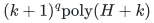
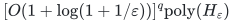

# A discrete scheduling tradeoff from processing buckets

**Guarantee**

For every integer <code class="math">k\ge0</code>, returns makespan at most <code class="math">\gamma_k\mathrm{OPT}</code>, where <code class="math">\gamma_k=\frac{3\cdot2^k-1}{2^{k+1}-1}=\frac{3}{2}+\frac{1}{2(2^{k+1}-1)}</code>.

**Objective and output**

Assign all original job totals with exact recipient feasibility and one exact assignment-cost budget.

**Randomness**

Deterministic bucket enumeration and exact minimum-cost recovery, for every stated integer bucket depth.

**Time**

<!-- math-display: 0ec2ea6f2751405f583d3074
(k+1)^q\mathrm{poly}(H+k)
-->

Choosing <code class="math">k=O(\log(1+1/\varepsilon))</code> gives factor <code class="math">3/2+\varepsilon</code> in

<!-- math-display: e55ad0d26aed68993a20d89b
[O(1+\log(1+1/\varepsilon))]^q\mathrm{poly}(H_\varepsilon)
-->

**Space**

Polynomial in the complete binary input and paid oracle workspace; numerical resource multiplicities are not expanded into individual units. Bucket depth is charged as stated in the time bound.

**Parameters**

<code class="math">q</code> is the physical-machine count; <code class="math">k</code> is an integer bucket depth. The first points are <code class="math">(\text{factor},\text{base})=(2,1),(5/3,2),(11/7,3),(23/15,4)</code>. <code class="math">H</code> includes the explicit ground, all rational and integer encodings, and paid rank, submodular-minimization, LP, intersection, and decomposition work.

**Model and representation**

Arbitrary nonnegative rational processing times and assignment costs, integral job polymatroids, mandatory original totals, eligibility masks, and one exact scalar budget.

**Lower-bound scope**

No lower bound is claimed for this algorithm.

**Review status**

The [verification note](verify/README.md) records the proof scope, executable evidence and remaining conditions. No proof-assistant verification or external peer review is claimed.

**Source**

[Manuscript and proof](proof.md), with [dependencies and verification sources](sources.md).

For an exact <code class="math">3/2</code> guarantee at constant base, use the separate [six-profile construction](../six-profile-three-halves/README.md).

**Attribution.** Yilin Liu · GPT-6 Astra Pro
