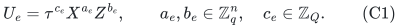
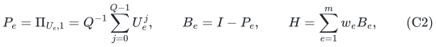
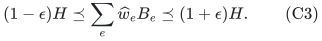
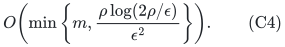
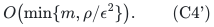
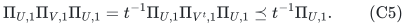
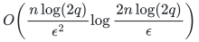
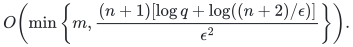

# Arbitrary-dimensional Weyl eigenvalue checks

**Abstract.** Positive eigenvalue checks on arbitrary-dimensional registers are the single-generator case of whole stabilizer-block sparsification. We give the resulting strongest support and compact construction bounds, including the dependence on binary-encoded composite dimension. The proof preserves whole original checks and requires no prime factorization.

## 1. Compact model

Let <code class="math">q\ge2</code>, <code class="math">Q=2q</code>, and <code class="math">\tau=e^{2\pi i/Q}</code>. On <code class="math">n</code> registers of local dimension <code class="math">q</code>, an input check is specified by

<!-- math-display: 78961af9b99355fcaaaa2067
U_e=\tau^{c_e}X^{a_e}Z^{b_e},\qquad
 a_e,b_e\in\mathbb Z_q^n,\quad c_e\in\mathbb Z_Q.
 \tag{C1}
-->

Here <code class="math">X&#124;z\rangle=&#124;z+1\rangle</code>, <code class="math">Z&#124;z\rangle=e^{2\pi iz/q}&#124;z\rangle</code>, and the vectors specify tensor products. A requested <code class="math">Q</code>-th-root eigenvalue is absorbed into the phase. Every such operator has <code class="math">U_e^Q=I</code>, including for even <code class="math">q</code>. Define

<!-- math-display: 7fa1101498e33e9cd88bbf90
P_e=\Pi_{U_e,1}=Q^{-1}\sum_{j=0}^{Q-1}U_e^j,
 \qquad B_e=I-P_e,
 \qquad H=\sum_{e=1}^m w_eB_e,
 \tag{C2}
-->

with nonnegative rational weights. The accepted eigenspace may be empty, giving <code class="math">B_e=I</code>, or the entire space, giving a zero clause. The phases, displacement vectors, dimensions, and weights form the compact input. The total Hilbert dimension is <code class="math">D=q^n</code>, and put <code class="math">\rho=\log_2(2D)</code>.

## 2. Support and construction theorem

**Theorem C.** For <code class="math">0&lt;\epsilon&lt;1</code>, there is a nonnegative reweighting of original checks satisfying

<!-- math-display: 9e00fd33f5e76c1d335bc14a
(1-\epsilon)H\preceq\sum_e\widehat w_eB_e
 \preceq(1+\epsilon)H.
 \tag{C3}
-->

A randomized algorithm polynomial in the compact binary input length and <code class="math">\epsilon^{-1}</code>, with success probability at least <code class="math">2/3</code>, obtains support

<!-- math-display: ecc8decf141eb777a86e1391
O\!\left(\min\left\{m,
 \frac{\rho\log(2\rho/\epsilon)}{\epsilon^2}\right\}\right).
 \tag{C4}
-->

An output also exists with support

<!-- math-display: a080a2a0deeb255166541cae
O\!\left(\min\{m,\rho/\epsilon^2\}\right).
 \tag{C4'}
-->

The construction supplied for (C4') is randomized polynomial in <code class="math">D</code> and the remaining input and accuracy parameters. It may therefore be exponential in the compact input. The compact algorithm for (C4) uses integer normal forms and does not factor <code class="math">q</code> or materialize a <code class="math">D</code>-dimensional matrix.

**Proof.** Treat each check as a block containing its single Weyl generator in [the arbitrary-dimensional whole-block theorem](arbitrary-dimension-whole-stabilizer-blocks.md), and set every local dimension equal to <code class="math">q</code>. Its phase modulus becomes <code class="math">2\mathrm{lcm}(q,\ldots,q)=2q=Q</code>; its block penalty is exactly (C2). Theorems 1 and 2 of that manuscript give (C4') and (C4), respectively, with the same original item identities and weights. This proves every claimed support, representation, probability, and running-time assertion. <code class="math">\square</code>

For clarity, the composite-dimensional algebra does not use a field basis. If <code class="math">UV=\zeta VU</code> and the nontrivial scalar commutator has order <code class="math">t</code>, then

<!-- math-display: 117351d05adf8debc14eba75
\Pi_{U,1}\Pi_{V,1}\Pi_{U,1}
 =t^{-1}\Pi_{U,1}\Pi_{V^t,1}\Pi_{U,1}
 \preceq t^{-1}\Pi_{U,1}.
 \tag{C5}
-->

To verify this, average the <code class="math">Q</code> powers of <code class="math">V</code>. Every term whose exponent is not divisible by <code class="math">t</code> changes the <code class="math">U</code>-eigenvalue and vanishes after sandwiching. Thus a conflicting pair of check penalties has an absolute lower spectral gap. Balanced subtraction separates a uniformly positive part from a commuting remainder. The commuting subgroup's scalar relations and displacement lattice are retained by the exact subgroup-order oracle; closure-preserving rationalization then supplies the compact quotient backend. These are the full proof's steps that require care at composite <code class="math">q</code>.

## 3. Dependence on the local dimension

Theorem C gives support <code class="math">O(n\log(2q)/\epsilon^2)</code> existentially and

<!-- math-display: 7125a5911bb8a7afdb490390
O\!\left(
 \frac{n\log(2q)}{\epsilon^2}
 \log\frac{2n\log(2q)}{\epsilon}
 \right)
-->

for the compact construction, always capped by <code class="math">m</code>. The bound has no locality, clause-order, or weight-ratio factor.

For <code class="math">q=2^k</code>, <code class="math">0&lt;\epsilon\le1/4</code>, and <code class="math">n\ge2\lceil(2\epsilon)^{-2}\rceil</code>, the layered modular cut construction in [Section 7 of the whole-block theorem](arbitrary-dimension-whole-stabilizer-blocks.md) already uses individual commuting checks and forces <code class="math">\Omega(n\log q/\epsilon^2)</code> retained items. Hence the existential order is jointly necessary in that regime.

When the dimension is known to be prime, the compact whole-block construction in [the prime-dimensional theorem](arbitrary-locality-stabilizer-block-sparsification.md) can be smaller:

<!-- math-display: feb568a458b515eb8bbd7289
O\!\left(\min\left\{m,
 \frac{(n+1)[\log q+\log((n+2)/\epsilon)]}{\epsilon^2}
 \right\}\right).
-->

The prime and general-dimensional construction bounds are therefore kept distinct. Neither asserts that the <code class="math">\log q</code> dependence is necessary for every prime dimension. The guarantee concerns the eigenvalue-check penalty <code class="math">I-\Pi_{U,1}</code>; the different energy <code class="math">I-(U+U^*)/2</code> has a different spectral analysis.

## 4. References

The complete proof, including character multiplicities, normal-form order queries, bit complexity, and the lower-bound construction, is in [Whole stabilizer-block sparsification in arbitrary local dimensions](arbitrary-dimension-whole-stabilizer-blocks.md). Its quotient-rank surrogate is proved in [Rational quotient ranks from weak value oracles](../../group-metric-constraints/manuscripts/rational-quotient-ranks-from-weak-oracles.md).

- Hostens, Dehaene, and De Moor, *Stabilizer States and Clifford Operations for Systems of Arbitrary Dimensions, and Modular Arithmetic*, Physical Review A 71 (2005): <https://arxiv.org/abs/quant-ph/0408190>.
- Kannan and Bachem, *Polynomial Algorithms for Computing the Smith and Hermite Normal Forms of an Integer Matrix*, SIAM Journal on Computing 8 (1979): <https://doi.org/10.1137/0208040>.
- Quanrud, *Quotient Sparsification for Submodular Functions*, SODA 2024, Theorem 1.1: <https://kentq.s3.amazonaws.com/submodular-sparsification.pdf>.
