# Whole stabilizer-block sparsification in arbitrary local dimensions

**Abstract.** For arbitrary, possibly heterogeneous, local dimensions with total Hilbert dimension <code class="math">D</code>, a positive weighted sum of whole stabilizer-block penalties admits an all-state spectral sparsifier on <code class="math">O(\log(2D)/\epsilon^2)</code> original blocks. A factorization-free randomized algorithm polynomial in the compact input retains <code class="math">O(\log(2D)\log(\log(2D)/\epsilon)/\epsilon^2)</code> blocks. The proof combines a uniform conflict gap, character duality, exact subgroup-order computation, and closure-preserving rationalization. A layered modular cut family gives the joint lower bound along powers of two.

## 1. Model and results

Let the local dimensions be arbitrary integers
<!-- math-display: 87913ce268711a4d25b641e3
q_1,\ldots,q_n\ge2,\qquad
 D=\prod_{j=1}^n q_j,\qquad
 Q=2\mathrm{lcm}(q_1,\ldots,q_n).
 \tag{CB1}
-->
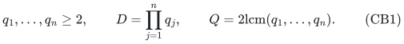
In particular, <code class="math">Q\le2D</code>, and its binary encoding has polynomial length in the input dimensions. Let <code class="math">\tau=e^{2\pi i/Q}</code>. On factor <code class="math">j</code>, use the shift and clock operators
<!-- math-display: e22f7c24549a190b80085ec9
X_j|z\rangle=|z+1\rangle,\qquad
 Z_j|z\rangle=e^{2\pi iz/q_j}|z\rangle.
-->
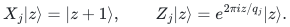
Each input Weyl check is specified by its compact phase and displacement data:
<!-- math-display: 893658b0a7ee74b4db0ec22c
U=\tau^c\bigotimes_{j=1}^n X_j^{a_j}Z_j^{b_j},
 \quad c\in\mathbb Z_Q,\quad a_j,b_j\in\mathbb Z_{q_j}.
 \tag{CB2}
-->
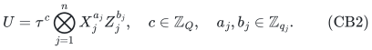
Every such <code class="math">U</code> satisfies <code class="math">U^Q=I</code>: each <code class="math">q_j</code> divides <code class="math">Q/2</code>, so the phase produced by the <code class="math">Q</code>-th power of a local shift-clock product also vanishes. A requested <code class="math">Q</code>-th-root eigenvalue is absorbed into the phase so that acceptance always means eigenvalue one.

An original block <code class="math">e</code> is an arbitrary list of mutually commuting checks <code class="math">U_{e,1},\ldots,U_{e,k_e}</code>. Define its joint acceptance projector and penalty by
<!-- math-display: 7dddf7c6ec85dd4860cdb273
E_e=\prod_{a=1}^{k_e}\Pi_{U_{e,a},1},
 \qquad B_e=I-E_e,\qquad
 H=\sum_{e=1}^m w_e B_e,
 \tag{CB3}
-->
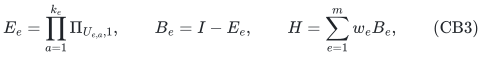
with nonnegative rational weights. The joint projector is allowed to be zero because of inconsistent phases; then the original block is the constant penalty <code class="math">I</code>. An empty list gives zero penalty. No rank, independence, locality, or block-size promise is imposed. Checks from different blocks may fail to commute.

The desired output is a nonnegative reweighting of **whole original blocks**:
<!-- math-display: 98eec5a7bb1a0bd232e99f9a
\widetilde H=\sum_e\widehat w_e B_e,\qquad
 (1-\epsilon)H\preceq\widetilde H\preceq(1+\epsilon)H.
 \tag{CB4}
-->
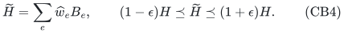
Thus every quantum state's energy and the exact kernel are preserved within the stated relative guarantee.

Write <code class="math">\rho=\log_2(2D)</code>.

**Theorem 1, optimal support.** For <code class="math">0&lt;\epsilon&lt;1</code>, an output satisfying (CB4) exists with
<!-- math-display: 6775159c7996d33713e60de6
O\!\left(\min\left\{m,\frac{\rho}{\epsilon^2}\right\}\right)
 \tag{CB5}
-->
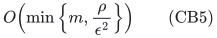
original blocks. The proof gives a randomized construction polynomial in an explicit finite character table, and consequently in <code class="math">D</code> and the remaining input/accuracy parameters. This sharper construction is not claimed polynomial in the compact binary description of the quantum input.

**Theorem 2, compact algorithm without factoring.** There is a randomized algorithm, polynomial in the compact input length, the rational weight encoding length, and <code class="math">\epsilon^{-1}</code>, that succeeds with probability at least <code class="math">2/3</code> and returns an output satisfying (CB4) with
<!-- math-display: b5e81915c9cd7d1f3738ad1e
O\!\left(\min\left\{m,
 \frac{\rho\log(2\rho/\epsilon)}{\epsilon^2}\right\}\right)
 \tag{CB6}
-->
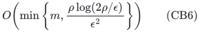
original blocks. It does not factor any <code class="math">q_j</code>, construct a <code class="math">D</code>-dimensional matrix, or enumerate the physical joint spectrum.

For a uniform composite dimension <code class="math">q</code>, these bounds are respectively
<!-- math-display: be1b5f2baf8808f858a83c2a
O(n\log(2q)/\epsilon^2)
 \quad\text{and}\quad
 O\!\left(
 \frac{n\log(2q)}{\epsilon^2}
 \log\frac{2n\log(2q)}{\epsilon}
 \right).
 \tag{CB7}
-->
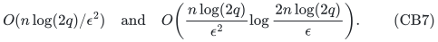
They are independent of how many checks occur inside one original block. The support statements always include the cap by <code class="math">m</code>.

## 2. A constant gap from any conflicting pair

The prime-dimensional overlap argument has the following general form.

**Lemma 3.** Suppose <code class="math">U^Q=V^Q=I</code> and <code class="math">UV=\zeta VU</code>, where <code class="math">\zeta\ne1</code> has order <code class="math">t\mid Q</code>. For <code class="math">P=\Pi_{U,1}</code> and <code class="math">R=\Pi_{V,1}</code>,
<!-- math-display: 25cad891390b1e5fee5a34cc
PRP
 =\frac1tP\Pi_{V^t,1}P
 \preceq\frac1tP.
 \tag{CB8}
-->
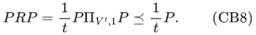
Consequently <code class="math">\&#124;PR\&#124;\le1/\sqrt t\le1/\sqrt2</code>.

**Proof.** If <code class="math">Uz=z</code>, then <code class="math">U(V^az)=\zeta^aV^az</code>. Thus <code class="math">PV^aP=0</code> unless <code class="math">t\mid a</code>. Average the <code class="math">Q</code> powers of <code class="math">V</code>:
<!-- math-display: 61e7cbca6892a0e50bb43eb6
PRP=\frac1Q\sum_{\ell=0}^{Q/t-1}PV^{t\ell}P
 =\frac1tP\left(\frac{t}{Q}
 \sum_{\ell=0}^{Q/t-1}(V^t)^\ell\right)P.
-->
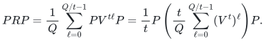
The parenthesis is the indicated orthogonal projector. This includes zero eigenspace projectors. <code class="math">\square</code>

If block <code class="math">e</code> contains <code class="math">U</code> and block <code class="math">f</code> contains <code class="math">V</code>, then <code class="math">E_e\preceq P</code>, <code class="math">E_f\preceq R</code>, and
<!-- math-display: df1713d33661f0149aaa66f4
\|E_eE_f\|=\|E_ePR E_f\|\le\|PR\|\le1/\sqrt2.
-->
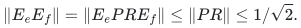
For two orthogonal projectors, <code class="math">E+F\preceq(1+\&#124;EF\&#124;)I</code>. Hence
<!-- math-display: e0c012de792c407d44301b30
B_e+B_f\succeq(1-1/\sqrt2)I.
 \tag{CB9}
-->
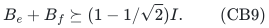
This depends on the order of the nontrivial commutator, not on how close its phase is to one. It concerns eigenvalue-check projectors, not the different penalty <code class="math">I-\mathrm{Re}U</code>.

For the compact representation (CB2), commutation and all products are computed by modular phase arithmetic:
<!-- math-display: d365bae0659751741f317857
(\tau^cX^aZ^b)(\tau^dX^uZ^v)
 =
 \tau^{c+d+\sum_j(Q/q_j)b_ju_j}
 X^{a+u}Z^{b+v}.
 \tag{CB10}
-->
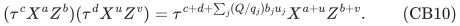
Thus the conflict test requires no cyclotomic-number approximation.

## 3. Balanced splitting

Maintain residual block coefficients <code class="math">r_e=w_e</code> and removed coefficients <code class="math">d_e=0</code>. Whenever two positive residual blocks contain a noncommuting generator pair, let <code class="math">s=\min(r_e,r_f)</code>, subtract <code class="math">s</code> from both residual coefficients, and add <code class="math">s</code> to both removed coefficients.

At least one residual block disappears at each step, so at most <code class="math">m</code> steps occur. At termination, every generator in the residual family commutes with every other generator. Define
<!-- math-display: 5e3a41eb24e7ddd7366a8e63
H_{\mathrm{gap}}=\sum_e d_eB_e,\qquad
 H_{\mathrm{com}}=\sum_e r_eB_e,\qquad
 W_{\mathrm{gap}}=\sum_e d_e.
 \tag{CB11}
-->
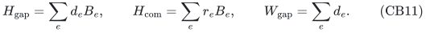
Then <code class="math">H=H_{\mathrm{gap}}+H_{\mathrm{com}}</code>, and (CB9) gives
<!-- math-display: a03991ed4e9983b52da8aa19
\gamma W_{\mathrm{gap}}I
 \preceq H_{\mathrm{gap}}
 \preceq W_{\mathrm{gap}}I,\qquad
 \gamma=\frac{1-1/\sqrt2}{2}.
 \tag{CB12}
-->
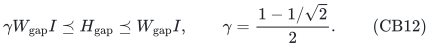

If <code class="math">W_{\mathrm{gap}}&gt;0</code>, sample original indices independently with probabilities <code class="math">d_e/W_{\mathrm{gap}}</code>, assigning weight <code class="math">W_{\mathrm{gap}}/k</code> to each occurrence. Standard matrix Chernoff gives a relative <code class="math">\eta</code>-approximation using
<!-- math-display: 10a992ab60f643b098097fe5
k=O\!\left(
 \frac{\log(2D)+\log(1/\delta)}{\eta^2}
 \right)
 \tag{CB13}
-->
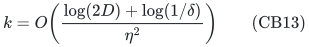
samples with failure probability at most <code class="math">\delta</code>. Indeed, whitening for the analysis gives summands of norm at most <code class="math">1/\gamma</code>. The algorithm only samples rational coefficients and does not perform the whitening. Repeated sampled indices are merged. If <code class="math">W_{\mathrm{gap}}=0</code>, this part is absent.

The remaining issue is therefore the commuting family, while retaining each whole block as one item.

## 4. The exact physical spectrum is a small character torsor

Let <code class="math">\mathcal H</code> be the finite abelian group of actual Weyl operators generated by all residual checks. Let <code class="math">\mathcal C\le\mathcal H</code> be its subgroup of scalar operators, and let
<!-- math-display: 78e173986a9543bad78e1c27
\chi_0:\mathcal C\longrightarrow\mathbb C^\times
-->
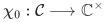
be the physical scalar character: <code class="math">\chi_0(\alpha I)=\alpha</code>.

Every non-scalar Weyl operator has trace zero. A scalar <code class="math">c\in\mathcal C</code> has trace <code class="math">D\chi_0(c)</code>. For a character <code class="math">\chi\in\widehat{\mathcal H}</code>, its multiplicity in the physical representation is therefore
<!-- math-display: 21bea7572f1878c10893b7f7
\begin{aligned}
 m_\chi
 &=\frac1{|\mathcal H|}
 \sum_{h\in\mathcal H}\overline{\chi(h)}\,\mathrm{tr}(h)\\
 &=\frac{D}{|\mathcal H|}
 \sum_{c\in\mathcal C}\overline{\chi(c)}\chi_0(c)\\
 &=
 \begin{cases}
 D|\mathcal C|/|\mathcal H|,
    &\chi|_{\mathcal C}=\chi_0,\\
 0,&\text{otherwise}.
 \end{cases}
\end{aligned}
 \tag{CB14}
-->
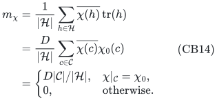
This is the ordinary character-orthogonality calculation for a commuting stabilizer group.

At least one physical character <code class="math">\chi_*</code> occurs, by simultaneous diagonalization. All extensions of <code class="math">\chi_0</code> are then
<!-- math-display: 34308db97cd2ce4c573a923d
\chi_*\mathcal A,\qquad
 \mathcal A=
 \{\psi\in\widehat{\mathcal H}:\psi|_{\mathcal C}=1\}
 \cong\widehat{\mathcal H/\mathcal C}.
 \tag{CB15}
-->
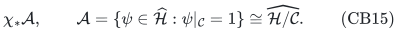
Every one of them occurs by (CB14), with the same positive integer multiplicity. In particular,
<!-- math-display: 074560562ecfbec27be37693
|\mathcal A|=|\mathcal H/\mathcal C|\mid D,
 \qquad |\mathcal A|\le D.
 \tag{CB16}
-->
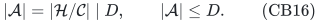
Thus the actual joint eigenpatterns form an affine torsor with at most <code class="math">D</code> points. This step does not assume that a module over a composite modulus has a field basis.

For block <code class="math">e</code>, let <code class="math">J_e\le\mathcal H</code> be generated by its original checks. On the character <code class="math">\chi_*\psi</code>, its acceptance is
<!-- math-display: 28561e000d5b31bd0f91921a
\chi_*(U_{e,a})\psi(U_{e,a})=1
 \qquad\text{for every internal check }a.
 \tag{CB17}
-->
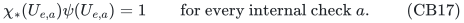
These are homomorphism equations in <code class="math">\psi\in\mathcal A</code>. Their solution set is either a coset of a subgroup of <code class="math">\mathcal A</code> or empty. An empty set gives the constant-one block penalty, including internally inconsistent blocks.

The affine-group theorem in [../../group-metric-constraints/manuscripts/affine-constraints-over-arbitrary-finite-groups.md](../../group-metric-constraints/manuscripts/affine-constraints-over-arbitrary-finite-groups.md) preserves all these original coset-complement items with
<!-- math-display: 7c4935ad095f365e8a5964b8
O(\log(2|\mathcal A|)/\eta^2)
 \le O(\log(2D)/\eta^2)
 \tag{CB18}
-->
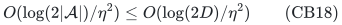
blocks. The guarantee on all physical characters is exactly the desired Loewner guarantee for <code class="math">H_{\mathrm{com}}</code>, because it is diagonal in their simultaneous eigenspaces.

Combine (CB18) with the gapped sample (CB13), add the two PSD inequalities, and merge coefficients assigned to the same original block. This proves Theorem 1.

The explicit-table construction has a finite bound even with heterogeneous dimensions. Since <code class="math">&#124;\mathcal C&#124;\mid Q</code> and (CB16) holds,
<!-- math-display: 46818ce42e67fe8f5666edc3
|\mathcal H|\mid DQ,\qquad
 |\mathcal H|\le DQ\le2D^2.
 \tag{CB19}
-->
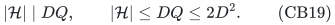
One can enumerate this finite operator group, compute its abelian character presentation, and list the physical acceptance table in time polynomial in <code class="math">D</code> and the remaining input length. This is an explicit-dimension algorithm, not the compact algorithm below.

## 5. A compact exact subgroup-order oracle

The compact construction does not enumerate characters. For a collection <code class="math">S</code> of residual blocks, define
<!-- math-display: fc63cb6a8116eaa879315f1d
\mathcal H_S=\langle J_e:e\in S\rangle.
 \tag{CB20}
-->
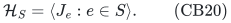
We compute <code class="math">&#124;\mathcal H_S&#124;</code> exactly with integer normal forms and greatest common divisors, without factoring.

Collect the <code class="math">s</code> checks in those blocks. Let <code class="math">A_S</code> be the integer <code class="math">2n\times s</code> matrix of their projective displacement columns, and let
<!-- math-display: 93e04b4e44186ee0f4b164b6
M=\mathrm{diag}(q_1,\ldots,q_n,q_1,\ldots,q_n).
-->
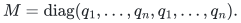
The projective displacement image is
<!-- math-display: 368a97198732a16fe8ffdcb6
\mathcal P_S=(A_S\mathbb Z^s+M\mathbb Z^{2n})/M\mathbb Z^{2n}.
-->
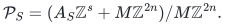
If <code class="math">D_S</code> is a column Hermite-normal-form basis of the full-rank lattice in the numerator, then
<!-- math-display: 794c5ebe129817c279ac209d
|\mathcal P_S|=\frac{\det M}{|\det D_S|}
 =\frac{D^2}{|\det D_S|}.
 \tag{CB21}
-->
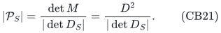

Next compute an integer basis of the relation lattice
<!-- math-display: 6783e7862efe6a438a1eacbc
\mathcal R_S=\{z\in\mathbb Z^s:A_Sz\in M\mathbb Z^{2n}\}.
 \tag{CB22}
-->
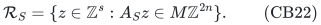
This is obtained from an integer kernel basis of <code class="math">[A_S\ -M]</code> by projecting onto its first <code class="math">s</code> coordinates. The projection is injective on that kernel, since the remaining coordinates are uniquely determined by <code class="math">z</code>. Standard Hermite/Smith normal-form algorithms produce such bases and transformation matrices with polynomial bit complexity.

For each basis relation <code class="math">z</code>, evaluate the compact operator
<!-- math-display: 47e23b9fd6fc02bd9f98402a
\prod_{i=1}^s U_i^{z_i}=\tau^{\kappa_z}I.
 \tag{CB23}
-->
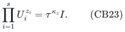
All the <code class="math">U_i</code> commute, so this is a homomorphism from the additive relation lattice to the scalar phase group. Its image is exactly the scalar subgroup <code class="math">\mathcal C_S</code> of <code class="math">\mathcal H_S</code>. Therefore
<!-- math-display: 948748b6a9fbf4419433f1ee
|\mathcal C_S|
 =\frac{Q}{\gcd(Q,\{\kappa_z:z\text{ is a basis relation}\})},
 \qquad
 |\mathcal H_S|=|\mathcal P_S|\,|\mathcal C_S|.
 \tag{CB24}
-->
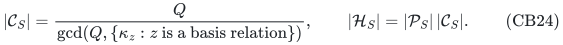
For an empty relation list, the gcd is interpreted as <code class="math">Q</code>. Products and powers are computed by (CB10), with exponents reduced modulo <code class="math">Q</code> when convenient. Large integer kernel coefficients therefore cause no expansion of a matrix or a word.

Equations (CB21)--(CB24) give an exact polynomial-bit order oracle. They also show why retaining only the projective displacement span would be insufficient: nontrivial scalar relations encode inconsistent targets and must be counted.

## 6. Compact quotient sparsification without factoring

On the residual block ground set, consider
<!-- math-display: c305d74be562d042472ee967
f(S)=\log_2|\mathcal H_S|.
 \tag{CB25}
-->
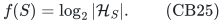
The ambient group <code class="math">\mathcal H</code> is abelian. Its subgroup product/intersection identity shows that <code class="math">f</code> is normalized, monotone, and submodular. Every positive marginal is at least one because a proper subgroup inclusion has index at least two. By (CB19),
<!-- math-display: e2dc43ded954526fb294e806
f([m])\le\log_2(DQ)\le2\log_2D+1.
 \tag{CB26}
-->
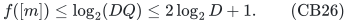
If this rank is zero, all residual checks are the identity, every residual penalty is zero, and the residual output is empty. Assume below that the residual rank is positive.

For any physical character <code class="math">\chi</code>, the zero-block set
<!-- math-display: 1b8c97aa28ac0b126ece027a
Z_\chi=\{e:J_e\subseteq\ker\chi\}
 \tag{CB27}
-->
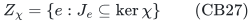
is closed for this rank. Indeed, all subgroups generated by its members lie in <code class="math">\ker\chi</code>. If adding a block has zero marginal, that block's subgroup is already contained in the generated subgroup and also lies in <code class="math">\ker\chi</code>. Thus <code class="math">[m]\setminus Z_\chi</code>, the set of violated original blocks, is a quotient of <code class="math">f</code>.

Quanrud's theorem mathematically applies to (CB25): it permits real-valued submodular ranks with positive marginals at least one. For a compact binary-input algorithm, however, an exact polynomial-bit value oracle cannot simply be assumed for logarithms and their subsequent optimization arithmetic.

The companion [../../group-metric-constraints/manuscripts/rational-quotient-ranks-from-weak-oracles.md](../../group-metric-constraints/manuscripts/rational-quotient-ranks-from-weak-oracles.md) resolves this issue. Fix an integer <code class="math">R\ge\log_2(DQ)</code> with <code class="math">R=O(\log(2D))</code>, for example the bit length of <code class="math">DQ</code>. Let
<!-- math-display: e71a0e28cbd0c68dbc698d5e
\phi(t)=t-\frac{t^2}{4R}.
-->
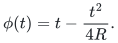
For every integer order <code class="math">N</code>, deterministically approximate <code class="math">\phi(\log_2N)</code> to error at most <code class="math">1/(64R)</code> with one fixed dyadic denominator <code class="math">O(R)</code>, assigning exactly zero to <code class="math">N=1</code>. Multiplying these approximations by four produces an **exact rational** monotone submodular function <code class="math">F</code>, with:

- exactly the same zero marginals and closed sets as <code class="math">f</code>;
- every positive marginal at least one;
- rank at most <code class="math">4R</code>;
- polynomial-bit values and evaluation, using the integer order from Section 5.

The proof creates a submodularity slack of at least <code class="math">1/(2R)</code> whenever both relevant rank increments are positive. If either increment vanishes, the values are equal in pairs, and the deterministic order-based approximations cancel exactly. This is why ordinary numerical approximation is sufficient here; no factorization or exact comparison of transcendental expressions is required.

Apply Quanrud's quotient sparsifier and the adaptive resparsification consequence in [../../label-block-cut/manuscripts/adaptive-quotient-resparsification.md](../../label-block-cut/manuscripts/adaptive-quotient-resparsification.md) to this exact rational rank. It retains
<!-- math-display: 74642411a190423fe58ac929
O\!\left(
 \frac{R\log(2R/\eta)}{\eta^2}
 \right)
 \tag{CB28}
-->
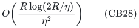
whole residual blocks while preserving every quotient, hence every physical character query (CB27).

Keep the same rational rank and common denominator through all restrictions. The fixed-denominator extension of the companion bit ledger gives polynomial accumulated weight encoding length. Submodular minimization now receives exact rational values. The denominator is not multiplied into the rank parameter of the support analysis.

Finally, sample the gapped part at error <code class="math">\eta\le\epsilon</code> and failure probability <code class="math">1/10</code>, and set the classical procedure's constant success probability above <code class="math">9/10</code>. Add the two relative PSD approximations and merge duplicate original indices. The combined success probability exceeds <code class="math">2/3</code>; (CB13) and (CB28) prove Theorem 2.

All quantum algebra, block-conflict tests, normal forms, order evaluations, rational surrogate evaluations, and weight arithmetic are polynomial in the compact input. The Hilbert dimension enters the sample count only through <code class="math">\log D</code>.

## 7. A matching multilevel lower bound

The modulus logarithm is necessary in the worst case, even for commuting two-local single-check blocks.

Let
<!-- math-display: 7d45969de59bd6f7dc3b5896
q=2^k,\quad k\ge1,\qquad
 0<\epsilon\le1/4,\qquad
 s=\lceil(2\epsilon)^{-2}\rceil,\quad B\ge s,\quad n=s+B.
-->
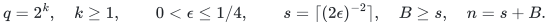
Use <code class="math">n</code> registers of local dimension <code class="math">q</code>, so <code class="math">D=q^n</code>. For every edge <code class="math">uv</code> of <code class="math">K_{s,B}</code>, and every level <code class="math">j=0,\ldots,k-1</code>, include the original block
<!-- math-display: b7f48d73e086541407b67492
B_{j,uv}
 =I-\Pi_{(Z_uZ_v^{-1})^{2^j},1},
 \qquad w_{j,uv}=3^j.
 \tag{CB29}
-->
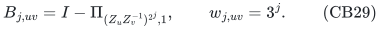
All checks commute. The level is part of the original item identity. The largest weight uses <code class="math">O(k)</code> bits.

Fix any Boolean cut vector <code class="math">b\in\{0,1\}^n</code>. For
<code class="math">\ell=0,\ldots,k</code>, use the computational basis assignment
<!-- math-display: 0fb970349d515e93940d6a95
x_v=2^{k-\ell}b_v\pmod{2^k},
-->
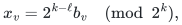
where <code class="math">\ell=0</code> is the all-zero assignment. The check at level <code class="math">j</code> violates exactly when <code class="math">uv</code> crosses the cut and <code class="math">j&lt;\ell</code>. Thus its original energy is
<!-- math-display: 46c95f3c7c3cdae79fb631c6
W_\ell\,\mathrm{cut}_{K_{s,B}}(b),
 \qquad W_\ell=\sum_{j<\ell}3^j=\frac{3^\ell-1}{2}.
 \tag{CB30}
-->
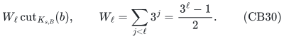

Let <code class="math">\widehat G_j</code> be the nonnegative weighted graph consisting of the output coefficients at level <code class="math">j</code>. The spectral guarantee on these basis states implies
<!-- math-display: 3216e6cfec7e0c047427a16e
\left|
 \sum_{j<\ell}\mathrm{cut}_{\widehat G_j}(b)
 -W_\ell\mathrm{cut}_{K_{s,B}}(b)
 \right|
 \le\epsilon W_\ell\mathrm{cut}_{K_{s,B}}(b).
 \tag{CB31}
-->
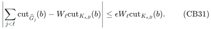
Subtract the estimates for <code class="math">\ell=j+1</code> and <code class="math">\ell=j</code>. Since
<!-- math-display: 182ae099a862944bf16bada2
W_{j+1}+W_j=2\cdot3^j-1<2\cdot3^j,
-->
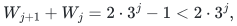
we obtain
<!-- math-display: 7fed55fb70d15f4c9c0e4c69
\left|
 \mathrm{cut}_{\widehat G_j}(b)
 -3^j\mathrm{cut}_{K_{s,B}}(b)
 \right|
 \le2\epsilon\,3^j\mathrm{cut}_{K_{s,B}}(b).
 \tag{CB32}
-->
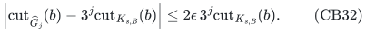
After division by <code class="math">3^j</code>, each level is independently a weighted <code class="math">(1\pm2\epsilon)</code> cut sparsifier of <code class="math">K_{s,B}</code>.

The complete-bipartite cut lower bound (EC15) in the companion exact-label-cut manuscript forces
<code class="math">\Omega(n/\epsilon^2)</code> retained original edges in **each** level. Therefore every successful output needs
<!-- math-display: 097f027e3a97dcbf6c104ae5
\Omega(nk/\epsilon^2)
 =\Omega(\log D/\epsilon^2)
 =\Omega(n\log q/\epsilon^2)
 \tag{CB33}
-->
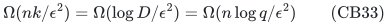
whole original blocks.

This allows arbitrary nonnegative output weights. It establishes the joint worst-case support order for composite dimensions along powers of two, in the regime <code class="math">n\ge2\lceil(2\epsilon)^{-2}\rceil</code>. It does not assert that every fixed prime dimension needs an extra <code class="math">\log q</code> factor. The graph-cut lower bound is classical; the layered modular construction transfers it to this whole-check model.

## 8. Baselines and boundaries

**Companion results.** The prime-dimension whole-block theorem and the arbitrary-composite single-check theorem are the direct starting points. The present result permits entire joint acceptance projectors at arbitrary and heterogeneous local dimensions, proves the compact factorization-free construction through rationalized subgroup ranks, and supplies the joint modulus lower bound. The order oracle accounts for scalar relations rather than assuming a field basis.

**Quanrud, SODA 2024.** *Quotient Sparsification for Submodular Functions*, Theorem 1.1, already permits real-valued normalized monotone submodular ranks with all positive marginals at least one, and gives <code class="math">O(r\log(mr)/\epsilon^2)</code> support. Its entropy corollary is also explicit. The adaptive <code class="math">O(r\log(2r/\epsilon)/\epsilon^2)</code> consequence and finite-precision surrogate are stated in separate companion notes; they are not attributed as a new theorem of Quanrud. [Primary source](https://kentq.s3.amazonaws.com/submodular-sparsification.pdf).

**Basu--Brakensiek--Putterman, May 2026.** *Many Hamiltonians Are Sparsifiable* gives sparsification results for fixed-locality qubit Pauli terms and other local PSD classes. It is the checked quantum sparsification baseline. The present operator class consists of arbitrary-locality complements of joint Weyl acceptance spaces, with composite or heterogeneous local dimensions. A block is penalized once when any internal check fails, so replacing it by the sum of its check penalties changes the objective and output model. [Primary source](https://arxiv.org/html/2605.02211v1).

**Hostens--Dehaene--De Moor, 2005.** *Stabilizer States and Clifford Operations for Systems of Arbitrary Dimensions, and Modular Arithmetic* is standard background for compact arbitrary-dimensional Weyl and stabilizer algebra. The trace/character calculation and integer normal forms used here are classical tools. [Primary source](https://arxiv.org/abs/quant-ph/0408190).

**Kannan--Bachem, 1979.** *Polynomial Algorithms for Computing the Smith and Hermite Normal Forms of an Integer Matrix* supplies the polynomial-bit normal forms and transformation matrices used by the order oracle. [Primary source](https://doi.org/10.1137/0208040).

**Tropp, matrix concentration.** The gapped-component sampling is ordinary matrix Chernoff; it is not a new concentration theorem. [Primary source](https://arxiv.org/abs/1501.01571).

The sharper support theorem depends on the new whole-subgroup/affine-group Gaussian backend. The compact theorem depends instead on the rational quotient surrogate and the existing quotient-sparsification machinery. Neither theorem is a ground-state optimization algorithm, and neither extends to arbitrary projector-complement Hamiltonians lacking the Weyl overlap and subgroup structure.
