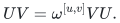
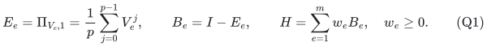
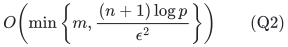
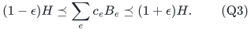
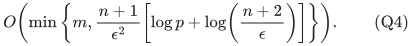
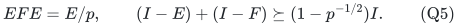
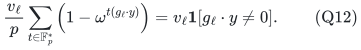
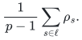
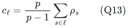

# Arbitrary-locality prime-dimensional Weyl checks

**Abstract.** Positive eigenvalue-check Hamiltonians on prime-dimensional qudits admit whole-check spectral summaries independent of locality. The result is a direct corollary of the whole-block theorem. An independent projective-line averaging argument shows how an abelian Cayley sparsifier can retain whole check predicates. Compact construction and optimal support existence have distinct bounds.

## 1. Model and theorem

Let <code class="math">p</code> be prime, <code class="math">\omega=e^{2\pi i/p}</code>, and let the Hilbert space be <code class="math">(\mathbb C^p)^{\otimes n}</code>. A normalized Weyl operator has projective label in <code class="math">\mathbb F_p^{2n}</code>, satisfies <code class="math">U^p=I</code>, and any two such operators satisfy

<!-- math-display: 51228cb073344803544445bb
UV=\omega^{[u,v]}VU.
-->

Here <code class="math">[u,v]</code> is the standard symplectic form. For odd <code class="math">p</code>, tensor products of the usual shift and clock operators, multiplied by a power of <code class="math">\omega</code>, have this normalization. For <code class="math">p=2</code>, use signed Hermitian Pauli strings; this includes the usual phase correction for <code class="math">Y</code>.

An input check asks for the eigenvalue <code class="math">\omega^{t_e}</code> of a normalized Weyl operator <code class="math">U_e</code>. Absorb the target into <code class="math">V_e=\omega^{-t_e}U_e</code>, and define

<!-- math-display: 7f45ab7cd9f6b7f0a02df7b2
E_e=\Pi_{V_e,1}=\frac1p\sum_{j=0}^{p-1}V_e^j,
\qquad B_e=I-E_e,
\qquad H=\sum_{e=1}^m w_e B_e,
\quad w_e\ge0.
\tag{Q1}
-->

Thus <code class="math">E_e</code> is an orthogonal projection and <code class="math">0\preceq B_e\preceq I</code>. Scalar Weyl operators are allowed: they give a zero check or the constant penalty <code class="math">I</code>. Zero terms and zero weights may be discarded.

**Theorem Q.** For every <code class="math">0&lt;\epsilon&lt;1</code>, there are nonnegative coefficients <code class="math">c_e</code>, supported on

<!-- math-display: a3dcb16ecba70fd781e12fef
O\!\left(\min\left\{m,\frac{(n+1)\log p}{\epsilon^2}\right\}\right)
\tag{Q2}
-->

original checks, such that

<!-- math-display: dd41c937369dd2584089a2b9
(1-\epsilon)H\preceq\sum_e c_eB_e\preceq(1+\epsilon)H.
\tag{Q3}
-->

For rational input weights, a randomized algorithm using time polynomial in <code class="math">n,m,\log p,\epsilon^{-1}</code> and the weight encoding length constructs such an approximation, with success probability at least <code class="math">2/3</code>, with the slightly larger support bound

<!-- math-display: beecf24b89f3189b4c442711
O\!\left(\min\left\{
m,\frac{n+1}{\epsilon^2}
\left[\log p+\log\!\left(\frac{n+2}{\epsilon}\right)\right]
\right\}\right).
\tag{Q4}
-->

The support in (Q4) has no dependence on the locality of a check or the dynamic range of the weights. The compact algorithm never constructs a <code class="math">p^n</code>-dimensional matrix. Its constant-success contract is sufficient here; no unchanged-support arbitrary-confidence claim is made.

The inherited graph-cut lower bound gives <code class="math">\Omega(n/\epsilon^2)</code> necessary original checks when <code class="math">0&lt;\epsilon\le1/2</code> and <code class="math">n\ge2\lceil\epsilon^{-2}\rceil</code>. Thus for fixed prime <code class="math">p</code>, the support in (Q2) is jointly sharp in <code class="math">n,\epsilon</code> in this regime. No matching lower bound for the displayed <code class="math">\log p</code> dependence is claimed.

## 2. Proof of Theorem Q

Regard every check as a block containing exactly one normalized Weyl generator. Its block penalty is exactly <code class="math">B_e</code>, so it satisfies the input contract of [the prime-dimensional whole-block theorem](arbitrary-locality-stabilizer-block-sparsification.md), with no change in weights, physical dimension, locality, or item identities. The compact support bound (SB3) is exactly (Q4), and the whole-block support bound (SB4a) is exactly (Q2). Both outputs retain original checks. The whole-block theorem's two success events have total failure probability below <code class="math">1/3</code>; its construction therefore proves the claimed compact randomized contract. <code class="math">\square</code>

The argument can also be decomposed into three elementary steps. A conflicting pair of accepted-eigenvalue projectors obeys

<!-- math-display: c15aee11cba0ffb38298b4b2
EFE=E/p,\qquad
 (I-E)+(I-F)\succeq(1-p^{-1/2})I.
 \tag{Q5}
-->

Indeed, every nonconstant power in the Fourier expansion of <code class="math">F</code> maps the accepted eigenspace of the other check to a distinct eigenspace. Balanced subtraction of equal coefficient mass from conflicting pairs then leaves one pairwise-commuting family. The removed positive part has a lower spectral bound equal to an absolute constant times its total coefficient, so coefficient-proportional sampling uses <code class="math">O(n\log p/\epsilon^2)</code> original checks at constant confidence. The commuting family is an affine linear-code objective on at most <code class="math">n</code> variables over <code class="math">\mathbb F_p</code>. Its augmented row rank is at most <code class="math">n+1</code>, and quotient resparsification uses <code class="math">O((n+1)\log((n+2)/\epsilon)/\epsilon^2)</code> coordinates. These two PSD approximations add without an additional relative-error factor.

For the lower bound, take one commuting check <code class="math">I-\Pi_{Z_uZ_v^{-1},1}</code> per edge of <code class="math">K_{s,B}</code>, with <code class="math">s=\lceil\epsilon^{-2}\rceil</code> and <code class="math">B=n-s\ge s</code>. On computational-basis symbols in <code class="math">\{0,1\}</code>, its penalty is exactly the corresponding Boolean cut indicator. Equation (EC15) of [the cut theorem](../../label-block-cut/manuscripts/exact-label-cut-and-matroid-quotient-sparsification.md) requires <code class="math">\Omega(n/\epsilon^2)</code> original checks. This proves the stated fixed-prime joint lower bound; it does not establish necessity of the <code class="math">\log p</code> factor.

## 3. An independent support proof by projective-line averaging

Here is the additional argument needed to obtain (Q2) without replacing a check by independently weighted powers of its Weyl operator.

After the commuting reduction in [the whole-block theorem](arbitrary-locality-stabilizer-block-sparsification.md), let <code class="math">r\le n</code> be its projective rank and set <code class="math">d=r+1</code> and <code class="math">G=\mathbb F_p^d</code>. First merge collinear nonzero rows <code class="math">g_e</code>: multiplying a row by a nonzero scalar leaves its nonzero predicate unchanged. Let a projective line <code class="math">\ell</code> have total residual weight <code class="math">v_\ell</code>. For every nonzero <code class="math">s\in\ell</code>, give the Cayley generator <code class="math">s</code> weight <code class="math">v_\ell/p</code>. This is a symmetric weighted generating set. At the character indexed by <code class="math">y\in G</code>, the contribution of the line to its Laplacian eigenvalue is

<!-- math-display: 8d0bedc8bec95b147736c2a7
\frac{v_\ell}{p}\sum_{t\in\mathbb F_p^*}
\left(1-\omega^{t(g_\ell\cdot y)}\right)
=v_\ell\mathbf1[g_\ell\cdot y\ne0].
\tag{Q12}
-->

The weighted abelian Cayley theorem supplies a relative sparsifier with
<code class="math">O(d\log p/\epsilon^2)</code> generators. Let its nonnegative weights be <code class="math">\rho_s</code>. It need not initially assign equal weights to generators on the same projective line.

For each <code class="math">\alpha\in\mathbb F_p^*</code>, conjugate this sparsifier by the group automorphism <code class="math">z\mapsto\alpha z</code>, then average all <code class="math">p-1</code> conjugates. The input Cayley Laplacian is invariant under every such automorphism, so averaging preserves the same relative Loewner inequalities. The averaged output assigns every nonzero generator on a line <code class="math">\ell</code> the common weight

<!-- math-display: dff38561e5dec2817573456c
\frac1{p-1}\sum_{s\in\ell}\rho_s.
-->

Consequently it is exactly the code/check sparsifier with coefficient

<!-- math-display: 350dbb6837f16fb8fee4a8e3
c_\ell=\frac{p}{p-1}\sum_{s\in\ell}\rho_s
\tag{Q13}
-->

on one representative original check of each retained line. The number of retained lines is at most the number of generators before averaging. All nonzero scalar multiples of <code class="math">g_e</code> describe the same operator on the physical affine slice, so selecting a representative original check is valid.

Thus the commuting part has an original-check sparsifier of size <code class="math">O((r+1)\log p/\epsilon^2)</code>. The current Cayley construction takes time polynomial in <code class="math">&#124;G&#124;=p^{r+1}</code>, rather than polynomial in <code class="math">r,\log p</code>. This averaging argument is used for support existence and the exponential construction only.

## 4. References

1. **Khanna, Putterman, Sudan, STOC 2025, _Efficient Algorithms and New Characterizations for CSP Sparsification_.** Section 5 explicitly treats arbitrary weighted generating matrices. Theorem 5.19 and Claim 5.18 provide the earlier weighted-code backend; its two-pass final algorithm removes the original code-length logarithm. Primary source: <https://arxiv.org/html/2404.06327v2>.

2. **Basu, Kothari, Meka, Tudose, July 2026, _Optimal Sparsifiers for Abelian Cayley Graphs_.** Theorem 1.5 covers arbitrary weighted abelian Cayley graphs with <code class="math">O(\epsilon^{-2}\log&#124;G&#124;)</code> generators and a randomized algorithm polynomial in <code class="math">&#124;G&#124;</code>. The projective-line averaging in Section 5 above is the transfer used here to preserve whole check terms. Primary source: <https://arxiv.org/pdf/2607.08261v1>.

3. **Basu, Brakensiek, Putterman, May 2026, _Many Hamiltonians Are Sparsifiable_.** Theorem 3.5 proves near-linear support for fixed-locality qubit Pauli penalties, with locality-dependent bounds and preprocessing; Theorem 2.11 explicitly records the weighted binary-code primitive. The present statement permits unbounded locality and prime-dimensional check projectors, with no locality factor. It is not a claim to improve their fixed-locality bound as a function of <code class="math">n</code>. Primary source: <https://arxiv.org/html/2605.02211v1>.

4. **Hostens, Dehaene, De Moor, 2005, _Stabilizer states and Clifford operations for systems of arbitrary dimensions, and modular arithmetic_.** This supplies standard compact Weyl/stabilizer representation background. The pair-gap calculation, balanced decomposition, and projective-line averaging are proved directly above. Primary source: <https://arxiv.org/abs/quant-ph/0408190>.

5. **Tropp, _An Introduction to Matrix Concentration Inequalities_.** Matrix Chernoff is used only for the uniformly gapped peeled part. Primary source: <https://arxiv.org/abs/1501.01571>.

6. **Quanrud, SODA 2024, _Quotient sparsification for submodular functions_.** Theorem 1.1 and its linear-matroid application give the weighted subspace-complement primitive. Adaptive resparsification, proved in 27_adaptive_quotient_resparsification.md, removes the original ground-set logarithm and yields the explicit compact bound (Q4). Primary source: <https://kentq.s3.amazonaws.com/submodular-sparsification.pdf>.
