# Compact and optimal-support sparsification of whole stabilizer-check blocks

**Abstract.** Positive Hamiltonians whose original items are complements of prime-dimensional stabilizer acceptance spaces admit support <code class="math">O((n+1)\log p/\epsilon^2)</code> existentially. A compact randomized algorithm retains <code class="math">O((n+1)[\log p+\log((n+2)/\epsilon)]/\epsilon^2)</code> whole blocks, independent of locality and internal block size. A constant conflict gap permits balanced splitting into a uniformly positive part and a commuting finite-field block objective.

The [arbitrary-dimensional theorem](arbitrary-dimension-whole-stabilizer-blocks.md) also handles composite and heterogeneous dimensions. The prime-dimensional compact bound here remains a separate result: its additive dependence on <code class="math">\log p</code> can be smaller than the product of logarithms in the general-dimensional construction.

## Main result

Let <code class="math">p</code> be a prime. On <code class="math">n</code> qudits of local dimension <code class="math">p</code>, let each input block specify an arbitrary finite collection of mutually commuting normalized Weyl checks. Their joint accepting subspace has orthogonal projection <code class="math">E_e</code>. The input Hamiltonian is

<!-- math-display: f03f5d010abb2a43f2d6cee9
H=\sum_{e=1}^{m} w_e B_e,\qquad B_e=I-E_e,\qquad w_e\ge0.
\tag{SB1}
-->
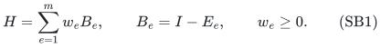

The penalty of a block is zero when **all** checks in that block are satisfied and one otherwise. Blocks may overlap arbitrarily, checks in different blocks need not commute, their locality is unrestricted, and a block can contain up to <code class="math">n</code> independent checks. The output must retain and reweight **whole original blocks**.

**Theorem SB.** For <code class="math">0&lt;\epsilon&lt;1</code>, there is a randomized algorithm, polynomial in the compact input length, <code class="math">\epsilon^{-1}</code>, and the rational weight encoding length, which succeeds with probability at least <code class="math">2/3</code> and returns nonnegative coefficients <code class="math">c_e</code> such that

<!-- math-display: 53ed8af7e3424fb59920745e
(1-\epsilon)H
\preceq \widetilde H:=\sum_e c_eB_e
\preceq(1+\epsilon)H,
\tag{SB2}
-->
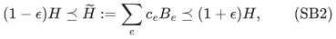

with support

<!-- math-display: f5ea793b3d1296e78e06105a
O\!\left(
\min\!\left\{
m,\,
\frac{n+1}{\epsilon^2}
\left[\log p+\log\!\left(\frac{n+2}{\epsilon}\right)\right]
\right\}
\right).
\tag{SB3}
-->
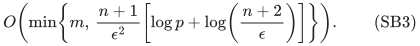

No <code class="math">p^n</code>-dimensional matrices or quantum states are constructed. For qubits, and more generally any fixed prime <code class="math">p</code>, the bound is

<!-- math-display: 67e8f8cfe338a18335c6e301
O\!\left(\frac{(n+1)\log((n+2)/\epsilon)}{\epsilon^2}\right).
\tag{SB4}
-->
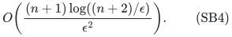

This extends the earlier single-check Pauli result to arbitrary stabilizer-subspace complements, with no factor for the number of checks within a block. The classical backend is an application of **Quanrud's existing quotient-sparsification theorem**, with the adaptive resparsification argument in 27_adaptive_quotient_resparsification.md. No new hedgegraph or classical code-sparsification priority claim is made.

The theorem deliberately states constant success probability. Stronger confidence can be obtained by adjusting the invoked sampling bounds, but no unchanged-support arbitrary-confidence claim is needed here.

**Theorem SB, optimal-order existence bound for fixed prime dimension.** Under the identical hypotheses, there also exists a nonnegative reweighting of whole original blocks satisfying (SB2) with support

<!-- math-display: 984cef53dfe217f2cce5414c
O\!\left(
\min\!\left\{m,\frac{(n+1)\log p}{\epsilon^2}\right\}
\right).
\tag{SB4a}
-->
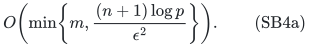

For fixed prime <code class="math">p</code>, this is <code class="math">O(n/\epsilon^2)</code>, matching the inherited joint lower bound in Section 7. The construction supplied by the proof of (SB4a) is polynomial in an explicitly listed <code class="math">p^{n+1}</code>-row classical query table; no algorithm polynomial in the compact quantum input is claimed for this sharper bound. The compact polynomial-time guarantee remains (SB3).

The additional input is the **whole-subgroup sparsification theorem** proved in 30_optimal_whole_subgroup_constraints.md. Its Gaussian symmetrization argument retains entire block predicates. It does not expand a block into separately weighted characters or individual check penalties.

## 1. Compact model and preprocessing

A normalized Weyl operator <code class="math">U</code> has a label <code class="math">u\in\mathbb F_p^{2n}</code>, satisfies <code class="math">U^p=I</code>, and obeys

<!-- math-display: 3273ddcac5a27ea844101dd1
UV=\omega^{[u,v]}VU,\qquad \omega=e^{2\pi i/p},
\tag{SB5}
-->
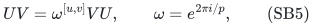

where <code class="math">[u,v]</code> is the symplectic form. For odd <code class="math">p</code>, use shift-clock tensor products with their scalar phase tracked modulo <code class="math">p</code>. For <code class="math">p=2</code>, use signed Hermitian Pauli strings, including the standard phase correction for <code class="math">Y</code>. The representation is symbolic; roots of unity need not be numerically expanded.

Absorb each required eigenvalue <code class="math">\omega^a</code> into its check by replacing <code class="math">U</code> with <code class="math">\omega^{-a}U</code>. For block <code class="math">e</code>, with its mutually commuting normalized checks <code class="math">U_{e,1},\ldots,U_{e,k_e}</code>, set

<!-- math-display: 7b82304a8b84a2fde2cf0a94
E_e=\prod_{j=1}^{k_e}\Pi_{U_{e,j},1},
\qquad
\Pi_{U,1}=\frac1p\sum_{a=0}^{p-1}U^a.
\tag{SB6}
-->
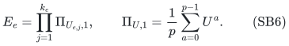

Finite-field elimination with phase tracking removes redundant checks. A dependency that produces a nonidentity scalar makes <code class="math">E_e=0</code>, so <code class="math">B_e=I</code>. All constant blocks can be represented exactly by one original constant block with their summed coefficient. A block with <code class="math">E_e=I</code> has zero penalty and is discarded. Every other block has a nonempty accepting subspace and at most <code class="math">n</code> projectively independent generators.

These operations, including testing whether two blocks contain a pair of noncommuting generators, require only polynomially many operations on <code class="math">O(n\log p)</code>-bit Weyl labels. Scalar phases are computed by modular Weyl multiplication and repeated squaring, so the running time is polynomial in <code class="math">\log p</code>, not in <code class="math">p</code>.

## 2. Noncommuting blocks have a constant spectral gap

**Lemma SB1.** Suppose block <code class="math">e</code> contains a check <code class="math">U</code> and block <code class="math">f</code> contains a check <code class="math">V</code> with <code class="math">UV=\omega^aVU</code>, <code class="math">a\ne0</code>. Then

<!-- math-display: 4a7db50f3e5ebc4e71e1ab82
\|E_eE_f\|\le p^{-1/2},
\qquad
B_e+B_f\succeq(1-p^{-1/2})I.
\tag{SB7}
-->
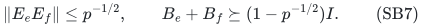

**Proof.** Write <code class="math">P=\Pi_{U,1}</code> and <code class="math">Q=\Pi_{V,1}</code>. For <code class="math">1\le j&lt;p</code>, the operator <code class="math">V^j</code> maps the <code class="math">1</code>-eigenspace of <code class="math">U</code> into its <code class="math">\omega^{aj}</code>-eigenspace. Thus <code class="math">PV^jP=0</code>, and

<!-- math-display: bacf25cd06c7340640fad572
PQP=P/p,\qquad \|PQ\|=p^{-1/2}.
-->
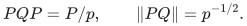

The accepting spaces of the two blocks lie in these individual eigenspaces. Hence

<!-- math-display: fa3ada17f4d0470bde1d3371
E_eE_f=E_ePQE_f,\qquad \|E_eE_f\|\le\|PQ\|.
-->
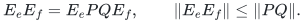

For orthogonal projections <code class="math">E,F</code>, <code class="math">E+F\preceq(1+\&#124;EF\&#124;)I</code>. Applying this inequality to <code class="math">E_e,E_f</code> and subtracting from <code class="math">2I</code> proves (SB7). <code class="math">\square</code>

The bound depends on the prime dimension, but is bounded below by the absolute constant <code class="math">1-2^{-1/2}</code>, independently of how many generators a block contains.

## 3. Balanced splitting leaves a commuting family of blocks

Maintain residual coefficients <code class="math">r_e=w_e</code> and peeled coefficients <code class="math">b_e=0</code>. While two positive residual blocks contain a noncommuting pair of generators, let <code class="math">d=\min(r_e,r_f)</code>, subtract <code class="math">d</code> from both residual coefficients, and add <code class="math">d</code> to both peeled coefficients.

Each step eliminates at least one positive residual coefficient, so at most <code class="math">m</code> steps occur. At termination, **every generator in every positive residual block commutes with every generator in every other residual block**. Write

<!-- math-display: faabccd99ed62b50f236c5a3
H=H_{\rm com}+H_{\rm gap},\qquad
H_{\rm com}=\sum_e r_eB_e,\quad
H_{\rm gap}=\sum_e b_eB_e,\quad W=\sum_e b_e.
\tag{SB8}
-->
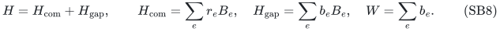

The exactly retained constant blocks may be added to <code class="math">H_{\rm com}</code>. Summing Lemma SB1 over all balanced pairs gives

<!-- math-display: 157d34b427cec2f7cf3419c6
H_{\rm gap}\succeq \beta_p W I,
\qquad
\beta_p=\frac{1-p^{-1/2}}2
\ge \frac{1-2^{-1/2}}2.
\tag{SB9}
-->
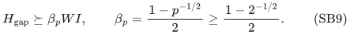

Since <code class="math">0\preceq B_e\preceq I</code>, the gapped part is easy to sample. If <code class="math">W&gt;0</code>, draw <code class="math">k</code> original block indices independently with probabilities <code class="math">b_e/W</code>, assigning coefficient <code class="math">W/k</code> to every draw. Matrix Chernoff, applied only in the proof after whitening by <code class="math">H_{\rm gap}^{-1/2}</code>, gives a relative <code class="math">1\pm\epsilon</code> approximation with failure probability at most <code class="math">\delta</code> when

<!-- math-display: d348446c1840bf0e001c8ad6
k=O\!\left(\frac{n\log p+\log(1/\delta)}{\epsilon^2}\right).
\tag{SB10}
-->
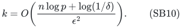

For clarity, the normalized norm of each draw is at most <code class="math">1/(\beta_pk)</code>, and the expected sum is the identity on dimension <code class="math">p^n</code>. The algorithm uses only the scalar weights <code class="math">b_e</code>, and never performs this whitening. If <code class="math">W=0</code>, this component is absent.

## 4. The commuting blocks are affine linear-algebra queries

Choose a projectively independent basis <code class="math">Q_1,\ldots,Q_r</code> from all generators of the commuting residual family. Their projective span is isotropic, so <code class="math">r\le n</code>. Each residual generator is exactly a scalar power of <code class="math">\omega</code> times a product of powers of these basis generators.

On a joint eigenvalue assignment <code class="math">Q_j=\omega^{x_j}</code>, <code class="math">x\in\mathbb F_p^r</code>, each block is represented by a matrix <code class="math">A_e</code> and a vector <code class="math">s_e</code>, and has penalty

<!-- math-display: de0470fadd6bd2623da494da
B_e(x)=\mathbf1[A_ex+s_e\ne0].
\tag{SB11}
-->
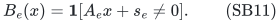

The right side is one if at least one equation in the block fails. Every simultaneous assignment occurs: expansion of the joint eigenspace projection has trace <code class="math">p^{n-r}</code>, since nontrivial products of projectively independent Weyl operators are traceless. In particular, preserving the scalar functions (SB11) preserves the entire commuting Hamiltonian in Loewner order.

Homogenize by setting <code class="math">y=(x,1)</code> and <code class="math">M_e=[\,A_e\ \ s_e\,]</code>. Let

<!-- math-display: 0f097beb81b24b76c31dab97
S_e=\mathrm{rowspan}_{\mathbb F_p}(M_e)
\subseteq\mathbb F_p^{d},\qquad d=r+1\le n+1.
\tag{SB12}
-->
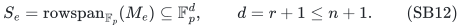

Then (SB11) is <code class="math">\mathbf1[M_ey\ne0]</code>. Different blocks can have different numbers of rows and different row ranks.

The following entirely classical consequence of quotient sparsification is the backend.

## 5. Classical backend: quotient sparsification and resparsification

**Lemma SB2 (finite-field block queries).** Given arbitrary matrices <code class="math">M_e</code> with <code class="math">d</code> columns over <code class="math">\mathbb F_p</code> and arbitrary nonnegative weights <code class="math">w_e</code>, there is a compact randomized polynomial-time algorithm returning nonnegative coefficients <code class="math">c_e</code>, with

<!-- math-display: 08e792bdd0677248c30dc3af
\sum_e c_e\mathbf1[M_ey\ne0]
\in(1\pm\epsilon)\sum_e w_e\mathbf1[M_ey\ne0]
\quad\text{for every }y\in\mathbb F_p^d,
\tag{SB13}
-->
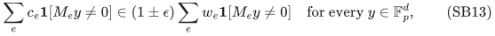

and support

<!-- math-display: 7e8fa745e98edfb7bd3ba045
O\!\left(
\frac{d\log(2d/\epsilon)}{\epsilon^2}
\right).
\tag{SB14}
-->
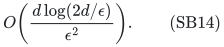

Neither the number of rows within a block nor the field size appears in the support bound. Both contribute to the input reading and rank-query costs.

**Proof.** Remove zero matrices. On the original block ground set, define the integer-valued monotone submodular rank function

<!-- math-display: b5df9bc2518a3f84fbc5eb38
f(T)=\dim_{\mathbb F_p}\left(\sum_{e\in T}S_e\right).
\tag{SB15}
-->
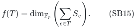

Its rank is at most <code class="math">d</code>, and its value oracle is ordinary finite-field elimination. For any query <code class="math">y</code>, its zero-block set

<!-- math-display: 47cfd9566bff6ec9efd4179a
Z_y=\{e:M_ey=0\}
-->
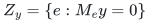

is closed for this rank function. Indeed, the span of the row spaces of zero blocks lies in <code class="math">y^\perp</code>; any block contained in that span also vanishes on <code class="math">y</code>. Therefore the active set <code class="math">\{e:M_ey\ne0\}</code> is a quotient, meaning the complement of a closed set.

Quanrud's Theorem 1.1 gives an <code class="math">O(d\log(2md)/\eta^2)</code>-support sparsifier preserving the weight of **every quotient**, for arbitrary nonnegative input weights, in randomized polynomial time with oracle access to <code class="math">f</code>. Every <code class="math">Z_y</code> intersected with a retained ground set remains closed by the identical row-span argument. Thus successive calls preserve all the same scalar queries.

Apply the adaptive resparsification lemma in 27_adaptive_quotient_resparsification.md. For completeness, while the current size <code class="math">m_i</code> exceeds a fixed polynomial in <code class="math">d/\epsilon</code>, choose a pass error proportional to
<!-- math-display: 554b7aa376abe6697784b2e2
\epsilon\sqrt{\frac{\log(2d/\epsilon)}{\log m_i}}.
-->
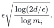
The next size is <code class="math">O(d\epsilon^{-2}(\log m_i)^2/\log(2d/\epsilon))</code>, which is at most <code class="math">\sqrt{m_i}</code> above a sufficiently large polynomial threshold. The preliminary errors sum to less than <code class="math">\epsilon/8</code>, because they increase geometrically as <code class="math">\log m_i</code> decreases. One final call at error <code class="math">\epsilon/4</code> gives (SB14), with total relative error at most <code class="math">\epsilon</code>.

The cited companion provides the exact threshold, the error product, and the confidence ledger. Preliminary call failures are bounded by fixed inverse powers of <code class="math">m_i</code>; their sum is bounded by a geometric series read backward through the square-root shrinkage. Together with the final call, the whole classical procedure can be set to succeed with probability above <code class="math">9/10</code>.

Every call uses a polynomial-time finite-field rank oracle. No vectors <code class="math">y</code>, failure scenarios, or row spaces absent from the input are enumerated. The number of calls is <code class="math">O(\log\log(2m))</code>, and the rational threshold weights have polynomial accumulated bit length, as detailed in the companion. If the support bound exceeds the number of input blocks, retain them all. <code class="math">\square</code>

**Attribution.** The rank-function quotient reduction and resparsification consequence are stated here to make the imported backend precise. In particular, a near-linear hedgegraph sparsifier is already known from the 2025 hedgegraph-polymatroid work; this lemma is not used to claim an improvement for hedgegraph cuts.

### 5.1 An alternative backend for the sharper existence bound

**Lemma SB3 (whole-block support existence).** For the same weighted matrices <code class="math">M_e</code>, there are coefficients satisfying (SB13) on

<!-- math-display: de0915b351213e813848e4fa
O\!\left(\min\{m,d\log p/\epsilon^2\}\right)
\tag{SB16}
-->
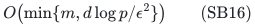

whole original blocks.

**Proof.** Take the additive group <code class="math">G=\mathbb F_p^d</code> and the subgroup <code class="math">H_e=\ker M_e</code> for each block. Then
<code class="math">\mathbf1[M_ey\ne0]=\mathbf1[y\notin H_e]</code>.
The whole-subgroup theorem applies to arbitrary subgroups and arbitrary nonnegative input weights, and gives support <code class="math">O(\log(2&#124;G&#124;)/\epsilon^2)=O(d\log p/\epsilon^2)</code> for <code class="math">d\ge1</code>. Zero blocks are discarded. Every retained item is an original matrix block, irrespective of its rank. The affine restriction <code class="math">y=(x,1)</code> in Section 4 is a subset of the queries already preserved. <code class="math">\square</code>

The companion proves the needed theorem using a hereditary one-sided Gaussian bound of <code class="math">1/&#124;G&#124;</code>, Gaussian symmetrization, and ordinary partial coloring. With all <code class="math">p^d</code> query rows listed, its separation oracle scans the defining inequalities. This is the source of the exponential-in-<code class="math">d\log p</code> table in the stated construction. Lemma SB3 is not substituted for Lemma SB2 in the compact polynomial-time algorithm.

## 6. Completing the quantum algorithm

Apply Lemma SB2 to the commuting residual family using its original block identities. Restrict (SB13) to <code class="math">y=(x,1)</code> and simultaneously diagonalize the commuting generators to obtain a relative spectral approximation of <code class="math">H_{\rm com}</code>.

Independently sample the gapped part with <code class="math">\delta=1/10</code> in (SB10). Set the entire classical procedure's success probability above <code class="math">9/10</code>. A union bound gives overall success greater than <code class="math">2/3</code>.

The relative inequalities for the two positive semidefinite components add directly. When a block was split between the two components, add its two output coefficients. Hence the output is a nonnegative reweighting of **whole original blocks**, as required.

The commuting support from (SB14) is

<!-- math-display: a9b5be1203244776c5e039cf
O\!\left(
\frac{(n+1)\log((n+2)/\epsilon)}{\epsilon^2}
\right).
-->
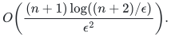

Adding (SB10) proves (SB3). The remaining <code class="math">\log p</code> contribution comes entirely from matrix concentration for the noncommuting component. One exactly retained constant block is absorbed by the <code class="math">n+1</code> term.

All Weyl algebra and all rank computations take place over compact finite-field labels. Each block's independent generators are computable in polynomial time. There are at most <code class="math">m</code> balanced subtraction steps, and the rational weights produced by them have polynomial encoding length. The classical calls use weighted, integer-rank instances of Quanrud's theorem. Standard rational implementations can use slack in <code class="math">\epsilon</code> when choosing sampling thresholds; their arithmetic involves rank values and scalar weights, not matrices over a cyclotomic field of dimension <code class="math">p</code>.

To prove the stronger existence bound (SB4a), keep the same balanced splitting and the same <code class="math">O(n\log p/\epsilon^2)</code>-term gapped-component sample, and use Lemma SB3 for the commuting residual family. Its homogeneous dimension is <code class="math">d\le n+1</code>, so its support is <code class="math">O((n+1)\log p/\epsilon^2)</code>. The two relative semidefinite inequalities again add, and coefficients on duplicate original blocks again merge. This proves (SB4a). The sharper classical backend affects only the commuting component; all block identities and the whole-block output requirement remain intact.

## 7. Lower bounds and model scope

For fixed prime dimension, the theorem gives <code class="math">O(n\log(n/\epsilon)/\epsilon^2)</code> retained blocks uniformly over unrestricted locality and unrestricted internal block size. The distinction from single Pauli checks is substantive: a block is penalized once when any of its internal equations fails, and its individual check penalties cannot be substituted for the block while preserving the original operator or output model.

Even individual commuting checks can require all <code class="math">n</code> terms: the <code class="math">n</code> separate requirements <code class="math">Z_i=1</code> are individually witnessed by computational basis states violating just one requirement.

There is also an inherited joint lower bound <code class="math">\Omega(n/\epsilon^2)</code>, for <code class="math">0&lt;\epsilon\le1/2</code> and <code class="math">n\ge2\lceil\epsilon^{-2}\rceil</code>. Put <code class="math">s=\lceil\epsilon^{-2}\rceil</code>, <code class="math">B=n-s\ge s</code>, and assign one single-generator block <code class="math">I-\Pi_{Z_uZ_v^{-1},1}</code> to each edge <code class="math">uv</code> of <code class="math">K_{s,B}</code>. On computational basis symbols restricted to <code class="math">\{0,1\}\subseteq\mathbb F_p</code>, each block is exactly that edge's Boolean crossing indicator. Therefore any spectral whole-block sparsifier is also a cut sparsifier of <code class="math">K_{s,B}</code>; equation (EC15) in 28_exact_label_cut_and_matroid_quotient_sparsification.md forces <code class="math">\Omega(B/\epsilon^2)=\Omega(n/\epsilon^2)</code> original blocks. All these checks commute and are two-local. This is the inherited classical cut lower bound. Thus for fixed <code class="math">p</code>, (SB4a) is jointly optimal in <code class="math">n</code> and <code class="math">\epsilon</code> in this regime, whereas the compact polynomial-time support is optimal up to its logarithm. No matching lower bound for the <code class="math">\log p</code> factor is asserted.

This does not imply sparsifiability of arbitrary projector-complement Hamiltonians. The argument uses both the constant overlap gap between conflicting stabilizer checks and the finite-field description of the commuting residual family. It also does not produce a ground-state optimizer.

The earlier <code class="math">O(n/\epsilon^2)</code> existential bound for single qubit checks therefore extends to whole stabilizer-subspace-complement blocks, with no internal-block-size loss. The compact algorithm also extends to this larger operator class, at its stated logarithmic overhead.

## 8. Primary sources and baseline boundary

* **Kent Quanrud, SODA 2024, _Quotient sparsification for submodular functions_.** Theorem 1.1: arbitrary weighted integral monotone submodular rank <code class="math">r</code>, ground-set size <code class="math">m</code>, support <code class="math">O(r\log(mr)/\epsilon^2)</code>, randomized polynomial time with a value oracle. This is the classical sparsification input to Lemma SB2. Primary manuscript: <https://kentq.s3.amazonaws.com/submodular-sparsification.pdf>. Publication: <https://doi.org/10.1137/1.9781611977912.187>.

* **Chandrasekaran, Chekuri, Wang, Zhu, 2025, _Hedgegraph Polymatroids_.** Theorem 7 already supplies weighted hedgegraph partition sparsifiers with <code class="math">O(n\log n/\epsilon^2)</code> support in randomized polynomial time. Section 6 makes explicit the quotient-sparsification connection. Primary source: <https://arxiv.org/html/2510.25043v1>.

* **Basu, Brakensiek, Putterman, May 2026, _Many Hamiltonians Are Sparsifiable_.** Theorem 3.5 gives fixed-locality qubit Pauli sparsification; the result here uses arbitrary stabilizer-block complements and has no locality parameter. The individual penalties and output model should be compared literally, without treating a sum of individual checks as one block. Primary source: <https://arxiv.org/html/2605.02211v1>.

* **Hostens, Dehaene, De Moor, 2005, _Stabilizer states and Clifford operations for systems of arbitrary dimensions, and modular arithmetic_.** Standard compact Weyl/stabilizer algebra background. Primary source: <https://arxiv.org/abs/quant-ph/0408190>.

* **Joel Tropp, _An Introduction to Matrix Concentration Inequalities_.** Matrix Chernoff is used for the constant-gap component. Primary source: <https://arxiv.org/abs/1501.01571>.

* **Brakensiek, Guruswami, Putterman, May 2026, _Multiplicative error set system sparsification: A simpler proof via chain length contraction_.** Theorem 1.2 supplies the stronger general set-system baseline <code class="math">O(c\log^2(c/\epsilon)(\log\log(c/\epsilon))^2/\epsilon^2)</code>, where <code class="math">c</code> is chain length; for finite-field whole-block queries <code class="math">c\le d</code>. This supersedes the older <code class="math">\log^6m</code> overhead of Brakensiek--Guruswami's group-code theorem. The new Gaussian companion removes this remaining logarithmic overhead for fixed-field subgroup blocks, and its broader group statement is compared separately there. Primary source: <https://arxiv.org/abs/2605.01508>.

* **Companion manuscript, _Optimal-support sparsification of whole subgroup constraints_.** 30_optimal_whole_subgroup_constraints.md supplies the new whole-subgroup theorem used only for (SB4a). Its proof depends on standard Gaussian comparison, the Reis--Rothvoss partial-coloring theorem, and a stated Gaussian version of their hereditary-section symmetrization argument. The compact polynomial-time bound (SB3) does not depend on this new lemma.

The quantum results are the whole-block constant-gap decomposition with the compact quotient backend, and its sharper support-existence consequence from the Gaussian whole-subgroup theorem. The two construction guarantees use different classical backends and remain separate throughout the proof.
