# A commuting surrogate and a constant-factor stabilizer witness for positive Pauli Hamiltonians

**Abstract.** We construct, in polynomial time in a compact positive-Pauli description, a commuting surrogate whose minimum energy is within a factor <code class="math">2+\sqrt2</code> of the original ground energy. Every state in the constructed stabilizer basis has the same energy for the original and surrogate Hamiltonians. Exact minimization of the resulting affine-parity objective yields a polynomial-size stabilizer witness; it takes <code class="math">2^n\mathrm{poly}(L)</code> time and polynomial space by enumeration. Prime-dimensional eigenvalue checks admit the analogous factor <code class="math">2(1+p^{-1/2})</code>.

## 1. Main statement

Let
<!-- math-display: c4709f603addcf5e007c6907
H=\sum_{e=1}^{m} w_e(I-P_e),\qquad w_e>0,
 \tag{1}
-->
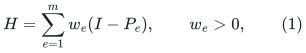
where each <code class="math">P_e</code> is an arbitrary-locality signed Hermitian Pauli string on <code class="math">n</code> qubits. Input strings have compact <code class="math">O(n)</code>-bit descriptions and weights are positive rationals. The identity shifts in (1) belong to the promised objective. Write <code class="math">E_0(H)=\lambda_{\min}(H)</code>.

**Theorem 1.** There is a deterministic polynomial-time reduction producing a maximal commuting Pauli basis <code class="math">\mathcal B</code> and a compact Hamiltonian <code class="math">K</code>, diagonal in <code class="math">\mathcal B</code>, such that
<!-- math-display: 6d04e4fede971506d28f725d
\frac{1}{1+1/\sqrt2}\,H
 \ \preceq\ K\ \preceq\
 (2+\sqrt2)H.
 \tag{2}
-->
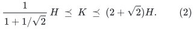
Every basis state <code class="math">\lvert s\rangle\in\mathcal B</code> has exactly the same energy for <code class="math">H</code> and <code class="math">K</code>:
<!-- math-display: 938cdd795ae17d16c9f55e60
\langle s|H|s\rangle=\langle s|K|s\rangle.
 \tag{3}
-->
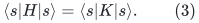
Consequently,
<!-- math-display: 730a51d837736dd1a31f0483
E_0(H)\le E_0(K)\le (2+\sqrt2)E_0(H),
 \tag{4}
-->
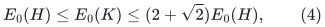
and a stabilizer basis state minimizing <code class="math">K</code> is a <code class="math">2+\sqrt2</code> approximation to the true ground energy.

The output <code class="math">K</code> is a scalar plus an explicitly given positive weighted affine-parity objective on at most <code class="math">n</code> bits. Thus exact enumeration yields a deterministic
<!-- math-display: b2962a591599ef790557a46d
2^n\mathrm{poly}(n,m,\text{input bit length})
-->
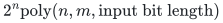
time algorithm using polynomial space and outputting an <code class="math">O(n^2)</code>-bit stabilizer tableau with the guarantee (4). If only <code class="math">d\le n</code> independent diagonal Pauli labels occur in <code class="math">K</code>, enumeration needs <code class="math">2^d</code> assignments instead.

More generally, an <code class="math">\alpha</code>-approximation for this particular nonnegative affine-parity objective, including its scalar term, yields an <code class="math">\alpha(2+\sqrt2)</code>-approximation for <code class="math">H</code>. This is an explicit classical reduction, not a claim that arbitrary weighted parity minimization has an efficient constant-factor algorithm.

The theorem also gives a small classical witness: for any <code class="math">a\ge0</code>, the promise problem
<!-- math-display: 2dfec2a834a61304820e9af6
E_0(H)\le a
 \quad\text{versus}\quad
 E_0(H)>(2+\sqrt2)a
 \tag{5}
-->
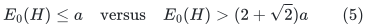
has an NP verifier using a stabilizer-state tableau. Expectation values of the input Pauli strings on such a tableau lie in <code class="math">\{-1,0,1\}</code> and are computable in polynomial time. A rational comparison margin can be added if desired; the fixed algebraic constant itself causes no arithmetic difficulty.

## 2. Weighted peeling

Two signed Hermitian Pauli strings either commute or anticommute. If <code class="math">P,Q</code> anticommute, then
<!-- math-display: c029ed2f0e8823337235aec2
(P+Q)^2=2I,\qquad
 (2-\sqrt2)I\preceq 2I-P-Q\preceq(2+\sqrt2)I.
 \tag{6}
-->
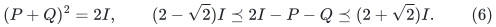

Initialize residual coefficients <code class="math">a_e=w_e</code>. Whenever two positive residual coefficients <code class="math">a_e,a_f</code> belong to anticommuting strings, set
<!-- math-display: a96709d8c95d3c756fc41aef
d=\min(a_e,a_f),
-->
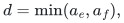
subtract <code class="math">d</code> from both, and record the balanced pair <code class="math">d(2I-P_e-P_f)</code>. Each iteration sets at least one positive residual coefficient to zero. After at most <code class="math">m</code> iterations,
<!-- math-display: 975b1074451aba143c6f697a
H=H_{\rm com}+\sum_j d_j(2I-P_j-Q_j),
 \qquad d_j>0,\quad \{P_j,Q_j\}=0,
 \tag{7}
-->
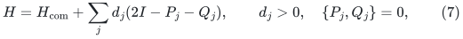
and all strings with positive coefficient in <code class="math">H_{\rm com}</code> commute pairwise.

The pair records may reuse an original index across iterations; their total assigned coefficient is still at most its original coefficient. Equation (7) is exact. Binary symplectic products test commutation, and rational subtraction preserves polynomial encoding length.

## 3. Pinch in a computable stabilizer basis

Let <code class="math">L\subseteq\mathbb F_2^{2n}</code> be a maximal isotropic subspace extending the projective span of the strings in <code class="math">H_{\rm com}</code>. Symplectic Gaussian elimination constructs <code class="math">L</code> in polynomial time. Choose <code class="math">n</code> independent commuting Hermitian representatives generating a common eigenbasis <code class="math">\mathcal B</code>. Signs in a dependent list need not be simultaneously <code class="math">+1</code>; no such assumption is made.

Let <code class="math">\mathcal E_L</code> be dephasing in this complete basis. Equivalently, it is averaging conjugation by the <code class="math">2^n</code>-element abelian Pauli group generated by those representatives. For a signed Pauli <code class="math">P</code>,
<!-- math-display: 3c9dfc775e4cc97c4d5e73d2
\mathcal E_L(P)=
 \begin{cases}
 P,&\text{if the projective label of }P\text{ belongs to }L,\\
 0,&\text{otherwise}.
 \end{cases}
 \tag{8}
-->
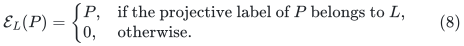
Indeed, membership in the centralizer of a maximal isotropic subspace is membership in that subspace; outside it, conjugation by some generator reverses the sign. This test is finite-field linear algebra and does not require an exponential average.

Set <code class="math">K=\mathcal E_L(H)</code>. Residual clauses are fixed. At most one member of an anticommuting pair belongs to <code class="math">L</code>, so its image is one of
<!-- math-display: 4c2782041e38c608dc3f4e21
C=2I,\qquad C=2I-P,\qquad C=2I-Q.
 \tag{9}
-->
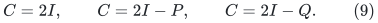

Write
<!-- math-display: 4873a7f1910d9a65a124bab1
\kappa=2+\sqrt2,\qquad \beta=1+\frac1{\sqrt2}.
-->
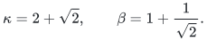
For <code class="math">B=2I-P-Q</code>, we claim
<!-- math-display: d993d710e5c8e5813a7b7a45
C\preceq\kappa B,\qquad B\preceq\beta C
 \tag{10}
-->
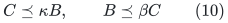
in all three cases.

If <code class="math">C=2I</code>, both statements follow immediately from (6). If <code class="math">C=2I-P</code>, then
<!-- math-display: 5aee4fe7f356f0c9b8710cfe
\kappa B-C
 =2(\kappa-1)I-(\kappa-1)P-\kappa Q.
-->
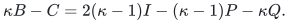
For anticommuting involutions, <code class="math">(uP+vQ)^2=(u^2+v^2)I</code>, so this matrix is positive semidefinite whenever
<!-- math-display: 5bfbbcc4192d3d329664938c
2(\kappa-1)\ge\sqrt{(\kappa-1)^2+\kappa^2}.
 \tag{11}
-->
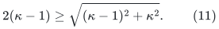
The smallest admissible constant in this case is <code class="math">(3+\sqrt3)/2</code>, which is below <code class="math">\kappa</code>. Similarly,
<!-- math-display: f843b401bdb826ebe0b04d69
\beta C-B=2(\beta-1)I-(\beta-1)P+Q
-->
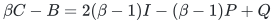
is positive semidefinite whenever <code class="math">3(\beta-1)^2\ge1</code>. Its sharp constant is <code class="math">1+1/\sqrt3&lt;\beta</code>. The <code class="math">2I-Q</code> case is identical.

Apply (10) to every recorded pair and leave the nonnegative commuting residual unchanged. Summing proves (2). Equation (8) also shows (3), since every erased Pauli has zero expectation on each state in <code class="math">\mathcal B</code>.

A basis state attaining <code class="math">E_0(K)</code> therefore has <code class="math">H</code>-energy <code class="math">E_0(K)</code>, proving the first inequality in (4). The second follows from <code class="math">K\preceq\kappa H</code>, evaluated on a ground state of <code class="math">H</code>. This completes the theorem.

## 4. Explicit classical objective and computational interpretation

Each retained diagonal input Pauli has an expression
<!-- math-display: 5f4d21f9e2ef4ba344bc3959
P_e=(-1)^{s_e}\prod_{j=1}^{n}Q_j^{v_{ej}},
-->
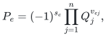
where <code class="math">Q_1,\ldots,Q_n</code> generate <code class="math">L</code>. On their eigenvalue assignment <code class="math">Q_j=(-1)^{x_j}</code>,
<!-- math-display: 6791a99f97580017ceaa7be7
\langle x|K|x\rangle
 =
 \sum_{\mathrm{label}(P_e)\notin L} w_e
 +2\sum_{\mathrm{label}(P_e)\in L}
       w_e\,\mathbf1[s_e+v_e\cdot x=1].
 \tag{12}
-->
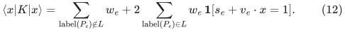
All arithmetic in the indicator is over <code class="math">\mathbb F_2</code>. The discarded-from-the-basis terms remain in (12) as an exact scalar. Terms with <code class="math">P=-I</code> are handled by a constant affine row; zero <code class="math">P=I</code> clauses can be removed.

An optimal assignment gives the signs of a complete stabilizer tableau. The enumeration can retain just a current assignment, its rational energy, and the best assignment seen, so its space is polynomial. It never constructs a <code class="math">2^n\times2^n</code> matrix or stores a length-<code class="math">2^n</code> state vector.

The remaining minimization contains the familiar weighted affine-parity problem. For example, clauses <code class="math">I+Z_iZ_j</code> encode unsatisfied cut constraints. The reduction is useful because it isolates the quantum noncommutation cost with a uniform relative guarantee; it does not remove the classical optimization component.

For <code class="math">E_0(H)=0</code>, the conclusion gives a zero-energy stabilizer witness. The exact zero test itself is standard: all positive-weight Pauli clauses must commute, and their requested eigenvalue equations must be consistent. An anticommuting pair precludes a common <code class="math">+1</code> eigenvector, and commuting consistency is checked by phase-aware binary elimination.

## 5. A state-dependent alternative and the remaining constant gap

There is also a short existence proof of the same variational factor that does not use peeling. Fix any quantum state <code class="math">\rho</code>. The signed input Paulis with
<!-- math-display: 8c34ce4ebc783336e6b23221
\mathrm{Tr}(\rho P)>1/\sqrt2
-->
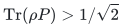
commute pairwise: for anticommuting <code class="math">P,Q</code>,
<!-- math-display: c655fb6168d837fbe14bf9e9
\mathrm{Tr}(\rho P)^2+\mathrm{Tr}(\rho Q)^2\le1.
-->
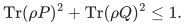
Extend their span to a maximal commuting Pauli space and dephase <code class="math">\rho</code> in its stabilizer basis. A retained expectation is unchanged. An erased expectation <code class="math">x\le1/\sqrt2</code> has new penalty <code class="math">1</code>, and
<!-- math-display: d52d21abde4bf119590993fd
1\le(2+\sqrt2)(1-x).
-->
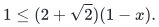
The resulting mixture of stabilizer basis states has energy at most <code class="math">(2+\sqrt2)\mathrm{Tr}(\rho H)</code>; one pure member is at least as good. Unlike Theorem 1's basis construction, this argument uses expectation information about <code class="math">\rho</code>, so it is not the constructive reduction used above.

The true best universal ratio for stabilizer states is not settled by either argument. A one-qubit example already requires
<!-- math-display: 40c843de6d77bea8a04b6015
\frac{\min_{\text{stabilizer }\psi}\langle\psi|(2I-X-Z)|\psi\rangle}
      {\lambda_{\min}(2I-X-Z)}
 =
 \frac1{2-\sqrt2}
 =
 1+\frac1{\sqrt2}.
 \tag{13}
-->
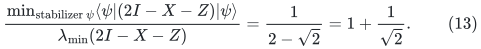
Thus the present results leave a gap between <code class="math">1+1/\sqrt2</code> and <code class="math">2+\sqrt2</code>.

The larger constant is sharp for arbitrary choices in the stated peeling-and-extension procedure. Take
<!-- math-display: 06fa3d75317a804637ab93a8
H_\eta=(I-X)+(I-Y)+\eta(I-Z),\qquad \eta>0.
-->
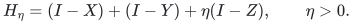
Peeling the <code class="math">X,Y</code> pair first leaves <code class="math">\eta(I-Z)</code>, forcing the <code class="math">Z</code> basis on one qubit. Then
<!-- math-display: f2ac5bb208b1922759ec7a7c
E_0(K)=2,\qquad E_0(H_\eta)=2+\eta-\sqrt{2+\eta^2},
-->
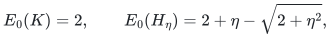
and their ratio tends to <code class="math">2+\sqrt2</code> as <code class="math">\eta\downarrow0</code>. This is a limitation of that allowed basis choice, not a lower bound on the optimal stabilizer state. A different basis gives a better answer on this example.

## 6. Prime-dimensional Weyl checks

The same reduction extends to positive single-eigenvalue checks on <code class="math">n</code> qudits of prime dimension <code class="math">p</code>. Let <code class="math">U_e</code> be compact Weyl operators normalized so that <code class="math">U_e^p=I</code>, let <code class="math">\lambda_e</code> be a specified <code class="math">p</code>-th root of unity, and put
<!-- math-display: d18c16de8f20c9db033e4085
E_e=\Pi_{U_e,\lambda_e},\qquad
 H=\sum_e w_e(I-E_e).
 \tag{14}
-->
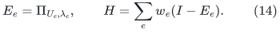
Scalar operators give the constant checks <code class="math">E_e=0</code> or <code class="math">I</code> and can be handled directly. For a nonscalar Weyl operator, its spectral projector has rank <code class="math">p^{n-1}</code>. The model retains an entire eigenvalue check; it is not the different objective <code class="math">I-\mathrm{Re}U_e</code>.

**Corollary 2.** A deterministic reduction polynomial in <code class="math">n,m,\log p</code>, and the rational input bit length produces one complete stabilizer basis and a diagonal Hamiltonian <code class="math">K</code> such that every basis state has equal <code class="math">H</code>- and <code class="math">K</code>-energy and
<!-- math-display: 11ee970e357378cfc66445e1
K\preceq\kappa_p H,\qquad
 E_0(H)\le E_0(K)\le\kappa_p E_0(H),\qquad
 \kappa_p=2(1+p^{-1/2}).
 \tag{15}
-->
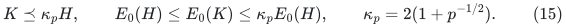
Enumeration takes <code class="math">p^n\mathrm{poly}(n,m,\log p,\text{input bit length})</code> time and polynomial space, and outputs a stabilizer tableau of polynomial bit length. This is not a polynomial-time optimizer when the Hilbert-space dimension is exponential in the compact input.

To prove the corollary, peel equal coefficient mass from every noncommuting pair until the residual Weyl operators commute. If <code class="math">E,F</code> are the accepted-eigenvalue projectors of a noncommuting pair, Weyl commutation gives
<!-- math-display: 9282b5969061e347792a5ecb
EFE=p^{-1}E,\qquad FEF=p^{-1}F.
-->
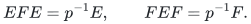
Indeed, sandwich the Fourier expansion of <code class="math">F</code> between <code class="math">E</code>'s; all its nonconstant Weyl powers change the <code class="math">U</code>-eigenvalue and vanish. Writing <code class="math">u=p^{-1/2}</code>, this also gives
<!-- math-display: c6372c181ed1ae86a7883289
(1-u)I\preceq B:=2I-E-F.
 \tag{16}
-->
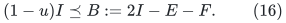
Extend the residual projective labels to a maximal isotropic subspace <code class="math">L\subseteq\mathbb F_p^{2n}</code> and pinch in its complete stabilizer eigenbasis. A projector whose Weyl label lies in <code class="math">L</code> is fixed. If its label lies outside <code class="math">L</code>, every nonzero power also lies outside <code class="math">L</code>, since <code class="math">p</code> is prime; all of those powers are erased by pinching. Consequently its pinching is exactly <code class="math">I/p</code>. At most one of a noncommuting pair can have its label in <code class="math">L</code>.

If neither is retained, the pair image is
<!-- math-display: e25872662f7321ce3c53796b
C=2(1-u^2)I\preceq2(1+u)B
-->
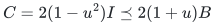
by (16). If only <code class="math">E</code> is retained, then <code class="math">C=(2-u^2)I-E</code>. For nonnegative <code class="math">a,b</code>, the constant-angle relation <code class="math">EFE=u^2E</code> gives
<!-- math-display: 43e2aead013dc158a7f891c6
\lambda_{\max}(aE+bF)
 =\frac{a+b+\sqrt{(a-b)^2+4ab u^2}}2.
 \tag{17}
-->
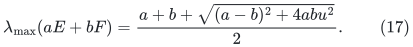
One way to see this is to split the two ranges into two-dimensional principal-angle blocks; in every block the overlap is <code class="math">u</code>. Any common orthogonal complement contributes eigenvalue zero.

Thus <code class="math">C\preceq\kappa B</code> follows when
<!-- math-display: 2dcfb9133e49101e8b900933
2\kappa-3+2u^2\ge
 \sqrt{1+4u^2\kappa(\kappa-1)}.
-->
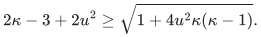
At <code class="math">\kappa=2+2u</code>, the left side is <code class="math">1+4u+2u^2&gt;0</code>, and the left square minus the right square is
<!-- math-display: a729a06265c34f0e1a6b90a8
4u(1-u^2)(2+3u)>0.
-->
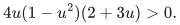
The case retaining only <code class="math">F</code> is identical. Summing these inequalities over the peeled pairs and leaving the positive commuting remainder fixed proves <code class="math">K\preceq\kappa_p H</code>. Pinching preserves every energy on its basis states, which proves the ground-energy statements exactly as in Theorem 1.

The diagonal objective consists of positive weighted affine equations over <code class="math">\mathbb F_p</code> together with the scalar contribution
<!-- math-display: c6ed24e073eef492f587b830
(1-1/p)\sum_{\mathrm{label}(U_e)\notin L} w_e.
-->
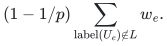
Its evaluation and a complete stabilizer tableau use only finite-field and phase arithmetic. Independent generators of <code class="math">L</code> realize all <code class="math">p^n</code> eigenvalue assignments, so direct enumeration is valid without constructing Hilbert-space matrices.

Even one qudit requires a best-stabilizer ratio at least <code class="math">1+p^{-1/2}</code>: for two noncommuting checks, the true minimum of <code class="math">2I-E-F</code> is <code class="math">1-p^{-1/2}</code>, whereas its minimum over qudit stabilizer states is <code class="math">1-1/p</code>. The factor <code class="math">2(1+p^{-1/2})</code> is sharp for arbitrary allowed basis choices in this reduction. Peel two equally weighted noncommuting checks first and leave an arbitrarily small positive weight on a third Weyl check whose projective direction differs from both. Its basis gives energy tending to <code class="math">2(1-1/p)</code>, while the original ground energy tends to <code class="math">1-p^{-1/2}</code>. This again limits that basis choice, not the optimal stabilizer approximation ratio.

## 7. Relation to public baselines

- **Sun, Cheng, and Zhang, _Stabilizer ground states for simulating quantum many-body physics: theory, algorithms, and applications_, Quantum 9, 1782 (2025), arXiv:2403.08441v4.** They study optimizing a general Pauli Hamiltonian over stabilizer states, characterize the relevant closed commuting subsets, and give special one-dimensional algorithms. These are direct antecedents for the variational class and classical tableau output. The checked general statements and Section 2.5 do not state the multiplicative positive-clause guarantee (4). Primary source: <https://arxiv.org/html/2403.08441v4>.

- **Robin, _Stabilizer-Accelerated Quantum Many-Body Ground-State Estimation_ (2025), arXiv:2505.02923v2.** This studies decomposing a Hamiltonian into a stabilizer component and a remainder and uses the resulting state as a simulation starting point. It is an antecedent for commuting-component variational ideas, but the checked paper gives model-specific analyses rather than the all-input bound (2). Primary source: <https://arxiv.org/html/2505.02923v2>.

- **Macêdo et al., _Every Little Thing Heat Does Is Magic_ (2026), arXiv:2604.08663v1.** Sections V and Appendix B study the additive stabilizer energy gap, give perturbative criteria and model examples, and reduce exact stabilizer-energy optimization to commuting subsets. This is another direct antecedent for the energy-witness interpretation. The checked statements do not supply the uniform multiplicative positive-clause ratio or the single-basis operator reduction above. Primary source: <https://arxiv.org/html/2604.08663v1>.

- **Le Gall, _Classical Algorithms for Constant Approximation of the Ground State Energy of Local Hamiltonians_, ESA 2025.** This supplies <code class="math">2^{O(n)}</code>-time, polynomial-space approximation algorithms for general constant-locality Hamiltonians. Its approximation definition is additive error <code class="math">\epsilon\sum_i\&#124;H_i\&#124;</code>, as specified at the start of the paper. Equation (4) instead bounds error relative to <code class="math">E_0(H)</code>, can handle arbitrary Pauli locality, and produces a classical stabilizer witness. These are different guarantees; this note does not claim a general improvement over that more general Hamiltonian algorithm. Primary source: <https://drops.dagstuhl.de/storage/00lipics/lipics-vol351-esa2025/LIPIcs.ESA.2025.73/LIPIcs.ESA.2025.73.pdf>.

- **Xu, Schwonnek, and Winter, _Bounding the Joint Numerical Range of Pauli Strings by Graph Parameters_, PRX Quantum 5, 020318 (2024), arXiv:2308.00753; Xu et al., _Simultaneous variances of Pauli strings, weighted independence numbers, and a new kind of perfection of graphs_ (2025), arXiv:2511.13531.** These analyze Pauli joint expectation sets, anticommutation graphs, and spectral lower bounds. They warn against assuming that every graph is described by its ordinary independent-set polytope: the latter paper explicitly treats a special graph class, with counterexamples outside it. No such perfectness assumption enters (2). Primary sources: <https://arxiv.org/pdf/2308.00753> and <https://arxiv.org/pdf/2511.13531>.

- **Coble, Coudron, Nelson, and Nezhadi, _Local Hamiltonians with No Low-Energy Stabilizer States_, TQC 2023.** Their constructions use more general positive local projectors, including non-Clifford rotations of Pauli checks. They do not contradict this note: writing those operators as signed Pauli sums requires additional identity shifts to obtain the specific positive-clause model (1), and multiplicative approximation is sensitive to that shift. Primary source: <https://drops.dagstuhl.de/storage/00lipics/lipics-vol266-tqc2023/LIPIcs.TQC.2023.14/LIPIcs.TQC.2023.14.pdf>.

The pair decomposition supplies a constructive reduction with an explicit operator bound and a classical witness. Its approximation guarantee is relative to the supplied positive-clause objective, including its identity terms.
