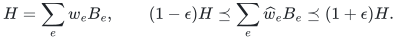
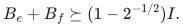
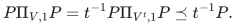
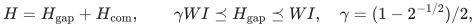
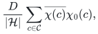
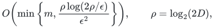
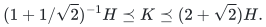
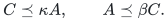
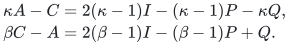

# Proofs for whole stabilizer-block sparsification and energy witnesses

## 1. Operator model

Let <code class="math">D=\prod_jq_j</code> and <code class="math">Q=2\mathrm{lcm}_jq_j</code>. Each original block consists of mutually commuting, compactly represented Weyl operators of order dividing <code class="math">Q</code>, with required eigenvalues absorbed into their phases. Write <code class="math">E_e</code> for the joint acceptance projector and <code class="math">B_e=I-E_e</code>. Inconsistent blocks have <code class="math">E_e=0</code>; an empty or universally accepting block has <code class="math">B_e=0</code>. The target is

<!-- math-display: ca35c3668f7d20cf0191eb9f
H=\sum_ew_eB_e,\qquad
(1-\epsilon)H\preceq\sum_e\widehat w_eB_e\preceq(1+\epsilon)H.
-->

The final coefficients refer to whole original blocks.

## 2. Constant gap and balanced splitting

**Lemma 1.** If finite-order Weyl operators obey <code class="math">UV=\zeta VU</code>, with <code class="math">\zeta</code> of order <code class="math">t\ge2</code>, then their accepted-eigenvalue projectors satisfy <code class="math">\&#124;\Pi_{U,1}\Pi_{V,1}\&#124;\le t^{-1/2}</code>. If two blocks contain such a conflicting pair, then

<!-- math-display: 1bdfe473dc6e04616fae1092
B_e+B_f\succeq(1-2^{-1/2})I.
-->

**Proof.** Sandwich the Fourier projector <code class="math">Q^{-1}\sum_{a=0}^{Q-1}V^a</code> by <code class="math">P=\Pi_{U,1}</code>. Every exponent not divisible by <code class="math">t</code> changes the <code class="math">U</code>-eigenvalue and vanishes, giving

<!-- math-display: 6694ac9093e7929c551e15a4
P\Pi_{V,1}P=t^{-1}P\Pi_{V^t,1}P\preceq t^{-1}P.
-->

The block acceptance spaces are subspaces of the respective single-check spaces, so their projector-product norm is at most <code class="math">t^{-1/2}\le2^{-1/2}</code>. For orthogonal projectors, <code class="math">E+F\preceq(1+\&#124;EF\&#124;)I</code>. Subtracting from <code class="math">2I</code> proves the claim. <code class="math">\square</code>

**Lemma 2.** Polynomially many rational coefficient operations produce

<!-- math-display: f80d786b72ebfcaa3824ea00
H=H_{\mathrm{gap}}+H_{\mathrm{com}},\qquad
\gamma WI\preceq H_{\mathrm{gap}}\preceq WI,
\quad \gamma=(1-2^{-1/2})/2,
-->

where all generators of the residual <code class="math">H_{\mathrm{com}}</code> commute globally and <code class="math">W</code> is the total coefficient assigned to <code class="math">H_{\mathrm{gap}}</code>.

**Proof.** Whenever two positive residual blocks conflict, subtract the minimum of their coefficients from both and assign that amount to both removed blocks. Each operation eliminates at least one residual block, so there are at most <code class="math">m</code> operations. Sum Lemma 1 over these balanced pairs. Each pair contributes twice the removed amount to <code class="math">W</code>, proving the lower bound. The upper bound follows from <code class="math">0\preceq B_e\preceq I</code>. On termination no cross-block generators conflict. An item may appear in both parts; its final coefficients are added. <code class="math">\square</code>

If <code class="math">W&gt;0</code>, sample original blocks with probability proportional to their removed coefficients. Matrix Chernoff, used only in the proof after whitening, needs <code class="math">O((\log(2D)+\log(1/\delta))/\epsilon^2)</code> samples. The algorithm computes no quantum matrix: it samples a rational distribution. If <code class="math">W=0</code>, this part is absent.

## 3. Whole-block support existence

**Theorem 3.** There is a whole-block spectral sparsifier on <code class="math">O(\log(2D)/\epsilon^2)</code> original blocks. Its supplied randomized construction is polynomial in <code class="math">D</code> and the remaining encoding and accuracy parameters.

**Proof.** Let <code class="math">\mathcal H</code> be the abelian group of actual Weyl operators generated by the commuting remainder, and <code class="math">\mathcal C</code> its scalar subgroup. A non-scalar Weyl operator has trace zero. Character orthogonality gives the multiplicity of a character <code class="math">\chi</code> as

<!-- math-display: 1c0b5cb2aa5a66c9864d726e
\frac{D}{|\mathcal H|}\sum_{c\in\mathcal C}
\overline{\chi(c)}\chi_0(c),
-->

where <code class="math">\chi_0</code> is the physical scalar character. This is <code class="math">D&#124;\mathcal C&#124;/&#124;\mathcal H&#124;</code> for every extension of <code class="math">\chi_0</code>, and zero otherwise. The occurring characters therefore form one torsor under <code class="math">\widehat{\mathcal H/\mathcal C}</code>, of size at most <code class="math">D</code>.

On this torsor, a block accepts either a coset of a subgroup or no characters at all. The [affine subgroup theorem](../group-metric-constraints/manuscripts/affine-constraints-over-arbitrary-finite-groups.md) retains <code class="math">O(\log(2D)/\epsilon^2)</code> whole block predicates while preserving every character value. Since the remainder is diagonal in these eigenspaces, that scalar guarantee is precisely its Loewner guarantee. Add it to the gapped approximation and merge coefficients assigned to the same input block. Relative PSD inequalities add without additional error. Finally <code class="math">&#124;\mathcal H&#124;\le DQ\le2D^2</code>, so an explicit character-table construction is polynomial in <code class="math">D</code>. <code class="math">\square</code>

## 4. Compact construction without factoring

**Theorem 4.** In randomized polynomial time in the compact binary input and <code class="math">\epsilon^{-1}</code>, one can retain

<!-- math-display: a2a4897c324d8505d1cde9ca
O\!\left(\min\left\{m,
\frac{\rho\log(2\rho/\epsilon)}{\epsilon^2}\right\}\right),
\qquad \rho=\log_2(2D),
-->

whole blocks with success probability at least <code class="math">2/3</code>, without factoring the local dimensions.

**Proof.** For a block subset <code class="math">S</code>, let <code class="math">\mathcal H_S</code> be its generated subgroup. Compute its projective displacement image using the lattice generated by the displacement columns and the diagonal modulus lattice. Hermite normal form gives the image order. An integer basis of the relation lattice identifies every displacement relation; compact Weyl multiplication maps those basis relations to scalar phases. A gcd with <code class="math">Q</code> gives the scalar subgroup order. The product is <code class="math">&#124;\mathcal H_S&#124;</code>. Normal forms, products, and gcds have polynomial bit complexity; scalar relations cannot be discarded.

The rank <code class="math">f(S)=\log_2&#124;\mathcal H_S&#124;</code> is normalized, monotone, and submodular, with unit positive-marginal gap and total rank <code class="math">O(\rho)</code>. For any physical character, its zero-block set is closed: a block already in the subgroup generated by zero blocks must also be annihilated by that character.

Apply the [exact rational rank theorem](../group-metric-constraints/manuscripts/rational-quotient-ranks-from-weak-oracles.md) to the integer-order oracle. Its concave transform and canonical-key rounding produce an exact rational rank with the same closures, the same unit positive-marginal gap, and rank <code class="math">O(\rho)</code>. Quanrud's quotient theorem and [adaptive resparsification](../label-block-cut/manuscripts/adaptive-quotient-resparsification.md) then preserve all physical character queries on <code class="math">O(\rho\log(2\rho/\epsilon)/\epsilon^2)</code> whole blocks. Use constant failure budgets for this construction and the gapped sample, then add their PSD guarantees. The complete relation-lattice and fixed-denominator ledger is in [Sections 5–6 of the general-dimensional manuscript](manuscripts/arbitrary-dimension-whole-stabilizer-blocks.md). <code class="math">\square</code>

For prime local dimension <code class="math">p</code>, the commuting projective span has field dimension at most <code class="math">n</code>, so ordinary integer rank after affine homogenization is at most <code class="math">n+1</code>. The commuting support is then <code class="math">O((n+1)\log((n+2)/\epsilon)/\epsilon^2)</code>, while the gapped sample contributes <code class="math">O(n\log p/\epsilon^2)</code>. Their sum is the sharper prime-dimensional compact bound in [Theorem SB](manuscripts/arbitrary-locality-stabilizer-block-sparsification.md).

Positive Pauli clauses <code class="math">I-P</code> are twice their accepted-eigenvalue projector penalties. The Pauli manuscript additionally preserves the total coefficient exactly and provides a distinct correlated-deletion theorem. Arbitrary deletions do not preserve a single precomputed balanced-pair decomposition; its robust construction uses hereditary importance and common label-pool scores instead.

## Randomness and confidence

Both the compact construction of Theorem 4 and the explicit-dimension
construction accompanying Theorem 3 are Monte Carlo. Their sampling is
classical preprocessing randomness. For the latter, assign failure budget
<code class="math">1/6</code> to the gapped matrix-Chernoff sample and <code class="math">1/6</code> to the commuting
explicit-character-table construction. The
[group-theorem confidence argument](../group-metric-constraints/proof.md#randomness-and-confidence)
uses bounded fresh partial-coloring trials and explicit table verification
to attain that fixed confidence without changing support asymptotics.
The union bound gives success at least <code class="math">2/3</code> for the full Loewner guarantee,
simultaneously over all states. Theorem 4 already allocates constant failure
budgets to its gapped sample and quotient sparsifier in the same way.

The separate correlated-Pauli theorem uses a single event of probability at
least <code class="math">1-\delta</code> for all allowed failures and states; it does not rerandomize
coefficients at query time. The globally commuting failure construction
inherits the quotient theorem's simultaneous success at least <code class="math">2/3</code>.
These statements do not assert a Las Vegas guarantee. The surrogate-basis
reduction in Section 5 and the stated exhaustive exact optimization over
that basis are deterministic.

## 5. A classical stabilizer witness

**Theorem 5.** Let <code class="math">H=\sum_e w_e(I-P_e)</code> on <code class="math">n</code> qubits, where each <code class="math">P_e</code> is a compact Hermitian signed Pauli string and each <code class="math">w_e</code> is a nonnegative rational. Let <code class="math">L</code> count the explicit <code class="math">n</code>-qubit inventory and the full binary input description; zero-weight clauses may be discarded. A deterministic polynomial-time reduction gives a complete stabilizer basis and a diagonal Hamiltonian <code class="math">K</code> with

<!-- math-display: 7befc32289f0f14635efacf6
(1+1/\sqrt2)^{-1}H\preceq K\preceq(2+\sqrt2)H.
-->

Every state of that basis has the same <code class="math">H</code>- and <code class="math">K</code>-energy. Consequently a basis state minimizing <code class="math">K</code> has energy at most <code class="math">(2+\sqrt2)E_0(H)</code>.

**Proof.** Repeatedly peel the minimum residual coefficient from an anticommuting pair. Each step removes one positive residual coefficient, so after at most <code class="math">m</code> steps the residual family commutes and the recorded weighted pair terms give an exact decomposition. Phase-aware binary symplectic elimination extends its projective span to a maximal isotropic space. Independent commuting Hermitian representatives give a complete stabilizer basis; dependent input signs need not all be simultaneously positive.

Let <code class="math">K</code> be the pinching of <code class="math">H</code> in this basis. A Pauli label in the maximal isotropic space is fixed. Every other label anticommutes with a basis generator, so averaging its two conjugates erases it. At most one member of an anticommuting pair can be fixed. Thus, for <code class="math">A=2I-P-Q</code>, its pinching <code class="math">C</code> is one of <code class="math">2I</code>, <code class="math">2I-P</code>, and <code class="math">2I-Q</code>. Put <code class="math">\kappa=2+\sqrt2</code> and <code class="math">\beta=1+1/\sqrt2</code>. We show

<!-- math-display: 4881dcef694450a1bf04b582
C\preceq\kappa A,\qquad A\preceq\beta C.
-->

For <code class="math">C=2I</code>, the eigenvalues of <code class="math">P+Q</code> are bounded by <code class="math">\sqrt2</code> in magnitude, since <code class="math">(P+Q)^2=2I</code>. Both inequalities follow, using <code class="math">\kappa(2-\sqrt2)=2</code> and <code class="math">2\beta=2+\sqrt2</code>.

For <code class="math">C=2I-P</code>, the two differences are

<!-- math-display: bb213e250b0ddf1b310ac01c
\begin{aligned}
\kappa A-C&=2(\kappa-1)I-(\kappa-1)P-\kappa Q,\\
\beta C-A&=2(\beta-1)I-(\beta-1)P+Q.
\end{aligned}
-->

Because <code class="math">(aP+bQ)^2=(a^2+b^2)I</code>, positivity of these differences follows from <code class="math">3(\kappa-1)^2-\kappa^2=3+2\sqrt2&gt;0</code> and <code class="math">3(\beta-1)^2-1=1/2&gt;0</code>, respectively. The <code class="math">C=2I-Q</code> case is symmetric. The fixed commuting remainder is positive, and <code class="math">\beta,\kappa\ge1</code>, so adding every pair inequality proves the claimed operator comparison for <code class="math">H,K</code>.

Pinching preserves every diagonal matrix element in its defining basis. Hence a basis state minimizing <code class="math">K</code> has the same original energy <code class="math">E_0(K)</code>, which is at least <code class="math">E_0(H)</code>. Evaluating <code class="math">K\preceq\kappa H</code> on a ground state of <code class="math">H</code> gives <code class="math">E_0(K)\le\kappa E_0(H)</code> and proves the witness guarantee. <code class="math">\square</code>

The diagonal objective is a nonnegative scalar plus weighted affine parity penalties. Enumeration on its <code class="math">d\le n</code> independent labels costs <code class="math">2^d\mathrm{poly}(L)</code> time and polynomial space, producing a stabilizer tableau. [The full witness proof](manuscripts/commuting-surrogates-and-stabilizer-energy-witnesses.md) supplies the constants, prime-dimensional factor <code class="math">2(1+p^{-1/2})</code>, and basis-choice lower examples. The polynomial-time reduction does not solve its remaining classical minimization in polynomial time.

**Attribution:** Yilin Liu and GPT-6 Astra Pro.
