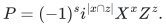
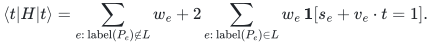
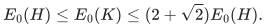

# Native compact Pauli stabilizer witnesses

The [constructor](reference/pauli_witness.py) realizes Theorem 1 of the
[witness manuscript](manuscripts/commuting-surrogates-and-stabilizer-energy-witnesses.md).
The [independent verifier](reference/verify_witness.py) checks the exact energy
of a complete stabilizer tableau against the original positive Pauli clauses.
This is the Pauli witness interface; prime-dimensional Weyl checks and the
separate sparsification theorems retain their own implementation boundaries.

## Original phase convention and balanced decomposition

A Pauli record contains two nonnegative binary masks and a sign bit. The
corresponding signed Hermitian operator is

<!-- math-display: 652b9ce151bb035aa5c1feb9
P=(-1)^s i^{|x\cap z|}X^x Z^z.
-->

Thus an overlapping pair of mask bits represents the standard Pauli Y matrix.
Multiplication adds the two phases and twice the overlap of the left Z mask
with the right X mask, then takes exclusive-or of corresponding masks.
The usual symplectic overlap tests commutation. All original clauses have
strictly positive rational weights and include their identity shifts.

Balanced peeling repeatedly subtracts the smaller residual weight from two
anticommuting original clauses. It records both original IDs and the exact
amount. At least one residual coefficient disappears each iteration, so
there are at most as many iterations as clauses. The recorded pairs and the
remaining coefficients reconstruct every original weight exactly, including
when one original record occurs in several pairs. The remaining projective
labels commute pairwise.

## Complete stabilizer basis and phase-aware diagonal objective

Binary elimination extracts independent residual labels. While there are
fewer generators than qubits, solve the symplectic orthogonality equations
and select a kernel vector outside their span. An isotropic subspace of
dimension below the qubit count has a strictly larger orthogonal complement,
so such a vector exists. Appending it preserves isotropy. The result is a
maximal isotropic basis; canonical Hermitian representatives commute and are
independent. All assignments to their eigenvalue signs describe unique pure
stabilizer states. No inconsistent dependent signs are assumed positive.

For every original Pauli, binary elimination either finds its coordinates in
this basis or proves nonmembership. If coordinates exist, exact multiplication
of the selected generators determines its additional sign. This phase step
is necessary: projective dependence alone does not determine the operator.
A nonmember has zero expectation on every state of the basis, since some
basis generator anticommutes with it. Its entire original weight remains as
a scalar term. A member contributes the exact nonnegative affine parity
penalty. Consequently every basis assignment has identical original and
surrogate energy:

<!-- math-display: 30b2f82792f963b52cbd0eda
\langle t|H|t\rangle
=\sum_{e:\,\mathrm{label}(P_e)\notin L}w_e
 +2\sum_{e:\,\mathrm{label}(P_e)\in L}
 w_e\,\mathbf{1}[s_e+v_e\cdot t=1].
-->

Identity clauses contribute zero, and negative-identity clauses contribute
twice their weight, even with zero qubits. All original locality and duplicate
records are allowed. Peeling determines the basis, but the objective is
compiled from the **original** weights rather than residual weights.

The manuscript's pairwise operator inequalities apply to exactly this
balanced decomposition and maximal extension. Summing them and preserving
the commuting remainder proves the original approximation guarantee:

<!-- math-display: 35b42dc97bc1731b0055b909
E_0(H)\le E_0(K)\le(2+\sqrt2)E_0(H).
-->

No ground-state computation or Hilbert-space matrix is needed in the reduction.

## Effective-rank enumeration and original witness verification

Extract independent rows from the masks of the diagonal parity equations.
If their binary rank is `d`, the linear map to these independent parities is
surjective. For each of the `2^d` possible parity values, triangular binary
elimination recovers one full generator assignment with all free variables
fixed to zero. Every other diagonal parity is a combination of these rows,
so the objective is constant within each fiber. Enumerating these assignments
therefore finds the exact minimum in the constructed basis. It is not an
exact minimum over all stabilizer bases or all quantum states.

The output records signed independent generators for their common positive
eigenstate and its exact rational original energy. The independent verifier
imports no constructor, optimizer or shared phase routine. It checks the
complete tableau's commutation and rank, solves original label membership,
and multiplies local operators with the explicit Pauli multiplication table.
Nonmembers have zero expectation; members have expectation plus or minus
one. Summing the original positive-clause penalties verifies the claimed
energy. The verifier checks the supplied witness's actual energy, not a claim
of global optimality or an arbitrary caller's approximation ratio.

Reduction, objective evaluation and verification require polynomial work in
qubits, clauses and original bit length. The conservative implementation
uses ordinary binary elimination and repeated pair scans, with separately
charged rational arithmetic. Search takes `2^d` times polynomial work and
polynomial space; it retains no assignment list, state vector or dense
operator. The tableau has a quadratic number of binary entries. Helper
functions and manually instantiated surrogate records are internal building
blocks; the validated constructor and original-input verifier define the
public input contract.

## Independent executable evidence

The [checker](verify/check_witness.py) compares exact original energies for
all basis states in small generated instances. Its dense computational-basis
Pauli action and stabilizer projectors are independent of both elimination
implementations and use only exactly representable dyadic complex entries.
It exercises phase-dependent relations, inconsistent commuting signs,
negative identities, empty objectives and 100-digit rational data. An
80-qubit example has parity rank one, so native search examines only two
assignments. Verification also runs after disabling all producer routines.
The finite matrix checks support the symbolic arbitrary-size argument; they
are not a numerical proof of the operator approximation inequality.

**Attribution:** Yilin Liu and GPT-6 Astra Pro.
