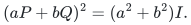

# Verification and scope

[Main proof](../proof.md) · [Source dependencies](../sources.md)

## Available finite arithmetic evidence

The shared [composite-modulus quotient-rounding checker](../../group-metric-constraints/verify/check_quotient_rounding.py) can be run from the repository root:

~~~sh
python3 problems/group-metric-constraints/verify/check_quotient_rounding.py
~~~

It enumerates six fixed whole blocks in <code class="math">\mathbb Z_6^3</code>, all 64 subsets, and all 4,096 ordered subset pairs. It checks rational logarithm enclosures, fixed-denominator rounding, preservation of zero marginals, positive gaps, and submodularity.

This exercises a finite arithmetic component of the compact rank interface. It does not certify HNF subgroup orders, test the quantum operator identities, or establish the all-state sparsification theorem. There is no dedicated executable for those general quantum claims.

## Symbolic operator identities

The quantum arguments do not depend on numerical diagonalization.

- For anticommuting involutions,
  <!-- math-display: 39213bfa2a144044a4183a1f
  (aP+bQ)^2=(a^2+b^2)I.
  -->
  
  This gives the pair eigenvalue bounds and commuting-surrogate constants.
- If <code class="math">UV=\zeta VU</code>, sandwiching by the accepted-eigenvalue projector <code class="math">P</code> gives <code class="math">PV^jP=0</code> unless the commutator order divides <code class="math">j</code>. The surviving Fourier terms give projector overlap at most <code class="math">1/\sqrt2</code> for a conflicting pair, including composite and heterogeneous local dimensions.
- Character orthogonality and the trace-zero property of non-scalar Weyl operators give the common multiplicity <code class="math">D&#124;\mathcal C&#124;/&#124;\mathcal H&#124;</code> for a commuting subgroup. The scalar subgroup <code class="math">\mathcal C</code> is part of the formula.

Every output coefficient belongs to a whole original block. Balanced removal of conflicting pairs merges coefficients on shared original blocks; it does not turn block generators into separate selectable items.

## Compact algebra and construction

The physical commuting spectrum is a character torsor with size dividing <code class="math">D</code>. The compact order oracle multiplies the displacement-image order by the scalar-relation order. Omitting the latter would lose inconsistent-phase information. Integer relation lattices, modular products, and gcd computations require no factoring oracle.

The logarithmic rank is passed through an exact rational surrogate before applying the value-oracle backend. The prime-field theorem retains its separate, sometimes smaller, additive <code class="math">\log p</code> dependence. Optimal support and the compact randomized support with logarithmic overhead remain distinct guarantees.

## Energy witnesses and failures

The witness argument uses a complete maximal isotropic space. Pinching fixes its diagonal Paulis and erases the others while preserving every resulting basis-state energy. The classical parity objective is optimized by the stated exponential enumeration; polynomial construction of a commuting surrogate is not polynomial optimization of that objective.

The ordinary theorem allows noncommuting original blocks. Its decomposition is not reused after arbitrary clause deletion. Correlated Pauli failures use a separate hereditary-importance argument, while the exact-label whole-block failure theorem requires global commutation. These are clause deletions as defined in the respective manuscripts, not physical loss of a quantum subsystem.

**Attribution:** Yilin Liu and GPT-6 Astra Pro.
