# Prefix rank additivity and eager release for resource matroids

The algorithm maintains rank additivity for every ordered center prefix,
including prefixes ending inside a layer, and immediately processes a
stored center when its designated blockers become redundant.

**Theorem 1.** Let <code class="math">M</code> have rank <code class="math">r\ge1</code>. For arbitrary recipient
matroids, a deterministic algorithm returns an allocation with minimum
utility at least <code class="math">T_{\rm conf}/d</code>, where <code class="math">T_{\rm conf}</code> is the
coupled configuration optimum and
<!-- math-display: d0dbdddf2e9b184bc9e3ac4a
d=4-\frac3r.
-->
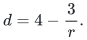
Its time is <code class="math">2^{O(r)}\mathrm{poly}(H)</code> and its space is
polynomial. For any positive rational <code class="math">\eta</code>, factor <code class="math">d+\eta</code> is
obtained in
<!-- math-display: 36901d7897b7e27583b68d70
\mathrm{poly}(H)
 \min\{2^{O(r)},(r+1)^{O((1+\eta^{-1})\log(r+1))}\}.
 \tag{P1}
-->
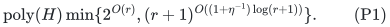
With a certified factor-<code class="math">\lambda</code> local availability oracle, replace
<code class="math">d</code> by <code class="math">\lambda^{-1}+3-3/r</code>. Input and oracle costs, including
all rational accuracy bits, are paid in <code class="math">H</code>.

## 1. Model, comparator, and player-side operations

There is an explicit player set <code class="math">P</code>, a player-selection matroid <code class="math">M</code>,
and resources <code class="math">j</code> of common intrinsic value <code class="math">v_j\ge0</code>. Resource <code class="math">j</code>
may serve exactly the player sets independent in its supplied recipient
matroid <code class="math">R_j</code>; a player receives at most one service from each resource.
The output selects an actual <code class="math">M</code>-basis and gives its players feasible
resource bundles. Unused capacity is allowed.

The certified local approximation parameter is rational and satisfies
`0 < lambda <= 1`. Optionally each player has a downward-closed family <code class="math">\mathcal F_p</code>
of allowed resource subsets. On an available resource list, its paid
oracle returns a feasible bundle of value at least <code class="math">\lambda</code> times
the best available feasible bundle. Unrestricted availability has
<code class="math">\lambda=1</code>.

At target <code class="math">T</code>, let <code class="math">\mathcal C_p(T)=\{C\in\mathcal F_p:v(C)\ge T\}</code>,
including only individually permitted services. The coupled
configuration relaxation has nonnegative variables <code class="math">z_{pC}</code> and
constraints
<!-- math-display: a7d4534274d4e964a12c7ed7
\begin{aligned}
 x_p&=\sum_{C\in\mathcal C_p(T)}z_{pC},&
 x&\in B(M),\\
 y_{pj}&=\sum_{C\ni j}z_{pC},&
 y_{\cdot j}&\in P(R_j).
 \end{aligned}
 \tag{P0}
-->
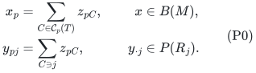
Its largest feasible target is <code class="math">T_{\rm conf}</code>. Configurations may
be exponentially numerous. They and a feasible fractional point are
not part of the input, and the algorithm does not solve this LP.
They are used only to prove the soundness of its obstruction
certificate. The implied small-resource relaxation has
<code class="math">0\le y_{pj}\le x_p</code> and <code class="math">\sum_jv_jy_{pj}\ge Tx_p</code>;
with local families it also retains their row perspective
<code class="math">y_p\in x_p\mathrm{conv}\{\mathbf1_C:C\in\mathcal F_p\}</code>.

We use the earliest fundamental-circuit exchange, last-layer refresh,
and bounded integer signature from
[the current-blocker player search](../../manuscripts/allocation-and-scheduling/matroid-allocation-current-blocker-quasipolynomial.md)
and its
[player-side invariant proof](../../manuscripts/allocation-and-scheduling/matroid-allocation-current-blocker-quasipolynomial.md).
The resource invariants and normalization needed for this extension
are established below. Let <code class="math">B&gt;0</code> be the desired bundle threshold and
let <code class="math">u</code> be the largest retained resource value, or zero if none.
Zero-valued resources are discarded. Rank zero is the empty allocation;
target zero is attained by any player basis with empty bundles.

The current matching consists of k<r minimal B-bundles with independent
owner set I. Current matching **records**, not just player names, identify
the objects in blocker groups. Layers contain selected centers. Each
center c has a disjoint designated group D(c) of current matching records.
The resource bundle and owner of a retained record do not change.

Within each layer order centers by insertion time, and concatenate layers
in increasing layer order. All new blocked centers are appended to the
last layer. An exchange truncates whole higher layers, never reorders the
remaining centers, and never inserts a center before a retained center.

For an ordered prefix S of centers and a resource j, define

<!-- math-display: 0b20d3eff1abf304d71bfef6
\begin{split}
 Y(S)&=\bigcup_{c\in S}D(c),\\
 X_j(S)&=\{p(c):c\in S,\ j\in c\},\\
 Y_j(S)&=\{p(b):b\in Y(S),\ j\in b\},\\
 W_j(S)&=X_j(S)\cup Y_j(S),\\
 U_j(S)&=M_j\setminus Y_j(S).
 \end{split}
 \tag{P2}
-->
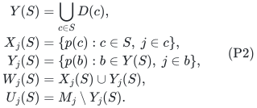

Here M_j is the actual current matching's recipient set. The
distinctness invariant is retained: selected occurrences using j have
distinct owners, and X_j is disjoint from M_j. Set notation never merges
two services to the same player-resource pair.

At layer i, player eligibility is

<!-- math-display: 6d985d257cdde4c9ba71a4b6
p\notin\mathrm{cl}_M(I\setminus\mathrm{owners}(Y_{<i})).
 \tag{P3}
-->
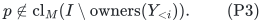

Use the **one-at-a-time earliest-layer player circuit exchange**.
For a free owner outside cl_M(I), augment. For an already matched owner,
remove its own earlier marked record. For a new spanned owner, remove a
record in the earliest blocker layer met by its fundamental circuit.
That layer h is strictly smaller than i. Keep X_h, remove the one outgoing
record from Y_h, and truncate every layer above h. By the cited player-side invariant proof, every retained layer's eligibility flat stays
identical, including layer h. Below h both X and Y records are identical.

## 2. Three resource invariants

In addition to universal reservations, maintain two prefix statements.

### 2.1 Universal simultaneous reservations

For every actual subset Z of selected centers and every resource j,

<!-- math-display: 2a8aa480fe90a6e02819093c
(M_j\setminus\mathrm{owners}(D(Z)))
        \mathbin{\dot\cup}X_j(Z)\in\mathcal I(R_j).
 \tag{P4}
-->
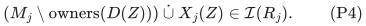

This remains an inductively maintained theorem. The algorithm does not
enumerate Z.

### 2.2 Prefix rank additivity

For every ordered prefix S and every resource j, require

<!-- math-display: d5775370627703f97e2bfcf7
r_j(W_j(S)\cup U_j(S))
             =r_j(W_j(S))+|U_j(S)|.
 \tag{P5}
-->
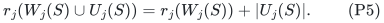

Equivalently, the currently unmarked matching recipients are independent
after contracting the flat spanned by the selected-plus-marked prefix.
W_j(S) need not itself be independent. For the empty prefix, (P5) is
exactly independence of the actual matching recipient set M_j.

### 2.3 Current inherited birth availability

For a retained center c, let S^-_c be the centers strictly preceding it.
For every resource j in c, require

<!-- math-display: 7dc1bb671c37a1b921a35a4a
p(c)\notin\mathrm{cl}_{R_j}(W_j(S^-_c)).
 \tag{P6}
-->
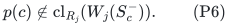

This is a current invariant, not a stored numerical birth charge. It is
true when c is chosen. Afterwards, the preceding center records remain
the same, their designated groups can only lose matching records, and
new centers are appended after c. Thus the set on the right can only
shrink while c is retained. A newly inserted matching record is unmarked
and does not enter any old group. Consequently (P6) persists literally.

## 3. Dependency-filtered completion preserves every prefix

During a last-layer scan, use the accepted availability test

<!-- math-display: 0b1f4d0ff624228f5f51f561
p\notin\mathrm{cl}_{R_j}(X_j\cup Y_j),
 \tag{P7}
-->
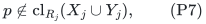

where X,Y are the entire current center/blocker prefix. Find a feasible
minimal B-bundle c from available resources, using the exact or certified
approximate local oracle and subsequent ordinary minimality pruning.

Call a resource j used by c **problematic** when

<!-- math-display: ae57c86555a71b5bc7c00763
p\in\mathrm{cl}_{R_j}(X_j\cup M_j).
 \tag{P8}
-->
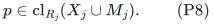

Designate the following records:

<!-- math-display: c14e1810291bc09826f0e1ae
D(c)=\bigcup_{j\in c:\ (P8)}
       \{b:\ b\text{ is a current matching record outside }Y,\ j\in b\}.
 \tag{P9}
-->
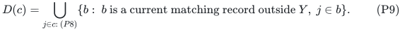

Every designated blocker shares a problematic resource with c. If D(c)
is nonempty, append c with that group. Otherwise process c as a fresh
free candidate; it need not be stored.

For (P4), at a problematic used resource, deleting D(c) removes every
unmarked matching recipient. Each prospective reservation before adding
p is an independent subset of X_j union Y_j. Availability (P7) extends
it. At a nonproblematic used resource, p lies outside the span of
X_j union M_j, which contains every old reservation. Unused resources
only lose matching recipients. This proves all new subset cases at once.
Distinct receiving names follow exactly as in the accepted proof: an
eligible already-matched player has its own old record in an earlier Y,
so all resources of that old record were unavailable.

Old ordered prefixes in (P5) do not change. For the new prefix, fix j and
write W,U for the previous prefix. The completion moves a subset A of U
to W. Independence of U over W implies independence of U minus A over
W union A. There are three cases:

* If j is unused, this movement is the whole change.
* If j is used and nonproblematic, p is outside cl(W union U); adjoining
  p preserves independence of the remaining U minus A over W union A.
* If j is problematic, (P9) moves **all** of U to W. The new unmarked
  set is empty, and (P5) is automatic.

Thus completion preserves every prefix instance of (P5). The new (P6)
is precisely (P7), while old instances are unchanged.

If D(c) is empty, no used resource can be problematic. Otherwise (P9)
would contain a matching record, unless U were empty; in that latter
case (P8) would contradict (P7). Therefore a fresh free candidate satisfies

<!-- math-display: 2b8e9e223edfdc603fb5840c
p\notin\mathrm{cl}_{R_j}(M_j\cup X_j)
                         \quad(j\in c).
 \tag{P10}
-->
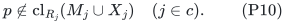

This stronger form of freedom will pay for preservation of (P5).

## 4. Empty groups and redundant groups are strongly free

For a stored center c, let S=S^-_c followed by c. For j in c, put

<!-- math-display: 5bd6190fd8dd2c30e0c2ef82
V_j=W_j(S^-_c)\cup
           \{p(b):b\in D(c),\ j\in b\}.
 \tag{P11}
-->
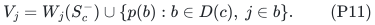

Suppose

<!-- math-display: 316254eee9ad0f119abbc4da
p(c)\notin\mathrm{cl}_{R_j}(V_j)
                          \quad\hbox{for every }j\in c.
 \tag{P12}
-->
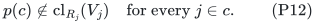

Then c is **strongly free relative to the earlier centers**:

<!-- math-display: fa312af2e0eb5292ddfa6e98
p(c)\notin\mathrm{cl}_{R_j}(M_j\cup X_j(S^-_c))
                             \quad(j\in c).
 \tag{P13}
-->
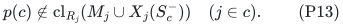

Indeed, by (P5) for S, the remaining unmarked set U_j(S) is independent
over V_j plus p(c). Hence

<!-- math-display: 087bba247da210f2627da115
r_j(V_j\cup\{p(c)\}\cup U_j(S))
       =r_j(V_j)+1+|U_j(S)|.
-->
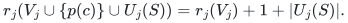

The rank without p(c) is at most r_j(V_j)+|U_j(S)|. This strict rank
increase proves (P13), because V_j union U_j(S) equals
M_j union X_j(S^-_c). No representability assumption is used.

For an empty group, (P12) follows immediately from (P6). This proves
strong freedom of every ordinary stored free center. For **any nonempty
group**, test (P12) by ordinary rank/independence queries. When it holds,
process c immediately as free even though its conservative group still
contains matching records. When it fails, there is a used resource j
at which the owner is spanned by the preceding prefix and the current
group's services. In particular, for D(c)={b}, there is a resource with

<!-- math-display: 5402885d41adb15d3d4ab393
p(c)\in\mathrm{cl}_{R_j}
               (W_j(S^-_c)\cup\{p(b)\}),\qquad j\in b.
 \tag{P14}
-->
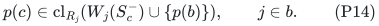

The final membership j in b is forced by (P6): without that service,
V_j would equal the earlier W_j and could not span p(c).

This is the repair missing from the birth-saving counterexample. The
algorithm never assumes that the dependence at birth persists. It tests
the **current** prefix and either obtains a current dependence witness
or makes a genuine free exchange.

## 5. A strong free exchange preserves every retained prefix

Suppose c was found in layer i, either as a fresh free candidate, an
empty-group stored center, or a stored center passing (P12). Its owner
remains eligible by (P3) and the earliest player-exchange flat lemma.
If it does not augment, the chosen outgoing matching record b lies in
a strictly earlier layer h<i. Every center retained after the exchange
therefore precedes c in the ordered list.

By (P10) or (P13), for every resource used by c its owner p lies outside
the span of the old M_j together with **all retained** selected recipients.
Consequently it can be added to every retained reservation (P4), even
before deleting b. Deleting b then preserves independence. As before,
removing a record from both M and its old designated group does not
reintroduce it into a reservation that had already excluded it. The new
matching record has no inherited blocker flag. Distinctness is also
immediate from the strong span condition.

Now fix any retained ordered prefix S, including an internal prefix in
layer h. Its X_j(S) set does not change. Before inserting the incoming
service, delete the old service of b if present. If b was in Y(S), this
deletes one element from W; independence of U over W remains true after
contracting the smaller flat. If b was unmarked for S, this deletes an
element from U; that also preserves independence over W. If b did not
use j, nothing changes. The incoming service, when present, lies outside
the span of the entire old W union U, by strong freedom. It is a new
unmarked element and is therefore independent over the post-deletion
W union U. This proves (P5) for the new prefix.

Removing higher layers does not change any retained prefix. Releasing
their groups does not change actual matching allocations and does not
change which records belong to the retained Y(S). The above argument
already treated all records outside Y(S) as unmarked, including records
formerly designated in those higher layers. Thus no extra assumption
about released records is hidden here.

Finally, (P6) persists by its shrinking-prefix argument. Every retained
center remains player-eligible by the earliest exchange lemma. Below h,
the X and Y records, hence every resource closure used in the old failed
scan, are literally unchanged. Their player eligibility flats are also
unchanged. Their old maximality statements remain true. Only last layer
h needs a fresh scan and a new growth test.

The same proof covers replacement by a player already in I: eligibility
forces its old record into Y_<i, and its own record is the outgoing one.
Strong resource freedom excludes reuse of its old resources in c.

## 6. Normalization is a paid sequence of existing-signature decreases

Before a completed maximality/growth test, normalize the current state:

1. Immediately process any empty-group stored center as strongly free.
2. Scan every stored center. If it passes (P12), process that center as
   strongly free, then repeat normalization.
3. Stop when every group is nonempty and every center has a current
   resource dependency on its earlier prefix plus its current group.
   For singleton groups this witness has exactly the form (P14).

An exchange may remove a dependency witness for several later centers,
even though only one designated group loses a record. That is why step
2 scans **all** stored centers, not just the group containing
the deleted record. The scan costs only polynomially many original
matroid queries on O(r)-element sets.

No free candidate is removed from X, and no redundant group is released,
as a standalone charged mutation. Instead perform the usual atomic
earliest player exchange and the consequent truncation. For an eager
release from layer i, its entire old layer is discarded because h<i.
At layer h, X_h is unchanged and Y_h loses exactly the outgoing matching
record. Thus the same signature

<!-- math-display: 7801307b81a28754aade695c
(-|X_1|,|Y_1|,\ldots,-|X_\ell|,|Y_\ell|,\infty)
 \tag{P15}
-->
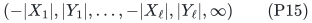

strictly decreases. A successful augmentation ends the phase. A
nonaugmenting normalization exchange strictly lowers the index of the
last retained layer, so one normalization episode has at most r such
exchanges. Empty groups can be processed first, preserving the accepted
one-free-center cascade convention. Blocked insertions, ordinary free
exchanges, and appending an empty last layer retain their existing
signature decreases.

Between charged changes, a full normalization scan and a full candidate
scan cost polynomial work. A failed scan either completes the current
layer, returns a certificate, or is followed by a layer append. There is
no uncharged repetition of scans at the same state.

At a fully normalized state, every group is nonempty, so |X|<=|Y|<=k.
During a free cascade or an eager release, no selected center is added.
Therefore total selected and blocker counts remain at most k. The
accepted bounded-integer-composition proof still gives 2^{O(r)} possible
signatures. Under positive current layer growth, the accepted
rank-quasipolynomial depth and signature count also apply.

## 7. The sharp current rank-cover coefficient

At a normalized completed prefix, define the same cover

<!-- math-display: 9b9f75b3a7cc2181aa5b1b97
\Phi=\sum_j v_j r_j(X_j\cup Y_j).
 \tag{P16}
-->
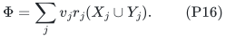

Telescope this rank over the ordered center prefixes. Put a=min(u,B).
Every current blocker still shares a resource with its assigned center,
because record bundles are immutable. There are three cases.

First, suppose c is a singleton resource j of value at least B. Every
blocker in D(c) contains j and, by minimality, is itself the singleton
resource j. Since c did not pass normalization, its owner is dependent
on the previous W_j and its current t=|D(c)| blocker recipients. Thus
the current prefix rank increment is at most t, not t+1. Its cover
increment is at most t v_j<=t u.

Second, suppose c is nonsingleton and t>=2. Each of its resource values
is below B. Every blocker contains a shared resource below B; minimality
then prevents that blocker from containing any resource of value at
least B. Thus c and all its blockers have value below B+a. Their rank
increment is at most the sum of those service values, giving

<!-- math-display: 3c51c1b73f86eea95c7683d6
\Delta\Phi_c<(t+1)(B+a)\le t(2B+a).
 \tag{P17}
-->
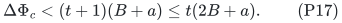

The last inequality is (t-1)B>=a, valid for t>=2 and a<=B.

Third, suppose c is nonsingleton and D(c)={b}. Normalization gives a
current witness j from (P14). At j,
adjoining p(c) after the blocker service does not increase rank. Thus
the rank increment saves at least v_j compared with separately counting
both service occurrences. At every other resource, cardinality remains
an upper bound. Minimality of b implies v(b)-v_j<B, hence

<!-- math-display: 30d7b200247617b7987bc62c
\Delta\Phi_c\le v(c)+v(b)-v_j<2B+a.
 \tag{P18}
-->
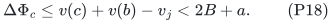

This saving uses the **current ordered prefix**. It is not the invalid
claim that a dependency charge established at birth survives unchanged.
The groups partition Y and the increments telescope, giving

<!-- math-display: 05a3aad98a918317db767c87
\Phi\le C(B,u)|Y|,\qquad
 C(B,u)=\max\{u,\ 2B+\min(u,B)\}.
 \tag{P19}
-->
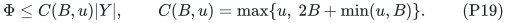

In particular, for u<=B,

<!-- math-display: 17a9cc0ecb6df3d303b44b4c
C(B,u)=2B+u.
 \tag{P20}
-->
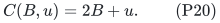

**Lemma 2 (fractional lower cover).** At a completed failed available
scan, a feasible compact point at target <code class="math">T</code> implies
<!-- math-display: 362d82d9a0585e859fffdb88
\Phi>(T-B/\lambda)w,\qquad B\le\lambda T,
 \tag{P20a}
-->
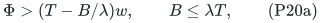
where <code class="math">w=r-k+&#124;Y_{&lt;i}&#124;</code>.

**Proof.** Let <code class="math">J_0=I\setminus\mathrm{owners}(Y_{&lt;i})</code> and
<code class="math">E=P\setminus\mathrm{cl}_M(J_0)</code>. Because <code class="math">x\in B(M)</code>,
<code class="math">x(E)\ge r-r_M(J_0)=w</code>. For resource <code class="math">j</code>, an unavailable player
lies in <code class="math">\mathrm{cl}_{R_j}(X_j\cup Y_j)</code>. Its total fractional
receiving mass is at most the rank of that closure, so the total
unavailable value is at most <code class="math">\Phi</code>.

For an eligible player with <code class="math">x_p&gt;0</code>, restrict each configuration
in its row perspective to its available resources. Downward closure
keeps these restricted bundles feasible. The complete failed
factor-<code class="math">\lambda</code> scan says that every such available bundle has
value strictly below <code class="math">B/\lambda</code>. Hence its available fractional
value is strictly below <code class="math">Bx_p/\lambda</code>, whereas total fractional
value is at least <code class="math">Tx_p</code>. Summing the unavailable value over <code class="math">E</code>
gives
<code class="math">\Phi&gt;(T-B/\lambda)x(E)\ge(T-B/\lambda)w</code>.
At least one positive <code class="math">x_p</code> occurs because <code class="math">w&gt;0</code>, so the
strictness is preserved. <code class="math">\square</code> Write tau=1/lambda and rho=(r-1)/r. The sufficient exact
boundary condition is therefore

<!-- math-display: e302b3cb8e222a20b18a7f2e
\tau B+\rho C(B,u)\le T.
 \tag{P21}
-->
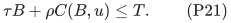

If a newly completed layer has no blocker, its entire cover uses only
the preceding s blockers, and s/w<=rho. Inequality (P21) contradicts
the strict lower cover, yielding a sound infeasibility certificate.

For positive gap Delta=T-tau B-rho C(B,u)>0, a completed layer with
y<=gamma w contradicts the lower cover whenever

<!-- math-display: f6ae864295f0cd4cb768132c
\gamma\le\min\{1/2,\Delta/(2C(B,u))\}.
 \tag{P22}
-->
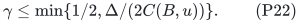

Thus all continuing completed layers have multiplicative current growth.
Earlier growth tests remain true below the next earliest exchange layer,
since their records and eligibility flats do not change.

## 8. Arbitrary resource sizes: factor tau+3rho

Use the accepted fat-resource matroid-union and dual-complement wrapper,
with

<!-- math-display: 545575257ba3ef77a132ed8b
d=\tau+3\rho,\qquad B_0=T/d,
 \tag{P23}
-->
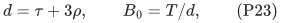

and declare v_j>=B_0 fat. For each fat resource, restrict its recipient
matroid to players whose singleton service is locally feasible. The
union of these recipient matroids is exactly the matroid of players that
can receive one fat service. Its oracle and decomposition costs are
polynomial and paid. The dual-union reduction yields an all-small
instance of rank r'<=r with u<B_0 and the same target T whenever the
coupled configuration LP is feasible.

At B=B_0, (P20) gives C(B_0,u)<=3B_0, so

<!-- math-display: 4492aad35fabb4427f78e82c
\tau B_0+\rho_{r'}C(B_0,u)
                            \le(\tau+3\rho)B_0=T.
-->
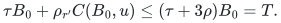

The exact-boundary signature count gives factor d in rank-exponential
time. The fat and small allocations combine exactly as in the accepted
wrapper; deleting allocations of additional players preserves all
recipient and local constraints.

For eta>0 set eta_0=min{eta,1}, keep the fat threshold B_0 and take
B=T/(d+eta_0). This delivers at least the requested factor d+eta.
Because d>=1, one has B>=B_0/2. Since u<B_0,

<!-- math-display: b1b9b38c536cd9dc10a55617
C(B,u)\le\max\{B_0,3B\}=\overline C=3B,\qquad
 T-\tau B-\rho\overline C
                         =T-dB=\eta_0 B.
 \tag{P24}
-->
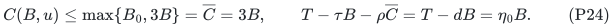

Consequently

<!-- math-display: cbe1eec9d28f0b347adf1b5a
\frac{T-\tau B-\rho\overline C}{\overline C}
                  =\tfrac13\min\{\eta,1\}.
 \tag{P25}
-->
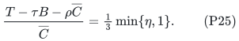

Hence gamma=min{eta,1}/16 safely satisfies the positive-gap growth
condition. The rank exponent is uniform in lambda; the cost of obtaining
its approximate oracle is still paid. This proves the claimed time (P1)
and the corresponding lambda version.

For completeness, the configuration reduction is as follows. Let
<code class="math">f_p</code> be the mass of configurations containing a large service and
<code class="math">h_p=x_p-f_p</code>. Choose one large service from each such configuration.
Its typewise recipient marginals are dominated by the original feasible
columns; their sum <code class="math">f\le x\le\mathbf1</code> therefore belongs to the
independent polytope of the large-service union <code class="math">N</code>. With
<code class="math">U=M^*\vee N</code>, the vector <code class="math">\mathbf1-x+f</code> is <code class="math">U</code>-independent by
the matroid-union rank formula. Extend it fractionally to a <code class="math">U</code>-base.
The complementary vector <code class="math">x'\in B(U^*)</code> satisfies <code class="math">0\le x'\le h</code>.

All-small configurations have recipient marginals <code class="math">a_{pj}\le h_p</code>
and utility at least <code class="math">Th_p</code>. Multiplying the entire row by
<code class="math">x'_p/h_p</code> (zero when <code class="math">h_p=0</code>) preserves every recipient-polytope
constraint and every local row perspective, and gives small utility
at least <code class="math">Tx'_p</code>. Thus a feasible original configuration target
supplies the small-resource compact promise used in Lemma 2.
This is the same fractional union calculation proved explicitly in
[the configuration reduction](../item-matroid-union/configuration-comparator.md),
with matroid-union recipient columns in place of bipartite item
capacities. None of these fractional witnesses is computed.

A common rational grid of the resource values contains every
configuration value and hence the attained largest feasible target.
An upper bound is <code class="math">V=\sum_jv_jr_{R_j}(P)</code>. A grid search initialized
at zero and an external upper point above <code class="math">V</code> saves actual
allocations on success and lowers the upper endpoint only on a
sound full-target failure. Adjacent endpoints imply that the saved
nominal target is at least <code class="math">T_{\rm conf}</code>, even if successes are
not monotone. The number of trials and all numerical encodings are
polynomial.

Rank zero and target zero have the handling specified in Section 1; empty resources give value zero. For r=1 and an exact local available optimizer, there
is no allocation competition and exact optimization is possible. With
an approximate oracle, only its lambda guarantee is claimed.

## 9. Proof dependencies and scope

The [resource-backend realization](resource-backend.md) proves the exact
contract of the shipped ordered-reservation implementation. It checks the
resource side of completion and exchange; the full player-layer allocator,
local optimizer and union decomposition are separate components.

The resource proof consists of (P5) for every internal ordered prefix; strong
freedom (P13); preservation of (P5) by every retained-prefix exchange;
atomic eager release; and the current telescoping rank charge (P18).
The all-subsets theorem alone does not establish this chain. A retained singleton center that loses its dependence witness passes (P12) and is immediately processed as free.

No polynomial-time claim follows from the signature. No approximation
lower bound follows from the old counterexample. No recipient-polymatroid
extension follows merely by replacing matroid ranks with submodular
capacities. No claim of exhaustive publication priority is made here.

The public-source comparison is separate from the mathematical
audit. In particular, the accepted general-resource polynomial 8+epsilon
baseline and its two-value polynomial 4+epsilon case must retain their
different runtime and scope, and the ordinary physical-resource public
quasipolynomial factor 4 must not be described as a new theorem of this
note.

---

**Attribution:** Yilin Liu and GPT-6 Astra Pro.
