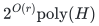
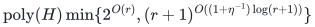

# Allocation with arbitrary recipient polymatroids

**Guarantee**

Returns at least <code class="math">\mathrm{OPT}/d</code> with <code class="math">d=4-3/r</code> against integer optimum. With a certified local factor-<code class="math">\lambda</code> availability oracle, use <code class="math">d=\lambda^{-1}+3-3/r</code>. The equal-unit core also returns <code class="math">\lceil K/3\rceil</code> units from a full quota-<code class="math">K</code> promise.

**Objective and output**

Select an actual player basis and legal integral recipient counts, maximizing common intrinsic value.

**Randomness**

Deterministic current-blocker search with paid exact primitives. A supplied factor-`lambda` availability oracle must satisfy its certified guarantee on every call.

**Time**

Factor <code class="math">d</code> and the equal-unit core take

<!-- math-display: f53c232e9b6631d4d9719b29
2^{O(r)}\mathrm{poly}(H)
-->

Factor <code class="math">d+\eta</code> takes

<!-- math-display: 8ced10ea45fea6f141e8d448
\mathrm{poly}(H)\min\{2^{O(r)},(r+1)^{O((1+\eta^{-1})\log(r+1))}\}
-->

**Space**

Polynomial in the complete binary input and paid oracle workspace; numerical resource multiplicities are not expanded into individual units.

**Parameters**

<code class="math">r\ge1</code> is the player-matroid rank; <code class="math">\eta&gt;0</code> is rational; optional <code class="math">0&lt;\lambda\le1</code> is a certified local-oracle guarantee. <code class="math">H</code> includes the explicit ground, all rational and integer encodings, and paid rank, submodular-minimization, LP, intersection, and decomposition work.

**Model and representation**

Common intrinsic values, arbitrary normalized monotone integral submodular recipient ranks, binary counts, and an arbitrary selected player basis. Optional local families are type-symmetric and downward closed. No assignment budget is added by this theorem.

**Lower-bound scope**

The [hidden-rank oracle barrier](../allocation-lower-bounds/proof.md) excludes deterministic factor strictly below two in rank-FPT oracle time. The [configuration gap](../allocation-lower-bounds/configuration-gaps.md) prevents replacing integer <code class="math">\mathrm{OPT}</code> by the simple aggregate configuration LP.

**Review status**

**Ready for review.** Complete canonical integer allocation and binary representation family, together with all linked fractional companions: natural ranks and whole-owner contraction, original-box integral comparator recovery and distinct records, large-unit dual-union completion, prefix additivity and current release/exchange/rank charging, exact and positive-slack signatures and quota endpoint; residual-capacity configuration comparator, dependent-reserve basis replacement, exact full and support-restricted subset-cut equivalence and fat preservation; scaled recipient-matroid component fractional loss; count-box signed convex pricing, strict cost grids, explicit-row and implicit-aggregate weak fractional optimizers with uniform finite-system interior balls and primal extraction; full and bounded-support XP runtime distinctions; and fractional-only player-dependent profits. Aggregate and full residual configuration gaps remain separate from integer-comparator guarantees. Native count and fractional references exercise original input interfaces with separately charged table, finite generation, storage and Bland pivot costs.

**Dependencies and scope.** The integer allocation theorem and residual/scaled comparator transfers use common intrinsic nonnegative values, independent integral recipient polymatroids, unused capacity and an original selected player basis. Arbitrary type-symmetric downward-closed local families require the supplied certified availability oracle. This is a declared input-model primitive; the fractional pricing implementation does not supply a general local oracle or add original assignment budgets. The fractional optimizer requires local integer coordinate boxes, with quotas at most original singleton ranks. It retains every original player-base and aggregate-resource constraint even with a restricted residual-cut family. Its output is fractional configuration mass, not an actual integer allocation or a fractionally mixed basis substituted into the integer comparator proof. The player-dependent-value extension applies only to fractional optimization. All mathematical allocation and weak-optimizer constructions pay for the exact rank/SFM, integral intersection/decomposition, rational LP, greedy support and ellipsoid operations they use. Support-restricted fractional optimization is XP in the support/rank parameter, while the full cut family is singly exponential in the total original player count. It is not a rank-FPT or rank-quasipolynomial fractional optimizer. The native outer implementation uses actual normalized homogeneous Farkas column/aggregate-vertex generation with exact canonical Bland certificates. At zero margin its LP dual supplies a finite primal directly. Local signed convex pricing uses binary segments, nonpositive-prefix shifting, profit scaling and exact strict-cost grids. The number of generated objects and Bland pivots can be enormous, and all generated columns/vertices are stored; these finite costs and full rational accuracy encoding are explicit and separate from the fast mathematical ellipsoid time and workspace. No numerical unit list is constructed. Scaled matroid types remain separate supplied components; merging equal-value types can weaken the configuration comparator. The full residual relaxation itself has an exact integrality gap of two, and the unstrengthened aggregate gap approaches selected rank. Neither is a computational hardness claim against integer optimum or a below-two algorithm. The small-quota positive-growth boundary is unchanged. Full player-layer integer-allocation software, a fast ellipsoid implementation and arbitrary local-availability oracle implementations are not supplied by these references. Independent mathematical review, original-input finite evidence and producer-independent verification do not constitute proof-assistant formalization, external peer review or an exhaustive publication-priority claim.

The [verification note](verify/README.md) identifies executable coverage. This status does not claim external peer review or proof-assistant verification.

**Source**

[Manuscript and proof](proof.md), with [dependencies and verification sources](sources.md).

The [representation lemmas](representation.md) prove the compressed natural-matroid implementation, exact residual availability, distinct record bookkeeping, and the integer-comparator loss bound. A uniform near-three quasipolynomial equal-unit guarantee is not claimed at small quotas.

## Stronger comparators and fractional optimization

The aggregate configuration LP and the residual-capacity relaxation are
different comparators. Adding all stated residual cuts gives the following
additional results.

**[Residual-capacity comparator](../../manuscripts/allocation-and-scheduling/recipient-polymatroid-residual-configuration-relaxation.md)**

**Guarantee and cost.** Factor <code class="math">4-3/r</code> in <code class="math">2^{O(r)}\mathrm{poly}(H)</code> with exact local availability; factor <code class="math">\lambda^{-1}+3-3/r</code> with certified availability <code class="math">\lambda</code>

**Scope.** Arbitrary recipient polymatroids; the allocation algorithm uses the LP as a comparator without solving it

**[Scaled recipient-matroid types](../../manuscripts/allocation-and-scheduling/scaled-recipient-matroids-binary-configuration-transfer.md)**

**Guarantee and cost.** The same approximation against the component configuration LP

**Scope.** Each supplied type has rank <code class="math">f_j=c_jr_{R_j}</code> with binary multiplicity; component constraints are retained

**[Fractional weak optimizer](../../manuscripts/allocation-and-scheduling/residual-configuration-bounded-support-xp-solver.md)**

**Guarantee and cost.** Target at least <code class="math">(1-\epsilon)\mathrm{OPT}_{\rm LP}</code> in <code class="math">(q+1)^{O(s+1)}\mathrm{poly}(H,\epsilon^{-1})</code> for support-<code class="math">s</code> cuts; the full LP takes <code class="math">2^{O(q)}\mathrm{poly}(H,\epsilon^{-1})</code>

**Scope.** Coordinate-box local families; <code class="math">s=2(r-1)</code> is an XP rank bound, and the output is fractional

The residual-cut proof also transfers the exact integer-quota comparator.
It preserves the critical small-quota growth boundary and does not give a
new uniform quasipolynomial factor-three theorem.

The [native references](reference/README.md) implement natural ranks,
availability and integral comparator recovery, plus actual coordinate-box
fractional pricing and generation. Their [count proof](reference-realization.md),
[fractional proof](fractional-realization.md) and [independent checks](verify/README.md)
separate finite reference costs from the complete mathematical theorems.

**Attribution.** icekylinx · GPT-6 Astra Pro
