# Prefix normalization gives factor four for arbitrary recipient polymatroids

The deterministic algorithm below allocates integral resource counts to a
basis of an arbitrary player-selection matroid. Its exact rank-dependent
factor is <code class="math">4-3/r</code> for unrestricted availability. It uses ordered-prefix
rank additivity and eager release of redundant blocker groups. The
[representation and comparator lemmas](representation.md) establish every
conceptual-copy operation with binary count vectors.

## 1. Model and theorem

Use the precise allocation model in [representation.md, Section 1](representation.md):
a rank-<code class="math">r</code> player matroid, integral recipient-polymatroid ranks
<code class="math">f_j</code>, nonnegative rational intrinsic values <code class="math">v_j</code>, and unused capacity
allowed. The objective is the minimum utility on an actual selected
basis; <code class="math">\mathrm{OPT}</code> denotes its integral optimum.

The optional local family at player <code class="math">p</code> is type-symmetric and downward
closed. Its paid availability oracle has certified rational
approximation guarantee <code class="math">0&lt;\lambda\le1</code>; unrestricted availability
has <code class="math">\lambda=1</code>.
Put tau=1/lambda, rho=(r-1)/r,
and d=tau+3rho.

**Theorem 1.** The integer-optimum approximation factor is

<!-- math-display: e6e0a5e068a76826fd2abf57
\boxed{d\text{ in }2^{O(r)}\mathrm{poly}(H),}
 \tag{Q1}
-->
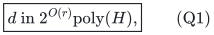

or d+eta, eta>0, in

<!-- math-display: f97f8f1da577473779030018
\boxed{\mathrm{poly}(H)
 \min\{2^{O(r)},(r+1)^{O((1+\eta^{-1})\log(r+1))}\}.}
 \tag{Q2}
-->
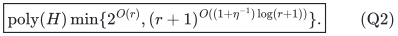

Thus exact unrestricted availability gives 4-3/r and 4-3/r+eta,
respectively. H pays all original input bits, resource value-oracle and
deterministic submodular-minimization costs, player-matroid operations,
and local-oracle work. The wrapper uses polynomial space, with no
expanded capacities or service-copy universe. Rank zero returns the empty selection. Target zero is served by any basis
with zero allocation. For rank one, unrestricted exact availability is
solved exactly by checking each nonloop player's full available value;
an approximate local oracle retains only its stated lambda guarantee.

## 2. Conceptual copy blocks and every ordered prefix

For resource j, use its natural matroid with f_j({p}) conceptual copies
owned by each player p. Let C_j(c) be the whole service-copy block of
selected record c at j; its cardinality is the stored integer count
n^c_j. Different current matching and selected records use disjoint
copies, including when they have the same player owner, as proved by
[the distinct-record argument](representation.md#3-residual-availability-and-distinct-records).

Order centers by layer, and within each layer by their insertion time.
For every ordered prefix S, including one ending inside a layer, set

<!-- math-display: 38f06a526895a63a14476ad1
W_j(S)=X_j(S)\cup Y_j(S),\qquad
 U_j(S)=M_j\setminus Y_j(S),
-->
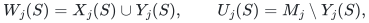

where these are actual copy sets, not just distinct player names.
In addition to the universal reservations, maintain

<!-- math-display: 22d11dcfbab0071ef9570427
r_j(W_j(S)\cup U_j(S))=r_j(W_j(S))+|U_j(S)|.
 \tag{Q3}
-->
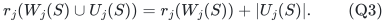

Thus every still-unmarked matching copy is independent after contraction
of the prefix reservation. Cardinality in (Q3) counts units, with
binary numerical representation.

For a retained center c and its strictly earlier prefix S^-_c, maintain

<!-- math-display: 0eff32e08f3ccf660542be29
r_j(W_j(S^-_c)\cup C_j(c))-r_j(W_j(S^-_c))=|C_j(c)|
                         \quad(j\text{ used by }c).
 \tag{Q4}
-->
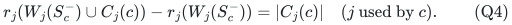

The residual-availability construction establishes (Q4) at birth.
Preceding center records stay fixed, and their designated groups can
only lose matching records while c is retained. New matching records
carry no old group flags. Thus their reserved copy set only shrinks,
and independence over it persists. This is a current invariant.

## 3. Block-dependent completion

A new candidate is selected with the residual available
counts from Lemma 2 of [the representation manuscript](representation.md)

<!-- math-display: 129ad4108a529aa44ccea517
A_{pj}=r_j(W_j\cup E_{pj})-r_j(W_j),\qquad n^c_j\le A_{pj}.
-->
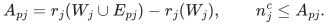

Hence the entire block C_j(c) is independent over W_j, not merely each
of its individual elements. Call a used resource j problematic if

<!-- math-display: d39e75d67393ec7e7372c0bb
r_j(M_j\cup X_j\cup C_j(c))-r_j(M_j\cup X_j)<|C_j(c)|.
 \tag{Q5}
-->
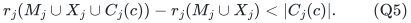

At every such resource, mark all currently unmarked matching records
using j. Take their union as the new designated group. Every designated
record shares a used type with c. If that union is empty, treat c as
a fresh free candidate.

The all-subsets reservation induction is valid blockwise. At a
problematic resource, deleting the new designated group removes every
unmarked matching copy. The remaining independent reservation is a
subset of old W_j, over which the entire C_j(c) is independent. At a
nonproblematic resource, (Q5) fails, so C_j(c) is independent over all
M_j union X_j and hence over any old reservation. Other resources only
lose elements. Every new subset case is established at once.

For (Q3), some subset A of the old U moves into W. Independence of U
over W implies independence of U minus A over W union A. At an unused
resource this is the whole operation. At a nonproblematic used resource,
adjoining C_j(c), independent over W union U, preserves this additivity.
At a problematic resource, every member of U moves into W and the new
unmarked set is empty. Thus every old and new ordered-prefix instance
of (Q3) remains true.

If the new designated group is empty, no used resource is problematic.
Indeed a problematic resource with nonempty U would have marked a
record, and one with empty U would contradict block independence over
W. The whole fresh bundle is therefore strongly free over M plus all
old selected records.

## 4. Current strong release

For a stored center c, let

<!-- math-display: 44f8f1c973bd37b1dd534009
V_j=W_j(S^-_c)\cup\{
       \text{resource-j copies in the current records of }D(c)\}.
-->
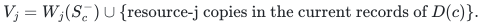

If every used resource satisfies

<!-- math-display: 50bf20b8fa15db0726bf4ffb
r_j(V_j\cup C_j(c))-r_j(V_j)=|C_j(c)|,
 \tag{Q6}
-->
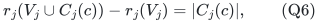

then process c immediately as free, whether or not its group is empty.
This is safe because (Q3), applied to the prefix ending at c, makes
the remaining U independent over V_j union C_j(c). Together with
(Q6), it gives

<!-- math-display: 13eed66117847bf759765826
r_j(V_j\cup C_j(c)\cup U)=r_j(V_j)+|C_j(c)|+|U|.
-->
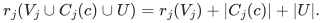

The rank without C_j(c) is at most r_j(V_j)+|U|. Hence the whole
block C_j(c) is independent over V_j union U, which equals M_j plus
the selected copies strictly preceding c. Empty groups automatically
satisfy (Q6) by (Q4).

If (Q6) fails, it supplies a current integer rank deficit of at least
one at a used resource. If D(c)={b}, that resource is also used by b:
otherwise V_j is the earlier W_j and (Q4) contradicts the deficit.

## 5. Block exchanges preserve all retained prefixes

Use the usual earliest player-circuit exchange. A nonaugmenting free
center in layer i removes one matching record from a strictly earlier
layer h<i and truncates every higher layer. Thus every retained center
precedes the incoming center.

Strong freedom from Section 4 means each whole incoming block is
independent over the old actual matching and every retained selected
copy. Universal reservations are preserved by adding that block and
deleting the outgoing record, just as in the preceding theorem.

Fix a retained prefix S. Deleting the outgoing matching record removes
a subset from W_j(S), from U_j(S), or nothing at a given resource.
In the first case U stays independent over the smaller contracted set;
in the second, a subset of an independent contracted set remains
independent. The incoming block is independent over the entire old
W union U, hence over the post-deletion set. It is an unmarked matching
block in this prefix, proving (Q3) after the exchange. This argument
allows arbitrarily many units in either the outgoing or incoming record.

Higher-group release changes no retained prefix. The incoming record
never inherits a deleted record's group membership. The shrinking-prefix
argument keeps (Q4), and the earliest player-exchange lemma keeps
eligibility. Below h, the old record counts and resource rank queries
are unchanged, so old maximality statements persist.

Normalize before every completed maximality/growth test: process empty
groups, then repeatedly scan all retained centers for (Q6) and perform
any passing free exchange. Do not remove a center or release its group
as a standalone mutation. Each actual eager release is an atomic
earliest exchange, strictly decreasing the old micro-signature; an
augmentation ends the phase. A single normalization episode has at
most r nonaugmenting exchanges because its last retained layer strictly
decreases. Full scans are polynomial rank-query work.

## 6. Current rank charge with whole blocks

At a normalized state telescope Phi=sum_j v_j r_j(W_j) over the ordered
prefixes. Put a=min(u,B). Every current blocker still shares a used
resource type with its assigned center.

If c consists of one unit worth at least B, every designated blocker
contains a unit of that type and, by minimality, is itself one unit.
The current failed strong-release test saves one rank unit when adding
the center after its t blockers. The cover increment is at most t u.

If c has at least two units and t>=2 blockers, all units in the center
are below B. Each blocker shares such a unit and therefore also has no
unit of value at least B. All t+1 bundles have value below B+a. Their
cover increment is less than

<!-- math-display: 9e9b9dc756f70dc5f42c51aa
(t+1)(B+a)\le t(2B+a).
-->
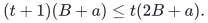

Finally, if c has at least two units and D(c)={b}, failure of (Q6)
provides a common used type j with an integer rank deficit at least one.
Compared with counting every service in c and b, the current rank
increment saves at least v_j. Minimality of b gives v(b)-v_j<B, even
when b has several units of type j. Hence the increment is below

<!-- math-display: 770a5dbe64ddf38db2588fdf
v(c)+v(b)-v_j<2B+a.
-->
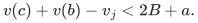

The current groups partition all blockers, so

<!-- math-display: 217f8b2a6708bd76c456845d
\boxed{\Phi\le C(B,u)|Y|,\qquad
                  C(B,u)=\max\{u,\,2B+\min(u,B)\}.}
 \tag{Q7}
-->
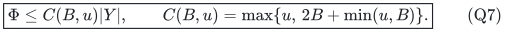

No dependence saving is carried from birth without testing it. The
deficit used in the singleton-group charge is a present prefix deficit.

## 7. Integer lower cover and the approximation

The preceding theorem's contraction-and-box loss certificate applies
unchanged to these states and the same availability counts:

<!-- math-display: ee975a81491b1988df1ba322
\Phi>(T-\tau B)w,\qquad \tau B\le T,
 \tag{Q8}
-->
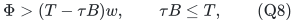

whenever an integer target-T basis allocation exists and a completed
available scan fails. Thus the sufficient condition becomes

<!-- math-display: a9d9336b80180ce5473ff712
\tau B+\rho C(B,u)\le T.
 \tag{Q9}
-->
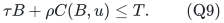

Use Lemma 4 of [the representation manuscript](representation.md) with B0=T/(tau+3rho). At exact B=B0, small-unit
u<B0 implies C(B0,u)<=3B0, proving the exact-boundary factor (Q1).

For eta>0 put eta0=min(eta,1), retain the fat threshold B0, and take
B=T/(d+eta0). Since d>=1, B>=B0/2. Consequently

<!-- math-display: 5d682f6c63b85bca3ee20a50
C(B,u)\le\max\{B0,3B\}=3B,
 \qquad T-\tau B-\rho(3B)=\eta0 B.
-->
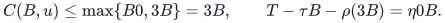

Growth gamma=eta0/16 safely contradicts a failed small-growth layer.
The unchanged rank-quasipolynomial signature gives (Q2). The proof is
uniform in lambda apart from the paid available-oracle costs.

## 8. Numerical implementation

Each required rank is evaluated on a multiplicity vector z using

<!-- math-display: 4d4f8e41416e9bc55960deb9
R_j(z)=\min_{S\subseteq P}
                            \{f_j(S)+z(P\setminus S)\}.
-->
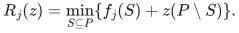

The disjoint-copy invariant guarantees all coordinates describe actual
subsets of the conceptual natural matroid. Prefix additivity uses the
binary sum |U|; it is a proved invariant, not an exponentially large
test. Problematic-block and strong-release tests use two such rank
queries per used resource. Whole-state scans use polynomially many
queries on q explicit players and polynomial-bit modular terms.

Records store count vectors, and all group changes, pruning and record
moves are numerical. No query or loop is proportional to the number
of units. Lemma 1 of [the representation manuscript](representation.md) proves
the rank implementation; its Lemma 4 proves the large-unit singleton
tests and reconstruction. A common rational grid of the values contains
every integral utility. With <code class="math">V=\sum_jv_jf_j(P)</code>, initialize target zero
and an external upper grid point above <code class="math">V</code>; on success save the actual
allocation, and lower the upper endpoint only on a sound full-target
failure. At adjacent grid points the saved nominal lower target is at
least <code class="math">\mathrm{OPT}</code>. This uses polynomially many calls in the encoding
length and never assumes monotonicity of successful answers.

## 9. A sharper equal-unit quota theorem

Suppose every small unit has value one, there are no local-oracle errors,
and each minimal bundle has integer quota b>=1. The normalized prefix
cover sharpens further to

<!-- math-display: af4ba083f5854d67aaf98431
\Phi\le(2b-1)|Y|.
 \tag{Q10}
-->
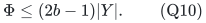

For b=1 every center and blocker is a singleton, and its current
dependence gives coefficient one. For b>=2, a singleton blocker group
saves at least one unit of rank, giving 2b-1. For t>=2 blockers the
coarse count (t+1)b is at most t(2b-1), since (t-1)b>=t.

If an integral target-t allocation exists, failed available scans leave
each residual optimal player at most b-1 units. The contraction loss
proof therefore gives Phi>=(t-b+1)w. A sufficient contradiction is

<!-- math-display: e9b8826116e21e71de30785d
\boxed{(3-2/r)b<t+1+(r-1)/r.}
 \tag{Q11}
-->
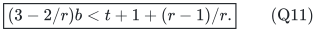

In particular b=ceil(t/3) always satisfies (Q11). Write t=3k+s with
s in {0,1,2}. For s=0, the strict gap is 1+rho+(2/r)k. For s=1, it is
(2k+1)/r. For s=2, it is 1+(2k+1)/r. All are positive for finite r.
Thus the equal-unit core has a **uniform factor-three rank-exponential
guarantee**; this statement includes small integer targets.

This calculation does not automatically provide a uniform positive
quasipolynomial growth margin. For example t=4, b=2 leaves only 3/r
in (Q11). A near-three quasipolynomial statement needs a large-quota
condition, a separate small-quota algorithm, or another progress proof.
The general arbitrary-value near-four quasipolynomial theorem above
does not have that problem; its fat threshold and eta gap were paid
explicitly.

The quota guarantee can be used when big resources form a supplied
matroid of players who can each receive one sufficient big service:
the same dual-union argument reduces the remaining promise to this
small-unit core. Any makespan or two-value application must state that
adapter and its running-time and rounding consequences separately.

## 10. Comparator and scope

The player-side earliest-circuit exchange and signature bounds are
the explicit prerequisites from the
[recipient-matroid proof](../recipient-matroid-configuration/proof.md).
The compressed-copy and integer-comparator arguments are proved in the
[representation manuscript](representation.md). The ordered-prefix
normalization and block-dependence arguments above supply the resource
extension; one-service matroid claims are not transferred by notation
alone.

The guarantee here is against integer optimum. A supplied scalar
matroid-copy resource type may admit a stronger component-configuration
comparator by a separate fractional-loss lemma. Arbitrary polymatroid
aggregation does not preserve that comparator: the explicit rank-sized
gap is retained alongside this theorem.

---

**Attribution:** Yilin Liu and GPT-6 Astra Pro.
