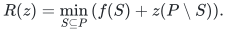
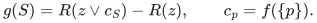
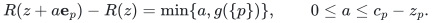
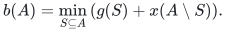
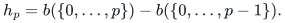
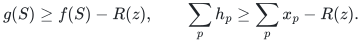

# Exact binary-count representation and comparator recovery

The [reference](reference/counts.py) realizes the natural-matroid rank,
whole-owner availability, contracted comparator recovery and minimal-bundle
interfaces of the [representation manuscript](representation.md). Inputs are
complete integral recipient-rank tables. The table reference has explicit
exponential dependence on the number of original players; it does not
implement the paid submodular-minimization primitive of the fast theorem.

## Original-input validation

`RankTable` verifies normalization, integer nonnegativity, monotonicity and
all submodular pairs before accepting a table. Every count vector is indexed
by the original players and bounded by their singleton ranks. Counts may
have arbitrarily many binary digits. Validation and subsequent loops visit
players and table entries, never individual resource copies.

## Natural rank and whole-block contraction

The natural matroid and its rank formula are established in Lemma 1 of the
representation manuscript. The reference evaluates exactly

<!-- math-display: 2479e5f9d9ccbafb1c0b54bb
R(z)=\min_{S\subseteq P}\left(f(S)+z(P\setminus S)\right).
-->

This formula remains valid when the reserved set is dependent. To compute
its whole-block contraction, replace the coordinates in a queried player
set by their singleton capacities and subtract the original reserved rank:

<!-- math-display: c0780da1ffe14d5be81cd061
g(S)=R(z\vee c_S)-R(z),\qquad c_p=f(\{p\}).
-->

The replacement describes the union of the reserved set with those entire
owner blocks. Matroid contraction and disjoint block aggregation make this
a normalized integral polymatroid rank. Singleton values give residual
availability. Partitioning the minimum defining the natural rank according
to whether it contains one specified player proves

<!-- math-display: 6d6420ba62f84aa3c43538f2
R(z+a\mathbf e_p)-R(z)=\min\{a,g(\{p\})\},
\qquad 0\le a\le c_p-z_p.
-->

Thus an available block can be added in one numerical operation, with no
copy list and no loop proportional to its size.

## Actual integral comparator recovery

`recover_comparator` first checks the supplied original allocation against
every original rank inequality. With that count vector as an upper box,
the contracted feasible region has integral rank

<!-- math-display: 9727542898ccca0df06ff65b
b(A)=\min_{S\subseteq A}\left(g(S)+x(A\setminus S)\right).
-->

This is the box-restriction identity of Lemma 3 in the representation
manuscript. For prefixes in the original player order, the implementation
returns successive rank differences:

<!-- math-display: a1bc3c8e427ca82f32268f2d
h_p=b(\{0,\ldots,p\})-b(\{0,\ldots,p-1\}).
-->

Monotonicity gives nonnegativity. Submodularity bounds the sum over any
subset by its box-restricted rank, by comparing each selected coordinate's
marginal against its smaller selected prefix. Consequently this vector is
integral, satisfies all contracted rank inequalities and is bounded by the
original comparator coordinatewise. Telescoping attains the full boxed
rank, so the recovered total is maximal.

The union with the reserved set contains every full block in a queried
player subset. Its rank is at least that subset's original rank. Therefore

<!-- math-display: de9c3eb7202c004a48cf1a7e
g(S)\ge f(S)-R(z),\qquad
\sum_p h_p\ge\sum_p x_p-R(z).
-->

This is a concrete producer for the per-resource loss bound used in the
integer lower-cover proof. Downward-closed local feasibility is preserved
because the returned bundle at each player is coordinatewise smaller.
The implementation does not search for the player-selection basis or run
the complete layered allocation algorithm.

## Minimal bundles with numerical counts

For each positive-value type, `minimal_bundle` deletes in one step the
smaller of its entire count and the floor of current utility surplus divided
by that type's exact value. It removes zero-value units outright. The
threshold remains satisfied after each step. If a positive unit remains,
one further deletion would violate the threshold at that point; later
steps only decrease utility, so that unit remains essential at termination.
One pass suffices, with exact rational arithmetic and binary integer counts.

## Costs and executable evidence

For `n` original players, rank-table validation takes `O(4**n + n*2**n)`
integer comparisons and operations. One natural rank query takes
`O(n*2**n)` operations; all singleton availabilities take `O(n**2*2**n)`
operations without constructing the full contraction table. A whole
contracted table and comparator recovery
take `O(n*4**n)` operations and `O(2**n+n)` stored numbers. Actual integer,
rational and coordinate bit lengths are charged separately. Minimal-bundle
recovery uses one exact arithmetic step per resource type, up to constant
factors. These are explicit-table bounds, distinct from oracle-model bounds.

The [checker](verify/check_counts.py) derives ranks by enumerating feasible
original allocations under the original subset inequalities, independently
of the rank-minimum formula. It compares every small reserved count vector,
every single-coordinate increment, and every original comparator with
exhaustive contracted feasible recovery. It also checks minimality and
100-digit capacities without unit expansion. Finite evidence supplements
the arguments above; it is not formal verification.

**Attribution:** icekylinx and GPT-6 Astra Pro.
