# Binary representation and the integer-comparator lemma

This manuscript supplies the representation and lower-cover arguments used by
the [prefix-normalized allocation theorem](proof.md). All resource
multiplicities remain binary encoded.

## 1. Allocation model

Let <code class="math">P</code> be a finite set of players and let <code class="math">M</code> be a matroid of rank
<code class="math">r</code> on <code class="math">P</code>. Each resource type <code class="math">j</code> has a nonnegative rational value
<code class="math">v_j</code> and a normalized, monotone, integral submodular function
<code class="math">f_j:2^P\to\mathbb Z_{\ge0}</code>. A legal allocation chooses a basis
<code class="math">I</code> of <code class="math">M</code> and vectors <code class="math">n_{\cdot j}\in P(f_j)\cap\mathbb Z^P_{\ge0}</code>
supported on <code class="math">I</code>, where

<!-- math-display: 5383fdaf6867615a27977efa
P(f_j)=\{x\ge0:x(S)\le f_j(S)\text{ for all }S\subseteq P\}.
-->
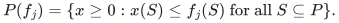

Its utility at <code class="math">p\in I</code> is <code class="math">\sum_jv_jn_{pj}</code>. Unused capacity is
allowed. The comparator <code class="math">\mathrm{OPT}</code> is the largest achievable
minimum utility of an integral allocation on an actual basis.

Optionally, player <code class="math">p</code> has a type-symmetric downward-closed family
<code class="math">\mathcal F_p\subseteq\prod_j\{0,\ldots,f_j(\{p\})\}</code>. Given an
integer availability vector <code class="math">A</code>, its supplied oracle returns a
feasible <code class="math">n\in\mathcal F_p</code>, <code class="math">n\le A</code>, whose value is at least
<code class="math">\lambda</code> times the best feasible value under <code class="math">A</code>. The guarantee
<code class="math">0&lt;\lambda\le1</code> is a certified rational input; write
<code class="math">\tau=1/\lambda</code>. Without local restrictions the exact oracle returns
<code class="math">A</code>. All oracle work and workspace are charged explicitly.

## 2. A conceptual natural matroid

For one resource <code class="math">f=f_j</code>, imagine a block <code class="math">E_p</code> of
<code class="math">f(\{p\})</code> distinct copies at every player. Declare a set independent
when its vector of block counts lies in <code class="math">P(f)</code>. Heredity follows from
downward closure; the augmentation axiom follows from integral
polymatroid augmentation. This defines a matroid, without constructing
its possibly enormous ground set.

**Lemma 1 (rank from counts).** A conceptual set with block-count vector
<code class="math">z</code> has rank

<!-- math-display: 964df809921f99ae14b918f5
R(z)=\min_{S\subseteq P}\{f(S)+z(P\setminus S)\}.
 \tag{R1}
-->
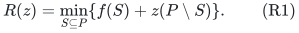

**Proof.** An independent subset has counts <code class="math">h\in P(f)</code> with
<code class="math">0\le h\le z</code>. For every <code class="math">S</code>, its total is at most
<code class="math">f(S)+z(P\setminus S)</code>. Conversely, the box-restricted polymatroid has
rank
<!-- math-display: ad6d926ed48a6419608e82bf
f_z(A)=\min_{S\subseteq A}\{f(S)+z(A\setminus S)\},
-->
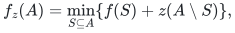
and <code class="math">P(f_z)=P(f)\cap[0,z]</code>. Submodular uncrossing proves that <code class="math">f_z</code>
is an integral polymatroid rank; an integral base attains <code class="math">f_z(P)</code>.
This gives equality in (R1). In particular, the union of the full
blocks indexed by <code class="math">S</code> has rank <code class="math">f(S)</code>. <code class="math">\square</code>

Thus every rank query is one submodular minimization on the original
<code class="math">&#124;P&#124;</code> elements with a binary modular term.

## 3. Residual availability and distinct records

At any stage of the local search, selected centers <code class="math">X</code> and marked
matching records <code class="math">Y</code> reserve a count vector

<!-- math-display: d3d097b471d8a2f885065210
z^j_p=\sum_{\substack{c\in X\\p(c)=p}}n^c_j+
       \sum_{\substack{b\in Y\\p(b)=p}}n^b_j.
 \tag{R2}
-->
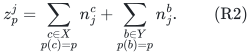

Replace coordinate <code class="math">p</code> by <code class="math">f_j(\{p\})</code>, obtaining <code class="math">z^{j,p}</code>, and
define

<!-- math-display: d719a5a043f86ed7d17d3c5c
A_{pj}=R_j(z^{j,p})-R_j(z^j).
 \tag{R3}
-->
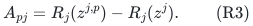

**Lemma 2 (block availability).** For every integer
<code class="math">0\le a\le A_{pj}</code>, any <code class="math">a</code> unused copies of player <code class="math">p</code> are
independent after contraction of the reserved set. Moreover,
<code class="math">A_{pj}\le f_j(\{p\})-z^j_p</code>.

**Proof.** In (R1), separate the sets <code class="math">S</code> containing <code class="math">p</code> from those
not containing <code class="math">p</code>. Increasing <code class="math">z_p</code> by <code class="math">a</code> leaves the first
minimum unchanged and increases the second by <code class="math">a</code>. The increase of
the minimum is therefore <code class="math">\min\{a,A_{pj}\}</code> until the entire block
has been added. Symmetry within a block makes the identity independent
of which unused copies are chosen. <code class="math">\square</code>

Matching records have distinct owners. A candidate owner already
matched must have its old matching record in the preceding marked
prefix: otherwise it lies in the eligibility flat and cannot be
chosen. Hence all its old copies are included in (R2). All prior
selected records are also included. Lemma 2 supplies disjoint copies
for every new record, even when one owner occurs in several layers.
An exchange moves the incoming record's own copies into the matching
and deletes the outgoing record; it never identifies two record
labels. The numerical execution therefore has a simultaneous
realization in one fixed conceptual matroid.

Only record count vectors, owners, and layer flags are stored.
No copy identities or unary arrays are needed. Minimality above a
positive utility threshold <code class="math">B</code> is achieved in one pass over types:
remove
<!-- math-display: f7e911024cff355ea5a20cae
\min\left\{n_j,\left\lfloor
       \frac{\sum_iv_in_i-B}{v_j}\right\rfloor\right\}
-->
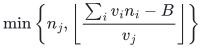
units of each positive-value type <code class="math">j</code>. Downward closure preserves
feasibility, and each surviving unit is essential when the pass ends.
Zero-value units can be deleted.

## 4. Loss against an integral comparator

Let <code class="math">J</code> be the current eligibility base, let
<code class="math">w=r-r_M(J)&gt;0</code>, and suppose a complete scan at an unchanged state
finds no available bundle of value at least <code class="math">B</code>. Put

<!-- math-display: 89796f3d771b8b11bbb6b7ca
\Phi=\sum_jv_jR_j(z^j).
 \tag{R4}
-->
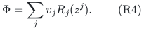

**Lemma 3 (integer lower cover).** If a target-<code class="math">T</code> integral allocation
exists on a basis and <code class="math">\tau B\le T</code>, then

<!-- math-display: 92e0a18e5b194556f7ae2f76
\Phi>(T-\tau B)w.
 \tag{R5}
-->
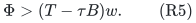

**Proof.** Let <code class="math">I^*</code> be such a basis and
<code class="math">E=I^*\setminus\mathrm{cl}_M(J)</code>. Since a basis has at most
<code class="math">r_M(J)</code> elements in this flat, <code class="math">&#124;E&#124;\ge w</code>. Restrict the target
allocation to <code class="math">E</code>, and denote its count vector of type <code class="math">j</code> by
<code class="math">n^*_{\cdot j}</code>.

Contract the reserved conceptual set <code class="math">W_j</code>. The full owner blocks
induce the integral polymatroid
<!-- math-display: 29f24eebd5dee04102a27101
g_j(S)=r_j(W_j\cup E_{S,j})-r_j(W_j).
-->
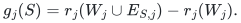
It has <code class="math">g_j(\{p\})=A_{pj}</code>, and
<!-- math-display: 257e3039affa14d8ac47d7b7
g_j(S)\ge f_j(S)-R_j(z^j).
 \tag{R6}
-->
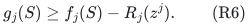
Box restriction by <code class="math">n^*_{\cdot j}</code> provides an integral
<code class="math">h_{\cdot j}\le n^*_{\cdot j}</code>, <code class="math">h_{\cdot j}\in P(g_j)</code>, with
<!-- math-display: 98743147c04ea29b0991cd92
\begin{aligned}
 h_{\cdot j}(P)
 &=\min_{S\subseteq P}
      \{g_j(S)+n^*_{\cdot j}(P\setminus S)\}\\
 &\ge n^*_{\cdot j}(P)-R_j(z^j).
 \end{aligned}
 \tag{R7}
-->
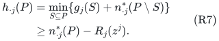
The last step uses <code class="math">n^*_{\cdot j}(S)\le f_j(S)</code>. Thus at most
<code class="math">R_j(z^j)</code> units of type <code class="math">j</code> are removed.

For each <code class="math">p\in E</code>, the surviving bundle <code class="math">h_p</code> belongs to
<code class="math">\mathcal F_p</code> by downward closure and satisfies
<code class="math">h_{pj}\le A_{pj}</code>. The completed failed oracle scan implies that its
value is strictly less than <code class="math">B/\lambda=\tau B</code>. Its original value
was at least <code class="math">T</code>. Summing the lost utility over <code class="math">E</code>, and then using
(R7), proves
<!-- math-display: 11e632d724b3b3a0e95f8518
\Phi>(T-\tau B)|E|\ge(T-\tau B)w.
 \qquad\square
-->
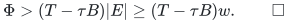

The proof uses an actual integral allocation. Fractional player masses
in an aggregate configuration LP cannot replace it; the
[configuration gap](../allocation-lower-bounds/configuration-gaps.md)
gives an explicit counterexample.

## 5. Large units and recovery of the original basis

At any chosen threshold <code class="math">B_0&gt;0</code>, a resource type is large if
<code class="math">v_j\ge B_0</code>. Its unit-box restriction is the matroid <code class="math">N_j</code> with
rank
<!-- math-display: c352b4f8144fa38ff00a4608
r_{N_j}(S)=
    \min_{A\subseteq S}\{f_j(A)+|S\setminus A|\}.
 \tag{R8}
-->
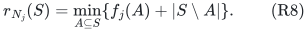
Restrict this matroid to players for whom one unit is locally feasible.
The local oracle tests that condition exactly on a singleton input:
with positive value, a positive approximation guarantee returns a
nonempty feasible bundle precisely when the singleton is feasible.
Let <code class="math">N=\bigvee_jN_j</code> over the large types and <code class="math">U=M^*\vee N</code>.

**Lemma 4 (large-unit reduction).** Every integral target allocation
on an <code class="math">M</code>-basis contains a target allocation using only small types
on a <code class="math">U^*</code>-basis. Conversely, a small-type allocation on a
<code class="math">U^*</code>-basis can be completed to an <code class="math">M</code>-basis by giving one large
unit to each additional selected player.

**Proof.** In a target allocation choose one large unit for each
player receiving any. Those players form an <code class="math">N</code>-independent set;
the complement of the selected <code class="math">M</code>-basis is <code class="math">M^*</code>-independent.
Their union extends to a <code class="math">U</code>-basis. Its complement is a
<code class="math">U^*</code>-basis contained among the original small-only players.

Conversely, decompose a <code class="math">U</code>-basis into an <code class="math">M^*</code>-independent part
and an <code class="math">N</code>-independent part. Extend the first part within that
<code class="math">U</code>-basis to an <code class="math">M^*</code>-basis. Such an extension exists because the
<code class="math">U</code>-basis spans <code class="math">M^*</code>: if an outside element increased its
<code class="math">M^*</code>-rank, it could also augment its <code class="math">U</code>-independent decomposition.
The complement of the extended <code class="math">M^*</code>-basis is the required
<code class="math">M</code>-basis. Its new players lie in the remaining <code class="math">N</code>-part and
receive a unit through the matroid-union decomposition. Small and
large types are disjoint, and deleting recipients preserves all
feasibility constraints. <code class="math">\square</code>

## 6. Encoding and dependencies

Every stored count is bounded by its singleton rank. Summing at most
a polynomial number of records adds only logarithmically many bits.
Submodular minimization, matroid duality and union, integral
polymatroid box restriction, and decomposition are the paid standard
primitives. The prefix invariants and progress analysis appear in the
[main proof](proof.md); Lemmas 1–4 supply its compressed representation
and its precise integer comparator.

**Attribution:** icekylinx and GPT-6 Astra Pro.
