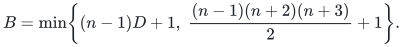
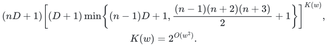
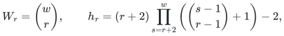
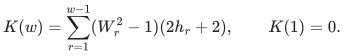
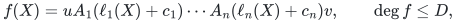
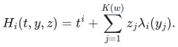

# Deterministic PIT for fixed-width affine ROABP orbits

A deterministic black-box hitting set for one unknown-order read-once oblivious algebraic branching program under an unknown invertible affine change of variables. The complete argument permits every field characteristic, arbitrary local matrix ranks, and arbitrary local matrix-entry degrees. For each fixed width, the query count is polynomial in the variable count and scalar total degree.

[Core paper](paper.pdf) · [Grid refinement](direction-grids.pdf) · [Proof and stronger special cases](proof.md) · [Sources](sources.md) · [Verification](verify/README.md)

**Guarantee**

For a promised width-at-most-<code class="math">w</code> affine ROABP orbit polynomial of scalar total degree at most <code class="math">D</code>, the explicit grid contains a nonzero evaluation whenever the polynomial is nonzero. The hidden matrices, variable order, endpoints and affine transformation are not input to the construction.

**Objective and output**

Decide whether the oracle polynomial is identically zero. A nonzero answer returns a point and its nonzero oracle value. A zero answer requires completing the grid and relies on the stated representation and degree promises. The prototype returns `incomplete` if a query limit interrupts the traversal.

**Randomness**

Deterministic construction and oracle evaluation; no random seed or failure probability. The theorem uses arithmetic over a sufficiently large working field, with extension-field oracle evaluations when the base field is too small. Promise recognition and a general Turing bit-complexity implementation are not included.

**Time**

Let <code class="math">K=K(w)</code> be the explicit width constant below, and put

<!-- math-display: 07e47d13bebdcee463191469
B=\min\!\left\{(n-1)D+1,\;\frac{(n-1)(n+2)(n+3)}2+1\right\}.
-->

The number of oracle evaluations is at most

<!-- math-display: eb01c4a74e0d46e41cc63966
\begin{gathered}(nD+1)\left[(D+1)\min\!\left\{(n-1)D+1,\frac{(n-1)(n+2)(n+3)}2+1\right\}\right]^{K(w)},\\K(w)=2^{O(w^2)}.\end{gathered}
-->

Constructing each point has polynomial field-arithmetic overhead. This is an XP bound in width: the exponent depends on <code class="math">w</code>. It is not a bound of the form <code class="math">g(w)(nD)^{O(1)}</code> with a uniform exponent. The constants are large; the retained small-width and rank-restricted theorems give substantially smaller grids.

**Space**

The grid can be enumerated without materializing all its points. The supplied implementation is a lazy exact-arithmetic prototype. No optimized workspace or uniform bit-space bound is asserted.

**Parameters**

<code class="math">n</code> is the number of variables, <code class="math">w</code> bounds ROABP width, and <code class="math">D</code> bounds the total degree of the scalar output. For <code class="math">1\le r&lt;w</code>, set

<!-- math-display: dc6d5cc33a4e7d6f2e9d7ca8
W_r=\binom wr,\qquad
h_r=(r+2)\prod_{s=r+2}^{w}\left(\binom{s-1}{r-1}+1\right)-2,
-->

<!-- math-display: ca97c95abd22a1cb56afd444
K(w)=\sum_{r=1}^{w-1}(W_r^2-1)(2h_r+2),\qquad K(1)=0.
-->

The first six values are <code class="math">0,12,128,1500,23718,553854</code>. These constants are not optimal. The univariate case uses ordinary interpolation with <code class="math">D+1</code> evaluations; constants need one evaluation.

**Model and representation**

The oracle polynomial admits

<!-- math-display: cd39c474067490852ef912d9
f(X)=uA_1(\ell_1(X)+c_1)\cdots A_n(\ell_n(X)+c_n)v,
\qquad \deg f\le D,
-->

where the <code class="math">A_i</code> are original-field univariate polynomial matrices and the linear forms <code class="math">\ell_i</code> are linearly independent. This is the invertible affine orbit of a single unknown-order ROABP. A working field with at least <code class="math">nD+1</code> elements is sufficient for the general grid. The model does not include singular affine projections or orbit closures. Hidden local degrees may exceed <code class="math">D</code>; the proof does not truncate the representation.

**Lower-bound scope**

The separate [palette construction](manuscripts/palette-sharpness.md) exactly attains the structural leading-support bound for each allowed interval-rank palette. Its degree-two lift works at the actual moment curve and preserves physical matrix-interval ranks. Those examples survive one SV pair, so this is not a lower bound on hitting-set size, SV seed count or PIT queries.

The [quadratic Hasse construction](manuscripts/quadratic-hasse-obstruction.md) attains local leading digit degree <code class="math">w^2-1</code> using a genuine original-field word and the ordinary moment curve. It gives a limit on improving that local proof interface from individual transcendence alone. It also survives one SV pair.

**Review status**

**Ready for review.** The complete general fixed-width affine-orbit PIT proof and direction-grid refinement have separate exact-source internal reconstructions, including a fresh-context review of the weighted Artin induction. Arbitrary local ranks, unrestricted local entry degrees and every characteristic are covered.

**Dependencies and scope.** The promise is one unknown-order ROABP under an invertible affine map, with a known scalar total-degree bound; small base fields require extension-field oracle access. The polynomial query exponent depends on width; no FPT, unbounded-width polynomial-time, singular-projection or orbit-closure claim is made. The generic Hasse pivot criterion is standard and attributed. Internal model-assisted review, finite tests and presentation checks are not external peer review, proof-assistant verification or priority certification.

The [verification note](verify/README.md) identifies executable coverage. This status does not claim external peer review or proof-assistant verification.

**Source**

Yilin Liu and GPT-6 Astra Pro. The canonical [core TeX](manuscripts/general-affine.tex) and [grid TeX](manuscripts/direction-grids.tex) contain the complete proofs. The [import record](../../provenance/imports/roabp-affine-pit.json) binds them to the research-session sources, with reversible publication-layout changes. The [source map](sources.md) distinguishes the new argument from standard Hasse-order tools and verified published comparisons.

## Reading the result

The main generator is the ordinary moment curve plus <code class="math">K(w)</code> Shpilka--Volkovich pairs:

<!-- math-display: 0ba1ccbe27eabfe60216ab60
H_i(t,y,z)=t^i+\sum_{j=1}^{K(w)}z_j\lambda_i(y_j).
-->

It has <code class="math">2K(w)+1</code> scalar parameters. The pure generator <code class="math">\mathrm{SV}_{K(w)+1}</code> also hits. The proof preserves ranks of actual contiguous intervals, uses a separate monomial-box quotient for each first homogeneous monomial, and then bounds its exponents with Hasse pivots. The [proof companion](proof.md) explains the interfaces and retains stronger theorems when their assumptions differ.

The reference program and finite tests are evidence about exact arithmetic, explicit constructions and traversal semantics. They do not replace the general proof and do not make the enormous general grids practical.
