# Exact support bounds for rank-stable matrix words

<!-- review-status:start -->
**Ready for review.** The general palette lower construction and original-field degree-two actual-curve lift have complete internal proofs, matching the separately proved concentration threshold. The uniform active-endpoint subcase retains its sharper exact threshold.

**Dependencies and scope.** Interval preservation concerns physical matrix words; the augmented scalar interval is excluded when the scalar vanishes on the initial curve. The examples survive one SV pair, so the result is not a PIT or generator lower bound. Internal review and finite identities do not constitute external peer review or formal verification.

The [verification note](../verify/README.md) identifies executable coverage. This status does not claim external peer review or proof-assistant verification.
<!-- review-status:end -->

**Yilin Liu and GPT-6 Astra Pro**

26 October 2026

## Abstract

Let a width-<code class="math">W</code> matrix word have its generic rank preserved at zero on every contiguous interval, and let its allowed ranks form a palette <code class="math">\mathcal P=\{0=p_0&lt;p_1&lt;\cdots&lt;p_m=W\}</code>. The companion coefficient-space theorem gives the support bound

<!-- math-display: 53843ff095906558e9715090
h(\mathcal P)=\prod_{j=1}^{m}(p_j-p_{j-1}+1)-2.
-->
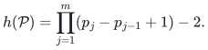

We construct an affine univariate word attaining this bound over every field. A fixed scalar entry is exactly the squarefree product of all <code class="math">h(\mathcal P)</code> variables. We also prove, directly over finite monomial quotient rings, the sharper active-endpoint bound <code class="math">(W-r+1)(r-1)</code> for words with constant matrices <code class="math">P_r</code> and <code class="math">I_W</code>, and give matching examples. Finally, a two-factor replacement realizes all these examples at the actual moment curve <code class="math">\gamma_i(t)=t^i</code> using original-field univariate matrices of local degree at most two. Every physical matrix interval retains its generic rank there, while the first homogeneous scalar component attains the same support and digit degree.

These are structural support bounds and matching examples. The lifted scalars are detected by one fresh Shpilka–Volkovich pair. Consequently the examples give no lower bound on generator seed count, oracle queries, or polynomial identity testing.

**Proof and review status.** The constructions, the uniform active upper bound, and the lift are proved below. The general palette upper bound is an explicit dependency on the [companion core manuscript](general-affine.tex); its proof is not repeated here. The arguments have received internal model-assisted mathematical reconstruction and exact-source review. External peer review, machine-checked formal verification, and publication priority are not claimed.

## 1. Definitions and the palette upper theorem

Work over an arbitrary field <code class="math">F</code>. Let

<!-- math-display: d0e0b025c16f4fbf52897aba
M(Z)=A_1(z_1)A_2(z_2)\cdots A_n(z_n)
-->
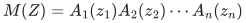

be a width-<code class="math">W</code> word in distinct variables. A factor may be constant. Generic rank means rank over the rational function field in the variables occurring in the matrix. A **physical interval** is a contiguous product of the displayed matrix factors, without adjoining the scalar endpoint vectors.

Write

<!-- math-display: 6be0e277adeea1aebe969878
P_s=\mathrm{diag}(I_s,0_{W-s}),
-->
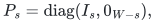

and let <code class="math">E_{ab}</code> be the matrix unit with its nonzero entry in row <code class="math">a</code> and column <code class="math">b</code>. A palette is an allowed set

<!-- math-display: a089342bc0ec1f197cb18877
\mathcal P=\{0=p_0<p_1<\cdots<p_m=W\}.
-->
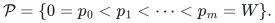

It is not required that every listed rank occur on a nonempty interval. In particular, the width <code class="math">W</code> remains a palette member even when the word has no full-rank factor.

For an exponent vector <code class="math">\alpha</code>, the support of <code class="math">Z^\alpha</code> is the number of indices with <code class="math">\alpha_i&gt;0</code>. For a fixed row <code class="math">u</code>, coefficient-row concentration at support <code class="math">b</code> means that the coefficient rows of <code class="math">uM</code> are spanned over <code class="math">F</code> by its actual coefficient rows whose monomials have support at most <code class="math">b</code>.

The following is the upper theorem used in the palette sharpness conclusion. It is proved in the companion manuscript's sections on weighted concentration and box quotients.

**Palette upper theorem.** Suppose every physical interval has generic rank equal to its rank at zero, and every such rank belongs to <code class="math">\mathcal P</code>. For every fixed row <code class="math">u</code>, the coefficient rows of <code class="math">uM</code> are spanned by coefficients supported on at most <code class="math">h(\mathcal P)</code> variables. Moreover, for fixed endpoints <code class="math">u,v</code> with <code class="math">uMv\ne0</code>, every monomial of the first nonzero ordinary homogeneous component of <code class="math">uMv</code> has support at most <code class="math">h(\mathcal P)</code>.

The theorem also holds in the finite monomial quotient setting needed to isolate a leading monomial. In that setting an interval of constant rank <code class="math">s</code> has a unit constant <code class="math">s</code>-pivot and vanishing <code class="math">(s+1)</code>-minors. This precise condition replaces fraction-field rank in a ring with zero divisors.

The next section proves that neither conclusion can have a smaller universal support constant under these hypotheses.

## 2. Exact sharpness for every palette

**Theorem 2.1.** For every field <code class="math">F</code> and every palette <code class="math">\mathcal P</code> of width <code class="math">W\ge1</code>, there is a word of <code class="math">N=h(\mathcal P)</code> affine univariate matrix factors on <code class="math">N</code> distinct variables such that:

1. Each factor has constant matrix <code class="math">P_s</code> and generic rank <code class="math">s</code> for a positive <code class="math">s\in\mathcal P</code>.
2. Every physical interval retains its generic rank at zero.
3. For standard-basis endpoints <code class="math">e_\alpha^T,e_\beta</code>, the scalar entry is the product of all <code class="math">N</code> variables, with coefficient one.

Consequently <code class="math">h(\mathcal P)</code> is the exact universal constant in both conclusions of the palette upper theorem.

### 2.1. Base case

Suppose <code class="math">\mathcal P=\{0,W\}</code>. Take the <code class="math">W-1</code> factors

<!-- math-display: c698ba60493defcfbaa20eb5
I_W+z_jE_{j,j+1},\qquad 1\le j<W,
-->
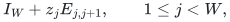

in that order, with source <code class="math">e_1^T</code> and sink <code class="math">e_W</code>. To reach coordinate <code class="math">W</code> from coordinate <code class="math">1</code>, a row must use every successive off-diagonal transition. Thus the scalar is

<!-- math-display: 7077c2bdb6381d157a9662c7
z_1z_2\cdots z_{W-1}.
-->
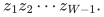

All factors are unipotent and have constant matrix <code class="math">I_W</code>, so every interval has generic and constant rank <code class="math">W</code>. The number of variables is <code class="math">W-1=h(\mathcal P)</code>.

When <code class="math">W=1</code>, use the empty word, whose scalar is <code class="math">1</code>. The empty monomial has support zero, agreeing with <code class="math">h(\{0,1\})=0</code>.

### 2.2. Recursive construction

Suppose <code class="math">\mathcal P</code> has at least two positive levels. Set

<!-- math-display: 5925c2c308d118bb2857de94
r=p_1<W,\qquad k=W-r,\qquad
\mathcal Q=\{0,p_2-r,\ldots,p_m-r=k\}.
-->
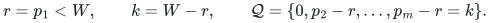

By induction, there is a width-<code class="math">k</code> word <code class="math">H</code> with standard endpoints <code class="math">e_\alpha^T,e_\beta</code> whose scalar is the product of its <code class="math">h(\mathcal Q)</code> variables. Take <code class="math">r+1</code> copies

<!-- math-display: def8b3bc1e9754f99e8f8269
H_0,H_1,\ldots,H_r
-->
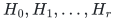

on disjoint variable sets. Embed every local factor <code class="math">A</code> of every copy as <code class="math">\mathrm{diag}(I_r,A)</code>. This increases its constant and generic ranks by <code class="math">r</code>; the resulting ranks belong to <code class="math">\mathcal P</code>.

For <code class="math">1\le j\le r</code>, introduce two fresh-variable factors

<!-- math-display: 52dc409888ba0d1a21878f8a
B_j=P_r+x_jE_{r+\beta,j},\qquad
C_j=P_r+y_jE_{j,r+\alpha}.
-->
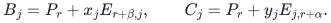

The extra row in <code class="math">B_j</code> is a multiple of active row <code class="math">j</code>, and the extra column in <code class="math">C_j</code> is a multiple of active column <code class="math">j</code>. Their top-left <code class="math">r</code>-minor is one. Hence each has generic rank exactly <code class="math">r</code> and constant matrix <code class="math">P_r</code>.

Use the word

<!-- math-display: c4c8ac7bd760b5180ec9b423
\mathrm{diag}(I_r,H_0)\,
B_1C_1\mathrm{diag}(I_r,H_1)\,
\cdots\,
B_rC_r\mathrm{diag}(I_r,H_r),
-->
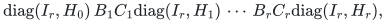

with source <code class="math">e_{r+\alpha}^T</code> and sink <code class="math">e_{r+\beta}</code>. Each displayed block diagonal denotes the product of the embedded local factors. It is not a multivariate local factor.

### 2.3. Exact scalar identity

After the first embedded copy, the row has passive part <code class="math">e_\alpha^TH_0</code> and no active coordinates. Multiplication by <code class="math">B_1</code> kills the passive coordinates and places

<!-- math-display: ab25e91d0c012aa1544c10a6
x_1H_0(\alpha,\beta)
-->
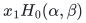

in active coordinate <code class="math">1</code>. Multiplication by <code class="math">C_1</code> retains that active entry and also places <code class="math">y_1</code> times it in passive coordinate <code class="math">\alpha</code>.

Inductively, after bridge pair <code class="math">j</code>, the active row is supported on <code class="math">\{1,\ldots,j\}</code> and the passive row is <code class="math">q_je_\alpha^T</code>. The next embedded copy preserves the active entries and changes the passive row to <code class="math">q_je_\alpha^TH_j</code>. The next <code class="math">B_{j+1}</code> sends its <code class="math">\beta</code>-coordinate to the new active coordinate <code class="math">j+1</code>. That coordinate had no earlier contribution. The next <code class="math">C_{j+1}</code> sends only this new coordinate back to passive coordinate <code class="math">\alpha</code>. Thus earlier active entries cannot create a later passive excursion.

It follows that

<!-- math-display: b395306f81bba34ae6e4f360
q_j=
\left(\prod_{a=1}^{j}x_ay_a\right)
\left(\prod_{a=0}^{j-1}H_a(\alpha,\beta)\right).
-->
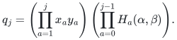

The last embedded copy and passive sink give exactly

<!-- math-display: 2db52dea48a3587931b77177
\left(\prod_{j=1}^{r}x_jy_j\right)
\left(\prod_{a=0}^{r}H_a(\alpha,\beta)\right).
-->
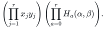

By induction, this is the squarefree product of all variables, with coefficient one. The identity uses no division and holds in every characteristic.

### 2.4. Number of variables and all interval ranks

The number of variables is

<!-- math-display: b4142a8f5b6c76f1eae57908
\begin{aligned}
(r+1)h(\mathcal Q)+2r
&=(r+1)\bigl(h(\mathcal Q)+2\bigr)-2\\
&=h(\mathcal P).
\end{aligned}
-->
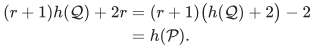

Indeed the first rank gap of <code class="math">\mathcal P</code> is <code class="math">r</code> and the remaining gaps are precisely those of <code class="math">\mathcal Q</code>.

Consider any nonempty physical interval and let <code class="math">s_{\min}</code> be the smallest rank of a local factor in it. Its constant product is <code class="math">P_{s_{\min}}</code> because the constant projections are nested. Therefore its generic rank is at least <code class="math">s_{\min}</code>. The product-rank inequality gives the reverse bound, since the interval contains a factor of rank <code class="math">s_{\min}</code>. Every interval consequently has generic rank equal to its rank at zero. This proves Theorem 2.1.

### 2.5. Coefficient-space and quotient consequences

Let <code class="math">u</code> be the constructed source row and <code class="math">v</code> the sink. The functional <code class="math">a\mapsto av</code> annihilates every coefficient row of <code class="math">uM</code> supported on fewer than <code class="math">N</code> variables, but it evaluates the full-product coefficient to one. Hence those smaller-support rows cannot span the full coefficient-row space. The same scalar is the entire first nonzero homogeneous component, so its support also proves the leading-component lower bound.

Passing to the quotient <code class="math">z_e^2=0</code> for every variable preserves the squarefree product. All larger-minor identities and constant unit pivots survive. Thus the example attains the same bound in the monomial Artin setting of the upper theorem.

In particular, the full palette gives <code class="math">h=2^W-2</code>. The palette <code class="math">\{0,r,W\}</code> gives

<!-- math-display: cfa29321d354f3da259da02d
h=(r+1)(W-r+1)-2.
-->
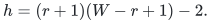

The latter has arbitrary endpoints. The stronger active-endpoint hypothesis in the next section gives a smaller bound.

## 3. The uniform active upper bound

Fix <code class="math">1\le r\le W</code> and let <code class="math">P=P_r</code>. Suppose each local constant is <code class="math">I_W</code> or <code class="math">P</code>. At a <code class="math">P</code>-layer, write

<!-- math-display: 7e07791be174a7eefd811253
B_i=\begin{pmatrix}E_i&F_i\\G_i&H_i\end{pmatrix},
\qquad E_i(0)=I_r,
-->
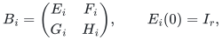

and assume the exact Schur identity

<!-- math-display: 5f0867871e99049a2cb0a9ed
H_i=G_iE_i^{-1}F_i.
-->
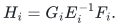

A polynomial or regular rational matrix of generic rank <code class="math">r</code> and constant matrix <code class="math">P</code> satisfies this identity. The formulation also applies to formal power series regular at zero.

Let the endpoints be active:

<!-- math-display: a0dce680b26d99fabad5bb4e
uP=u\ne0,\qquad Pv=v.
-->
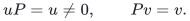

**Theorem 3.1.** If <code class="math">g=uB_1\cdots B_nv\ne0</code>, every monomial in its first nonzero ordinary homogeneous component has support at most

<!-- math-display: 9ff8ff3645f510fa03733cf8
h_{\mathrm{act}}=(W-r+1)(r-1).
-->
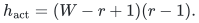

The active projections of the fixed-source coefficient rows are spanned by active projections of actual coefficients with support at most <code class="math">h_{\mathrm{act}}</code>. This active statement does not assert the same bound for the unprojected full row space.

### 3.1. Coefficient spaces in a finite box

We first prove the necessary concentration statement over

<!-- math-display: ca6e20079c1c7122229eab06
R=\bigotimes_{i=1}^{n}R_i,
\qquad R_i=F[Y_i]/(Y_i^{N_i+1}),
-->
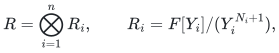

where <code class="math">N_i\ge0</code>. The case <code class="math">N_i=0</code> is a trivial variable block. A matrix with invertible constant term is a unit in each finite local ring. The surviving monomials form an <code class="math">F</code>-basis.

For a row or a matrix of row series, <code class="math">\mathrm{Coeff}</code> denotes the <code class="math">F</code>-span of its actual coefficient rows. Multiplying a row family on the left by a compatible matrix series takes linear combinations of existing coefficient rows. A square left multiplier with invertible constant term preserves the coefficient-row span in both directions, by applying the same observation to its inverse. Monomial truncation only deletes terms; it never identifies different surviving monomials.

Let <code class="math">S_i</code> be the coefficient-row space of <code class="math">uB_1\cdots B_i</code>, and set

<!-- math-display: 48d785a49693cb53ab6f9f2c
T_i=S_iP,\qquad d_i=\dim T_i,\qquad
a_i=\dim S_i-d_i,\qquad k=W-r.
-->
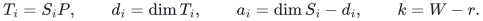

The kernel of active projection has dimension at most <code class="math">k</code>, so <code class="math">0\le a_i\le k</code>. Appending a local constant <code class="math">I_W</code> or <code class="math">P</code> preserves every old active projection. Thus <code class="math">T_{i-1}\subseteq T_i</code> and <code class="math">d_i</code> is nondecreasing. Initially <code class="math">d_0=1</code> and <code class="math">a_0=0</code>.

Put <code class="math">L_i=(k+1)(d_i-1)</code>. We prove simultaneously:

1. <code class="math">T_i</code> is spanned by active projections of actual coefficients supported on at most <code class="math">L_i</code> variables.
2. <code class="math">S_i</code> is spanned by actual coefficients supported on at most <code class="math">L_i+a_i</code> variables.

All spanning combinations have coefficients in <code class="math">F</code>. Multiplication of an old coefficient by any coefficient of the new local factor increases support by at most one. Because the variable blocks are disjoint, each such product is an actual coefficient of the new prefix.

### 3.2. Growth and stable identity steps

Write <code class="math">d=d_{i-1}</code>, <code class="math">a=a_{i-1}</code>, <code class="math">L=L_{i-1}</code> and <code class="math">\Delta=d_i-d</code>.

If <code class="math">\Delta&gt;0</code>, the old full space has a basis built from coefficients of support at most <code class="math">L+a</code>. Multiplying by all local coefficients spans <code class="math">S_i</code> at cost at most

<!-- math-display: 51bfbd35e33cc97e0a3a2df4
L+a+1\le L+k+1\le L+(k+1)\Delta=L_i.
-->
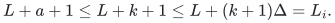

This proves both assertions at once.

Suppose <code class="math">\Delta=0</code> and <code class="math">B_i(0)=I_W</code>. Then <code class="math">S_{i-1}\subseteq S_i</code>. If their dimensions agree, the old full basis persists at local degree zero. Otherwise <code class="math">a_i\ge a+1</code>, and the multiplication bound <code class="math">L+a+1\le L+a_i</code> proves the full-space assertion. The old active witnesses persist in either case.

### 3.3. Stable projection steps

Suppose <code class="math">\Delta=0</code> and <code class="math">B_i(0)=P</code>. Write <code class="math">T=T_{i-1}=T_i</code>, identifying its active coordinates with a subspace of <code class="math">F^{1\times r}</code>. Choose a <code class="math">d\times r</code> field matrix <code class="math">T_0</code> whose rows form a basis of <code class="math">T</code>.

By the active induction hypothesis, choose a <code class="math">d\times W</code> field matrix <code class="math">Z</code> with rows in <code class="math">S_{i-1}</code>, each a combination of actual coefficients of support at most <code class="math">L</code>, such that the active block of <code class="math">Z</code> is <code class="math">T_0</code>.

The Schur identity implies that every output row factors through its active coordinates:

<!-- math-display: 5e4c5d0c991b60173e942fb6
aB_i=p_a(Y_i)[I_r,E_i^{-1}F_i].
-->
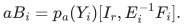

For <code class="math">a\in S_{i-1}</code>, each coefficient of <code class="math">p_a</code> belongs to the stable space <code class="math">T</code>, so

<!-- math-display: dc997719f927d19d0a00917d
p_a(Y_i)=c_a(Y_i)T_0
-->
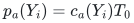

for a row <code class="math">c_a</code> over <code class="math">R_i</code>. For the selected lifts <code class="math">Z</code>, this gives

<!-- math-display: fa51ec9490126b1c9786e98c
ZB_i=R_0(Y_i)T_0[I_r,E_i^{-1}F_i],
\qquad R_0(0)=I_d.
-->
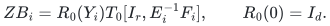

The matrix <code class="math">R_0</code> is a unit. Therefore

<!-- math-display: 9a8f0a09734480fbdd73d028
\mathrm{Coeff}(ZB_i)
=\mathrm{Coeff}\bigl(T_0[I_r,E_i^{-1}F_i]\bigr).
-->
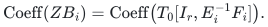

Every <code class="math">aB_i</code> with <code class="math">a\in S_{i-1}</code> has coefficient span contained in the right-hand side. Conversely, the rows of <code class="math">Z</code> belong to <code class="math">S_{i-1}</code>, so the left-hand side is contained in <code class="math">S_i</code>. Both are consequently equal to <code class="math">S_i</code>.

Thus the full space is generated at support cost at most <code class="math">L+1</code>. If <code class="math">a_i&gt;0</code>, this is at most <code class="math">L+a_i</code>. If <code class="math">a_i=0</code>, local constant multiplication by <code class="math">P</code> already supplies the pure active space <code class="math">T</code> inside <code class="math">S_i</code>. Their dimensions are equal, so <code class="math">S_i=T</code> and cost <code class="math">L</code> suffices. The active witnesses always persist at local degree zero. This completes the induction.

### 3.4. The scalar and every leading monomial

Since <code class="math">Pv=v</code>, the sink sees only the active projected coefficient space. If the scalar is nonzero in the finite box, the active spanning assertion supplies a nonzero scalar coefficient with support at most

<!-- math-display: e0c16b51ba85d6162045db0f
L_n\le(k+1)(r-1)=h_{\mathrm{act}}.
-->
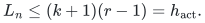

For a polynomial word, choosing the box bounds above its local degrees also proves the asserted active coefficient-span statement for the original polynomial. For a regular formal word, every particular coefficient lies in some finite box. The box argument expresses its active projection using original coefficients of support at most <code class="math">h_{\mathrm{act}}</code>, so the same span assertion follows for the full formal series.

Now return to the polynomial or regular formal word. Let <code class="math">c_\alpha Y^\alpha</code> be any nonzero monomial in its first nonzero ordinary homogeneous component, of degree <code class="math">m</code>. Set all variables outside its support to zero and quotient by <code class="math">Y_i^{\alpha_i+1}</code> on the remaining variables. Every surviving exponent vector is componentwise at most <code class="math">\alpha</code>. Each proper divisor has degree less than <code class="math">m</code> and zero scalar coefficient. Hence the entire quotient scalar is exactly <code class="math">c_\alpha Y^\alpha</code>.

All constants and Schur identities survive the quotient, and all matrices inverted above still have invertible constants. The finite-box result therefore forces

<!-- math-display: 68c2e0dc568385f5d8e99c39
|\mathrm{supp}\alpha|\le h_{\mathrm{act}}.
-->
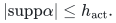

Since <code class="math">\alpha</code> was arbitrary, the bound holds for every monomial of the first component. No fraction-field rank over a ring with zero divisors is used. This proves Theorem 3.1.

## 4. Matching examples with active endpoints

**Theorem 4.1.** For every field and <code class="math">1\le r\le W</code>, the bound in Theorem 3.1 is attained by an affine univariate word with constant matrices <code class="math">P_r</code> and <code class="math">I_W</code>, local ranks <code class="math">r</code> and <code class="math">W</code>, and endpoints <code class="math">e_1^T,e_r</code>. Every physical interval retains its generic rank at zero.

Suppose first that <code class="math">1&lt;r&lt;W</code>. Put <code class="math">k=W-r</code> and <code class="math">P=P_r</code>. For each <code class="math">1\le j&lt;r</code>, use <code class="math">k+1</code> fresh variables and form the excursion

<!-- math-display: 4c81bc329a25282db5d8e30f
\begin{aligned}
D_j={}&(P+x_{j,0}E_{j,r+1})\\
&\cdot\left(\prod_{s=1}^{k-1}
          (I_W+x_{j,s}E_{r+s,r+s+1})\right)\\
&\cdot(P+x_{j,k}E_{W,j+1}).
\end{aligned}
-->
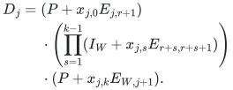

The middle product is empty when <code class="math">k=1</code>. The first factor has an extra column proportional to an active column; the last has an extra row proportional to an active row. Both have rank <code class="math">r</code> and constant <code class="math">P</code>. Every middle factor is unipotent.

On active rows, the excursion acts exactly as

<!-- math-display: 06378a09e8f806aba0d0a375
I_r+m_jE_{j,j+1},\qquad m_j=\prod_{s=0}^{k}x_{j,s}.
-->
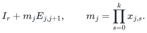

Indeed, a row may remain in its active coordinate. Its only other possibility is to enter passive coordinate <code class="math">r+1</code> from coordinate <code class="math">j</code>. To survive the final projection, it must traverse the entire passive chain to <code class="math">W</code> and exit at active coordinate <code class="math">j+1</code>. This uses all <code class="math">k+1</code> variables, and there is no second surviving passive path.

Concatenate <code class="math">D_1,\ldots,D_{r-1}</code>. The source-to-sink scalar is the <code class="math">(1,r)</code>-entry of

<!-- math-display: 679c34db2c6df25cde7df565
\prod_{j=1}^{r-1}(I_r+m_jE_{j,j+1}),
-->
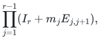

which is exactly <code class="math">\prod_jm_j</code>. It is the squarefree product of

<!-- math-display: 84287dc3a631ea06821b645e
(k+1)(r-1)=(W-r+1)(r-1)
-->
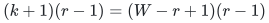

distinct variables.

An interval containing a <code class="math">P</code>-type factor has constant product <code class="math">P</code> and includes a factor of generic rank <code class="math">r</code>, so both ranks are <code class="math">r</code>. An interval containing only unipotent factors has both ranks <code class="math">W</code>. The endpoints are active, and the full constant product is <code class="math">P</code>.

If <code class="math">r=W</code>, use the <code class="math">r-1</code> factors <code class="math">I_W+x_jE_{j,j+1}</code> with the same endpoints. Their scalar is the full product and their support is <code class="math">r-1=h_{\mathrm{act}}</code>. If <code class="math">r=1</code>, use the empty word and endpoints <code class="math">e_1^T,e_1</code>. Its scalar is one and its support is zero. For this empty-word case the full constant product is <code class="math">I_W</code>, not <code class="math">P_1</code>; both endpoints are nevertheless active for <code class="math">P_1</code>.

These examples establish exactness for the scalar and active-projection conclusions of Theorem 3.1. In particular, at <code class="math">W=4,r=3</code> the word

<!-- math-display: e900e2ccbc38cac858fe1770
(P_3+x_1E_{14})(P_3+x_2E_{42})
(P_3+x_3E_{24})(P_3+x_4E_{43})
-->
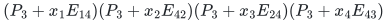

has scalar <code class="math">x_1x_2x_3x_4</code> between <code class="math">e_1^T</code> and <code class="math">e_3</code>, and every physical interval has generic and constant rank three.

## 5. A lift to an actual original-field moment curve

The zero-point examples have an additional common property. Every local factor is

<!-- math-display: 441c38916e63d8145b461e45
P_s+z_eE_{a_e b_e},\qquad a_e\ne b_e,
-->
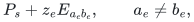

and at least one of its two indices is active for <code class="math">P_s</code>. Equivalently, writing <code class="math">E=E_{a_e b_e}</code>, either <code class="math">P_sE=E</code> or <code class="math">EP_s=E</code>. The recursive embeddings preserve this property. It holds for the uniform excursion words as well.

**Theorem 5.1.** Let a width-<code class="math">W</code> word on <code class="math">N</code> distinct edge variables have the preceding form and a fixed scalar contraction equal to <code class="math">\prod_{e=1}^{N}z_e</code>. If <code class="math">N\ge1</code>, it has a width-preserving replacement by an original-field read-once word on <code class="math">n=4N-2</code> coordinates, with local degrees at most two, such that:

1. Every physical interval retains its generic rank at <code class="math">\gamma_i(t)=t^i</code>.
2. The first homogeneous scalar component after that shift has degree, support, and characteristic digit degree exactly <code class="math">N</code>.
3. Its fixed-source coefficient rows cannot be spanned by rows supported on fewer than <code class="math">N</code> coordinates.

For <code class="math">N=0</code>, use the empty constant word and no curve coordinates. There is no claim of a nonconstant first component in that case.

### 5.1. Two univariate factors per edge

Give edge <code class="math">e</code> two distinct variables <code class="math">x_e,y_e</code>. If <code class="math">P_sE=E</code>, replace it by

<!-- math-display: 14b922a89474859882327c5f
(P_s+x_e^2E)(I_W-y_eE).
-->
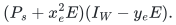

Otherwise <code class="math">EP_s=E</code>, and use

<!-- math-display: b8b2ad111b1fd54391ae1a0e
(I_W-y_eE)(P_s+x_e^2E).
-->
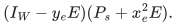

When both conditions hold, either orientation is valid. Since <code class="math">E^2=0</code>, each product is exactly

<!-- math-display: 431f27e6c1ff84510e961f6b
P_s+(x_e^2-y_e)E.
-->
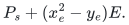

These are two original-field univariate factors, not one multivariate factor. Their ranks are <code class="math">s</code> and <code class="math">W</code>: the rank-<code class="math">s</code> factor is <code class="math">P_s</code> times an invertible shear, or an invertible shear times <code class="math">P_s</code>. Consequently the scalar identity becomes

<!-- math-display: b809869f8ddea629b6503323
f(x,y)=\prod_{e=1}^{N}(x_e^2-y_e).
-->
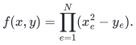

### 5.2. Rank preservation on intervals ending inside a macro

Work first at any coefficient-field point <code class="math">C</code> satisfying <code class="math">C_{y_e}=C_{x_e}^2</code>. Set

<!-- math-display: a2ee0d328b45d3bb64dff39e
U_e=I_W+C_{x_e}^2E,\qquad U_e^{-1}=I_W-C_{x_e}^2E.
-->
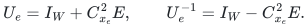

At <code class="math">C</code>, the two orientations become, respectively,

<!-- math-display: 89f1f7d37e0bbd75706c3a04
[P_sU_e,\ U_e^{-1}]
\qquad\text{or}\qquad
[U_e^{-1},\ U_eP_s].
-->
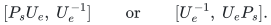

Every complete macro is <code class="math">P_s</code>. Consider any interval of the expanded physical word. All its interior macros are complete. A partial initial macro contributes an invertible left factor, possibly followed by its projection; a partial final macro contributes an invertible right factor, possibly preceded by its projection. Intervals contained in one macro satisfy the same assertion directly from the displayed pair.

Thus the evaluated interval has the form

<!-- math-display: 4da03d6877e896315aaa01b5
U_{\mathrm L}\left(\prod P_s\right)U_{\mathrm R},
-->
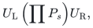

with invertible outer factors. The middle product is the product of the nested projections corresponding to rank-<code class="math">s</code> physical factors actually contained in the interval; it is <code class="math">I_W</code> if there are none. Its rank is therefore the minimum local rank in the interval.

The generic interval rank is at most that same minimum. Evaluation supplies the reverse inequality, proving equality. No shear is commuted through a projection. This verifies all partial-macro intervals, not only complete macros or the full word.

Constant identity factors can be inserted anywhere without changing the argument. If normalized constants are desired, choose the internal cut gauge <code class="math">U_e^{-1}</code> in the first orientation and <code class="math">U_e</code> in the second, with identity gauges at macro boundaries. The normalized pair has constants <code class="math">P_s,I_W</code> or <code class="math">I_W,P_s</code>. These are proof gauges over the shifted coefficient field; the original local factors still have coefficients in <code class="math">F</code>.

### 5.3. Coordinates of the prescribed moment curve

For <code class="math">N\ge1</code>, assign

<!-- math-display: 1b9807a2c0d8e29dcf922aeb
x_e=X_{2e-1},\qquad y_e=X_{4e-2},\qquad 1\le e\le N.
-->
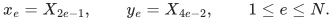

The <code class="math">x</code>-indices are odd and distinct, the <code class="math">y</code>-indices are even and distinct, and the largest is <code class="math">4N-2</code>. Pad every unused coordinate among <code class="math">1,\ldots,4N-2</code> with a constant identity factor. This gives an ordinary ROABP in an allowed variable order. Its affine transformation can be the identity; the factor order is a permutation of the coordinates.

At the actual curve <code class="math">\gamma_i(t)=t^i</code>,

<!-- math-display: 7e42087d3a99903ce5e2b292
C_{x_e}=t^{2e-1},\qquad
C_{y_e}=t^{4e-2}=C_{x_e}^2.
-->
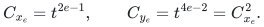

Every coordinate is individually transcendental over <code class="math">F</code> in every characteristic, and the interval argument applies. No arbitrary shift-dependent local matrix has been inserted. In characteristic zero the derivatives of the curve coordinates are linearly independent as well. In small characteristic this stronger derivative statement need not hold; the claimed all-characteristic lift only uses individual transcendence.

### 5.4. Leading component and coefficient-space obstruction

Write <code class="math">X'_e,Y'_e</code> for the residual coordinates of pair <code class="math">e</code>. The exact expansion is

<!-- math-display: ffbf48de0ed2a1e5cdcca662
f(C+X')=
\prod_{e=1}^{N}
\left(2C_{x_e}X'_e-Y'_e+(X'_e)^2\right).
-->
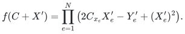

Each factor has nonzero linear part because the coefficient of <code class="math">Y'_e</code> is <code class="math">-1</code>. Hence the first ordinary homogeneous component is

<!-- math-display: 9e7180ed01f700bad02c1579
H_C(X',Y')=
\prod_{e=1}^{N}(2C_{x_e}X'_e-Y'_e).
-->
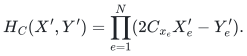

Its all-<code class="math">Y'</code> coefficient is <code class="math">(-1)^N</code>, so it is nonzero in every characteristic. Each nonzero monomial chooses one coordinate from each disjoint pair. It has support <code class="math">N</code> and all exponents equal to one.

In characteristic <code class="math">p&gt;0</code>, define the digit degree of a monomial by summing the base-<code class="math">p</code> digit sums of its exponents. In characteristic zero use ordinary degree. The component above has digit degree exactly <code class="math">N</code>. In characteristic two it is just the all-<code class="math">Y'</code> monomial.

Every monomial of the entire residual scalar uses at least one coordinate from each pair. The fixed sink therefore kills all row coefficients supported on fewer than <code class="math">N</code> coordinates, but not the all-<code class="math">Y'</code> coefficient. Those low-support rows cannot span the full fixed-source coefficient space over <code class="math">F(t)</code>. This proves Theorem 5.1.

## 6. Exact sharpness at the actual curve

Apply Theorem 5.1 to Theorem 2.1. Its base factors, bridges, and recursive embeddings all have the required off-diagonal matrix-unit form with an active index. Thus for every palette <code class="math">\mathcal P</code>, the support value

<!-- math-display: 441986da4e48b8a65ea9acfd
N=h(\mathcal P)
-->
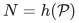

is attained after the actual moment-curve shift, with local degree at most two and all physical interval ranks preserved. Extra shear and padding factors have rank <code class="math">W</code>, already a palette member. The palette upper theorem therefore remains exactly sharp under this additional original-field shifted realization.

Likewise, applying the lift to Theorem 4.1 attains

<!-- math-display: d6a707f85ff05db63c20a42c
N=(W-r+1)(r-1)
-->
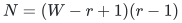

with active endpoints and constant-normalized layers <code class="math">P_r/I_W</code>. For <code class="math">N&gt;0</code>, the full constant product is <code class="math">P_r</code>. For <code class="math">N=0</code>, the empty product is <code class="math">I_W</code>. Both endpoints are active for <code class="math">P_r</code> in either case. This establishes exactness of the uniform active support bound at the actual curve as well.

The assertion about digit degree is a lower example for the whole first component; it is not a universal digit-degree upper theorem inferred from support. General monomials of small support can have large exponent digit sums.

## 7. Physical intervals, endpoint augmentation, and SV

The interval statements above concern the physical matrix word. They do not include scalar endpoint augmentation. If one appends the constant matrices <code class="math">e_1u</code> and <code class="math">ve_1^T</code>, the full augmented product is <code class="math">fE_{11}</code>. For <code class="math">N&gt;0</code>, this product has generic rank one but rank zero at the moment curve, since <code class="math">f(C)=0</code>. Thus its full augmented interval does **not** preserve rank. This is consistent with the separate endpoint-augmented preparation required by the affine-PIT proof.

The examples also survive a single fresh SV pair. Over a working field with enough distinct interpolation nodes, let <code class="math">\lambda_i(y)</code> be the Lagrange basis polynomials and write <code class="math">\mathrm{SV}_{1,i}=z\lambda_i(y)</code>. For each lifted relation, substitution after the curve gives linear amplitude coefficient

<!-- math-display: 5221439e347d95e6297d596c
2C_{x_e}\lambda_{x_e}(y)-\lambda_{y_e}(y).
-->
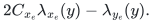

It is nonzero over <code class="math">F(t)</code>: it is either a nontrivial combination of two distinct, linearly independent Lagrange polynomials or, in characteristic two, just <code class="math">-\lambda_{y_e}(y)</code>. Every factor remains a nonzero polynomial, and their product remains nonzero. Thus <code class="math">\gamma+\mathrm{SV}_1</code> already detects these examples.

Even without the curve, the substitution into a relation is

<!-- math-display: 980535932bbe31755567d1b2
z^2\lambda_{x_e}(y)^2-z\lambda_{y_e}(y),
-->
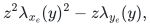

which is nonzero because its two terms have different amplitude degrees and its linear coefficient is nonzero. Hence <code class="math">\mathrm{SV}_1</code> detects the unshifted product as well.

The examples therefore establish exact support obstructions, not lower bounds on the number of SV pairs, seed variables, black-box queries, or the complexity of affine-orbit identity testing. They also do not show that an extremizer for a compound-shaped rank palette is itself an exterior power of a smaller matrix word. That additional representation condition is separate from the abstract palette hypotheses.

## 8. Provenance and dependencies

This canonical manuscript consolidates the following internally reviewed sources. The hashes identify the exact mathematical versions used; they do not constitute formal proof certificates.

| Content | Source version and SHA-256 |
|---|---|
| General palette upper theorem | Companion `general_affine_roabp_all_characteristics.tex`, final reviewed version: `9864136e134bbc9c3f35d8d0f1fb7595cf40c397e01d0247173956795f0c695f` |
| Exact palette lower construction | `rank_palette_exact_sharpness_candidate.txt`: `210aeda2b4bad178a215d6fc8b23f4666d24b4bcd5a137f9a44fb38d25e06dce` |
| Uniform active upper proof over finite boxes | `mixed_projection_artin_leading_support_candidate.txt`: `bd2a4ec45d3804ad7236935fc95add8f9a90c997722580b0cea0d2c14e090f90` |
| Uniform matching examples | `mixed_projection_artin_support_sharpness.txt`: `fba887bfa28e1c8ed4faec120111718d471b21c77f0b7cb767bfe44f8ab8c9d8` |
| Actual-curve lift, including the empty-word clarification | `rank_stable_support_lower_bound_actual_curve_lift.txt`: `4126eacd502cf8143f133cedf74f4797ae98b4a7f2ab382574f040f7c4ebdd60` |

The general coefficient-space induction is maintained in the [core manuscript](general-affine.tex), with its model and dependencies summarized in the [proof overview](../proof.md). The proof of the uniform active bound is reproduced here in full because it has a stronger endpoint hypothesis and a sharper constant. No external theorem is used to justify the elementary lower constructions or the macro lift.
