# A quadratic leading-digit obstruction at the ordinary moment curve

<!-- review-status:start -->
**Ready for review.** The binomial determinant formula and original-field actual-curve construction have a complete symbolic proof and a separate internal reconstruction. The first ordinary homogeneous component has digit degree exactly w²−1.

**Dependencies and scope.** Width w≥2 and prime characteristic p>w²+w−2; the construction uses n=p coordinates and scalar total degree 2p(w−1). The curve is the ordinary moment curve, whose p-th coordinate has zero derivative. This is not a counterexample to a derivative-separating-curve theorem. Every physical interval preserves full rank. The endpoint-augmented scalar interval does not. One SV pair detects the example, so no PIT or generator lower bound is asserted. The audit is internal model-assisted reconstruction, not external peer review, formal certification or priority determination.

The [verification note](../verify/README.md) identifies executable coverage. This status does not claim external peer review or proof-assistant verification.
<!-- review-status:end -->

**Authors:** Yilin Liu and GPT-6 Astra Pro

**Publication date:** 27 October 2026

**Review status.** The underlying construction has received independent model-assisted internal reconstructions and an exact-source audit. This formal presentation has been checked against that audited source. External peer review and proof-assistant certification remain outstanding; no publication-priority claim is made.

## Abstract

We construct an original-field width-<code class="math">w</code> read-once polynomial matrix word whose local matrices, and every consecutive product of its local matrices, remain invertible at the ordinary moment curve. Nevertheless, its entire first nonzero homogeneous residual component has characteristic digit degree <code class="math">w^2-1</code>. The construction works in every prime characteristic <code class="math">p&gt;w^2+w-2</code> and uses <code class="math">n=p</code> observed coordinates, of which only three are active.

The example distinguishes two shift hypotheses. Individual transcendence of the local arguments does not force leading digit degree at most <code class="math">w-1</code>. A curve that separates derivatives is a stronger hypothesis, which this example fails. The result is also compatible with a small hitting map: adding one Shpilka–Volkovich pair to the ordinary curve already detects the constructed polynomial. Thus the obstruction concerns a leading-component bound, not the number of generator pairs or oracle queries needed for identity testing.

## 1. Definitions and theorem

Let <code class="math">\mathbb F</code> be a field of prime characteristic <code class="math">p</code>. If

<!-- math-display: fb9a4f328d8b84ecd2d57700
a=\sum_{e\ge 0}a_e p^e,\qquad 0\le a_e<p,
-->
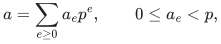

define its characteristic digit weight by

<!-- math-display: 4af6db06eb194ae25f302404
\mathrm{wt}_p(a)=\sum_e a_e.
-->
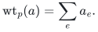

The digit degree of a monomial <code class="math">Y^\alpha</code> is <code class="math">\sum_i\mathrm{wt}_p(\alpha_i)</code>, and the digit degree of a nonzero polynomial is the maximum of these values over its nonzero monomials. Ordinary total degree continues to mean <code class="math">\sum_i\alpha_i</code>.

A width-<code class="math">w</code> read-once polynomial matrix word is a product of <code class="math">w\times w</code> univariate polynomial matrices, with each observed variable assigned to at most one matrix. A variable may be unused by assigning it the identity matrix. The scalar output is a constant row times the matrix product times a constant column. A **physical interval** is a consecutive product of the local <code class="math">w\times w</code> matrices, before appending any matrices that encode the scalar endpoints.

For the ordinary moment curve

<!-- math-display: 8688d9dc0f6ea241d7f71581
\gamma(t)=(t,t^2,\ldots,t^n),
-->
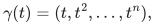

we regard <code class="math">f(\gamma(t)+Y)</code> as a polynomial in <code class="math">Y</code> over <code class="math">\mathbb F(t)</code>. Its first nonzero homogeneous component is defined using ordinary total degree in <code class="math">Y</code>.

**Theorem 1.** Let <code class="math">w\ge 2</code>, put <code class="math">N=w^2-1</code>, and let <code class="math">\mathbb F</code> have prime characteristic

<!-- math-display: 3ee0499c3eb7a48ce28ff2c8
p>N+w-1=w^2+w-2.
-->
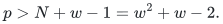

There is a width-<code class="math">w</code> read-once polynomial matrix word over <code class="math">\mathbb F</code> in <code class="math">n=p</code> observed variables, with nonzero scalar output <code class="math">f</code>, having the following properties:

1. Every local matrix is generically invertible, and every physical interval has rank <code class="math">w</code> both generically and after substitution by <code class="math">\gamma</code>.
2. Every observed curve coordinate is transcendental over <code class="math">\mathbb F</code>.
3. The scalar has total degree exactly <code class="math">2p(w-1)</code>, satisfies <code class="math">f(\gamma)=0</code>, and has first nonzero homogeneous residual component

   <!-- math-display: 7679dd332feab6bdf8cf4396
   [f(\gamma+Y)]_{N}=(-Y_p)^N.
   -->
   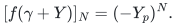

   All components of smaller ordinary degree vanish. Consequently the entire first component has digit degree exactly <code class="math">w^2-1</code>.

The matrices are defined over the original field. Their coefficients do not depend on the shift parameter <code class="math">t</code>.

The proof occupies Sections 2–5. Section 6 explains the shift hypotheses, and Section 7 proves the asserted success of one additional SV pair.

## 2. A consecutive-binomial determinant

We first establish the determinant identity needed to keep the middle matrix invertible in the stated characteristics. All factorial expressions in the following lemma are initially interpreted over <code class="math">\mathbb Q</code>.

**Lemma 2.** Let <code class="math">N\ge w-1</code>, and let <code class="math">k_0,\ldots,k_{w-1}</code> be integers satisfying <code class="math">0\le k_j\le N-w+1</code>. Then

<!-- math-display: 9658285dc027ae4a1d6350a9
\det_{0\le i,j<w}\binom{N}{k_j+i}
=
(-1)^{w(w-1)/2}
\frac{
\displaystyle\left(\prod_{s=0}^{w-1}(N+s)!\right)
\left(\prod_{0\le a<b<w}(k_b-k_a)\right)
}{
\displaystyle\prod_{j=0}^{w-1}(k_j+w-1)!(N-k_j)!
}.
\tag{1}
-->
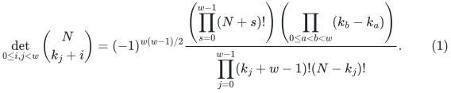

**Proof.** Factor

<!-- math-display: 4cf2e432cdc886371141d6c4
c_j=\frac{N!}{(k_j+w-1)!(N-k_j)!}
-->
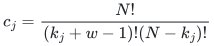

from column <code class="math">j</code>. The remaining entry is <code class="math">P_i(k_j)</code>, where

<!-- math-display: 6cd2cedf850311e2c0230f54
P_i(k)=
\left(\prod_{a=i+1}^{w-1}(k+a)\right)
\left(\prod_{b=0}^{i-1}(N-k-b)\right).
\tag{2}
-->
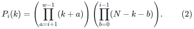

An empty product is one. Direct cancellation of factorials gives

<!-- math-display: 78c0cb1863241a8399e64a63
c_jP_i(k_j)
=\frac{N!}{(k_j+i)!(N-k_j-i)!}
=\binom{N}{k_j+i}.
-->
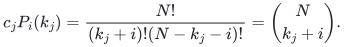

Each <code class="math">P_i</code> has degree at most <code class="math">w-1</code>. Let <code class="math">M</code> be their coefficient matrix, with row <code class="math">i</code> listing the coefficients of <code class="math">1,k,\ldots,k^{w-1}</code>. To compute <code class="math">\det M</code>, evaluate the polynomials at

<!-- math-display: cbf692104c38d2ae596fad84
q_s=N-s,\qquad 0\le s<w.
-->
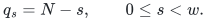

If <code class="math">i&gt;s</code>, the second product in (2) contains the zero factor corresponding to <code class="math">b=s</code>. On the diagonal,

<!-- math-display: 0d373103cbc405d7ec6bf951
P_s(q_s)=s!\,\frac{(N+w-1-s)!}{N!}.
-->
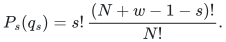

Thus the matrix <code class="math">(P_i(q_s))_{i,s}</code> is triangular with these diagonal entries. Its determinant is also <code class="math">\det M</code> times the Vandermonde determinant of the <code class="math">q_s</code>. That Vandermonde is

<!-- math-display: e97b961589ae5111f2e71137
\prod_{0\le a<b<w}(q_b-q_a)
=(-1)^{w(w-1)/2}\prod_{s=0}^{w-1}s!.
-->
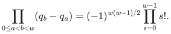

It follows that

<!-- math-display: c16b00a73e12c4ca40b80dff
\det M
=(-1)^{w(w-1)/2}
\frac{\prod_{s=0}^{w-1}(N+s)!}{(N!)^w}.
-->
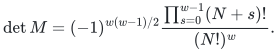

Evaluating the same coefficient matrix at the <code class="math">k_j</code> gives

<!-- math-display: 8e89f38f976c9b8cc7111484
\det(P_i(k_j))_{i,j}
=\det M\prod_{0\le a<b<w}(k_b-k_a).
-->
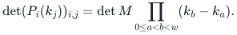

Restoring the column factors <code class="math">c_j</code> proves (1). <code class="math">\square</code>

We apply the lemma with <code class="math">N=w^2-1</code> and <code class="math">k_j=wj</code>. The largest <code class="math">k_j</code> is <code class="math">w(w-1)=N-w+1</code>, so the lemma applies. After clearing factorial denominators, (1) is an integer equality and may be reduced modulo <code class="math">p</code> whenever those denominators are units. Under <code class="math">p&gt;N+w-1</code>, every factorial in (1) is a unit. Moreover,

<!-- math-display: 609e326578db3fb39a99f90d
0<w(b-a)\le w(w-1)

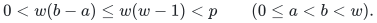

Every Vandermonde factor is therefore nonzero modulo <code class="math">p</code>. We have proved

<!-- math-display: 4045d9cda5105db200ed64e3
\det_{0\le i,j<w}\binom{N}{i+wj}\ne 0
\quad\text{in }\mathbb F.
\tag{3}
-->
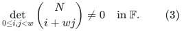

This explicit unit calculation is needed: a nonzero rational determinant alone would not justify nonvanishing after reduction modulo <code class="math">p</code>.

## 3. An invertible middle matrix with a high-order contraction

Index rows and columns by <code class="math">0,\ldots,w-1</code>, and define

<!-- math-display: 3860937b74cf71fc4cfad124
A_{ij}(T)
=(-1)^{N-i-wj}\binom{N}{i+wj}T^{N-i-wj}.
\tag{4}
-->
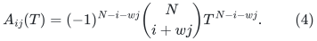

The map <code class="math">(i,j)\mapsto i+wj</code> is a bijection onto <code class="math">0,\ldots,N</code>. All exponents in (4) are therefore nonnegative. Since <code class="math">p&gt;N</code>, all its binomial coefficients are nonzero in <code class="math">\mathbb F</code>.

For an independent indeterminate <code class="math">C</code>, put

<!-- math-display: 186d2ec51f3bd734155c8cf9
u(C)=(1,C,\ldots,C^{w-1}),\qquad
v(C)=(1,C^w,\ldots,C^{w(w-1)})^{\mathsf T}.
-->
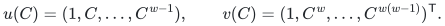

The bijection above and the binomial theorem give

<!-- math-display: 5be0787ecc61f8e9c18d61c2
u(C)A(T)v(C)
=\sum_{m=0}^{N}(-1)^{N-m}\binom Nm C^mT^{N-m}
=(C-T)^N.
\tag{5}
-->
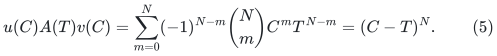

Despite this high-order scalar contraction, <code class="math">A</code> is generically invertible. For a determinant term indexed by a permutation <code class="math">\sigma</code>, its total power of <code class="math">T</code>, and the total exponent of the signs in (4), are both

<!-- math-display: 1e0bdb626dd28a380a477059
E=wN-\sum_{i=0}^{w-1}i-w\sum_{i=0}^{w-1}\sigma(i)
=\frac{w(w^2-1)}2.
-->
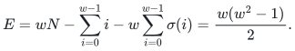

This is an integer. All determinant terms therefore have the same monomial and the same sign factor, apart from the permutation sign. Consequently

<!-- math-display: ee70c1078db151928e91ac6f
\det A(T)
=(-1)^ET^E
\det_{0\le i,j<w}\binom N{i+wj}.
\tag{6}
-->
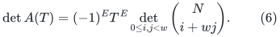

By (3), this is a nonzero scalar times <code class="math">T^E</code>. In particular, <code class="math">A(C)</code> is invertible whenever <code class="math">C</code> is transcendental over <code class="math">\mathbb F</code>.

The entries of <code class="math">A</code> are nonzero scalar multiples of the distinct monomials <code class="math">1,T,\ldots,T^N</code>. Thus their original-field span has dimension <code class="math">N+1=w^2</code>. If Hasse differentiation is defined by

<!-- math-display: 9e3fafe97402a43a15b6dd06
D^{[a]}R(T)=[h^a]R(T+h),
-->
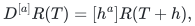

call <code class="math">a</code> a pivot order when the order-<code class="math">a</code> derivative vector is not in the <code class="math">\mathbb F(T)</code>-span of its predecessors. The vector of entries of <code class="math">A</code> has pivot orders <code class="math">0,1,\ldots,N</code>. Indeed, after ordering and scaling its coordinates to <code class="math">1,T,\ldots,T^N</code>, the jet matrix <code class="math">D^{[a]}T^d</code> has zero entries for <code class="math">d&lt;a</code> and diagonal entries one. Every initial square minor is therefore nonzero. The contraction in (5) reaches the last of these orders. The next section realizes its apparently moving endpoints within an original-field read-once word.

## 4. Realizing the endpoints and computing the scalar degree

Let <code class="math">U(X)</code> be the identity matrix except that its first row is

<!-- math-display: 8be9c549f62de2139c152ee6
(1,X^p,X^{2p},\ldots,X^{(w-1)p}).
-->
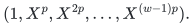

Let <code class="math">V(Z)</code> be the identity matrix except that its first column is

<!-- math-display: 30a8cc74ab507e24fca42b65
(1,Z^p,Z^{2p},\ldots,Z^{(w-1)p})^{\mathsf T}.
-->
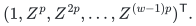

These matrices are unipotent: <code class="math">U-I</code> and <code class="math">V-I</code> each square to zero and have zero diagonal. In particular,

<!-- math-display: 078150c8c9cb8d466345fa93
\det U(X)=\det V(Z)=1.
-->
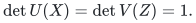

Let <code class="math">e_1</code> denote the first standard column vector, and define the scalar

<!-- math-display: 1c45dceb1e88ccc122d97dba
F(X,T,Z)=e_1^{\mathsf T}U(X)A(T)V(Z)e_1.
\tag{7}
-->
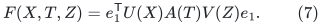

This is a width-<code class="math">w</code> word on three distinct variables, each occurring in exactly one layer. Every matrix entry belongs to a univariate polynomial ring over <code class="math">\mathbb F</code>; there is no dependence on a shift parameter in any original coefficient.

The term indexed by <code class="math">(i,j)</code> in (7) is

<!-- math-display: 7f2f8a618bc95870924963ac
(-1)^{N-i-wj}\binom N{i+wj}
X^{ip}T^{N-i-wj}Z^{jp}.
-->
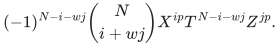

Distinct pairs <code class="math">(i,j)</code> have distinct <code class="math">X,Z</code> exponent pairs, so these terms cannot cancel. Their ordinary total degrees are

<!-- math-display: d7665b999a1882949f9efda3
N+i(p-1)+j(p-w).
-->
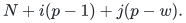

Both slopes are positive. The unique largest degree occurs at <code class="math">i=j=w-1</code>, where the <code class="math">T</code> exponent is zero and the coefficient is one. Its degree is

<!-- math-display: 3eb02018b6ffb7af629b2779
N+(w-1)(p-1)+(w-1)(p-w)=2p(w-1).
\tag{8}
-->
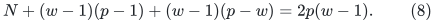

Thus <code class="math">F</code> is nonzero and has exactly the degree asserted in Theorem 1.

## 5. The actual moment curve and the complete first component

Take <code class="math">n=p</code> observed variables <code class="math">x_1,\ldots,x_p</code>, and set

<!-- math-display: 0b80fdccb168491005d42ad9
f(x_1,\ldots,x_p)=F(x_1,x_p,x_w).
-->
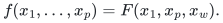

The indices <code class="math">1,w,p</code> are distinct because <code class="math">2\le w&lt;p</code>. Use the active matrix order <code class="math">U(x_1),A(x_p),V(x_w)</code> and insert identity matrices for all other observed variables. This is a valid read-once order; unused variables do not change the scalar or the matrix product.

At <code class="math">x_i=t^i</code>, write <code class="math">C=t^p</code>. Then

<!-- math-display: d2f79225e71f55a06a55f186
x_1^p=C,\qquad x_p=C,\qquad x_w^p=C^w.
-->
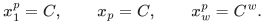

The evaluated source row and sink column are exactly <code class="math">u(C)</code> and <code class="math">v(C)</code> from Section 3. Equation (5) therefore gives <code class="math">f(\gamma)=0</code>.

Each evaluated local matrix is invertible over <code class="math">\mathbb F(t)</code>: the two endpoint factors and all padding factors have determinant one, and <code class="math">A(C)</code> is invertible by (6). Each generic local matrix is invertible as well. Every consecutive product of such matrices consequently has rank <code class="math">w</code> in both settings. Every coordinate <code class="math">t^i</code> is transcendental over the original field, even when its ordinary derivative vanishes.

It remains to determine the **whole** first homogeneous residual component. Frobenius gives

<!-- math-display: 2599f244d069e039ecf39cd8
(t+Y_1)^p=C+Y_1^p,\qquad
(t^w+Y_w)^p=C^w+Y_w^p.
-->
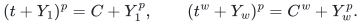

For <code class="math">0\le i,j&lt;w</code>, the entries <code class="math">X^{ip}</code> and <code class="math">Z^{jp}</code> are powers of these expressions. Every nonconstant residual contribution from <code class="math">U</code> or <code class="math">V</code> therefore has ordinary degree at least <code class="math">p</code>. Multiplying by other polynomial factors cannot reduce that degree. Because <code class="math">p&gt;N</code>, all terms of degree at most <code class="math">N</code> in <code class="math">f(\gamma+Y)</code> come from the constant endpoint row and column, with only the middle argument varying. Their contraction is exactly

<!-- math-display: 39435802f6168066bebed511
u(C)A(C+Y_p)v(C)=(-Y_p)^N.
\tag{9}
-->
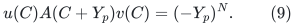

All residual components below degree <code class="math">N</code> vanish, and the complete component of degree <code class="math">N</code> is the right-hand side of (9). Since <code class="math">0&lt;N&lt;p</code>, the single base-<code class="math">p</code> digit of <code class="math">N</code> has value <code class="math">N</code>, so this component has digit degree <code class="math">N=w^2-1</code>. This completes the proof of Theorem 1. <code class="math">\square</code>

## 6. Individual transcendence and derivative separation

The example satisfies individual transcendence at an actual correlated shift, with every physical interval already full rank. It therefore refutes the proposed implication

<!-- math-display: 97f28d24a3e69a5910415df7
\text{individual transcendence and invertible local factors}
\quad\Longrightarrow\quad
\text{first-component digit degree}\le w-1.
-->
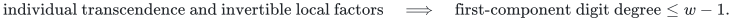

More generally, any width-only upper bound for that first-component quantity, uniformly over this class of characteristics and ordinary moment curves, must be at least <code class="math">w^2-1</code>.

Derivative separation is a stronger requirement. To ensure that every nonzero original-field linear form in the observed coordinates has nonzero derivative after a curve substitution, the coordinate derivatives must be linearly independent over the original field. Here

<!-- math-display: 747a304d4a4a0c5805635f51
\frac{d}{dt}\gamma_p(t)=\frac{d}{dt}t^p=0,
-->
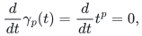

so even the active middle coordinate fails that requirement. The construction supplies no counterexample under a derivative-separating curve, such as the curve whose exponents are the first <code class="math">n</code> positive integers not divisible by <code class="math">p</code>.

It also does not satisfy a good-characteristic hypothesis <code class="math">p&gt;\delta</code> when <code class="math">\delta</code> bounds the degrees of all local matrix entries: <code class="math">U</code> and <code class="math">V</code> have degree <code class="math">(w-1)p\ge p</code>. Its compatibility with those separate hypotheses is therefore explicit.

The physical-interval qualification matters. If the scalar endpoints are encoded by additional constant rank-one matrices, the augmented full interval has rank one generically but rank zero at <code class="math">\gamma</code>, because its scalar entry is <code class="math">f</code> and <code class="math">f(\gamma)=0</code>. The theorem makes no rank-preservation assertion for that augmented interval.

## 7. One additional SV pair succeeds

Choose distinct interpolation nodes <code class="math">a_1,\ldots,a_n</code> in the working field, and let

<!-- math-display: adddcfe244b87ea0e4d85a5d
\lambda_i(y)=\prod_{j\ne i}\frac{y-a_j}{a_i-a_j}
-->
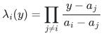

be their Lagrange basis. A single Shpilka–Volkovich pair has coordinates

<!-- math-display: 91d7fecc49b67d81c42fe709
\mathrm{SV}_{1,i}(z,y)=z\lambda_i(y).
-->
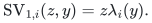

Substitute <code class="math">Y_i=z\lambda_i(y)</code> into the residual expansion from Theorem 1. Every homogeneous residual component of degree <code class="math">d</code> acquires amplitude degree <code class="math">d</code>. Equation (9) therefore gives

<!-- math-display: 83e2988ebaed2b7723aa9b65
[z^N]f\bigl(\gamma(t)+\mathrm{SV}_1(z,y)\bigr)
=\bigl(-\lambda_p(y)\bigr)^N\ne 0.
\tag{10}
-->
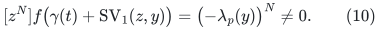

The Lagrange polynomial is nonzero, and higher residual degrees cannot cancel this coefficient. Contributions from nonconstant endpoint terms begin only at amplitude degree <code class="math">p&gt;N</code>.

Thus <code class="math">\gamma+\mathrm{SV}_1</code> hits this polynomial. The example gives no lower bound on the number of SV pairs or on black-box identity-testing queries. It demonstrates that a large first-component digit degree can coexist with a simple surviving one-coordinate term. A quadratic upper bound for general invertible words under individual transcendence, and sharper bounds under derivative separation, remain separate questions from the construction proved here.

## 8. Exact checks and their role

The symbolic proof above covers every <code class="math">w\ge2</code> and every qualifying characteristic. Separate exact computations corroborate the determinant and first-component identities for widths <code class="math">2</code> through <code class="math">10</code>. An independent checker reconstructs the polynomial coefficient basis in Lemma 2, uses fraction-free Bareiss elimination, and checks reductions at three primes above the threshold for each tested width. These finite checks passed.

The computational checks support transcription and arithmetic review. The general theorem rests on the determinant factorization, its explicit unit conditions, and the exact Frobenius residual argument supplied in this manuscript.

## 9. Source identity and review

This presentation reproduces the complete mathematical construction from the post-checkpoint research source `quadratic_hasse_obstruction_actual_curve.txt`, SHA-256 `72f5bb302f33884f03b9450a37087fc4b102571560f3b6ab8b8fd9ce51f8fb69`. It was created after the frozen checkpoint-22 archive. The [independent internal audit](../review/quadratic-hasse-audit.txt) identifies that exact source and reconstructs its determinant, original-field realization, residual, degree and scope arguments.

The [independent finite checker](../verify/check_quadratic_hasse.py), [stored evidence](../verify/quadratic_hasse_checks.json) and [verification note](../verify/README.md) distinguish the general proof from its finite arithmetic corroboration. The [import manifest](../../../provenance/imports/roabp-affine-pit.json) records the exact audit and verifier identities and their limited publication adaptations. Hashes establish source identity; they are not mathematical proof certificates.
