# Stronger bounds under distinct ROABP promises

icekylinx and GPT-6 Astra Pro. This ledger retains five nonredundant complete proof packages. All have internal mathematical review; none is represented as externally peer-reviewed or proof-assistant-certified. The [scope audit](../review/special-case-scope-audit.txt) identifies their exact research-session sources.

## Common model

The scalar polynomial is the invertible affine image of a single unknown-order width-at-most-<code class="math">w</code> ROABP. The hidden local matrices are over the original coefficient field. The algorithm knows the displayed degree and width bounds, not the representation. Extension-field oracle evaluation is part of the model whenever the base field is too small.

<code class="math">D</code> denotes scalar total degree. The meaning of <code class="math">\delta</code> is stated separately in each case; it must not be silently exchanged between a latent scalar degree promise and a promise on an actual rank-restricted representation. An SV pair consists of two independent scalar parameters. All fixed-width polynomial bounds have width-dependent exponents.

## 1. Arbitrary ranks and every characteristic

The [general proof](general-affine.tex) and [grid refinement](direction-grids.tex) use the ordinary curve <code class="math">\gamma_i=t^i</code> and <code class="math">K(w)</code> SV pairs, where

<!-- math-display: 13898769edc1d9a686622222
K(w)=\sum_{r=1}^{w-1}\left(\binom wr^2-1\right)(2h_r+2),\qquad
h_r=(r+2)\prod_{s=r+2}^{w}\left(\binom{s-1}{r-1}+1\right)-2.
-->
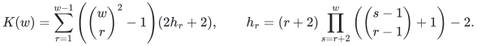

With <code class="math">K(1)=0</code>, the first values are <code class="math">0,12,128,1500,23718,553854</code> and <code class="math">K(w)=2^{O(w^2)}</code>. There is no bound on local representation degrees. The total-degree-<code class="math">D</code> query bound is

<!-- math-display: 9ad21331ab81bd42f670cfdd
(nD+1)\bigl((D+1)B\bigr)^{K(w)},\qquad
B=\min\left\{(n-1)D+1,\frac{(n-1)(n+2)(n+3)}2+1\right\}.
-->
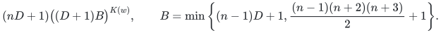

A working field of size at least <code class="math">nD+1</code> suffices. The map has <code class="math">2K(w)+1</code> parameters, and pure <code class="math">\mathrm{SV}_{K(w)+1}</code> also hits. This result supplies the broadest degree-independent, all-characteristic statement; it does not dominate all the bounds below.

## 2. Arbitrary ranks with factorial width dependence

The complete proof package consists of the [interval-rank cone theorem](interval-rank-cones.tex) **and** its [affine consequence](factorial-width-affine.tex). The latter uses the former as a proved companion dependency. Publishing the consequence alone would omit an essential structural proof.

Define the width-dependent recurrence

<!-- math-display: b08cd86afd5f1bf79e12df29
R_w(w)=w^2-1,\qquad
R_w(r)=2r^2\left(2\max_{r<s\le w}R_w(s)+1\right),\qquad
b_r=\max_{r<s\le w}R_w(s).
-->
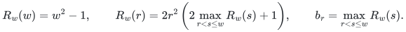

Here <code class="math">R_w</code> is the quantity denoted <code class="math">D_w</code> in the source; this ledger changes the letter to distinguish it from scalar degree. In characteristic zero, or prime characteristic <code class="math">p&gt;w\delta</code>, let

<!-- math-display: be138e6b471acfa31c34c720
K_{\rm good}=1+\sum_{r=1}^{w-1}
\min\left\{r\delta,\binom wr^2-1\right\}(2b_r+2).
-->
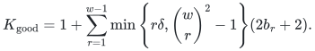

Pure <code class="math">\mathrm{SV}_{K_{\rm good}}</code> hits, and for <code class="math">w\ge2</code>,

<!-- math-display: 816dcfe5195929bf8e7b5e97
K_{\rm good}\le 4^{2w-1}(w!)^2=2^{O(w\log w)}.
-->
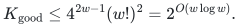

For <code class="math">w=1</code> use one pair. Here <code class="math">\delta</code> may be a bound on the **latent scalar individual degree**: truncating each local matrix above <code class="math">\delta</code> preserves that scalar, and no local-rank restriction is imposed. The affine output then has total degree at most <code class="math">n\delta</code>. The stated grid uses at most

<!-- math-display: 1391fa4b1d9529cb52b96cd2
(n^2\delta+1)^{2K_{\rm good}}
-->
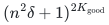

queries, over a working field of size at least <code class="math">n^2\delta+1</code>. This factorial dependence is asymptotically smaller in width than the general all-characteristic bound, even though it need not win numerically at each small width.

The same complete proof works in every characteristic with the replacement

<!-- math-display: 4d5ee1d5bf16c20632ab14f6
K_{\rm degree}=1+\sum_{r=1}^{w-1}r\delta(2b_r+2)
\le \delta w\,4^{w-1}(w!)^2 \qquad (w\ge2).
-->
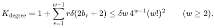

That alternative is polynomial for fixed <code class="math">w</code> and <code class="math">\delta</code>; its exponent depends on <code class="math">\delta</code>. It therefore does not replace the degree-independent all-characteristic theorem above. The geometric companion supplies the factorial bound. Its elementary coefficient-space fallback alone gives the larger quadratic-exponential width dependence.

## 3. Width at most three, arbitrary ranks, every characteristic

Use the [width-three proof](width-three-all-ranks.tex) with its [direction grids](width-three-grids.tex). In characteristic zero set <code class="math">e_i=i</code>; in characteristic <code class="math">p&gt;0</code> let <code class="math">e_i</code> be the <code class="math">i</code>-th positive integer not divisible by <code class="math">p</code>. Put <code class="math">\rho=e_n\le2n-1</code>.

The map

<!-- math-display: af64666e651d9ebac8517b26
H_i=t^{e_i}+\mathrm{SV}_{4,i}
-->
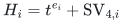

has **nine scalar parameters** and hits every promised width-at-most-three polynomial. Pure <code class="math">\mathrm{SV}_5</code> also hits. Rank-two layers are included, so this is stronger in scope than the width-three rank-one/full specialization below.

For a latent scalar individual-degree bound <code class="math">\delta</code>, take <code class="math">D=n\delta</code>. The refined query bound is

<!-- math-display: 0100f134a2a81d0299087e11
n^8(\rho D+1)(D+1)^4=O(n^{14}\delta^5),
-->
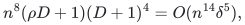

and a field of size at least <code class="math">\rho D+1</code> suffices. The basic pure-generator grid has at most <code class="math">(n^2\delta+1)^{10}</code> points. Local truncation is permitted because the theorem allows every local rank. This proof is independent of the general image-cone theorem and of the later Artin/palette proof.

## 4. Rank-one or full local matrices in good characteristic

The [constant-space proof](invertible-good-characteristic.tex) and [grid addendum](invertible-good-characteristic-grids.tex) assume an actual representation in which each nonzero local matrix has generic rank one or <code class="math">w</code>, every entry has degree at most <code class="math">\delta</code>, and the characteristic is zero or <code class="math">p&gt;\delta</code>.

The ordinary moment curve plus <code class="math">w-1</code> pairs hits:

<!-- math-display: f69b0c83b7d37854e4a6c026
H_i=t^i+\mathrm{SV}_{w-1,i}.
-->
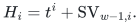

There are <code class="math">2w-1</code> parameters; pure <code class="math">\mathrm{SV}_w</code> also hits. With <code class="math">D=n\delta</code>, the query bound is

<!-- math-display: bb147eeff396e58a118b68dc
n^{2w-2}(nD+1)(D+1)^{w-1}
=O_w(n^{3w-1}\delta^w),
-->
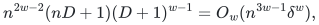

over a field of size at least <code class="math">nD+1</code>.

The degree promise here belongs to an **actual representation retaining the rank-one/full pattern**. A scalar individual-degree promise alone cannot replace it: truncating a representation can destroy that rank pattern. The precise characteristic condition is <code class="math">p&gt;\delta</code>, with no extra factor of <code class="math">w</code> or <code class="math">n</code>. Width one itself works in every characteristic.

This gives fewer pairs than the next all-characteristic bound from width five onward. For widths two through four, the next result obtains the same pair count without a characteristic restriction.

## 5. Rank-one or full local matrices in every characteristic

The [all-characteristic proof](invertible-all-characteristics.tex) contains both the structural argument and its finite grids. Put

<!-- math-display: 97406eb6bb2e45bdd2dafa42
b(1)=0,\qquad
b(w)=\max_{1\le k\le w-1}
\left\{\binom{w-2}{k-1}+k-1\right\}\quad(w\ge2).
-->
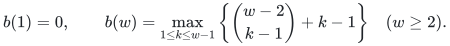

The values for widths two through eight are <code class="math">1,2,3,5,8,13,23</code>. With the derivative-separating exponents <code class="math">e_i</code> from the width-three case, the map

<!-- math-display: 81a23ce2bddd34b52b33350f
H_i=t^{e_i}+\mathrm{SV}_{b(w),i}
-->
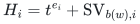

hits. Pure <code class="math">\mathrm{SV}_{b(w)+1}</code> also hits. A known scalar total-degree bound <code class="math">D</code> gives

<!-- math-display: f16f86aabdcc03c906b8b70c
n^{2b(w)}(\rho D+1)(D+1)^{b(w)}
-->
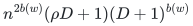

queries, over a working field of size at least <code class="math">\max\{n^2,\rho D+1\}</code>.

There is no restriction on characteristic or local matrix-entry degree. A latent scalar individual-degree bound <code class="math">\delta</code> implies <code class="math">D\le n\delta</code> without truncating the promised representation. In that notation the bound is <code class="math">O_w(n^{3b(w)+2}\delta^{b(w)+1})</code>.

The theorem recovers the following complete special cases, so separate older proofs are not duplicated as competing canonical manuscripts:

- **Every width-at-most-two ROABP:** one pair after the separating curve, hence three parameters; pure <code class="math">\mathrm{SV}_2</code>.
- **Width three with local ranks one or three:** two pairs after the curve; pure <code class="math">\mathrm{SV}_3</code>.
- **Width four with local ranks one or four:** three pairs after the curve, hence seven parameters; pure <code class="math">\mathrm{SV}_4</code>.

A nonzero width-two word cannot contain a generic-rank-zero local matrix, so its nonzero local ranks automatically satisfy the first specialization. Rank-three layers at width four are not covered by the rank-one/full theorem.

## Curve and degree distinctions

The ordinary curve <code class="math">t^i</code> makes each nonzero original-field affine coordinate form transcendental in every characteristic. It does not make its derivative nonzero in positive characteristic. The general theorem uses only individual transcendence. The width-three and rank-one/full all-characteristic proofs use the stronger derivative-separating curve. The good-characteristic proof uses its local representation-degree restriction instead.

Do not combine these results into a stronger first-component statement under weaker hypotheses. In particular, a bound proved after a derivative-separating curve cannot be transferred merely because another curve has individually transcendental coordinates. The explicit Hasse obstruction is a structural limit of that interface, not a failure of the stated PIT theorems.

The common review status and primary-source comparison are recorded in [sources](../sources.md) and [verification](../verify/README.md). The complete original mathematical sources are recoverable from the canonical files and the reversible [import manifest](../../../provenance/imports/roabp-affine-pit.json).
