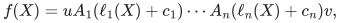
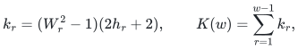
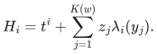
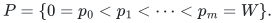
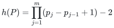
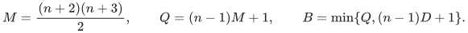
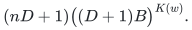

# Deterministic identity testing for affine ROABP orbits

icekylinx and GPT-6 Astra Pro. Complete mathematical statements and proofs are maintained in the linked native-TeX manuscripts. This companion fixes the model, explains the dependencies, and records incomparable stronger special cases. The proof package has undergone internal mathematical reconstruction; external peer review and formal verification are not claimed.

## 1. General theorem

Let <code class="math">\mathbb F</code> be any field. A degree-at-most-<code class="math">D</code> oracle polynomial in <code class="math">n</code> variables is promised to admit

<!-- math-display: 7803ec3f8417e9668f77305c
f(X)=uA_1(\ell_1(X)+c_1)\cdots A_n(\ell_n(X)+c_n)v,
-->

with <code class="math">w</code>-by-<code class="math">w</code> univariate polynomial matrices over <code class="math">\mathbb F</code>, constant endpoints, and linearly independent linear forms. Neither the factor order nor the invertible affine change is known. Local ranks and matrix-entry degrees are unrestricted.

Define

<!-- math-display: dc6d5cc33a4e7d6f2e9d7ca8
W_r=\binom wr,\qquad
h_r=(r+2)\prod_{s=r+2}^{w}\left(\binom{s-1}{r-1}+1\right)-2,
-->

<!-- math-display: 6a760bdd35f1fa3d4fce18c6
k_r=(W_r^2-1)(2h_r+2),\qquad K(w)=\sum_{r=1}^{w-1}k_r,
-->

with <code class="math">K(1)=0</code>. For distinct interpolation nodes, write <code class="math">\lambda_i</code> for their Lagrange basis polynomials. Then every nonzero promised polynomial remains nonzero under

<!-- math-display: 3e8c2085f73cf94510856fd5
H_i=t^i+\sum_{j=1}^{K(w)}z_j\lambda_i(y_j).
-->

The complete proof is [the core manuscript](manuscripts/general-affine.tex), also available as a [PDF](paper.pdf). It includes all the structural lemmas used below. The pure map <code class="math">\mathrm{SV}_{K(w)+1}</code> also hits: specialize its first pair to <code class="math">(t,t)</code>, whose nonzero latent linear combinations are nonconstant, and apply the same proof to that initial curve.

## 2. The weighted coefficient-space argument

The algebraic part works in tensor products of finite monomial quotient rings. The augmentation ideal is nilpotent, so a matrix with an invertible constant term is a unit. If an interval has constant rank <code class="math">s</code> and all its <code class="math">(s+1)</code>-minors vanish, an invertible constant pivot supplies an exact Schur graph over the quotient ring, even though that ring can have zero divisors.

Let the allowed interval ranks form a palette

<!-- math-display: b003e1549da5692f13fb5fc8
P=\{0=p_0<p_1<\cdots<p_m=W\}.
-->

The row coefficients are spanned by coefficients supported on at most

<!-- math-display: 07a53a878c5dfa0008ddfd8d
h(P)=\prod_{j=1}^{m}(p_j-p_{j-1}+1)-2
-->

variable blocks. The proof is a weighted induction on the active constant subspace. Positive passive rank provides a larger persistent active core. Its projection can grow only a bounded number of times, and every growth consumes one fresh variable block.

When the passive constant product is zero, the proof constructs an initial control that kills the entire interval output. That control may depend on later variables. It is used only to deduce an **unweighted coefficient-row-span inclusion**. The argument then restarts the actual original suffix from a source row with an actual prefix witness costing at most one block. The positive-passive case reserves precisely that cost. It does not assign a low support budget to the future-dependent control, and it does not assume that corrected passive matrices inherit the original interval ranks.

The [fresh-context audit](review/independent-core-audit.txt) independently reconstructs this induction and its support accounting. The [Artin reset audit](review/artin-reset-audit.txt) includes a nonzero corrected passive response and its exact cancellation over rings with zero divisors. These are review records; the proof itself is in the manuscript.

## 3. Why the whole first component is controlled

Fix any nonzero monomial <code class="math">Y^\alpha</code> in the first ordinary homogeneous component of a scalar contraction. Set variables outside its support to zero and impose <code class="math">Y_i^{\alpha_i+1}=0</code>. The surviving monomials divide <code class="math">Y^\alpha</code>. Every proper divisor has smaller total degree and therefore has zero scalar coefficient. The quotient scalar is exactly the selected term.

The interval's vanishing larger minors and unit constant pivots survive this quotient. Applying the row-concentration theorem inside this particular box bounds the support of the selected monomial. Repeating the argument for an arbitrary selected monomial controls **every** monomial in the first component. An unfiltered low-support coefficient somewhere in the full polynomial would not suffice.

The Hasse-order step is separate. A vector of <code class="math">q</code> original-field rational functions has generic pivot orders closed under the standard characteristic-order criterion. A pivot order has <code class="math">p</code>-adic digit weight at most <code class="math">q-1</code>. Specialization preserves the relevant rational relations at a point individually transcendental over the original field, even if the contracting functional depends on all correlated shifts.

For a chosen first-component monomial, fix the exponents in all other layers. Its remaining exponent must be a local Hasse pivot: an earlier nonzero local coefficient would give a smaller full total degree. The <code class="math">W^2</code> matrix entries therefore bound the digit weight of each exponent by <code class="math">W^2-1</code>. The generic pivot criterion is standard; the [sources](sources.md) give its attribution.

## 4. Compound matrices and rank descent

Append constant endpoint matrices so the full scalar is itself a rank-one matrix interval. Descend through the generic interval ranks. Before stage <code class="math">r</code>, all intervals of rank greater than <code class="math">r</code> have been preserved.

A rank-<code class="math">r</code> target interval splits into shortest rank-<code class="math">r</code> blocks. Each block consists of a prepared chunk whose every interval has rank greater than <code class="math">r</code>, followed by one layer. It is enough to preserve one nonzero <code class="math">r</code>-minor of each block, each adjacent block pair, and the last block with its remaining tail. These tests are all actual contiguous intervals.

The <code class="math">r</code>-th exterior power transforms original rank <code class="math">s</code> into <code class="math">\binom sr</code>. Its prepared-chunk palette yields <code class="math">h_r</code>. Conditioning on the other exponents gives constant row and column endpoints for the chunk; a lower chunk degree would contradict the first total degree of the full test. A test uses at most two chunks and two single layers, so its first-component support is at most <code class="math">2h_r+2</code>. The Hasse bound then gives digit degree at most <code class="math">k_r</code>.

An invertible residual linear change cannot increase digit degree. The SV map contains every coordinate subspace on at most <code class="math">k_r</code> coordinates, so it detects the nonzero first component. Higher ordinary degrees have higher fresh-amplitude degrees and cannot cancel it. All tests survive symbolically in one common seed field. Previously preserved minors survive by setting new amplitudes to zero.

Finally, if successive rank-<code class="math">r</code> blocks and adjacent products retain rank <code class="math">r</code>, the prefix row space equals the last block's row space. The separate tail test completes the target interval. Descending to rank one preserves the endpoint-augmented scalar interval and proves the theorem.

## 5. Finite grids

The [direction-grid proof](manuscripts/direction-grids.tex), also in [PDF](direction-grids.pdf), supplies the following improvement. Let

<!-- math-display: e91ff117315f93fdd442aa03
M=\frac{(n+2)(n+3)}2,\qquad Q=(n-1)M+1,\qquad
B=\min\{Q,(n-1)D+1\}.
-->

The curve grid has <code class="math">nD+1</code> points, each amplitude grid has <code class="math">D+1</code> points, and each direction grid has <code class="math">B</code> points. The resulting query count is

<!-- math-display: e4324de6d036bf93b592a7ec
(nD+1)\bigl((D+1)B\bigr)^{K(w)}.
-->

The degree-independent direction argument polarizes a maximum-digit-weight first-component monomial. Each resulting tensor is separately Frobenius-linear in each direction and excludes at most <code class="math">n-1</code> distinct field values. There are at most <code class="math">M</code> distinct interval tests per stage. This bound counts intervals, not the number of their decompositions or all their minors.

The minimum above selects globally between two complete grid arguments. Auxiliary minors need not have degree bounded by <code class="math">D</code>; only the final original scalar is interpolated by its degree promise. A field of size at least <code class="math">nD+1</code> is enough. Over a smaller base field, the oracle must support evaluations in a suitable extension field.

## 6. Stronger special cases and structural sharpness

The [special-case ledger](manuscripts/special-cases.md) retains the small-width, good-characteristic and rank-one/full bounds in their precise models. A stronger all-characteristic scope does not automatically dominate a better width dependence under an additional degree hypothesis. In particular, the ordinary curve and a derivative-separating curve have different small-characteristic guarantees.

The separate [sharpness proof](manuscripts/palette-sharpness.md) attains <code class="math">h(P)</code> for every palette using nested projectors and off-diagonal matrix units. A two-factor substitution of each edge by <code class="math">x^2-y</code> realizes the same leading-support obstruction at the actual ordinary moment curve, with original-field local degree at most two. Every physical matrix interval preserves rank, but the endpoint-augmented scalar interval need not. These examples survive a single SV pair and establish no lower bound on hitting-set size.

The [quadratic Hasse obstruction](manuscripts/quadratic-hasse-obstruction.md) separately attains local leading digit degree <code class="math">w^2-1</code> at a genuine original-field word and the ordinary moment curve. Its three nonconstant physical factors are generically invertible. This shows that individual transcendence and physical full-rank preservation alone cannot replace that local bound by a subquadratic one. The characteristic and the ordinary-curve choice are essential to the stated scope; one fresh SV pair detects these examples as well.

## 7. Evidence and interpretation

The research-session mathematical sources are frozen by exact hashes. Publication changes to their layout and attribution are recorded reversibly in the [import manifest](../../provenance/imports/roabp-affine-pit.json). The independent source reviews remain available alongside the complete proofs.

The exact prototype checks rational arithmetic and finite fields of characteristics two, three and five, actual rank-three/full factors, an invertible input shear, and complete versus interrupted grid traversal. The palette and Artin programs check explicit finite identities. Their scope is recorded in [verification](verify/README.md); none is a proof-assistant derivation of the general asymptotic theorem.

The named 2026 rigidity preprint is addressed in a separate [counterexample review](review/external-rigidity-review.txt). Its identified proof defects are not evidence that this theorem is correct, and the comparison does not claim exhaustive literature coverage or priority.
