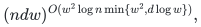

# Sources, attribution and comparison

Yilin Liu and GPT-6 Astra Pro. This page separates the complete internal argument from standard tools, published comparators and a review of a particular external preprint version. It does not certify historical priority or exhaustive coverage of subsequent literature.

## Canonical internal proofs

- [General affine-orbit theorem](manuscripts/general-affine.tex): all characteristics, arbitrary local ranks and degrees, unknown order and unknown invertible affine map. It contains the Artin-ring coefficient-space theorem, per-leading-monomial box filter, the required Hasse pivot statement and the complete augmented-interval rank descent.
- [Finite direction grids](manuscripts/direction-grids.tex): the degree-independent direction bound, maximum-digit-weight polarization, interval-test deduplication and the global minimum-grid corollary.
- [Stronger special cases](manuscripts/special-cases.md): the exact assumptions and canonical complete sources for results with smaller width constants or stronger characteristic hypotheses.
- [Palette sharpness and actual-curve lift](manuscripts/palette-sharpness.md): exact structural lower constructions, with the explicit distinction between physical and endpoint-augmented intervals.
- [Quadratic Hasse obstruction](manuscripts/quadratic-hasse-obstruction.md): a complete original-field construction attaining local leading digit degree <code class="math">w^2-1</code> at the ordinary moment curve, with a determinant formula and an explicit explanation of why one SV pair still detects it.

The [import manifest](../../provenance/imports/roabp-affine-pit.json) identifies the frozen research-session archive and source hashes. Each record distinguishes an exact archive member from a later session source; the new quadratic obstruction and publication audits postdate that archive. Recorded publication edits reverse to the identified source bytes. Layout and attribution edits preserve the mathematical arguments, while the factorial-width manuscript now states its proved companion dependency explicitly. Original checkpoint trees are not duplicated as competing canonical versions.

## Published affine-orbit comparator

**Vishwas Bhargava and Sumanta Ghosh, _Improved Hitting Set for Orbit of ROABPs_.** The verified reference is [ECCC TR21-062, revision 2](https://eccc.weizmann.ac.il/report/2021/062/revision/2/download/), with the [2021 conference record](https://drops.dagstuhl.de/entities/document/10.4230/LIPIcs.APPROX/RANDOM.2021.30) and [2022 journal version](https://doi.org/10.1007/s00037-022-00230-9).

The relevant unknown-order affine-orbit bound in that reference is

<!-- math-display: 45d4b2d36f99de7cd9be4f87
(ndw)^{O(w^2\log n\min\{w^2,d\log w\})},
-->

where <code class="math">d</code> is the individual-degree bound in the latent ROABP coordinates and the field has characteristic zero or greater than <code class="math">d</code> (Theorem 1.2). The current manuscript supplies a different complete proposed argument whose query count is polynomial in <code class="math">n,D</code> for each fixed <code class="math">w</code>, and removes that characteristic restriction. The actual comparison must retain the degree conventions and the working-field oracle model. No claim that this page exhausts all later or equivalent results is made.

The correct authors are Bhargava and Ghosh. An earlier research checkpoint expanded their names incorrectly; the title, source URL and model were unchanged. The canonical repository attribution is corrected here.

## Known order and every-order representations

**Rohit Gurjar, Arpita Korwar and Nitin Saxena, _Identity Testing for Constant-Width, and Any-Order, Read-Once Oblivious Arithmetic Branching Programs_**, Theory of Computing 13(2), 2017: [official article](https://theoryofcomputing.org/articles/v013a002/).

Its known-order fixed-width polynomial hitting set assumes characteristic zero or a sufficiently large characteristic. Its separate every-order representation result has a different promise. Neither promise is the same as one unknown order after an unknown affine change. These distinctions are necessary when interpreting a fixed-width claim. The present paper does not describe those earlier specialized polynomial results as new.

## Standard Hasse-order criterion

The generic Hasse pivot closure is a standard characteristic-order fact. **A. Garcia and R. F. Lax**, [arXiv:alg-geom/9208003](https://arxiv.org/pdf/alg-geom/9208003), Proposition 1.1, records the criterion and attributes its order-sequence setting to **F. K. Schmidt** and **Stoehr--Voloch**. See also [Stoehr--Voloch, 1986](https://doi.org/10.1112/plms/s3-52.1.1).

No novelty is claimed for that criterion. The core manuscript proves the exact rational-vector version it needs, then establishes its interface with arbitrary moving coefficient-field functionals and first homogeneous components. This avoids importing unstated geometric assumptions.

## The named rigidity preprint

**Shalender Singh and Vishnupriya Singh, _An Algebraic Rigidity Framework for Order-Oblivious Deterministic Black-Box PIT of ROABPs_**, [arXiv:2602.13449, version 1, 13 February 2026](https://arxiv.org/abs/2602.13449v1).

The [separate exact review](review/external-rigidity-review.txt) gives four explicit mathematical obstacles to intermediate statements in that version. For example, its proposed <code class="math">w^2</code>-by-<code class="math">w^2</code> matrix with entries <code class="math">e_1^T W_aW'_b e_w</code> factors through a <code class="math">w</code>-dimensional space, so its rank is at most <code class="math">w</code> and its determinant is zero when <code class="math">w&gt;1</code>.

The review addresses the displayed statements and version. It does not assert that the announced algorithm is impossible, infer anything about author intent, or use flaws in that proof to validate this manuscript. No contact with the authors or external reviewers occurred in this research session.

## Evidence boundaries

The complete core and grid arguments have several internal reconstructions, including one reviewer who did not read the earlier review conclusions. These are model-assisted internal reviews. The exact programs check their stated finite arithmetic and construction examples. Neither fact is external human peer review, a proof-assistant certificate, or a priority determination. The [verification note](verify/README.md) gives the executable scope and reproduction commands.
