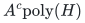
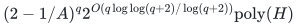

# Robust unit allocation with bounded failure certificates

**Guarantee**

For fixed integer <code class="math">d\ge2</code>, returns at least <code class="math">\lceil K_\star/d\rceil</code> units on one common selected basis under every scenario budget, assuming all inclusion-minimal aggregate one-unit failures have width at most <code class="math">w</code>.

**Objective and output**

Maximize robust minimum unit count with scenario-adaptive integral allocations; output a common basis and one allocation per scenario.

**Randomness**

Deterministic width-guarded branching and exact unit tests. A width-violation certificate reports a failed promise, rather than a probabilistic failure.

**Time**

Let <code class="math">A=\max\left\{w,\left(\frac{(d+1)^{d+1}}{4(d-1)^{d-1}}\right)^{1/(d-1)}\right\}</code>. Time is

<!-- math-display: 21e615b443c11b548e1208b5
A^c\mathrm{poly}(H)
-->

Or

<!-- math-display: c4cf9644f42598656ec40bc1
(2-1/A)^q 2^{O(q\log\log(q+2)/\log(q+2))}\mathrm{poly}(H)
-->

**Space**

Polynomial in the complete binary input and paid oracle workspace; numerical resource multiplicities are not expanded into individual units. The complete explicit scenario list is part of the input.

**Parameters**

<code class="math">q</code> is the player count; <code class="math">r</code> is the common basis rank; <code class="math">c=q-r</code>; <code class="math">d\ge2</code> is a fixed integer; <code class="math">w</code> bounds inclusion-minimal failure size; <code class="math">K_\star</code> is the robust optimum count. <code class="math">\Gamma(R)=R^R/(R-1)^{R-1}</code>.

**Model and representation**

One common actual player-matroid basis, explicit scenarios, scenario-specific recipient polymatroids and nonnegative exact assignment budgets, and one unit value. The width promise concerns the aggregate budget-feasible one-unit family, at least on player-independent sets.

**Lower-bound scope**

No universal corank-FPT finite-factor guarantee exists in the unrestricted two-scenario model unless <code class="math">\mathrm{FPT}=\mathrm{W}[1]</code>; see the [hardness proof](../robust-two-scenario-hardness/README.md). The width promise is substantive.

**Review status**

**Ready for review.** The complete bounded-certificate robust factor-d theorem: exact original budgeted unit tests and minimal failures, guarded common-basis extension, all-input forced-seed/node bounds, scenario-intersection support separation, exact integral high-quota recovery, one-sided target search and streamed global conversion. New reference realizes polynomial weighted matroid intersection with optimality/cut certificates, native budgeted unit scenarios and the bounded local gate.

**Dependencies and scope.** Original matroid/rank and Boolean-cap independence oracles must satisfy their declared contracts. The native complete-table adapter validates integral polymatroid tables and charges their full explicit encoding; no rank-only time bound is inferred by constructing those tables. Weighted augmentation and exchange-cycle optimality use Barasz et al., arXiv:2407.03229v2, Definition 2.2, Algorithm 2 and Lemma 2.5. Exact rational LP, submodular minimization and integral polymatroid intersection remain named paid mathematical dependencies for higher quotas. The software implements weighted intersection, exact unit tests/rejection certificates and bounded local extension, including actual integration with the Fibonacci client. It does not implement higher-quota LPs/recovery, integer target search or the streamed global wrapper. Width violation is a separate structural outcome and never failed extension. Scenario allocations are adaptive, one budget per allocation is exact, and binary capacities are not expanded. Sharp global bases retain fixed tradeoff parameters; binary-variable tradeoffs retain the stated rational upper-envelope option.

The [verification note](verify/README.md) identifies executable coverage. This status does not claim external peer review or proof-assistant verification.

**Source**

[Manuscript and proof](proof.md), with [dependencies and verification sources](sources.md).

Outside the width promise the guarded algorithm may return a legal solution, a sound negative result, or an explicit inclusion-minimal failure wider than <code class="math">w</code>. For <code class="math">w\le6</code>, exact factor two retains base <code class="math">27/4</code>; for <code class="math">w\le4</code>, factor three retains base <code class="math">4</code>. The [width-two gate](../robust-width-two-allocation/README.md) improves the positivity subroutine further.

**Attribution.** Yilin Liu · GPT-6 Astra Pro
