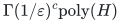
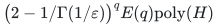

# Selected flow with scenario-adaptive routing

**Guarantee**

Selects one permitted commodity set and routes it in every explicit scenario at common rate at least <code class="math">(1-\varepsilon)\mathrm{OPT}</code>.

**Objective and output**

Maximize robust selected concurrent rate; output the common set and a separate feasible splittable routing in each scenario.

**Randomness**

Deterministic for the explicit scenario list, with a paid exact selector. Scenario-dependent routing is recourse after selection, rather than randomized or adversarial input.

**Time**

<!-- math-display: 55c29d6875d9c7670b3d4dd8
\Gamma(1/\varepsilon)^c\mathrm{poly}(H)
-->

For fixed rational <code class="math">\varepsilon</code>, the whole-ground alternative is

<!-- math-display: 23b4a2344acb655d6b5109c3
\bigl(2-1/\Gamma(1/\varepsilon)\bigr)^q E(q)\mathrm{poly}(H)
-->

**Space**

Polynomial in the full explicit scenario description, rational witnesses, selector state, and paid oracle workspace.

**Parameters**

<code class="math">q</code> is the commodity count; <code class="math">r</code> is the selected cardinality; <code class="math">c=q-r</code>; <code class="math">0&lt;\varepsilon&lt;1</code> is rational. <code class="math">\Gamma(R)=R^R/(R-1)^{R-1}</code> and <code class="math">E(q)=2^{O(q\log\log(q+2)/\log(q+2))}</code>. Scenario count and routing-budget rows are charged in <code class="math">H</code>.

**Model and representation**

Explicit rational networks and demand scales, one common selected set, exact capacities and nonnegative routing budgets, adaptive fractional flow, and an exact permitted-set restriction selector.

**Lower-bound scope**

Exact full-rate admission is <code class="math">\mathrm{W}[2]</code>-hard in the rejected count via Hitting Set, even on the stated forest instances with an unbounded explicit scenario list and no routing budgets. This does not imply the same hardness for the displayed approximate-rate output.

**Review status**

The [verification note](verify/README.md) records the proof scope, executable evidence and remaining conditions. No proof-assistant verification or external peer review is claimed.

**Source**

[Manuscript and proof](proof.md), with [dependencies and verification sources](sources.md).

Continuous scenario flows permit positive-rate approximation. The [integer robust-allocation obstruction](../robust-two-scenario-hardness/README.md) concerns a distinct positivity decision.

**Attribution.** Yilin Liu · GPT-6 Astra Pro
