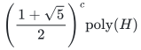
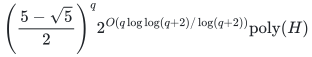

# Robust positivity with width-two failures

**Guarantee**

Under the width-two promise, exactly decides whether a common actual player basis can receive one unit in every explicit scenario and returns the corresponding scenario allocations.

**Objective and output**

Find a common basis in the aggregate budget-feasible one-unit family; detect and return an inclusion-minimal failure of size greater than two when needed outside the promise.

**Randomness**

Deterministic conflict enumeration, graph-cover branching and exact matroid intersection; the whole-ground alternative uses deterministic covers.

**Time**

<!-- math-display: ad15afaf2a049b5476f6efd5
\left(\frac{1+\sqrt5}{2}\right)^c\mathrm{poly}(H)
-->

Where <code class="math">\phi=(1+\sqrt{5})/2</code>. The whole-ground bound is

<!-- math-display: b7d5b8a89f9d1efd6368d08b
\left(\frac{5-\sqrt{5}}{2}\right)^q 2^{O(q\log\log(q+2)/\log(q+2))}\mathrm{poly}(H)
-->

**Space**

Polynomial in the complete binary input and paid oracle workspace; numerical resource multiplicities are not expanded into individual units. Explicit singleton and pair tests and the current branching state are stored.

**Parameters**

<code class="math">q</code> is the player count; <code class="math">r</code> is the common basis rank; <code class="math">c=q-r</code>. All scenarios, costs, budgets, and paid one-unit intersection operations are included in <code class="math">H</code>.

**Model and representation**

One common player-matroid basis, integral recipient polymatroids, explicit scenarios, separate exact nonnegative assignment budgets, and aggregate inclusion-minimal one-unit failures of size at most two.

**Lower-bound scope**

The width restriction is essential. The separate whole-ground rank-oracle barrier does not establish an optimal base for explicit-input instances.

**Review status**

**Ready for review in the stated scope.** The exact width-two robust one-unit gate, including original dual-rank forced omissions, polynomial matching matroid intersection and basis completion, complete Fibonacci branching accounting, all-input width-violation semantics and fixed-quadratic whole-ground conversion; exact optimization on Boolean resources. Section 8 high-quota factor tradeoffs and their inherited allocation chain are excluded from this scoped review.

**Dependencies and scope.** Original matroid rank and exact hereditary scenario unit tests with actual witnesses remain paid callbacks. General budgeted polymatroid unit tests retain the construction in robust-bounded-certificates. Matching terminal is implemented by standard shortest-exchange matroid intersection, using the explicitly identified augmentation theorem in Barasz et al., arXiv:2407.03229v2, Definition 2.2 and Algorithm 1. Oracle validity itself is an input-model contract. The reference implements the local Fibonacci gate and polynomial terminal, not general weighted polymatroid allocation, higher-quota recovery or the streamed global wrapper. A width violation is a third outcome, never failed extension. Separate rank-oracle obstructions do not establish an optimal explicit-input exponential base; no fastest-known or publication-priority claim.

The [verification note](verify/README.md) identifies executable coverage. This status does not claim external peer review or proof-assistant verification.

**Source**

[Manuscript and proof](proof.md), with [dependencies and verification sources](sources.md).

Outside the promise, the guarded output may still be a valid solution or a sound failure; otherwise it includes a concrete width violation. The Fibonacci recurrence comes from branching on a forbidden pair graph and completing the residual matching through matroid intersection.

**Attribution.** Yilin Liu · GPT-6 Astra Pro
