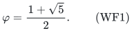
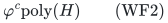
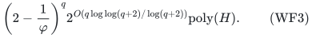
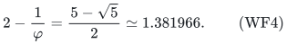
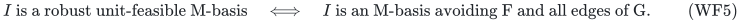
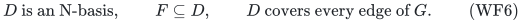
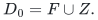
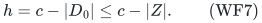
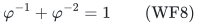
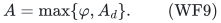

# A Fibonacci-base exact gate for width-two robust unit feasibility

Let

<!-- math-display: 37fa1c37309f62659b92c8d9
\varphi=\frac{1+\sqrt5}{2}.
 \tag{WF1}
-->

When every minimal budget-feasible one-unit obstruction has size at
most two, the exact robust unit gate improves from 2^c to
varphi^c times polynomial work. The improvement uses a polynomial
matching-case terminal solver. It respects the original player
matroid; an ordinary unconstrained vertex-cover dominance rule is
not needed. The [reference realization](reference-realization.md)
implements this local gate, including polynomial matching intersection,
with the original exact rank and scenario-unit tests as paid callbacks.

## 1. Model, promise and guarantees

Use the robust model and exact fixed-set unit tests of
robust_unit_bounded_certificate_exact_tradeoffs.md. There is an original
rank-r player matroid M on q nonloop players P, r>=1, and c=q-r.
A single actual M-basis must be unit-feasible in every explicitly
listed scenario. Assignment allocations are adaptive across scenarios,
and each scenario has one exact nonnegative assignment-cost budget.

Write F_omega for the hereditary family of sets that receive one
integer unit each within scenario omega's original constraints and
budget. Assume every inclusion-minimal set outside F_omega has size
at most two. As in BW, it suffices to impose this condition on
M-independent minimal infeasible sets.

**Theorem WF.** Exact robust one-unit feasibility can be decided, with
actual scenario allocations on success, in

<!-- math-display: 5d50c858ae804691a9e99fde
\varphi^c\mathrm{poly}(H)
 \tag{WF2}
-->

and polynomial space. The streamed forced-omission wrapper also gives

<!-- math-display: 258fedad38dba824388b7d73
\left(2-\frac1\varphi\right)^q
 2^{O(q\log\log(q+2)/\log(q+2))}\mathrm{poly}(H).
 \tag{WF3}
-->

The whole-ground base is

<!-- math-display: 09f2868ea0e37574fb8dca9a
2-\frac1\varphi
                         =\frac{5-\sqrt5}{2}
                         \simeq1.381966.
 \tag{WF4}
-->

There is a guarded implementation with the same time bounds on all
inputs: outside the width-two class it may instead return an actual
inclusion-minimal infeasible set of size at least three. This separate
width-violation outcome is never counted as a failed extension.

On genuinely Boolean resource instances where the robust optimum
integer count belongs to {0,1}, the exact unit gate solves the entire
optimization problem, with these bounds.

## 2. Building the complete singleton/pair conflict graph

Run the polynomial exact unit test in every scenario on each singleton
and each pair of players. Let F be the set of players whose singleton
fails in at least one scenario. Put an edge uv in a simple graph G
when {u,v} fails in at least one scenario.

This needs polynomially many exact tests on the explicit scenario list.
All tests use the original aggregate resource and assignment-budget
constraints. They are not inferred from individual resource circuits
or from the sparsity of a projected LP description.

Every actually robust unit-feasible set I avoids F and contains no
edge of G. Conversely, suppose an M-independent set I has these two
properties but fails unit service in a scenario. Greedily shrink it to
an inclusion-minimal infeasible C, as in BW. Then C is M-independent.
It has neither a failed singleton nor a failed pair, so |C|>=3,
contradicting the promised width.

Thus, on the width-two class,

<!-- math-display: 3d8221ad1aa9697ca0bd9ef8
I\text{ is a robust unit-feasible M-basis}
 \quad\Longleftrightarrow\quad
 I\text{ is an M-basis avoiding F and all edges of G}.
 \tag{WF5}
-->

The forward implication remains valid on arbitrary inputs. A final
actual unit test on a graph solution will enforce the guarded
semantics outside the class.

## 3. Passing to the dual basis and forced omissions

Let N=M*. For an original M-basis I, its complement D=P minus I is
an N-basis of size c. Condition WF5 becomes

<!-- math-display: 228b31ea23f1696f77146b1f
D\text{ is an N-basis},\qquad F\subseteq D,\qquad
       D\text{ covers every edge of }G.
 \tag{WF6}
-->

For a forced-omission seed Z, start by requiring

<!-- math-display: 906d029a8b31226146fe5be3
D_0=F\cup Z.
-->

If D_0 is dependent in N, fail: no dual basis can contain it.
Otherwise contract D_0 in N and remove all vertices of D_0 and every
edge incident to them from G. Those incident edges are already covered.
The residual dual matroid has rank

<!-- math-display: f1457c6b446183ce415683ae
h=c-|D_0|\le c-|Z|.
 \tag{WF7}
-->

The remaining task is to find a basis of this contracted matroid
that covers the residual graph. Keeping an explicit accumulated set
D_0 makes reconstruction of an original dual basis immediate.

Dual and contraction rank evaluation is polynomial through the
original M rank oracle. In particular
rank_(M*)(S)=|S|+rank_M(P minus S)-r. No representation of M is assumed.

## 4. The matching terminal case is polynomial

Suppose the residual graph has maximum degree at most one. Its edges
form a matching, say e_1,...,e_m. Isolated vertices impose no cover
requirement.

On the endpoints of these edges, intersect the current dual matroid
with the partition matroid whose blocks are e_1,...,e_m and whose
capacity in each block is one. Seek a common independent set S of
cardinality m.

If S exists, it contains exactly one endpoint of every edge and is
independent in the current dual matroid. Extend S to a full basis of
that matroid, using all remaining ground elements as necessary.
Extending S never uncovers an edge. Together with the previously
contracted D_0, the result is a genuine original N-basis satisfying
every cover and forced-omission condition.

If such an S does not exist, no independent cover exists. Indeed,
from any independent cover choose one of its vertices on each edge.
The edges are disjoint, so this gives m distinct representatives.
They remain independent and would be a common set in the stated
intersection, a contradiction.

This proves both directions of the terminal solver. It permits a
covering basis to contain both endpoints of some edges: only an
independent representative subset is found first, then the basis
is completed. It does not mistakenly enforce one endpoint per edge
on the final dual basis.

If m=0, extend the empty set to any current dual basis. If the current
rank is smaller than m, the intersection necessarily fails. The
rank-zero case succeeds exactly when no uncovered edge remains.

## 5. Degree branching with matroid constraints retained

If a residual vertex v has degree a>=2, every vertex cover contains
v or contains all its neighbors. Branch as follows.

1. Include v in the omitted dual basis. If {v} is independent in the
   current dual matroid, contract it, append it to D_0, and remove its
   covered edges. Otherwise this branch fails.
2. Include the full neighbor set N_G(v). If that set is independent
   in the current dual matroid, contract it, append it to D_0, and
   remove the edges covered by those vertices. Otherwise this branch
   fails.

These branches reduce the current dual rank by one and by a,
respectively, whenever they recurse. A selected set of size greater
than the current rank is rejected by its independence test.

For a protected covering dual basis, if it contains v, the first
branch preserves it. If it does not contain v, it contains every
neighbor, so the second branch preserves it. Contracting a subset
of a protected basis leaves the remainder as a basis of the
contraction. This proves completeness with arbitrary original
matroid constraints.

The second branch need not explicitly forbid v afterward. A later
basis completion may also include v; that only gives an overlapping
search branch and remains a legal cover. No unjustified leaf-neighbor
dominance rule is used.

## 6. Full Fibonacci running time and polynomial space

At a branching node the recursive decrements are 1 and a>=2. The
identity

<!-- math-display: f53ccabfbcb07f4afc322e64
\varphi^{-1}+\varphi^{-2}=1
 \tag{WF8}
-->

therefore bounds the outgoing weights
varphi^(-1)+varphi^(-a) by one. A root-to-leaf path contracts at most h
independent elements. Each recursively reached terminal leaf has
weight at least varphi^(-h), while the total leaf weight is at most
one. Hence there are at most varphi^h such leaves.

Every recursive step reduces the nonnegative rank, so the depth is
at most h. The total number of recursively processed nodes is at most
(h+1)varphi^h. Each processed node attempts at most two independence
tests, including tests that reject a contraction before recursion.
Those failed attempts are paid within the polynomial work of that
node; they are not omitted from the accounting. Terminal matroid
intersection and subsequent basis extension are polynomial.

The initial graph construction is polynomial. Thus every seed has
total time at most varphi^(c-|Z|) times polynomial work, even when
no covering basis exists. Depth-first traversal, explicit graph
updates and oracle contractions use only polynomial space.

The global inclusion-cover wrapper applies to this uniform extension
bound. For the fixed algebraic base varphi, its exact comparisons can
use varphi^t=F_t varphi+F_(t-1) and integer arithmetic in Q(sqrt(5)).
This is the same fixed-quadratic comparison case already treated by
the sparse-separator refinement. No irrational-number oracle is
assumed. The wrapper can stream its seeds and retains polynomial
space.

## 7. Final unit recovery and the all-input guard

The graph algorithm either finds no covering dual basis, or returns
one D. In the first case no actual robust unit basis avoiding the
seed can exist, even without the width promise, by the forward
direction of WF5.

In the second case put I=P minus D. This is an actual original
M-basis avoiding the forced seed. Test it for integer one-unit
service in every original scenario. If all tests pass, return
their actual unit allocations and I.

If one test fails, shrink I in that original scenario to a minimal
infeasible C. Since I avoids every precomputed failed singleton
and pair, C has size at least three. Return C and the scenario as
a **WIDTH VIOLATION**. This is a valid certificate even though
some other robust unit basis might still exist outside the promised
class.

The extra tests and shrinking are polynomial. Thus the global
wrapper can propagate a width violation as a third outcome while
retaining the complete all-input time bound. On the width-two class
it can never occur, on any seed, so exact completeness and WF3 follow.

## 8. Coupling to high quotas and scope

For the higher-quota algorithm in the BW manuscript, only the exact
one-unit gate changes. Its successful witness still handles all
nominal targets K<=d, and its fully exhausted failure still proves
the robust integer optimum count is zero.

For fixed integer d>=2, the positive quota routine has base
A_d=Gamma((d+1)/(d-1)). Consequently the complete robust factor-d
theorem on the width-two class has the improved combined base

<!-- math-display: 941d39b82c2628676a19617b
A=\max\{\varphi,A_d\}.
 \tag{WF9}
-->

It returns at least ceil(K*/d) units, preserving each scenario budget
exactly, in A^c polynomial time or the corresponding
(2-1/A)^q times the usual subexponential overhead.

For exact factor two and factor three, A_d still dominates, so this
refinement does not change the existing 50/27 and 7/4 whole-ground
bases. Its direct gain is the sharper exact positivity algorithm,
the exact Boolean-resource optimization, and the limiting unit-gate
term for sufficiently coarse quota tradeoffs.

The degree branching and matroid-intersection terminal solver are
elementary. Public priority and fastest-known graph bounds have not
been established here. The theorem concerns the aggregate, budgeted
unit family of each scenario; it makes no inference from an individual
resource's circuit size or from a sparse input row description.

---

**Attribution:** Yilin Liu and GPT-6 Astra Pro.
