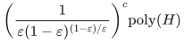
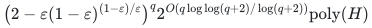

# Selected splittable concurrent flow

**Guarantee**

Returns one permitted set of commodities and a feasible splittable routing of common rate at least <code class="math">(1-\varepsilon)\mathrm{OPT}</code>.

**Objective and output**

Select exactly <code class="math">r</code> of <code class="math">q</code> commodities while preserving every edge capacity and every listed routing budget exactly.

**Randomness**

Deterministic branching and exact rational flow-LP optimization, conditional on the paid exact restriction selector; both time alternatives are deterministic.

**Time**

<!-- math-display: 5d5877611e1d9853318e206a
\left(\frac{1}{\varepsilon(1-\varepsilon)^{(1-\varepsilon)/\varepsilon}}\right)^c\mathrm{poly}(H)
-->

For fixed rational <code class="math">\varepsilon</code>, also

<!-- math-display: 9b29a55c59319e994d0659cc
\bigl(2-\varepsilon(1-\varepsilon)^{(1-\varepsilon)/\varepsilon}\bigr)^q 2^{O(q\log\log(q+2)/\log(q+2))}\mathrm{poly}(H)
-->

**Space**

Polynomial in the explicit network, rational flow data, selector state, and paid optimization workspace.

**Parameters**

<code class="math">c=q-r</code>; <code class="math">0&lt;\varepsilon&lt;1</code> is rational; <code class="math">\Gamma(R)=R^R/(R-1)^{R-1}</code>; <code class="math">H</code> includes all routing-budget rows and the exact restriction-selector cost.

**Model and representation**

Directed networks, or undirected networks with one shared capacity per edge, rational capacities and positive demand scales, splittable flow, nonnegative routing budgets, and a fixed-cardinality family with an exact restriction selector.

**Lower-bound scope**

No lower bound is claimed; the result requires the stated permitted-set selector. Examples include a matroid basis and suitable common-basis families.

**Review status**

**Ready for review.** The complete selected concurrent-flow theorem with exact fixed-cardinality selection and nonnegative routing budgets: finite normalized Farkas separation, weighted first-crossing omission, zero-optimum handling, exact rational comparator recovery and fixed-accuracy whole-ground conversion. The exact reference adds fixed-set primal/dual certificates, physical undirected-capacity handling and native enumeration.

**Dependencies and scope.** Exact polynomial rational LP, Farkas duality and the specified paid selection oracle remain mathematical dependencies. The whole-ground sharp base is stated for fixed rational accuracy. Splittable rational flow is required; integral or unsplittable multicommodity routing is outside the model. The shipped reference uses finite Bland simplex and explicit selected-set enumeration with separate potentially exponential running times. It supplies exact fixed-set certificates and normalized separation, but not the omission recursion or rational target search. A fixed-set certificate proves that set optimal; global optimality of the enumeration baseline additionally depends on the fixed permitted-family predicate and complete enumeration.

The [verification note](verify/README.md) identifies executable coverage. This status does not claim external peer review or proof-assistant verification.

**Source**

[Manuscript and proof](proof.md), with [dependencies and verification sources](sources.md).

The [rational-comparator lemma](../whole-ground-allocation/rational-optimization.md) uses exact optimization of the returned selected-set LP to retain the full <code class="math">\Gamma(1/\varepsilon)</code> base.

**Attribution.** Yilin Liu · GPT-6 Astra Pro
