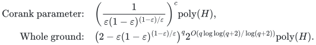

# Selected flow with a shared setup and routing budget

**Guarantee**

Returns a permitted <code class="math">r</code>-commodity set and common rate at least <code class="math">(1-\varepsilon)\mathrm{OPT}</code>, with one shared setup and routing budget and all routing-only budgets exact.

**Objective and output**

Maximize selected concurrent rate; output the actual selected set and its splittable flow.

**Randomness**

Deterministic, conditional on the paid exact minimum-setup restriction optimizer and exact rational flow-LP primitives.

**Time**

The corank-parameter and fixed-accuracy whole-ground bounds are:

<!-- math-display: 4ade41583a69b80a69bf3b88
\begin{aligned}
\text{Corank parameter:}\quad &\left(\frac{1}{\varepsilon(1-\varepsilon)^{(1-\varepsilon)/\varepsilon}}\right)^c\mathrm{poly}(H),\\
\text{Whole ground:}\quad &\bigl(2-\varepsilon(1-\varepsilon)^{(1-\varepsilon)/\varepsilon}\bigr)^q 2^{O(q\log\log(q+2)/\log(q+2))}\mathrm{poly}(H).
\end{aligned}
-->

For the whole-ground bound, <code class="math">\varepsilon</code> is fixed and rational.

**Space**

Polynomial in the explicit network, selected-set state, rational flow witnesses, and paid oracle workspace.

**Parameters**

<code class="math">c=q-r</code>; <code class="math">0&lt;\varepsilon&lt;1</code> is rational; setup fees and routing charges are nonnegative; <code class="math">\Gamma(R)=R^R/(R-1)^{R-1}</code>; <code class="math">H</code> includes the exact minimum-setup restriction optimizer.

**Model and representation**

A fixed family of permitted <code class="math">r</code>-sets with an attained exact minimum setup cost on every restriction, a rational directed network, splittable flows, and one combined exact budget.

**Lower-bound scope**

No lower bound is claimed; an ordinary existence-only restriction selector does not provide the required minimum-setup optimizer.

**Review status**

The [verification note](verify/README.md) records the proof scope, executable evidence and remaining conditions. No proof-assistant verification or external peer review is claimed.

**Source**

[Manuscript and proof](proof.md), with [dependencies and verification sources](sources.md).

The exact returned set must attain the setup cost used to compute the residual routing budget. The proof maintains one protected full-rate witness through the changing budget.

**Attribution.** Yilin Liu · GPT-6 Astra Pro
