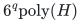

# Six-profile exact three-halves scheduling

**Guarantee**

Returns an integer schedule with makespan at most <code class="math">3\mathrm{OPT}/2</code> while preserving every original job total and the exact assignment-cost budget.

**Objective and output**

Minimize maximum load for arbitrary machine-type processing times; output a full original schedule.

**Randomness**

Deterministic enumeration of six profiles per machine and exact cost-preserving integral recovery.

**Time**

<!-- math-display: fff7e13acf3a224a277987f1
6^q\mathrm{poly}(H)
-->

With six profiles per physical machine.

**Space**

Polynomial in the complete binary input and paid oracle workspace; numerical resource multiplicities are not expanded into individual units.

**Parameters**

<code class="math">q</code> is the physical-machine count. <code class="math">H</code> includes original processing times, costs, binary job totals, recipient-rank descriptions, and paid profile, LP, intersection, and rounding work.

**Model and representation**

Arbitrary nonnegative rational processing times and assignment costs, integral job polymatroids, eligibility masks, mandatory original bases, and one exact budget.

**Lower-bound scope**

No lower bound or optimality claim is made for the base six.

**Review status**

**Ready for review.** The complete exact three-halves arbitrary-processing Theorem SX with mandatory original job-polymatroid bases and one exact assignment budget: six exact disjoint profiles, exhaustive one/two-big-unit coverage, original-total LPs, one joint prefix/partition integer cost recovery, zero processing, original-grid target search and complete streamed profile/time-space accounting. The reusable direct SixBackend lives with the activation adapter but implements the original SX model without activation.

**Dependencies and scope.** The theorem's polynomial per-profile exact LP/SFM and integral-intersection primitives remain explicitly paid. The reusable complete-table reference has separately charged canonical LP-vertex and numeric integer enumeration, including potentially exponential vertex storage; that implementation boundary is not an unresolved mathematical interface. The theorem permits arbitrary nonnegative machine/type times and one scalar assignment budget. No optimality of base six, general multiple-budget extension, exhaustive publication priority, proof-assistant formalization or external peer review is claimed.

The [verification note](verify/README.md) identifies executable coverage. This status does not claim external peer review or proof-assistant verification.

**Source**

[Manuscript and proof](proof.md), with [dependencies and verification sources](sources.md).

The reusable [six-profile backend](../activated-machine-scheduling/reference/README.md) implements the profile product and exact-budget recovery. Its [direct original-input checker](../activated-machine-scheduling/verify/check_six_profiles.py) covers all six labels independently of activation; finite solver costs are stated separately from the theorem's bound.

**Attribution.** icekylinx · GPT-6 Astra Pro
