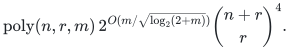
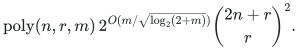
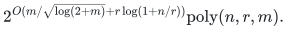
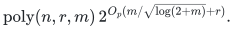

# Exact counting with a sparse correction and supplied low-rank factors

A division-free composition computes permanent and hafnian values on dense,
potentially full-rank matrices given as a sparse part plus supplied low-rank
factors. A sparse matching network is contracted over an explicit truncated
moment algebra; its entropy-sized basis preserves the entire sublinear-width
regime. Exact integer and rational recovery has polynomial bit overhead.

[Complete proof](proof.md) · [Sources and dependencies](sources.md) · [Finite verification](verify/README.md) · [Reference reductions](reference/README.md)

**Objective and output**

Return the exact permanent of `A=B+UV^T`, or the exact hafnian of
`A=B+UCU^T` with symmetric `B,C`. In the hafnian case `A` has `2n` vertices;
diagonal entries are irrelevant. Fixed original monomer weights are also
supported. The decomposition, sparse support and factor matrices are inputs.

**Randomness**

Deterministic exact division-free construction, using the cited quantitative crossing recursion and the existing normalization-one integral Schur primitive; finite check selection uses a fixed seed only.

**Time**

Over every commutative ring with identity, the permanent bound is

<!-- math-display: ad978422dc6419e03c30f769
\mathrm{poly}(n,r,m)\,
2^{O(m/\sqrt{\log_2(2+m)})}\binom{n+r}{r}^{4}.
-->

For the hafnian and its fixed-monomer extension, the bound is

<!-- math-display: d5e78f6bca7f5e33a8ca248c
\mathrm{poly}(n,r,m)\,
2^{O(m/\sqrt{\log_2(2+m)})}\binom{2n+r}{r}^{2}.
-->

For `1<=r<=n`, both have entropy-form exponent

<!-- math-display: 3c28f0b3f045d3bb9536c507
2^{O(m/\sqrt{\log(2+m)}+r\log(1+n/r))}\mathrm{poly}(n,r,m).
-->

Thus `m=O(n)` and every `r=o(n)` give subexponential time, even when the
full matrix is dense and has full rank. With explicitly represented integer
or rational inputs, the same exponential bounds hold in deterministic bit
time, times a polynomial in input bit length. The exact binomial bounds
also cover widths beyond the entropy-form range. Sparse exponential and
binomial factors are one at `m=0` and `r=0`, respectively. In fixed prime
characteristic `p`, the permanent functional also permits individual-exponent
truncation, giving the additional bound

<!-- math-display: a7369bd8174105ada28b1e7d
\mathrm{poly}(n,r,m)\,2^{O_p(m/\sqrt{\log(2+m)}+r)}.
-->

This modular refinement does not reconstruct an integer answer.

**Space**

A straightforward evaluator stores at most circuit-size many explicit
coefficient vectors. Permanent and hafnian coefficient dimensions are
`binom(n+r,r)^2` and `binom(2n+r,r)`. This package claims no polynomial-space
bound for the composed algorithm. Signed integer recovery uses a modulus
with polynomially many bits.

**Parameters**

`n` is the permanent dimension or half the hafnian dimension. `m` counts
supported entries of `B` for permanent, and unordered off-diagonal support
edges for hafnian. `r>=0` is the supplied factor width. Finding a suitable
decomposition is outside the input model. All supported values may be
signed, zero, or elements of a ring with zero divisors.

**Model and representation**

Arithmetic uses addition, negation and multiplication over any commutative
unital ring. All coefficient vectors have explicit finite monomial bases;
naive multiplication is charged quadratically in the basis dimension.
The sparse network has at most `3m` Boolean wires and arity at most three,
including state-chain wires. Normalization-one integer Schur pieces make
the cited quantitative recursion division-free. This dependency is separate
from integer factorization's literal truncated-2-adic theorem. Neither a
broader interpretation of that theorem nor an unconstructed moment evaluator
is used. Integer/rational inputs are explicit binary numbers.

**Lower-bound scope**

No general counting lower bound, global optimality or historical priority
claim is made. Fixed-rank permanent algorithms and the pure low-rank case
are prior work. The selected content is the sparse-network/moment-algebra
composition with full entropy and bit accounting. The result supplies no
improved unrestricted dense permanent algorithm or practical speed estimate.

**Review status**

**Ready for review.** Complete sparse matching/moment-algebra composition for permanent, hafnian and fixed monomers; entropy-sized truncation, all-ring arithmetic specialization, explicit integer/rational bit recovery, and supporting fixed-uniformity symmetric/partite hypermatching proofs. Actual primary contraction interface and existing integral prerequisite audited; no circularity found.

**Dependencies and scope.** Anthropic Appendix A Definition 7/Lemma 8/Theorem A, part (b) is a cited mathematical ingredient; local ring lift removes the normalizer division via existing finite Schur pieces. No independent proof or fast implementation of that external recursion is claimed. Only existing finite-crossing, integral-pieces and coefficient-computation proofs are dependencies. The prior package's matrix exponent/SAT branches and the separate literal truncated-2-adic integer-factorization theorem are not used. Explicit finite coefficient-vector costs and all Boolean state wires are charged. Native tests validate finite reductions and numeric lifting, not asymptotic exponents, source theorem correctness, historical priority or formal verification. Finding the supplied factorization, unrestricted dense permanent/hafnian, and arbitrary constant-circuit numeric inputs without output-size accounting are excluded.

The [verification note](verify/README.md) identifies executable coverage. This status does not claim external peer review or proof-assistant verification.

**Source**

Curated from the supplied 2 November 2026 TCS checkpoint, with the complete
core proof and exact dependency boundary preserved. The
[sources note](sources.md) records source-member transformations and the
prior work boundary. Hamiltonian, exceptional-set and unrelated counting
branches are outside this selected package.

**Attribution:** icekylinx and GPT-6 Astra Pro. Apache-2.0.
