# Exact structured hypermatching beyond matrices

Research manuscript, 2 November 2026.

## Statement and dependency

This manuscript extends the positive algorithms in
[the main composition proof](../proof.md) to fixed-uniformity hypergraphs. It uses
that manuscript's deterministic, division-free contraction theorem over
every commutative ring. That engine is the explicitly attributed
composition of the quantitative Anthropic crossing recursion and the
user's integral Schur crossing pieces. The hypermatching reductions and
their moment recurrences are proved below. Their historical priority has
not been established; no novelty claim is made for low-rank moment
identities in isolation.

Fix an integer `k >= 2`. Let `N` be divisible by `k`, and let `R` be a
commutative ring with identity. A weighted perfect `k`-matching partitions
`[N]` into unordered blocks of size `k` and has weight equal to the product
of the block weights. Write `H_k(A)` for its total weight. Entries on tuples
with repeated vertices are irrelevant.

Suppose the input supplies

<!-- math-display: 18ad50fe0abe1b02b6c491ae
A_{i_1,\ldots,i_k}
= B_{\{i_1,\ldots,i_k\}}
  +\sum_{a_1,\ldots,a_k=1}^{r}
      C_{a_1,\ldots,a_k}\prod_{t=1}^{k}U_{i_t,a_t},
\tag{1}
-->
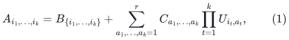

where `C` is a symmetric order-`k` core tensor, `U` has size `N by r`,
and `B` has a supplied sparse support of total incidence size `L`.
The factorization and the core are part of the input; no algorithm for
finding them is asserted.

**Theorem 1.** There is a deterministic division-free arithmetic circuit
for `H_k(A)` with size and uniform construction cost at most

<!-- math-display: 178b568fcf5e48ae50c482d3
\mathrm{poly}_k(N,r,L)\,
2^{O(L/\sqrt{\log_2(2+L)})}
\binom{N+r}{r}^{\,2}.
\tag{2}
-->
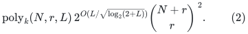

The sparse exponential factor is one if `L=0`. For `1 <= r <= N`,
the bound is

<!-- math-display: f0e7e582fe31996495323dc8
\mathrm{poly}_k(N,r,L)\,
2^{O_k(L/\sqrt{\log(2+L)}+r\log(1+N/r))}.
\tag{3}
-->
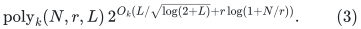

Thus `L=O(N)` and `r=o(N)` give a deterministic `2^{o(N)}` algorithm,
even though the full weighted hypergraph in (1) can be dense. This covers
the ordinary hafnian when `k=2` and symmetric core `C` is arbitrary.
For `k>=3`, it is a higher-uniformity exact-cover counting statement.
It concerns structured weights, rather than an algorithm for an arbitrary
dense hypergraph.

## 1. The sparse hypermatching partition polynomial

For each vertex put

<!-- math-display: 5a35d44c04b56b24f53d399a
\mu_i(x)=\sum_{a=1}^{r}U_{ia}x_a.
-->
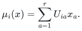

Let

<!-- math-display: 8d3ca5db8a514718e5e7977c
P(x)=\sum_{M\text{ a matching in the support of }B}
      \left(\prod_{e\in M}B_e\right)
      \left(\prod_{i\notin V(M)}\mu_i(x)\right).
\tag{4}
-->
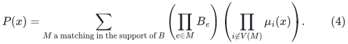

A Boolean variable selects each sparse hyperedge. An equality tensor
copies this selection to all its incidences, and the edge weight is
inserted exactly once. At each vertex an at-most-one tensor has value
`mu_i` when no incident edge is selected, value one when exactly one is
selected, and zero otherwise.

As in the matrix case, the vertex constraint splits into a two-state
running-count chain. An equality tensor of arbitrary arity also splits
into a tree of arity-three equality tensors. This produces a Boolean
network with `O(L)` wires and maximum arity three. Isolated vertices
contribute their monomer factors separately. The universal-ring engine
evaluates (4) in

<!-- math-display: cf9b7dc9126cefa1a438f221
\mathrm{poly}(N+L)\,
2^{O(L/\sqrt{\log(2+L)})}
-->
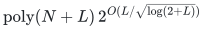

operations in the chosen coefficient algebra. Vertex degrees and sparse
hyperedge sizes do not create an uncharged large local tensor.

## 2. A division-free core moment

For a vector `alpha` of nonnegative integers, let `W_C(alpha)` be the
weighted perfect `k`-matching count on a labeled collection containing
`alpha_a` vertices of color `a`; a block with color tuple
`(a_1,...,a_k)` has weight `C_(a_1,...,a_k)`.

Set `W_C(0)=1` and set `W_C(alpha)=0` when `|alpha|` is not divisible
by `k`. For a nonzero admissible vector choose a canonical color `i`
with `alpha_i>0` and distinguish one of its labeled vertices. Its block
contains a color multiset `beta` of size `k-1`. Consequently

<!-- math-display: 77106db24107e815f59a0e59
W_C(\alpha)=
\sum_{\substack{0\le\beta\le\alpha-e_i\\|\beta|=k-1}}
\left(\prod_{j=1}^{r}
          \binom{\alpha_j-\mathbf1_{j=i}}{\beta_j}\right)
C_{i,\beta}\,W_C(\alpha-e_i-\beta).
\tag{5}
-->
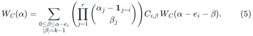

Here `C_(i,beta)` denotes the core entry with one distinguished color
`i` and the multiset `beta` of partner colors. It is well-defined because
`C` is symmetric. The product of binomial coefficients chooses an
unordered set of labeled partners. There is no ordering of the block
and no hidden division by `(k-1)!` or `k!`.

All binomial coefficients are ordinary integers and can be generated
by Pascal's recurrence before their images are embedded in `R`.
There are at most `binom(N+r,r)` states and, for fixed `k`, polynomially
many partner-color multisets per state. Thus all moments in the desired
degree range can be computed within the cost of (2).

## 3. The extraction identity and its complexity

Define an `R`-linear functional on monomials by

<!-- math-display: d88ab41d3d2b6464dd6a2cdb
\mathcal W_C(x^\alpha)=W_C(\alpha).
-->
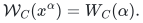

Then

<!-- math-display: bf1a3b2c589ab13941fd2005
H_k(A)=\mathcal W_C(P).
\tag{6}
-->
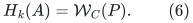

Indeed, expand each block of a perfect matching using either its sparse
term or its dense term in (1). The sparse blocks form one matching `M`
in (4). Color each remaining vertex by its `U` index. Once those colors
are fixed, their dense completions are exactly the labeled core-weighted
matchings counted by (5). This is a weight-preserving bijection, so the
identity holds as an integer polynomial and hence in every commutative
ring, including rings with zero divisors.

Compute `P` in the total-degree-`N` truncated algebra

<!-- math-display: dd61458a7c8611617685b18b
R[x_1,\ldots,x_r]/(\text{all monomials of degree greater than }N).
-->
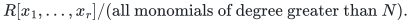

It is a quotient by a monomial ideal and has free-module dimension
`D=binom(N+r,r)`. Naive multiplication costs `O(D^2)` base-ring
operations. Discarded degrees cannot later decrease, so this truncation
is exact. Applying the already computed functional costs `O(D)`
operations. Equations (4)--(6) establish Theorem 1.

## 4. A partite analogue

Consider `k` labeled parts, each of size `n`. A perfect partite
hypermatching selects `n` disjoint tuples, each containing one vertex
from every part. Suppose its weight tensor is supplied as

<!-- math-display: 28fcdcf6881fe24f1e81aed2
A_{i_1,\ldots,i_k}
=B_{i_1,\ldots,i_k}
  +\sum_{a=1}^{r}\prod_{q=1}^{k}U^{(q)}_{i_q,a}.
\tag{7}
-->
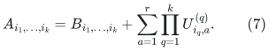

This is a sparse tensor plus a supplied rank-`r` sum of separable tensors.
Give each unmatched vertex in part `q` the monomer
`sum_a U^(q)_(i,a) x^(q)_a`. The sparse matching partition polynomial
has degree at most `n` in each of the `k` color-variable groups.

For color histograms `alpha^(1),...,alpha^(k)`, use the functional

<!-- math-display: 65edde885d07132e16a2e670
\mathcal L\!\left(\prod_{q=1}^{k}(x^{(q)})^{\alpha^{(q)}}\right)
= [\alpha^{(1)}=\cdots=\alpha^{(k)}]
     \prod_{a=1}^{r}(\alpha^{(1)}_a!)^{k-1}.
\tag{8}
-->
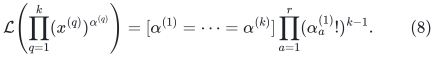

Fixing the labeled vertices of the first part, each other part can be
bijected independently to them within each color class. There are
exactly `(alpha_a!)^(k-1)` choices per color. This proves the analogue
of (6) without division in the target ring.

**Theorem 2.** The weighted perfect partite hypermatching sum for (7)
has a deterministic division-free circuit of size

<!-- math-display: 5bf49b226634cb4b41ca2a3b
\mathrm{poly}_k(n,r,L)\,
2^{O(L/\sqrt{\log(2+L)})}
\binom{n+r}{r}^{\,2k}.
\tag{9}
-->
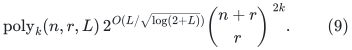

For fixed `k`, `L=O(n)`, and `r=o(n)`, this is `2^{o(n)}`. The
ordinary permanent is the case `k=2`. The total-degree truncation in
each part, rather than a rectangular `(n+1)^r` bound, is what preserves
the whole sublinear-rank regime.

In prime characteristic `p`, every individual color exponent may also
be truncated at `p-1`: any discarded monomial surviving the histogram
matching test would have a factorial factor divisible by `p`. This is
an optional refinement of the partite algorithm.

## 5. Exact integer and rational outputs

For explicitly represented integer factors, first bound each dense
hyperedge weight from the input heights and the number `r^k` of core
summands. There are at most `N!` perfect hypermatchings and at most
`N/k` factors in each matching weight. Hence the output has polynomial
bit length in the input length for fixed `k`. Evaluate the division-free
circuit modulo a power of two exceeding twice the absolute output
bound and recover the signed integer answer. This uses polynomial-bit
ring operations and does not require control of intermediate integer
magnitudes.

For rational input let `D` be the product of the input denominators.
In (1), multiply the full weight tensor by `D^(k+1)`, replace `U`
by `DU`, replace `C` by `DC`, and replace `B` by `D^(k+1)B`.
All factors are integral, the support and width are unchanged, and
the final answer is divided by `D^((k+1)N/k)`. For (7), use scaling
`D^k` and divide the answer by `D^(kn)`. Thus (2) and (9) are also
deterministic exact bit bounds up to a polynomial input-length factor.

## 6. Verification and limits

`verify/check_hypermatching.py` compares the
moment reductions with direct enumeration of complete perfect
hypermatchings and partite permutations. It tests signed integer data,
prime and composite moduli, repeated colors in the core, zero width,
and the empty instance. The saved JSON report records the finite scope.
It checks the new identities; it is not an implementation or benchmark
of the asymptotic contraction engine.

No claim is made that a generic dense hypergraph admits the supplied
decomposition with linear incidence size and sublinear width. There is
no general polynomial-time or VNP=VP conclusion. The positive content is
the exact algorithm for a broad structured class, with explicit
characteristic and bit-complexity control.

**Attribution:** icekylinx and GPT-6 Astra Pro. Apache-2.0.
