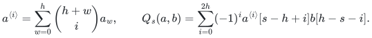
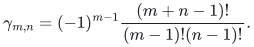
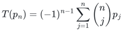
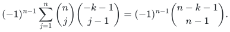
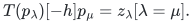
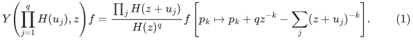
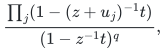
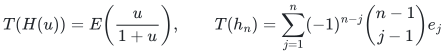

# Audit of the normalization-one integral crossing prerequisite

**Date:** 2 November 2026.

**Conclusion:** No gap was found in the algebraic prerequisite described
below. The proof yields crossing pieces with integer factorizations and
normalizing scalar exactly one. Its specialization to characteristic two
does not require division by two, by a factorial, or by a partition
normalization. This is a source-dependency audit, supplemented by exact
finite tests; it is not external peer review or formal verification of a
downstream partial-transpose-rank theorem.

## 1. Exact source boundary

The reviewed source is `icekylinx/algorithm-frontier`, commit
`2658b60c9d032611492792718bd9d39f721de09f`, under
`problems/noncommutative-crossing/`:

- `manuscripts/finite-crossing.tex`: the finite crossing operator identity
  and finite binomial duality.
- `manuscripts/integral-pieces.tex`: the integral Schur lattice and
  normalization-one crossing pieces.
- `manuscripts/coefficient-computation.tex`: finite construction, bit
  height and workspace accounting.
- `reference/schur_modes.py` and `reference/integral_crossing.py`:
  inspected finite reference implementations.
- `verify/check_schur_lattice.py` and
  `verify/check_integral_crossing.py`: inspected and rerun source checks.

Primary source directory:

https://github.com/icekylinx/algorithm-frontier/tree/2658b60c9d032611492792718bd9d39f721de09f/problems/noncommutative-crossing

The source's separate fast matrix-multiplication interfaces, ordered
insertion construction and SAT consequences are not used in this
prerequisite. The reviewed finite operator proof stands independently
of those results.

## 2. The exact algebraic contract

Let <code class="math">V=\mathbb Q[p_1,p_2,\ldots]</code> with <code class="math">\deg p_j=j</code> and
<code class="math">\dim V_w=p(w)</code>, the partition number. Define
<code class="math">D_{-k}f=p_kf</code> and <code class="math">D_kf=k\partial f/\partial p_k</code>. Their only
nonzero cross commutators are the central scalars
<code class="math">[D_k,D_{-\ell}]=k[k=\ell]</code>.

For a homogeneous state <code class="math">a</code> of weight <code class="math">w</code>, the source defines
<code class="math">Y(a,z)=\sum_r a[r]z^{r-w}</code>. Thus <code class="math">a[r]</code> changes the argument's
weight by <code class="math">r</code>. For an inhomogeneous state, the modes are extended
linearly **with this same weight-shift index <code class="math">r</code>**, not by collecting one
fixed exponent of <code class="math">z</code> across different state weights. This distinction
is required in the transformed-state duality and was explicitly checked.

For <code class="math">a=\sum_{w=0}^h a_w</code> and <code class="math">b\in V_h</code>, the source uses

<!-- math-display: f06b1c78cc0a91bf7c9ed66b
a^{\langle i\rangle}=\sum_{w=0}^h\binom{h+w}{i}a_w,
\qquad
Q_s(a,b)=\sum_{i=0}^{2h}(-1)^i
      a^{\langle i\rangle}[s-h+i]b[h-s-i].
-->

The conclusions are that each product may be reversed inside this
whole sum, <code class="math">Q_s</code> vanishes for <code class="math">&#124;s&#124;&gt;E+h</code> on <code class="math">V_E</code>, and
<code class="math">\sum_sQ_s=(a[-h]b)\mathrm{Id}_{V_E}</code>.

## 3. Audit of the finite crossing proof

For homogeneous states of weights <code class="math">h'</code> and <code class="math">h</code>, the commutator of the
corresponding single oscillator fields has pole order <code class="math">m+n</code> and scalar

<!-- math-display: c81761af3605d047d73759a4
\gamma_{m,n}=(-1)^{m-1}
      \frac{(m+n-1)!}{(m-1)!(n-1)!}.
-->

Reversing the fields gives the expansion of the same rational function:
the sign from swapping <code class="math">z-w</code> combines with <code class="math">\gamma_{n,m}</code> to recover
<code class="math">\gamma_{m,n}</code>. A finite partial matching of the separately labeled
state factors accounts for all commutations, since each commutator is
central and every labeled operator can be contracted at most once.

For a fixed input and output of weight <code class="math">E</code>, a completely normally
ordered unmatched term has total annihilation weight at most <code class="math">E</code>.
Its total creation weight is the same, because the initial and final
weights agree. Its matrix coefficient is therefore a finite Laurent
polynomial. Multiplication by <code class="math">(z-w)^{h+h'}</code> clears every contraction
pole. Both product orders then give expansions of this same finite
Laurent polynomial. This justifies coefficient extraction and evaluation
at <code class="math">z=w=1</code> without interchanging an uncontrolled infinite sum.

All non-fully-matched terms vanish at <code class="math">z=w</code> because they retain a
positive power of <code class="math">z-w</code>. The fully matched terms are scalar, and the
vacuum coefficient identifies their sum as <code class="math">a[-h]b</code>. The coefficient
of <code class="math">z^s w^{-s}</code> produces exactly the binomial coefficient
<code class="math">\binom{h+h'}i</code> in the stated <code class="math">Q_s</code>. Summing homogeneous components
gives the inhomogeneous formula.

The support bounds also use the correct product order. In the first
order the rightmost mode vanishes for <code class="math">s&gt;E+h</code>. After reversing the
whole sum, the other rightmost mode vanishes for <code class="math">s&lt;-E-h</code>. No individual
unreversed summand is asserted to have both support bounds.

## 4. Audit of the transformed duality

The ring homomorphism

<!-- math-display: 9784df9d589715d9010bd468
T(p_n)=(-1)^{n-1}\sum_{j=1}^n\binom njp_j
-->

is inhomogeneous but filtered. Its all-annihilation coefficient at index
<code class="math">k</code> contains

<!-- math-display: e9f16c2a6b2f18ddbcda66ae
(-1)^{n-1}\sum_{j=1}^n\binom nj\binom{-k-1}{j-1}
=(-1)^{n-1}\binom{n-k-1}{n-1}.
-->

This is zero for <code class="math">1\leq k&lt;n</code> and equals one at <code class="math">k=n</code>. In a mode
of shift <code class="math">-h</code> on <code class="math">V_h</code>, any creation would force the total
differentiation weight above <code class="math">h</code>, so it contributes zero. The remaining
indices are each at least the corresponding original state part and
sum to exactly <code class="math">h</code>; they must equal those parts. Thus

<!-- math-display: bcaf2c8916529cb59246b8ec
T(p_\lambda)[-h]p_\mu=z_\lambda[\lambda=\mu].
-->

There is no missing factorial here: <code class="math">z_\lambda</code> is precisely the
power-sum Hall norm. The Schur basis has Hall norm one, so linearity over
<code class="math">\mathbb Q</code> gives
<code class="math">T(s_\lambda)[-h]s_\mu=[\lambda=\mu]</code>. The subsequent independent
integrality proof is what permits this rational identity to specialize
to every characteristic.

## 5. Integrality and finite Laurent coefficients

Let <code class="math">\Lambda_{\mathbb Z}=\mathbb Z[h_1,h_2,\ldots]</code>. The complete
products <code class="math">h_\lambda</code> and Schur functions are integral bases. The source
derives the normally ordered generating identity

<!-- math-display: 269d5b4d0e092cbc5e82f4d3
Y\!\left(\prod_{j=1}^qH(u_j),z\right)f
=\frac{\prod_jH(z+u_j)}{H(z)^q}
f\left[p_k\mapsto p_k+qz^{-k}-\sum_j(z+u_j)^{-k}\right].
                                                       \tag{1}
-->

Both scalar series calculations were checked directly: the creation
coefficient sums to <code class="math">((z+u)^\ell-z^\ell)/\ell</code> and the annihilation
coefficient to <code class="math">z^{-k}-(z+u)^{-k}</code>. Normal ordering once over all state
factors is essential; multiplying separately normal-ordered operators
would introduce extra contractions and would not prove (1).

The substitution in (1) is addition of <code class="math">q</code> copies of one alphabet letter
and subtraction of <code class="math">q</code> other letters. On complete-function generating
series it multiplies by

<!-- math-display: d9609e35280a7dcd37512c05
\frac{\prod_j(1-(z+u_j)^{-1}t)}{(1-z^{-1}t)^q},
-->

which has integral coefficients in the complete-function lattice.
The prefactor is integral because <code class="math">H(z)^{-1}=E(-z)</code>.

There is an explicit finite-coefficient bound. Fix total <code class="math">u</code>-degree <code class="math">U</code>
and input weight <code class="math">E</code>. A coefficient of the substituted polynomial has
<code class="math">z</code>-exponent at least <code class="math">-E-U</code>. For each fixed <code class="math">u</code>-degree, the creation
prefactor has only nonnegative <code class="math">z</code>-powers. Consequently a requested
<code class="math">z</code>-coefficient receives only finitely many terms. Extracting the
specified <code class="math">u</code>-monomial proves that every mode of <code class="math">h_\lambda</code>, hence
every integral state, has integral Schur coordinates.

Likewise

<!-- math-display: 28f37e997732364c4e489120
T(H(u))=E\!\left(\frac{u}{1+u}\right),\qquad
T(h_n)=\sum_{j=1}^n(-1)^{n-j}\binom{n-1}{j-1}e_j
-->

proves componentwise integrality of the filtered transform. Multiplying
each weight component by <code class="math">\binom{h+w}i</code> preserves it. Both mode
factorizations of each crossing piece therefore have integer entries.

The expressions involving <code class="math">1/n</code>, exponentials, power sums, and rational
basis changes are proof calculations over <code class="math">\mathbb Q</code>. They are not
operations that must be performed inside a field of characteristic
dividing <code class="math">n</code> or <code class="math">h!</code>. Final integer matrices are constructed first and
then reduced into the target coefficient ring. This order removes the
apparent small-characteristic obstruction.

## 6. Dimensions, bit height, and scope of rank

In one orientation the intermediate weight is <code class="math">E+s-h+i</code>; in the
other it is <code class="math">E+h-s-i</code>. Summing the partition dimensions over
<code class="math">0\leq i\leq2h</code> gives exactly the two factorization sizes in the
source theorem. Negative weights contribute zero. All relevant weights
are <code class="math">O(h+E)</code>.

The source's coefficient algorithm enumerates only a fixed number of
partition sets, derivative subpartitions and finite-difference grids,
each of size <code class="math">2^{O(\sqrt{h+E})}</code>. Oscillator binomial coefficients,
falling factorials and basis-conversion denominators have polynomial
bit length. A common factorial denominator of a fixed power suffices
for the nested basis conversions; summing exponentially many terms
adds only <code class="math">O(\sqrt{h+E})</code> magnitude bits to this accounting. The final
coefficients are integers by the lattice argument.

Over a field these factorizations bound the ordinary matrix ranks.
Over a general commutative ring they provide the indicated integer
factorization lengths without needing to choose a particular notion of
module rank. The field statement is sufficient for all-characteristic
partial-transpose-rank applications.

## Finite evidence boundary

The source checkpoint reports prior runs of its Schur, crossing and mixed-state
checks. Those historical counts are not new execution claims for this import.
The existing [Schur lattice](../../noncommutative-crossing/verify/check_schur_lattice.py)
and [integral crossing](../../noncommutative-crossing/verify/check_integral_crossing.py)
checkers remain in their original package. This package's own finite coverage
is listed in [the verification note](../verify/README.md).

**Attribution:** icekylinx and GPT-6 Astra Pro. Apache-2.0.
