# Universal ring contraction and sparse weighted counting

## Scope and provenance

This note records a constructive consequence of two imported ingredients:
the quantitative clique-contraction recursion in Appendix A of Anthropic,
*A <code class="math">2^{o(n)}</code>-time algorithm for 3-SAT*, and the normalization-one integral Schur
crossing pieces at repository commit
2658b60c9d032611492792718bd9d39f721de09f.
The former already gives the characteristic-zero arithmetic consequence
after division by its nonzero integer normalizer. The latter has normalizer
one, so the same recursion uses only addition and multiplication and works
over every commutative ring. This is an algebraic consequence, not a claim
that the OpenAI 2-adic algorithm itself is an arithmetic circuit.

The additional parameter observation below is a uniform dependence on
maximum tensor arity, obtained by balancing original tensor vertices before
calling the source clique recursion. No claim of a faster dense permanent
algorithm is made.

## Theorem

Let <code class="math">R</code> be a commutative ring with identity. A tensor network has Boolean
edges, <code class="math">m\ge2</code> edges, at most <code class="math">2m</code> nonisolated vertices, and maximum
tensor arity <code class="math">\Delta</code>. Parallel edges are permitted; isolated scalar
vertices are removed first and their input and multiplication costs are
added separately. Suppose an original tensor entry can be evaluated by a
division-free arithmetic circuit of at most <code class="math">Q</code> ring operations, and
that the circuit and its ordinary control data can be generated in
<code class="math">\mathrm{poly}(m,Q)</code> bit operations from the vertex and its
incident bit assignment. There is a deterministic, division-free contraction algorithm
using
<!-- math-display: 42c5f17be323dce2c926a72a
(m+Q)^{O(1)}
2^{O\!\left(m/\sqrt{\log_2(2+m/\Delta)}\right)}
-->
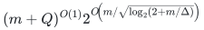
ring operations and a number of ordinary preprocessing bit operations
bounded by the same expression. The constants are absolute once the
imported crossing-piece implementation is fixed.

Equivalently, if each queried input entry is supplied by an arithmetic
circuit in a common set of formal variables, the contraction has an
explicit division-free arithmetic circuit of this size. The algorithm's
control flow and all structural choices depend only on the network and
the fixed crossing pieces, not on the values of its ring inputs.

For fixed <code class="math">\delta&gt;0</code>, the assumption
<code class="math">\Delta\le m^{1-\delta}</code> gives
<!-- math-display: 4957f6e24ee28d7621a36145
(m+Q)^{O(1)}2^{O_\delta(m/\sqrt{\log m})}.
-->
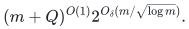
Every sublinear-arity family <code class="math">\Delta=o(m)</code> has a uniform <code class="math">2^{o(m)}</code>
ring-operation algorithm, up to its input-entry cost.

## Arithmetic lift of the source recursion

The integral source pieces have normalizer one, polynomially many pieces
in their bit-width parameter <code class="math">\lambda</code>, factor widths obeying
<!-- math-display: ee1e359c37d9aec16f4c5c77
c_i^{\rm row}+c_i^{\rm col}
\le 2\sqrt2\,\lambda+O(\log(2\lambda)),
-->
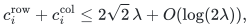
and integer factor entries computable in <code class="math">2^{O(\lambda)}</code> bit
operations. Their integer bit lengths are polynomial in <code class="math">\lambda</code>.
Consequently they satisfy the source's Definition 7 with
<code class="math">\rho=1/\sqrt2</code>, with normalizer exactly one.

The source's grid decomposition, row/column choice, regrouping,
entry-query composition, and final summation all use additions and
multiplications. The only division in its clique recursion is the final
division by the normalizer raised to the number of crossings
(Appendix A, equations (43)--(44)). That operation disappears here.
Choosing which network to recurse on uses only factor widths and wire
counts. Choosing a successful grouping uses only the network's edge
counts. Thus no order, comparison, lift, or division operation on <code class="math">R</code>
is introduced.

Repeat Theorem A(b)'s operation count with scalar arithmetic of unit cost.
The integer-size parameter <code class="math">B</code> is no longer an input-entry cost;
coefficient generation and the combinatorial control retain polynomial
costs in the integer parameters. There is a fixed sequence <code class="math">K_\ell</code>
with
<!-- math-display: 118f0f1e890971f2e7921c5c
K_{\ell+1}\le K_\ell^{10},\qquad
e_\ell=O((\log K_\ell)^{-1/2}),
-->
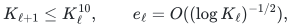
and every <code class="math">(K_\ell,\lambda)</code>-clique contracts in
<!-- math-display: 5b9f7a033bc4861f4cd205eb
2^{e_\ell K_\ell^2\lambda}
(K_\ell(\lambda+2))^{O(K_\ell^2)}
-->
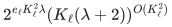
ring operations, apart from original-entry queries. This is the source's
recurrence with exactly the same <code class="math">\rho</code>, not a new asymptotic crossing
identity. Integer constants are embedded in <code class="math">R</code> by signed
double-and-add; their polynomial bit lengths are absorbed by the stated
preprocessing and ring-operation bounds.

## Reducing an arbitrary sublinear-arity network to a clique

Write <code class="math">R_0=m/\Delta</code>. If <code class="math">R_0</code> is below a sufficiently large fixed
constant, enumerate all <code class="math">2^m</code> edge assignments; this already has the
claimed form.

Otherwise choose <code class="math">K=K_\ell</code> as the largest available level satisfying
<!-- math-display: 740d548e5ec303caea51d44a
K\le m^{1/10},\qquad 3K^8\Delta\le m.
-->
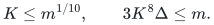
If no such level exists, direct enumeration again handles the bounded
parameter range. The growth bound on <code class="math">K_\ell</code> gives
<!-- math-display: c78909329528e8c0e998fd3b
\log K=\Omega(\log(2+R_0)).
-->
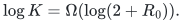
Indeed the smaller of <code class="math">m^{1/10}</code> and
<code class="math">(m/(3\Delta))^{1/8}</code> has logarithm
<code class="math">\Omega(\log(2+R_0))</code>, and stepping down one level loses at most a
constant factor in this logarithm.

Set <code class="math">g=3K^8</code>. Greedily assign each original vertex, with weight equal
to its arity, to a currently least-loaded one of <code class="math">g</code> clusters. Each
cluster then has total incident-port load
<!-- math-display: b234535e82eb2c491c1e0705
P\le 2m/g+\Delta\le 3m/g.
-->
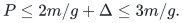
Empty clusters are allowed. Internal edges are contracted within the
entry oracle of their cluster; on a specified assignment of boundary
edges, this needs at most <code class="math">2^P</code> products of original entries.

There is a useful sharper accounting: in the source's subsequent
grouping of these <code class="math">g</code> clusters into <code class="math">K</code> clique vertices, do not
materialize any cluster tables. A final grouped entry is evaluated
directly from the original vertices assigned to that group. The source
grouping has at most <code class="math">2g/K</code> clusters per group, so the total incident
load of the group is at most
<!-- math-display: 994336d867b42f578246a21e
2gP/K\le 6m/K.
-->
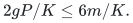
All edges internal to the group, including those formerly internal to
one cluster, are summed in one enumeration. Thus the total entry-query
overhead is <code class="math">2^{O(m/K)}\mathrm{poly}(m,Q)</code>, rather than
repeatedly multiplying separately materialized table costs.

The source's Lemma 8, case (i), finds a grouping in <code class="math">K^g</code> trials and
produces a clique with
<!-- math-display: 2f31e3d2632877486bb5f2df
K^2\lambda=O(m+m/K+K^2)=O(m).
-->
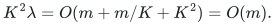
Here the original network's total shared-bit incidence is at most
<code class="math">2m</code>, and the lemma's load correction is <code class="math">gP/K=O(m/K)</code>.
The resulting logarithmic cost is
<!-- math-display: ee0b545cca6997e5ab3b34e7
O\!\left(
\frac{m}{\sqrt{\log K}}
+\frac{m}{K}
+K^8\log K
+K^2\log(m+2)
\right).
-->
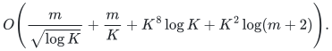
Because <code class="math">K\le m^{1/10}</code>, the last two terms are
<code class="math">O(m^{4/5}\log(m+2))</code> and <code class="math">O(m^{1/5}\log(m+2))</code>.
Both are absorbed by <code class="math">O(m/\sqrt{\log(2+R_0)})</code>; bounded small values
are absorbed into the absolute constant. The <code class="math">m/K</code> term is also
absorbed. This proves the theorem.

## Exact dependency boundary and finite coefficients

The integral algebraic prerequisites are the existing repository's
[finite crossing proof](../../noncommutative-crossing/manuscripts/finite-crossing.tex),
[Schur integral proof](../../noncommutative-crossing/manuscripts/integral-pieces.tex),
and [coefficient algorithm](../../noncommutative-crossing/manuscripts/coefficient-computation.tex),
pinned in the checkpoint to commit
`2658b60c9d032611492792718bd9d39f721de09f`.
Only these finite operator and integer coefficient arguments are used. The
matrix exponent, ordered insertion construction, and any SAT consequences
in that existing package are outside this dependency chain. Thus this use
of the prior primitive is acyclic.

For completeness, choose the least positive partition weight `h` with
`p(h)>=2^lambda`, select the first `2^lambda` Schur labels and put `E=h`.
The partition asymptotic gives `h=Theta(lambda^2)` and
`log_2 p(h)=lambda+O(log(2lambda))`. In each integral piece, the summands
of the two intermediate dimensions have weights `h+s+i-h=s+i` and
`2h-s-i`. Each index lies in a polynomial-sized range. Their maximal
nonnegative weights have sum at most `4h`. Concavity of the square-root
partition exponent therefore gives

<!-- math-display: d61f0795b3902cf770595199
\log_2 R_s^{\rm row}+\log_2 R_s^{\rm col}
\le 2\sqrt2\,\lambda+O(\log(2\lambda)).
-->
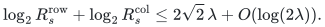

The same estimate holds after taking ceilings for the Boolean factor
widths. A zero-dimensional factor is the zero piece and can be omitted.
If one factor width exceeds `2lambda`, the source's trivial identity
factorization caps it at `2lambda` without increasing their sum. Extra
Boolean labels are padded by zero. There are `O(h)` pieces and the
finite coefficient algorithm costs `2^{O(sqrt(h))}=2^{O(lambda)}`
bit operations per requested entry, with polynomial bit height.
Consequently these pieces meet every part of Definition 7 with
`rho=1/sqrt(2)` and `d=1`. No divisions performed during rational
proof calculations or integer preprocessing are required inside `R`.

The tensor edge budget above counts individual Boolean wires, including
all state-chain wires. It never treats a multi-bit index as one edge.
All coefficient algebras in the main proof have an explicit finite monomial
basis. Their multiplication is a finite convolution followed by deletion
of monomials in the truncation ideal, with quadratic base-ring cost in
the basis dimension. There is no symbolic-coefficient or interpolation
oracle concealed in the arithmetic lift.

The external quantitative recursion is a cited mathematical ingredient;
this package proves its division-free specialization and supplies the
complete finite local reductions. It does not independently re-prove the
external recursion or ship its asymptotically fast implementation. The
OpenAI truncated-2-adic theorem used by integer factorization is a
separate theorem with a different literal coefficient interface; it is
not invoked here. In particular, no extension of that theorem to general
commutative rings or exponential coefficient vectors is assumed.

**Attribution:** icekylinx and GPT-6 Astra Pro. Apache-2.0.
