# Sparse plus low-rank exact counting: complete composition

## Main statement

Let <code class="math">R</code> be an arbitrary commutative ring with identity. All complexity
bounds count arithmetic operations in <code class="math">R</code>, together with uniform
integer preprocessing of the same asymptotic order. The input includes
the displayed sparse-plus-low-rank factorization. Finding such a
factorization is a separate problem and is not part of these claims.

**Permanent.** Given
<!-- math-display: a93ddceb0ee3261bd6957080
A=B+UV^{\mathsf T}\in R^{n\times n},
\qquad U,V\in R^{n\times r},
-->
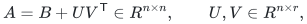
where <code class="math">B</code> has a supplied support of size <code class="math">m</code>, its permanent has an
explicit division-free arithmetic circuit, constructible deterministically,
of size
<!-- math-display: 8a2d5c167f38dc8d14f1a636
\boxed{\quad
\mathrm{poly}(n,r,m)\,
2^{O(m/\sqrt{\log_2(2+m)})}
\binom{n+r}{r}^{\,4}.
\quad}
-->
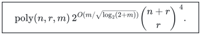
The bound is valid for <code class="math">m=0</code>, with the exponential factor interpreted
as one, and for <code class="math">r=0</code>, with the binomial factor one.

**Hafnian.** Given
<!-- math-display: 335d6b2c9988b9d3b116bd39
A=B+UCU^{\mathsf T}\in R^{2n\times2n},
\qquad U\in R^{2n\times r},\quad C=C^{\mathsf T}\in R^{r\times r},
-->
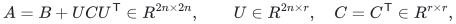
where <code class="math">B</code> is symmetric and has <code class="math">m</code> allowed unordered off-diagonal
edges, its hafnian has such a circuit of size
<!-- math-display: 7f5b72795eb823d93207999e
\boxed{\quad
\mathrm{poly}(n,r,m)\,
2^{O(m/\sqrt{\log_2(2+m)})}
\binom{2n+r}{r}^{\,2}.
\quad}
-->
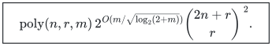
Diagonal entries of <code class="math">A</code> and <code class="math">B</code> are irrelevant. No square root,
Gram diagonalization, matrix inverse, or division by a factorial is used.

For <code class="math">1\le r\le n</code>, both bounds can be written
<!-- math-display: f5924a733b9066dcd13066aa
2^{O\left(
m/\sqrt{\log(2+m)}
+r\log(1+n/r)
\right)}\mathrm{poly}(n,r,m).
-->
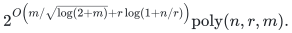
In particular, when <code class="math">m=O(n)</code>, the running time and circuit size are
<code class="math">2^{o(n)}</code> for **every <code class="math">r=o(n)</code>**. The full matrix can be dense and
can have full rank: the sparse part may be a nonsingular diagonal
matrix in the permanent case, or the nonsingular off-diagonal matrix
of a perfect matching in the hafnian case. The restriction concerns the supplied decomposition,
not the rank or sparsity of the full matrix.

More generally, a sufficient subexponential regime is
<!-- math-display: cd89f2883659b1cb09fb55d7
m/\sqrt{\log(2+m)}=o(n),\qquad r=o(n).
-->
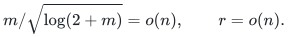
For example <code class="math">m=o(n\sqrt{\log n})</code>, with polynomially bounded <code class="math">m</code>,
satisfies the first condition.

The source of the <code class="math">m/\sqrt{\log m}</code> term is the imported quantitative
crossing recursion combined with the normalization-one integral Schur pieces,
as proved in [the ring-contraction companion](manuscripts/ring-contraction.md). The low-rank moment
identities below are classical in spirit. The stated contribution is
their explicit, division-free composition with the new contraction
engine and the entropy-sized truncation analysis. No claim of a faster
algorithm for unrestricted dense permanent or hafnian is made.

## A weighted monomer–dimer contraction primitive

For a graph <code class="math">G=(V,E)</code>, edge weights <code class="math">b_e</code>, and monomer weights
<code class="math">\mu_v</code>, define
<!-- math-display: 148a347188b5819341360cd8
Z_G(\mu)=
\sum_{M\text{ a matching in }G}
\left(\prod_{e\in M}b_e\right)
\left(\prod_{v\notin V(M)}\mu_v\right).
-->
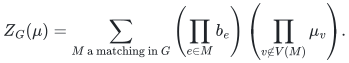
The weights can belong to any commutative coefficient algebra.

The local tensor at a vertex is <code class="math">\mu_v</code> when no incident edge is
selected, <code class="math">1</code> when exactly one is selected, and <code class="math">0</code> otherwise.
Assign each selected edge's weight to one of its endpoints.

This apparent high-arity tensor splits into a two-state chain. A state
<code class="math">s\in\{0,1\}</code> records the number of selected incident edges so far.
For an edge bit <code class="math">x</code>, the transition is allowed exactly when
<!-- math-display: 341c380153e98179be14aa07
s'=s+x\in\{0,1\}.
-->
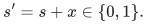
Start with state zero. At the terminal state use weight <code class="math">\mu_v</code> if
the state is zero and weight one if it is one. Folding the initial and
terminal states into the first and last transition gives arity at most
three and at most <code class="math">\deg(v)-1</code> new Boolean edges. Hence a graph with
<code class="math">m</code> edges becomes a Boolean tensor network with at most <code class="math">3m</code> edges
and maximum arity three. Isolated vertices simply multiply their
monomer weights outside the network.

The universal-ring contraction theorem therefore evaluates <code class="math">Z_G</code> in
<!-- math-display: 921a81a766e94ec91ece4a94
\mathrm{poly}(|V|+m)\,
2^{O(m/\sqrt{\log(2+m)})}
-->
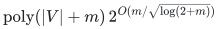
operations of the coefficient algebra. This construction works for
arbitrary high-degree vertices and arbitrary signs.

## Permanent identity

Introduce two sets of commuting variables <code class="math">y_1,\ldots,y_r</code> and
<code class="math">z_1,\ldots,z_r</code>. On the bipartite support graph of <code class="math">B</code>, put
<!-- math-display: 72c24804d0ae9a6d012f5190
\mu_i^{\rm row}(y)=\sum_{a=1}^r U_{ia}y_a,\qquad
\mu_j^{\rm col}(z)=\sum_{a=1}^r V_{ja}z_a.
-->
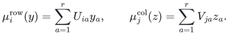
Let <code class="math">P(y,z)</code> be the resulting monomer–dimer partition polynomial.
Every matching leaves the same number of unmatched rows and columns,
so its monomials have equal total <code class="math">y</code>- and <code class="math">z</code>-degrees, each at most
<code class="math">n</code>.

Define the <code class="math">R</code>-linear functional
<!-- math-display: b4ca07b4b5175307ac95c26f
\mathcal L(y^\alpha z^\beta)
=[\alpha=\beta]\prod_{a=1}^r\alpha_a!.
-->
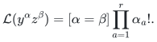
Then
<!-- math-display: 50ad7ce431e416f906752d86
\boxed{\mathrm{per}(B+UV^{\mathsf T})=\mathcal L(P).}
-->
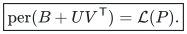

To prove the identity, expand each edge of a permutation as either its
<code class="math">B</code> term or its <code class="math">UV^{\mathsf T}</code> term. The <code class="math">B</code>-edges form a
partial matching. Color each remaining edge by an index <code class="math">a\in[r]</code>.
For fixed colors assigned to the unmatched rows and columns, a
completion exists only when the two color-count vectors agree. If
they equal <code class="math">\alpha</code>, there are exactly
<code class="math">\prod_a\alpha_a!</code> color-preserving bijections. Their weights are
exactly the products in the corresponding coefficient of <code class="math">P</code>.
Thus every expanded permanent monomial is counted once, with no
normalizing scalar.

Compute <code class="math">P</code> in
<!-- math-display: 6162061f1cdcee2ac5e3619d
\mathcal A_{n,r}
=R[y_1,\ldots,y_r,z_1,\ldots,z_r]/
\left(
\{\text{\(y\)-monomials of degree \(>n\)}\}
+\{\text{\(z\)-monomials of degree \(>n\)}\}
\right).
-->
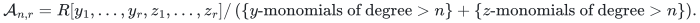
This is a quotient by monomial ideals; multiplication discards only
terms which can never return to the desired degree range. Its free
<code class="math">R</code>-module dimension is
<!-- math-display: eec29621ec87b89b4c3f774d
D=\binom{n+r}{r}^2.
-->
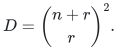
Addition costs <code class="math">O(D)</code> base-ring operations and naive multiplication
costs <code class="math">O(D^2)</code>. The final functional costs <code class="math">O(D)</code>, after
polynomial-time computation of the integer factorials or their images
in <code class="math">R</code>. This proves the first theorem.

In characteristic <code class="math">p&gt;0</code>, where <code class="math">p</code> is prime, one may additionally
truncate every individual exponent of <code class="math">y_a,z_a</code> at <code class="math">p-1</code>.
Any discarded final monomial has factorial coefficient divisible by
<code class="math">p</code>, and all later exponents can only increase. This yields an
alternative coefficient-algebra dimension at most <code class="math">p^{2r}</code>.
It is an optional modular refinement, not needed for the all-ring result.

## Hafnian identity

Put
<!-- math-display: 2b89a76501998de1967e29f1
\mu_i(x)=\sum_{a=1}^r U_{ia}x_a
-->
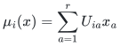
on the vertices of the support graph of <code class="math">B</code>, and let <code class="math">P(x)</code> be
its monomer–dimer partition polynomial. Its degree is at most <code class="math">2n</code>.

For <code class="math">\alpha\in\mathbb N^r</code>, let <code class="math">W_C(\alpha)</code> be the weighted sum
of perfect matchings on a labeled collection with <code class="math">\alpha_a</code> vertices
of color <code class="math">a</code>, where an edge between colors <code class="math">a,b</code> has weight <code class="math">C_{ab}</code>.
Set <code class="math">W_C(0)=1</code> and set it to zero when <code class="math">&#124;\alpha&#124;</code> is odd. For a
nonzero even vector choose any canonical color <code class="math">i</code> with <code class="math">\alpha_i&gt;0</code>.
Pair a distinguished color-<code class="math">i</code> vertex with its partner to obtain
<!-- math-display: f07f54e185c5dbe65619cf05
W_C(\alpha)=
\sum_{\substack{j\in[r]\\\alpha_j-\mathbf1_{i=j}>0}}
(\alpha_j-\mathbf1_{i=j}) C_{ij}
W_C(\alpha-e_i-e_j).
-->
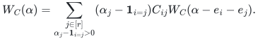
This recurrence is division-free over every commutative ring.
The labels in the definition account for the integer multiplicity;
there is no division by <code class="math">2</code> or by a factorial.

Define <code class="math">\mathcal W_C(x^\alpha)=W_C(\alpha)</code> linearly. Then
<!-- math-display: 04760f094f30a884bc2833b3
\boxed{\mathrm{haf}(B+UCU^{\mathsf T})=\mathcal W_C(P).}
-->
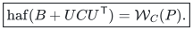
Indeed, choose the edges that use <code class="math">B</code> in an expanded perfect
matching, color the remaining vertices using their <code class="math">U</code>-entries,
and pair those colored vertices with edge kernel <code class="math">C</code>. This is
exactly the definition of <code class="math">W_C</code>.

Compute <code class="math">P</code> in the total-degree-<code class="math">2n</code> truncated polynomial algebra,
whose dimension is <code class="math">\binom{2n+r}{r}</code>. Naive multiplication has
quadratic cost in this dimension. All moment values are computed by
the displayed recurrence in polynomially many operations per state.
This proves the hafnian theorem.

The same proof allows fixed original monomer weights <code class="math">\ell_i</code>:
replace <code class="math">\mu_i(x)</code> by <code class="math">\ell_i+\sum_aU_{ia}x_a</code>.
The functional then gives the loop-hafnian/weighted partial-matching
sum with low-rank updates on the paired edges and original monomers
<code class="math">\ell_i</code>.

## Why the rank dependence is sublinear-rank, not <code class="math">n/\log n</code>

For <code class="math">1\le r\le n</code>,
<!-- math-display: 9b29b3bb1cd05797a3892cba
\log_2\binom{n+r}{r}
\le r\log_2\!\left(\frac{e(n+r)}r\right)
=O(r\log(1+n/r)).
-->
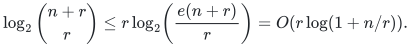
If <code class="math">r/n\to0</code>, then
<!-- math-display: da5fcdf2f4ccd5d397444ae2
\frac r n\log(1+n/r)\longrightarrow0.
-->
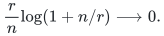
Using the loose rectangular bound <code class="math">(n+1)^r</code> would obscure this
regime. No interpolation over a large field is needed to achieve the
entropy-sized state space.

## Deterministic bit complexity for explicitly represented numbers

The circuits work uniformly in arbitrary characteristic and remain
valid with formal polynomial inputs. Over a finite field their cost
is the displayed operation count times the chosen field-arithmetic
cost.

Suppose the supplied entries of <code class="math">B,U,V</code>, or <code class="math">B,U,C</code>, are integers
of at most <code class="math">b</code> bits in magnitude. For the permanent,
<code class="math">\max_{ij}&#124;A_{ij}&#124;\le 2^b+r2^{2b}</code>, and
<!-- math-display: d86fe4fe6fedc701a1b1e2b0
|\mathrm{per}A|\le n!(2^b+r2^{2b})^n.
-->
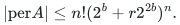
For the hafnian,
<code class="math">\max_{ij}&#124;A_{ij}&#124;\le 2^b+r^22^{3b}</code>, and
<!-- math-display: 7c7d7d5b115c55edff581805
|\mathrm{haf}A|\le(2n-1)!!(2^b+r^22^{3b})^n.
-->
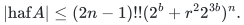
Choose <code class="math">P=O(n(b+\log(2n(r+1))))</code> so that <code class="math">2^P</code> exceeds twice
the relevant upper bound. Run the division-free algorithm in
<code class="math">\mathbb Z/2^P\mathbb Z</code>, and recover the unique integer answer in
the known symmetric interval. Each base-ring operation has
<code class="math">\mathrm{poly}(n,r,b)</code> bit cost. Therefore the displayed
arithmetic bounds are also deterministic exact bit bounds up to a
factor polynomial in <code class="math">n,r,m,b</code>.

This avoids any need to bound intermediate integer magnitudes.
Evaluation modulo several polynomial-size primes followed by CRT is
an alternative, but is not required: the coefficient and contraction
algebras work equally well over the composite modulus <code class="math">2^P</code>.

For explicitly represented rational inputs, let <code class="math">D</code> be the product
of all input denominators. Its bit length is polynomial in the total
input length. For a permanent,
<!-- math-display: 9774d155eb672a9a5a706b4e
D^2 A=D^2B+(DU)(DV)^{\mathsf T}
-->
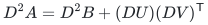
has integer factors, so compute its permanent and divide the final
answer by <code class="math">D^{2n}</code>. For a hafnian,
<!-- math-display: 393f7ed9a8e9b16374fe1cb6
D^3 A=D^3B+(DU)(DC)(DU)^{\mathsf T}
-->
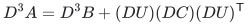
has integer factors; divide the final hafnian by <code class="math">D^{3n}</code>.
The sparsity and factor width are preserved. Thus the same exponential
bounds hold with a polynomial factor in the rational input bit length.

These bit statements assume explicitly represented numbers. They do
not apply without an additional output-size charge to arbitrary
constant-only input circuits that can produce exponentially many bits
by repeated squaring.

For the fixed-monomer extension, the same numerical conclusion needs a
separate homogeneity accounting. If the monomer weights also have at most
`b` magnitude bits, put

<!-- math-display: 4cb62be80eb640d9c047f576
T=2^b+r^22^{3b},\qquad H=\max\{1,T,2^b\}.
-->
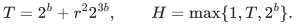

The number of partial matchings on `2n` vertices is at most `(2n)!`:
map each partial matching injectively to the permutation having its edges
as transpositions and its monomers as fixed points. Every term contains
at most `2n` edge or monomer factors, so the absolute output is at most
`(2n)! H^{2n}`. A power-of-two modulus larger than twice this bound still
has polynomial bit length.

For rational fixed monomers let `D` include their denominators as well.
Use the integral factors

<!-- math-display: 6243e2ce34398e593cccedc3
B'=D^6B,\qquad U'=D^2U,\qquad C'=D^2C,\qquad \ell'=D^3\ell.
-->
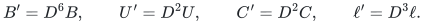

The edge matrix is `D^6 A`. A partial matching with `e` edges and `v`
monomers satisfies `2e+v=2n`, so every term is scaled by
`D^{6e+3v}=D^{6n}`. Computing the integral partial-matching sum and dividing
by `D^{6n}` recovers the rational result with the same exponential bound.
This argument supplies the numeric accounting for the already proved
monomer identity; it changes none of the core coefficient identities.

## Related work and novelty boundary

Barvinok's 1996 paper proves polynomial-time permanent evaluation at
fixed rank. Arvind, Chatterjee, Datta, and Mukhopadhyay (FSTTCS 2018)
give an <code class="math">n^{O(r)}</code> low-rank permanent algorithm over every field.
These are direct precedents for the low-rank coefficient method; the
case <code class="math">B=0</code> is not claimed as new.

Björklund, Kaski, Koana, and Nederlof (ICALP 2026), Lemmas 5.3--5.4,
encode permanent and hafnian as squarefree coefficients of small
arithmetic circuits, and their Theorem 1.4 gives a conditional hafnian
improvement from the Kronecker-scaling exponent. That result does not
state the sparse-plus-low-rank bound proved here. The new parameter
combination uses a sparse matching partition function over a
low-dimensional coefficient algebra, rather than applying a general
squarefree-coefficient algorithm to a dense matrix.

No exhaustive priority claim is made. The identities are elementary
and may have appeared in related sparse-update or Gaussian-moment
algorithms; the stated runtime follows from the explicitly audited
contraction engine and the supplied decomposition.

Primary references:

- A. I. Barvinok, *Two Algorithmic Results for the Traveling Salesman
  Problem*, Mathematics of Operations Research 21(1), 65--84, 1996.
  https://doi.org/10.1287/moor.21.1.65
- V. Arvind et al., *Univariate Ideal Membership Parameterized by Rank,
  Degree, and Number of Generators*, FSTTCS 2018.
  https://drops.dagstuhl.de/entities/document/10.4230/LIPIcs.FSTTCS.2018.7
- A. Björklund, P. Kaski, T. Koana, J. Nederlof,
  *Kronecker Scaling of Tensors with Applications to Arithmetic Circuits
  and Algorithms*, ICALP 2026, Article 36.
  https://doi.org/10.4230/LIPIcs.ICALP.2026.36
- Anthropic, *A <code class="math">2^{o(n)}</code>-time algorithm for 3-SAT*, Appendix A,
  version 1 deposited 27 October 2026.
  https://hexagonmath.org/2610.00577
- User integral Schur crossing primitive, commit
  2658b60c9d032611492792718bd9d39f721de09f:
  https://github.com/icekylinx/algorithm-frontier/tree/2658b60c9d032611492792718bd9d39f721de09f/problems/noncommutative-crossing

## Supporting generalization

The [fixed-uniformity hypermatching companion](manuscripts/hypermatching.md) proves the same composition for a supplied symmetric core and for a supplied partite separable sum. These are supporting extensions within this package, rather than separate catalogue results.

**Attribution:** icekylinx and GPT-6 Astra Pro. Apache-2.0.
