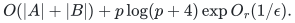
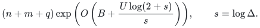
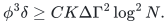

# Certifying matching under a strong Haxell condition

**Guarantee**

Returns a left-perfect hypergraph matching, or a nonempty <code class="math">S\subseteq A</code> and a right-vertex hitting set <code class="math">C</code> with <code class="math">\lvert C\rvert&lt;\Delta r^2\lvert S\rvert</code>. Under <code class="math">\tau(E_S)\ge\Delta r^2\lvert S\rvert</code> for every <code class="math">S</code>, the matching outcome is guaranteed.

**Objective and output**

Find a matching covering every left vertex, or return the stated directly checkable hitting-set obstruction.

**Randomness**

Deterministic certifying hypergraph matching. The routing and expander-packing transfers use the locally constructed destructive-support distance interface and preserve their stated expansion, density and congestion promises.

**Time**

<code class="math">O(&#124;A&#124;+&#124;B&#124;)+p\exp O(h+a\log(q+1)/s)</code>, where <code class="math">q=&#124;A&#124;</code>, <code class="math">p=\sum_e&#124;e&#124;</code> is the full listed incidence volume, <code class="math">U=\log(p+4)</code>, <code class="math">h=\log(U+4)</code>, <code class="math">s=\log\Delta</code>, and <code class="math">a=\min\{\log(2+s),\log(2+\log(r+2))\}</code>. This is the retained rank-sensitive refinement of the earlier rank-free bound.

**Space**

<code class="math">O(\lvert A\rvert+\lvert B\rvert+p(1+U/s))</code> words with explicit layered certificates. Both outputs are checkable in <code class="math">O(p+\lvert A\rvert+\lvert B\rvert)</code> time.

**Parameters**

Each hyperedge contains one left vertex and between one and <code class="math">r</code> right vertices; integer <code class="math">\Delta\ge4</code>. Prechecks handle <code class="math">\Delta&gt;p</code>. Vertex identities and counters use input-size words.

**Model and representation**

An explicitly listed bipartite hypergraph, with parallel edge identities allowed; the hitting number uses right vertices only.

**Lower-bound scope**

No lower bound is claimed. A hitting-set certificate refutes the strong Haxell promise but need not prove absence of all left-perfect matchings.

**Review status**

**Ready for review.** The explicit certifying hypergraph-matching algorithm, including build/growth/collapse and weighted finite-prefix termination; the public explicit-algorithm weighted reanalysis; certified disjoint-path routing and spanning-expander packing. The destructive-support extractor, exact-size auxiliary graph and route/conductance accounting are explicitly instantiated. The retained rank-sensitive layer count, its separate root factor and the fixed-right-rank polynomial-strength consequence are included; explicit incidence input is not replaced by an implicit graph-edge count.

**Dependencies and scope.** The hitting, expansion, density, load and input-size promises remain part of their respective theorems. The companion’s separate conditional observation about the public approximate-extension algorithm is not used by these results and retains its stated assumption. Manuscript readiness does not claim a full executable implementation.

The [verification note](verify/README.md) identifies executable coverage. This status does not claim external peer review or proof-assistant verification.

**Source**

[Manuscript and proof](proof.md), with [dependencies and verification sources](sources.md).

The same sharper asymptotic rate also follows from the documented weighted reanalysis of the public BHHS operation sequence. The proof does not claim an exclusive speed advantage over that reanalysis.

## Constant-rank and linear-time endpoints

For each fixed right rank <code class="math">r\ge2</code> and <code class="math">\Delta\ge p^{\epsilon}</code>, the [rank-sensitive theorem](../../manuscripts/matching-and-routing/rank-sensitive-layer-count.md) gives

<!-- math-display: 927b5f6cd42a51f4ef148090
O(|A|+|B|)+p\log(p+4)\exp O_r(1/\epsilon).
-->

The constants are uniform in <code class="math">\epsilon</code>. The logarithmic root factor is retained. A direct greedy scan is already linear when <code class="math">q\le\Delta r</code>; after the whole-left certificate test, <code class="math">\Delta^2r^3\ge&#124;B_{\rm used}&#124;</code> also suffices. Thus <code class="math">\epsilon\ge1/2</code> in the displayed regime is already covered by the elementary linear-time endpoint. Rank one is a bipartite graph and has the separate classical phase bound.

These results concern an explicitly listed hypergraph. The routing application below retains its own full distance-structure, support-extraction and output costs; its path rank <code class="math">R=\lceil\Gamma h_0\rceil</code> is not assumed constant.

## Certified routing and expander packing

The [routing theorem](routing.md) uses the [constructed destructive-support interface](../../manuscripts/graph-backends/destructive-apsp-path-support-extractor.md) with stretch <code class="math">\Gamma</code> and aggregate cost <code class="math">(n+m+q)\exp(O(B))</code>. For short-path comparison length <code class="math">h_0</code>, put <code class="math">R=\lceil\Gamma h_0\rceil</code>. If the demand-path hypergraph satisfies <code class="math">\tau(E_S)\ge\Psi\lvert S\rvert</code> and <code class="math">\Psi\ge\Delta R^2</code>, <code class="math">\Delta\ge4</code>, the algorithm returns all demanded edge-disjoint simple paths in

<!-- math-display: 2f1f766aa4ba196913a1f619
(n+m+q)\exp\left(O\left(B+\frac{U\log(2+s)}s\right)\right),\qquad s=\log\Delta.
-->

For an expander of conductance <code class="math">\phi</code> and minimum degree <code class="math">\delta</code>, the [packing corollary](expander-packing.md) constructs <code class="math">K</code> edge-disjoint connected spanning subgraphs when

<!-- math-display: ec30d904a722d58ec88361db
\phi^3\delta\ge C K\Delta\Gamma^2\log^2N.
-->

Each has conductance <code class="math">\Omega(\phi/(\Gamma\log N))</code>, and the total construction time is <code class="math">(n+m)\exp(O(B+U\log(2+s)/s))</code>. All copies share one routing instance, so there is no hidden leading factor <code class="math">K</code>. The corollary credits the existing auxiliary-expander reduction and states the quantitative interface substitution separately.

**Attribution.** Yilin Liu · GPT-6 Astra Pro
