# Edge-disjoint spanning expander packing: a direct routing corollary

This is a consequence of
the certified disjoint-path routing theorem, not a separate
algorithmic breakthrough. The reduction is already public in
BHHS, Corollary 1.2 and Appendix A.1. This note gives its exact
quantitative interface, verifies a uniform auxiliary-expander
construction, and supplies the cut/volume and inventory proofs
needed to use the new routing parameters.

## 1. Statement

Let `G=(V,E)` be an undirected, unweighted, loopless multigraph
with `n>=2` vertices, `m` physical edge identities, minimum
degree `delta>0`, and conductance at least `phi>0`. Parallel
edges count with multiplicity in degrees and cuts. Fix

<!-- math-display: fa63a53d5cd8d6ef0b347524
N=32(n+m+4),\qquad U=\log N,
 \qquad s=\log\Delta,
-->
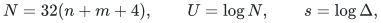

where `Delta>=4` is an integer. Use a valid dyadic conductance
lower bound `phi>=1/(4m)`, as justified in Section 9 of
[routing.md](routing.md). Rounding a
supplied valid lower bound loses at most a constant factor.

Assume the destructive distance interface has stretch at most
`Gamma>=1` and per-build aggregate time
`(n+m+q) exp O(B)` on `q` indexed pairs. For a desired integer
`K>=1`, suppose

<!-- math-display: e3a121bd3a864fb7fa93da77
\boxed{\quad
       \phi^3\delta
          \ge C K\Delta\Gamma^2\log^2N
       \quad}
 \tag{1}
-->
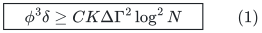

for a sufficiently large absolute constant `C`. Then one can
deterministically construct `K` subgraphs

<!-- math-display: b443fd11486a4edb23bd9735
G_i=(V,E_i),\quad i=1,\ldots,K,
-->
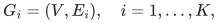

whose edge sets are pairwise disjoint subsets of `E`, and each
of which is spanning, connected, and satisfies

<!-- math-display: dc1346907eb83ca865e4ce73
\Phi(G_i)\ge
                  c\,\frac{\phi}{\Gamma\log N}
 \tag{2}
-->
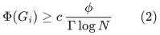

for an absolute constant `c>0`. The total time is

<!-- math-display: 3fe2da287855a14bbc9a35ce
(n+m)\exp O\!\left(B+
                  U\frac{\log(2+s)}s\right).
 \tag{3}
-->
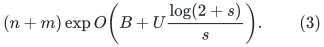

The subgraphs are given explicitly using original edge identities.
Their total number of edges is at most `m`. Each has at most
`O(n Gamma log N/phi)` edges; its vertex degrees need not be
constant or regular. The common vertex set can be shared in the
output representation. Even if it is listed separately for every
subgraph, the resulting `nK` work fits the stated bound.

## 2. A uniform auxiliary expander on exactly the input vertices

The only auxiliary construction imported here is Theorem 2.4 of
Chuzhoy--Gao--Li--Nanongkai--Peng--Saranurak,
[*A Deterministic Algorithm for Balanced Cut with Applications
to Dynamic Connectivity, Flows, and Beyond*](https://arxiv.org/html/1910.08025v2).
For every integer `n>1`, it deterministically constructs, in
`O(n)` time, an `n`-vertex graph `X` of maximum degree at
most nine and constant edge expansion `alpha_0>0`:

<!-- math-display: 5af5a4b3df586bb2bdc02297
|\partial_X S|\ge\alpha_0\min\{|S|,|V\setminus S|\}
       \quad\text{for every nontrivial }S\subset V.
 \tag{4}
-->
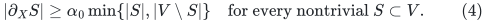

Its vertex set is identified with `V`. This is an exact-size
construction, so no square-sized family or unaccounted padding
is needed. If an implementation of the construction produces
self-loops, discard them: no cut boundary changes, and the
maximum degree can only decrease. Parallel auxiliary edges may
be retained with distinct identities.

After deleting loops, `X` is connected and every vertex has
positive degree by (4). Its number of edges is between `n-1`
and `9n/2`. Constant edge expansion and the degree upper bound
also imply constant conductance, but the proof below uses (4)
directly and does not assume regularity.

## 3. One simultaneous routing instance

For every auxiliary edge identity `e={u,v}` in `X` and every
copy index `i in {1,...,K}`, create one demand identity `(i,e)`
with endpoints `(u,v)`. There are

<!-- math-display: 327faae3d8bed39d6dea1191
q=K|E(X)|\le9nK/2
 \tag{5}
-->
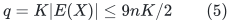

demands. At each original vertex there are at most `9K`
demand endpoints. Duplicate endpoint pairs are distinct indexed
demands, exactly as allowed by the routing interface. There are
no equal-endpoint pairs after auxiliary loops have been dropped.

Route **all these demands in one call** to the theorem of
[routing.md](routing.md), with endpoint
load `k=9K` and comparison length

<!-- math-display: 0b3e8704d4b31b198d91fbe0
h_0=\left\lceil32\log(2N)/\phi\right\rceil,
 \qquad R=\lceil\Gamma h_0\rceil.
 \tag{6}
-->
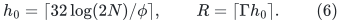

The factor nine and the absolute constants in (6) are absorbed
in `C` in (1). The routing theorem returns a simple path
`P_(i,e)` for every demand, all paths pairwise edge-disjoint
across **all** copy indices and auxiliary edges, each of length
at most `R`.

Set `E_i=union_(e in E(X)) E(P_(i,e))`. Global
edge-disjointness immediately proves that the `E_i` are pairwise
disjoint and that `sum_i |E_i|<=m`. Connectivity of `X`
implies connectivity of each `G_i`, since every auxiliary edge
has been replaced by a path with the same endpoints. In
particular every original vertex belongs to the connected
spanning subgraph, regardless of how many other paths traverse
it internally.

This construction does not route the copies sequentially in a
degrading residual graph. There is a single demand instance on
the original graph, with one global edge-disjointness guarantee.

## 4. Conductance of one routed copy

Fix a copy `i` and a nontrivial cut. Let `T` be its side with
at most `n/2` vertices, and put

<!-- math-display: 7dde2fb84d938a1b16d246eb
b=|\partial_{G_i}T|.
-->
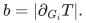

Each auxiliary edge crossing `T` is represented by a path
crossing this cut. These paths are edge-disjoint, so their
crossings use distinct physical boundary edges. Consequently,

<!-- math-display: c816e3c3f07ef9469a1894cb
b\ge|\partial_X T|
                    \ge\alpha_0|T|.
 \tag{7}
-->
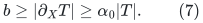

To control the degree volume of `T` in `G_i`, divide its
represented paths into two relevant types. There are at most
`sum_(v in T) deg_X(v)<=9|T|` paths with an endpoint in
`T`. Every other path visiting `T` has both endpoints outside,
and therefore crosses the cut at least twice. Edge-disjointness
bounds the number of these latter paths by `b/2`.

Each represented path contributes at most twice its length,
hence at most `2R`, to `vol_(G_i)(T)`. Thus

<!-- math-display: c24a2f605d743e692c98730b
\mathrm{vol}_{G_i}(T)
       \le2R\left(9|T|+b/2\right)
       \le\left(18/\alpha_0+1\right)Rb,
 \tag{8}
-->
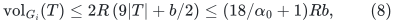

where the last inequality uses (7). The smaller of the two
`G_i` degree volumes is at most the volume of this cardinality
smaller side `T`, even if it is not the volume smaller side.
Therefore the conductance of this cut is at least

<!-- math-display: d826fe811dd882b464cbde22
\frac{\alpha_0}{(18+\alpha_0)R}.
 \tag{9}
-->
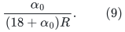

Taking the minimum over cuts proves (2). The proof explicitly
accounts for paths whose endpoints are both outside the chosen
side; ignoring their internal vertices would not justify a
conductance bound. The extra factor two in a path's volume
contribution is also retained. There is one inverse path-length
loss, giving `Omega(phi/(Gamma log N))`, not an extra power
of the original conductance.

## 5. Input, temporary, and output inventories

Because `phi<=1`, `Delta>=4`, and `Gamma>=1`, condition
(1), with a large enough constant, implies `K<=delta`.
Hence

<!-- math-display: 004003eb90bdfbaa6415c648
nK\le n\delta\le2m,
 \qquad q\le9m.
 \tag{10}
-->
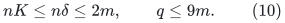

Thus the master `N=32(n+m+4)` covers `n+m+q+4` as
required by the routing theorem. The `O(n)` auxiliary
construction, `O(nK)` demand replication and indexing, and
all returned path materialization fit `O(n+m)` outside the
routing time. No hidden leading factor `K` is introduced.

During a layer build, the route oracle handles `O(m+q)` edits
and queries in its temporary copy of the original graph. It
does not materialize `K` graph copies. The certified outer
algorithm's number of such builds is the weighted bound
`exp O(U log(2+s)/s)`, giving (3).

For each copy, the edge union has size at most
`R |E(X)|<=9nR/2`. Globally these unions are disjoint, so
their total size is at most `m`; the per-copy estimate is
not multiplied into the global output size. Listing all
`nK` vertex occurrences also fits (10). Alternatively, one
can output a common vertex array and one copy label for each
used original edge.

## 6. Instantiating the current time--stretch curve

The hierarchy in [apsp frontier proof](../apsp-frontier/proof.md) supplies

<!-- math-display: a6a0018d4e2a747fc27b2a48
B=O(U/t+t^3h),\qquad \log\Gamma=O(t^4h),
 \qquad h=\log(U+4).
-->
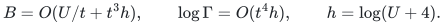

Choose an integer power-of-two `Delta` with
`s=log Delta=Theta(t log(t+2))`. Then the outer term in
(3) is `O(U/t)`. Any integer `K>=1` satisfying

<!-- math-display: e7ada8f842ce382ba864c505
\phi^3\delta/K
          \ge\log^2N\,\exp O(t^4h)
 \tag{11}
-->
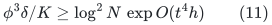

can be packed in time

<!-- math-display: 98e443a98bcceb44282812c3
(n+m)\exp O(U/t+t^3h),
-->
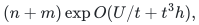

and every output graph has conductance at least

<!-- math-display: 9a0876c5fa42e3b614fc669e
\frac{\phi}{\log N}\exp(-O(t^4h)).
-->
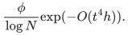

In particular, the previously audited parameter choices give:

| Choice of `t` | Time overhead | Output conductance | Sufficient density per requested copy |
|---|---:|---:|---:|
| `Theta(U^(3/14))` | `exp O(U^(11/14))` | `(phi/log N) exp(-O(U^(6/7)h))` | `phi^3 delta/K >= log^2N exp O(U^(6/7)h)` |
| `Theta((U/h^2)^(1/4))` | `exp O(U^(3/4)h^(1/2))` | `(phi/log N) exp(-O(U/h))` | `phi^3 delta/K >= log^2N exp O(U/h)` |

The hidden constants in the sufficient density conditions are
chosen against the actual declared stretch bound, not against
an unspecified favorable representative of its asymptotic class.
If the density allowance gives fewer than one copy, this
corollary makes no nontrivial packing guarantee for those
parameters.

## 7. Public comparison and scope

BHHS,
[*Disjoint Paths in Expanders in Deterministic Almost-Linear Time
via Hypergraph Perfect Matching*](https://arxiv.org/html/2511.02214v1),
Corollary 1.2 and Appendix A.1, already use the same constant-degree
auxiliary-expander reduction. They state deterministic
almost-linear expander packing under an `n^(o(1))` density
allowance, and an earlier alternative with shorter paths and
larger running time. Thus neither the reduction nor its
qualitative packing conclusion is new here.

The present contribution is the direct, fully accounted
quantitative substitution of the certified routing theorem,
including its stronger outer count and absence of a hidden
polynomial path-length factor in the build cost. The auxiliary
construction is uniform in `n`, all copies share one routing
instance, and (8) proves the actual degree-volume guarantee.
This remains an expander-input corollary. It does not improve
the unrestricted general-graph maximum-matching exponent.

**Attribution:** Yilin Liu and GPT-6 Astra Pro.
