# A faster certifying algorithm for explicit hypergraph matching under strong Haxell conditions

This manuscript specializes the
fixed-certificate, no-superposition algorithm from
[Certified layers without superposition for disjoint-path routing](routing.md) to an explicitly
listed bipartite hypergraph. It also uses a stronger count of the
tree of layer lifetimes. The resulting parameter dependence improves
the displayed bound in BHHS, SODA 2026, under the same strong Haxell
condition. The result concerns hypergraphs satisfying that condition;
it is not an algorithm for unrestricted general-graph maximum matching.

**Baseline qualification.** The same sharper rate also follows,
in this research round, from a new analysis of the existing BHHS
operation sequence. See
[The same sharper rate for the existing BHHS explicit-hypergraph algorithm](../../manuscripts/matching-and-routing/public-hypergraph-algorithm-weighted-reanalysis.md) and Section 7.
It is not a speed advantage exclusive to the new implementation.

## 1. Input, outcome, and quantitative theorem

Let `H=(A,B,E)` be a bipartite hypergraph. Every input hyperedge
contains exactly one vertex of `A` and between one and `r` vertices
of `B`. Its rank here means its number of `B` vertices. Parallel
hyperedge identities are allowed. Write

<!-- math-display: 37b2ca1e999daa22691e20cc
p=\sum_{e\in E}|e|,\qquad
 U=\log(p+4),\qquad s=\log\Delta,
-->
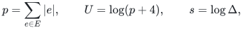

where `Delta>=4` is an integer. For `S subseteq A`, let `E_S`
denote the hyperedges whose left vertex belongs to `S`; their
hitting number `tau(E_S)` uses only right vertices in `B`.

**Certifying theorem.** There is a deterministic algorithm which
returns one of the following:

1. a matching covering every vertex of `A`; or
2. a nonempty set `S subseteq A` and a set `C subseteq B` which
   intersects every hyperedge in `E_S` and satisfies
   `|C|<Delta r^2 |S|`.

The rank-free running time proved first below is

<!-- math-display: a63b5310e9aa6582a1814a02
O(|A|+|B|)+
 p\exp O\!\left(\frac{U\log(2+s)}s\right).
 \tag{1}
-->
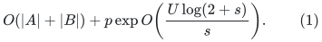

**Retained rank-sensitive refinement.** Put <code class="math">q=&#124;A&#124;</code>, <code class="math">h=\log(U+4)</code> and

<!-- math-display: 4f8e79a07afc47f2d9c89393
a=\min\{\log(2+s),\log(2+\log(r+2))\}.
-->
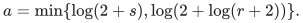

The same certifying construction has the stronger bound

<!-- math-display: 0e80e4ad5545a73a33fb3371
O(|A|+|B|)+p\exp O\left(h+\frac{a\log(q+1)}s\right).
\tag{1r}
-->
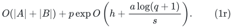

The sharper count in Section 5 retains the root prefactor explicitly. It is
an existing proved refinement from the [rank-sensitive companion](../../manuscripts/matching-and-routing/rank-sensitive-layer-count.md), now stated at this main entry point. It also applies to the public explicit operation sequence through its constant number of adopted-reset epochs.

The nontrivial execution only needs `4<=Delta<=p`; the
prechecks below handle larger parameters immediately. The theorem
is in the usual adjacency-list word model, with vertex identities
and integer counters represented in input-size words. Both possible
outputs can be independently checked in
`O(p+|A|+|B|)` time.

Consequently, if

<!-- math-display: 0f68ba9a0357da1d223d2769
\tau(E_S)\ge\Delta r^2 |S|
       \quad\text{for every }S\subseteq A,
 \tag{2}
-->
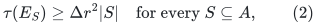

the algorithm necessarily returns a perfect matching on the left.
A certificate of type 2 refutes (2). It does **not** assert that a
perfect matching is impossible.

### Input preprocessing and trivial certificates

Scan the explicit input once. Remove unused right vertices from
the working instance, retaining their original names if needed.
The used right set `B_used` has size at most `p`; every nonisolated
left vertex also contributes to `p`. An isolated left vertex
immediately gives the certificate `S={a}, C=empty`. An empty
left side gives the empty perfect matching.

If `Delta r^2>|B_used|` and `A` is nonempty, choose any left
vertex `a` and return `S={a}, C=B_used`. This is already a
strict certificate of type 2. In every remaining execution,

<!-- math-display: d8a17036f822e821247d5778
\Delta r^2\le |B_{used}|\le p,
 \tag{3}
-->
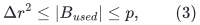

so `s<=U` and `log r<=U`. The initial cost of reading unused
vertices is paid only once, in the leading term of (1). All
subsequent working inventories have size `O(p)`.

## 2. A linear-time certified build on the edge list

The maintained matching `M` has disjoint right coordinates.
`Y_0` consists of unmatched left vertices. Each positive-index
layer is `L_i=(X_i,Y_i)`, where:

* the left vertices of `X_i` belong to `A(Y_{i-1})`, with at
  most `Delta` selected hyperedges per left vertex;
* the right sets of all selected hyperedges are disjoint, within
  and across layers;
* `X_i` avoids every right vertex of earlier `Y_j`;
* `Y_i` is exactly the set of matching edges blocking `X_i`,
  and one matching edge blocks at most one selected edge of `X_i`.

To build a new layer from prefix `0,...,ell`, mark as forbidden

<!-- math-display: 8265cc50b9a71e177d8f0188
F_0=B(X_{\le\ell}\cup Y_{\le\ell}).
-->
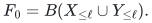

Index the matching owner of each right vertex. Scan the input
hyperedge list once, in a fixed deterministic order. An edge is
accepted precisely when its left vertex is active, its active
counter is below `Delta`, and none of its right vertices is
currently forbidden. On accepting an edge:

1. add it to `X` and increment its left counter;
2. mark all its right vertices forbidden;
3. mark all right vertices of every matching edge touched by it
   forbidden.

Each matching edge needs to be processed at most once in this
call. The accepted right sets are disjoint. Thus the input scan,
the marking work, and all matching-edge scans cost `O(p)`.
The final exact blocker set of `X` is stored as `Y`.

The construction never accepts an edge of the current matching
itself. At the root the active vertices are unmatched. At a deeper
layer their own matching edges lie in `Y_ell`, whose full right
sets are already forbidden. No exceptional exclusion oracle is
needed for these states.

Store two further objects:

* `F`: active left vertices whose counters reached `Delta`;
* `C`: right vertices newly marked after the initial marking
  of `F_0`, stored as fixed original resource identities.

They satisfy

<!-- math-display: d3096eea7574beda893c772f
|F|\le |X|/\Delta,\qquad B(X\cup Y)\subseteq C,
 \qquad |C|\le r^2|X|.
 \tag{4}
-->
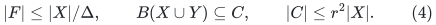

For the last inequality, an accepted right set `Q` has size at
most `r` and touches at most `|Q|` disjoint matching edges.
Their union with `Q` contains at most
`|Q|+(r-1)|Q|<=r^2` right vertices. If a matching edge had
intersected the initial `F_0`, exactness of the old blockers and
disjointness of `M` would already put its entire right set in
`F_0`. Such an edge cannot touch a new accepted edge. Thus the
middle inclusion in (4) holds even though `C` excludes `F_0`.

Finally, for every active left vertex outside `F`, every incident
input edge intersects `F_0 union C`. Its counter was never full,
so any such edge that was not accepted must have met the forbidden
set when scanned. That set only grows during the call. Therefore

<!-- math-display: 1f9b5e845ebe88b4e9c90949
F_0\cup C\text{ hits every edge incident to an active
 left vertex outside }F.
 \tag{5}
-->
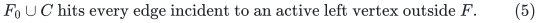

This is a direct edge-list certificate. No approximation oracle
and no shortest-path structure enter the explicit-hypergraph result.

## 3. The outer algorithm and certificate persistence

Run the algorithm in Sections 3--8 of the companion note, using
the build above and replacing paths by hyperedges and `R` by `r`.
For completeness, its actions are as follows.

Start with an empty matching and unmatched set `Y_0=A`. Append
one newly built layer at a time. After building a layer, perform
the growth test in Section 4 below. If it passes, repeatedly
collapse the last layer whenever more than one tenth of its
selected edges are unblocked by `M`: choose one free edge for
each represented left vertex, replace that vertex's old matched
edge if there is one, and discard the collapsed layer. Only the
current last layer is discarded, and it is discarded only through
its own collapse. There is no superposition or rebuilding of any
surviving `X_i`.

Inserted edges are free of all of `M` in their right coordinates,
have distinct left vertices, and avoid all earlier layers. Thus
the matching remains valid and no new lower-layer blocker is
created. A surviving `X_i` is fixed; `Y_i` can only shrink.
It shrinks only when its direct child collapses.

While layer `i` survives, its entire lower prefix remains fixed.
Any collapse that could change that lower prefix first requires
layer `i` to collapse and disappear. Hence (5) remains valid for
the entire lifetime of the layer. Edges of a retired matching
hyperedge remain valid resource identities in its stored `C_i`.
This is the reason a fixed physical certificate replaces repeated
superposition.

At the beginning of a build, all old positive-index layers are
noncollapsible. Since different nonfree selected edges have
disjoint blocker sets,

<!-- math-display: 665275106123adf16e2c8939
|Y_i|\ge\tfrac9{10}|X_i|.
 \tag{6}
-->
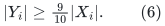

## 4. The growth test or a directly checkable violation

For the just-built layer `ell+1`, put

<!-- math-display: abc355c63fd891594b51b2d9
W=|Y_{\le\ell}|>0,
 \qquad T=\sum_{i=1}^{\ell+1}|X_i|.
-->
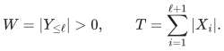

If `|X_(ell+1)|>Delta W/10`, the growth test passes. Otherwise
(6) gives

<!-- math-display: a5798a524c81c10ddb67a735
T\le(\Delta/10+10/9)W.
-->
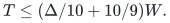

Let `S` be all left identities represented in `Y_(<=ell)`,
excluding every full-counter set `F_i`, and let
`C=union_i C_i`. The active sets are disjoint across layers.
Therefore

<!-- math-display: 905c5b73f7f89de82fa4dc43
|S|\ge W-T/\Delta
       \ge(9/10-10/(9\Delta))W>0.
-->
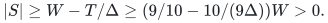

For each left vertex in `S`, apply (5) in its unique layer.
The earlier forbidden prefix is covered by earlier `C_j`,
using (4). Hence `C` hits every input edge incident to `S`,
and

<!-- math-display: 9771a661c5a05006da9b387a
\begin{split}
 |C|&\le r^2T
      \le r^2(\Delta/10+10/9)W\\
    &<r^2(9\Delta/10-10/9)W
      \le\Delta r^2|S|.
 \end{split}
 \tag{7}
-->
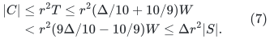

The strict inequality holds for every `Delta>=4`. Return
this `S,C` as the violation certificate. This argument does
not assume the strong Haxell condition. If (2) holds, the test
always passes, so every surviving layer satisfies

<!-- math-display: 7d1d2424c524284361ec9967
|X_i|>\Delta |Y_{<i}|/10.
 \tag{8}
-->
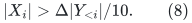

The algorithm therefore has a valid, verifiable outcome on every
input, without pretending to test all subsets in (2) in advance.

## 5. A stronger bound on the number of builds

All statements in this section apply to arbitrary finite execution
prefixes whose completed growth tests have passed. Thus the proof
does not presuppose termination.

### Depth

At a main-loop boundary, (6) and (8) imply
`|Y_i|>(9Delta/100)|Y_<i|`. The sets `Y_i` use disjoint left
vertices. Therefore the maximum number of surviving layers is

<!-- math-display: 3abf3dbd6b57fb767fbf8851
D=O(U/\log\Delta)=O(U/s).
 \tag{9}
-->
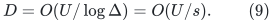

The currently appended layer adds at most one to the depth.

### Geometric sizes of a node's children

Fix one positive-index layer instance `i`, and write
`W_i=|Y_<i|`. Its lower prefix is fixed, so `W_i` is a fixed
positive integer at most `q=|A|`. When it creates a direct child
it is noncollapsible. By (6), (8), the child's fixed prefix size
is therefore

<!-- math-display: 9f56be9045f20639fca33f56
W_{child}=W_i+|Y_i|
       \ge\kappa W_i,
 \qquad\kappa=1+9\Delta/100.
 \tag{10}
-->
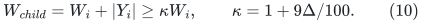

When a direct child collapses, more than `|X_child|/10` of
its edges are free. At most `Delta` share a left vertex, so
the swap removes more than `|X_child|/(10Delta)` distinct
members of `Y_i`. The child's growth inequality makes this
reduction greater than `(W_i+|Y_i|)/100`. Its lower prefix
is fixed until that collapse, so the birth inequality remains
applicable to the final swap.

List this instance's children in creation order, and let `z_j`
be the fixed prefix size of child `j`. Only the current top
layer is collapsed or discarded. Thus child `j` must collapse
before child `j+1` can be born, giving

<!-- math-display: 8cc7f86272f33372043ae165
z_{j+1}\le0.99z_j.
 \tag{11}
-->
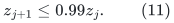

Both (10) and (11) hold in every finite execution prefix,
including its possible last living child. We do not need the
rank-based upper bound on how many blockers the parent initially
had.

### A contracting weight on layer instances

Let `rho=0.99` and

<!-- math-display: 84f392f78bce71378e8252cd
\lambda=100\frac{\log(2+s)}s.
-->
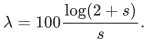

Give each positive-index layer instance weight
`w_i=W_i^(-lambda)`. These weights are used only in the
analysis; the algorithm itself uses integer counters, set
membership tests, and the integer growth comparison. From (10),
(11), the children of this
instance have total weight at most

<!-- math-display: 5a231d258762b582e4ea46df
\sum_{child} w_{child}
     \le\frac{\kappa^{-\lambda}}{1-\rho^\lambda}\,w_i
     \le\tfrac12w_i.
 \tag{12}
-->
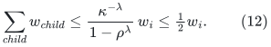

Indeed, reverse the geometric sequence of children: every earlier
weight is at most `rho^lambda` times the next, and the last
child has weight at most `(kappa W_i)^(-lambda)`. For the
numerical inequality, `kappa>=Delta^(1/5)` when `Delta>=4`.
Thus `kappa^(-lambda)<=(2+s)^(-20)`, whereas
`1-rho^lambda>=min{1/100,lambda/200}`. Their ratio is less
than one half throughout `s>=log 4`.

The root's children have prefix sizes equal to the successive
positive unmatched counts. These also decrease by a factor at
most `rho` between children and are at least one. Their total
weight is at most `1/(1-rho^lambda)`.

For the forest of positive-index layer instances in any finite
execution prefix, sum (12). Every nonroot weight occurs as one
child weight, so total forest weight is at most twice the sum
of the root-child weights. Each node has weight at least
`q^(-lambda)`. Its node count is consequently at most

<!-- math-display: dcf9032458518ae848d0ccb1
\frac{2q^\lambda}{1-\rho^\lambda}
       =\exp O\!\left(\frac{U\log(2+s)}s\right).
 \tag{13}
-->
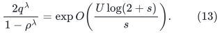

The logarithm of the prefactor is
`O(log(1+1/lambda))=O(log(U+4))`, which is absorbed by the
displayed exponent because `s<=U`. This bound no longer
depends on `r`.

It forces termination without a circular assumption. While an
unmatched left vertex remains, the next finite build either
returns a certificate or creates another layer; every finite
execution prefix has the same upper bound (13). Thus there
cannot be infinitely many creations. Combining (13) with the
linear build and collapse costs proves (1).

### The retained rank-sensitive child cutoff

A positive layer with lower-prefix size <code class="math">W</code> has at most <code class="math">r\Delta W</code> matching
blockers. A child is born only while the parent is noncollapsible, so its
prefix size is at least <code class="math">\kappa W</code>, where <code class="math">\kappa=1+9\Delta/100</code>. The child
birth sizes decrease geometrically by <code class="math">\rho=.99</code>, and all lie in
<code class="math">[\kappa W,(1+r\Delta)W]</code>. Since

<!-- math-display: 56b255c86b223f1285ba1096
\frac{1+r\Delta}{1+9\Delta/100}\le\frac{100r}{9}<12r,
-->
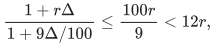

the number of child births is at most
<code class="math">L_r=2+\lceil\log(12r)/(-\log\rho)\rceil=O(\log(r+2))</code>.
The possible last living child is counted in every finite execution prefix.

With <code class="math">\lambda_r=\log(2L_r)/\log\kappa</code>, the sum of child weights
<code class="math">W_{\rm child}^{-\lambda_r}</code> is at most one half of the parent's weight.
This gives <code class="math">\lambda_r=\Theta(\log(2+\log(r+2))/s)</code>. Taking the smaller of this
valid exponent and the earlier rank-free exponent gives
<code class="math">\lambda=\Theta(a/s)</code>. The root's geometrically decreasing unmatched counts
have total weight at most

<!-- math-display: f3e69f3fb63b46ac4f52e7a3
O\left(\min\{\log(q+1),1+1/\lambda\}\right).
-->
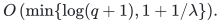

Thus the number of builds is bounded by

<!-- math-display: 2ec373e7f8044914139ae709
O\left(\min\{\log(q+1),1+s/a\}\right)
\exp O\left(\frac{a\log(q+1)}s\right).
\tag{13r}
-->
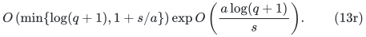

Each build and collapse costs <code class="math">O(p)</code>, proving (1r), including its <code class="math">h</code> term.
The root factor must remain when <code class="math">r</code> is fixed and <code class="math">s</code> is comparable to <code class="math">U</code>.
For the reanalyzed public explicit algorithm there are at most 26 epochs;
replace <code class="math">L_r</code> by <code class="math">26L_r</code> in the weight, leaving the displayed asymptotic
bound unchanged. The [full companion proof](../../manuscripts/matching-and-routing/rank-sensitive-layer-count.md) proves this epoch statement and all parameter endpoints. No implicit path-hypergraph enumeration is used by the explicit theorem.

## 6. Full inventory and verification costs

Each build costs `O(p)`. The combined right-coordinate size of
all surviving `X_i` is at most `|B_used|`, and the same holds
for the matching. A direct scan to find free edges, perform a
collapse, update matching ownership, and update the lower exact
blockers therefore costs `O(p)` per collapse. Each collapse
discards one layer, so there are no more collapses than builds.

Each `C_i` has at most `|B_used|` actual resources, regardless
of the larger symbolic bound `r^2 |X_i|`. Its creation or
discard costs `O(p)`. Reference counts over resources can
maintain the union of all live `C_i` in `O(p)` per layer birth
or discard, so producing the final union certificate costs
`O(p)`. The full-counter sets across live layers have total
size at most the number of selected edges, also `O(p)`.
Storage for certificates is `O(pD)`.

A returned matching is checked by scanning its left and right
coordinates for repeats. For a returned certificate, mark `S`
and `C`, scan every input edge whose left vertex lies in `S`,
and check that its right coordinates meet `C`. Count the sets
and verify `|C|<Delta r^2 |S|`. Thus verification is linear
in the explicit input representation, and does not rely on the
history of the algorithm.

## 7. Comparison with the public quantitative bound

The relevant primary source is Bucić--He--Huang--Saranurak,
[*Disjoint Paths in Expanders in Deterministic Almost-Linear Time
via Hypergraph Perfect Matching*](https://arxiv.org/html/2511.02214v1),
SODA 2026. Its Theorem 1.5 and Lemma 3.3 provide the explicit
hypergraph bound `p exp O(U/sqrt(log Delta))` under (2).
Its arXiv record lists only v1, submitted 4 November 2025.
The new construction preserves that sufficient condition and
improves the displayed parameter dependence through fixed
certificates and the child-count argument.

The baseline audit also yields the same sharper rate for the
existing BHHS Algorithms 1--3. A layer starts with
`|X_i|>Delta W/10`, is always capped by `Delta W`, and
therefore has only constantly many adopted superpositions, each
of which multiplies its size by at least `1.1`. Split its
children into those constantly many epochs and apply the weighted
count in each epoch. Historical certificates from the latest
actual attempted extension establish the necessary growth
invariant without a stale rerun assumption. The complete proof
is in [The same sharper rate for the existing BHHS explicit-hypergraph algorithm](../../manuscripts/matching-and-routing/public-hypergraph-algorithm-weighted-reanalysis.md).
Thus the weighted columns below are a quantitative analysis that
applies to both operation sequences. It is not a strict separation
from every algorithm already described in public sources.

The following comparisons use the same explicit volume `p` and
the same promise `tau(E_S)>=Delta r^2 |S|` throughout.

| Strength parameter | BHHS displayed overhead | Rank-free weighted bound | Retained bound for each fixed right rank |
|---|---:|---:|---:|
| `Delta>=p^epsilon`, fixed `0<epsilon<1` | `exp O(sqrt(U/epsilon))` | `(log p)^{O(1/epsilon)}` | `log(p+4) exp O_r(1/epsilon)` |
| `Delta>=exp(U^beta)`, fixed `0<beta<1` | `exp O(U^(1-beta/2))` | `exp O(U^(1-beta) log U)` | `U exp O_r(U^(1-beta))` |
| `Delta>=U^c`, fixed `c>0` | `exp O(U/sqrt(log U))` | `exp O(U log log U/log U)` | `U exp O_r(U/log U)` |

The total time includes a leading factor `p` and the one-time
vertex-list reading cost. The rank-free column of the first row gives

<!-- math-display: ff141f1857404f6574759f1f
O(|A|+|B|)+p(\log p)^{O(1/\epsilon)}
-->
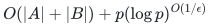

for each fixed `epsilon`, with the same matching-or-violation
certificate alternative even without a promise.

These displayed comparisons should also be minimized with elementary
greedy baselines. Write `q=|A|`. If `q<=Delta r`, a single scan
finds a perfect matching under (2), or returns a singleton violation:
previously used right resources number less than `Delta r^2`.
First checking the all-left certificate makes the input condition
`Delta^2 r^3>=|B_used|` sufficient for the same linear-time outcome.
In particular `Delta>=sqrt(p)` is already an elementary linear-time
regime, so the first row is not new over that elementary algorithm
when `epsilon>=1/2`. A maximal greedy matching also leaves at most
`q/(Delta r+1)` unmatched left vertices under (2), although this does
not recursively solve the remaining matching constraints. The further
rank-sensitive count and these baseline endpoints are detailed in
[Rank-sensitive counting for certified Haxell layers](../../manuscripts/matching-and-routing/rank-sensitive-layer-count.md).

For right-side rank one, the input is a bipartite graph. Neighborhood
expansion and classical shortest-augmenting-path phases already give
`O(p(1+log(q+1)/log Delta))`, plus input-list reading, as proved in
that companion note. The layer result is not a claimed improvement
over this classical graph boundary either.

More generally, for every strength parameter tending to infinity,
the new overhead exponent is
`O(U log(2+log Delta)/log Delta)`. The rank affects the
sufficient condition (2), but no additional rank dependence
appears in this exponent. Since `log(2+s)/s=o(1/sqrt(s))`
as `s` grows, this is a uniform improvement of the displayed
strength-parameter dependence, not just a choice of one favorable
rank regime.

The qualitative matching-or-violation alternative also predates
this manuscript. Annamalai's
[*Finding Perfect Matchings in Bipartite Hypergraphs*](https://arxiv.org/html/1509.07007v2),
Theorem 5.4, gives such an outcome in polynomial time for each
fixed uniformity and slack parameter, under a near-threshold
Haxell formulation. Its rank counts the entire hyperedge, unlike
our right-side rank `r`. We do not claim that alternative itself
as new. Here it is available with the sharper time bound and an
explicit resource set that can be checked in one input scan.

The comparison is to named, checked public statements and the
additional public-algorithm reanalysis supplied in this round;
it does not assert that all possible algorithms have been
exhaustively optimized. BHHS already established the qualitative
almost-linear result under a growing strength parameter. The
progress consists of the sharper quantitative analysis, the
simpler fixed-certificate operation sequence, and its compatibility
with destructive path-support queries. The general-graph
maximum-matching exponent is not changed by this hypergraph
corollary.

---

**Attribution:** Yilin Liu and GPT-6 Astra Pro.
