# Certified layers without superposition for disjoint-path routing

This note gives a constructive
outer algorithm for the destructive path-support oracle in
[destructive-apsp-path-support-extractor.md](../../manuscripts/graph-backends/destructive-apsp-path-support-extractor.md). It retains the
alternating-layer idea of Bucić--He--Huang--Saranurak (BHHS), but uses
fixed physical hitting certificates and removes the superpose-build
operation. In particular, the proof does not invoke the approximate
half-layer reduction, Lemma 3.5 of BHHS, as a black box.

The input graph below is static. The distance oracle is used on
temporary subgraphs of that graph while building individual layers.
Its updates are internal to the routing algorithm.

## 1. The precise imported distance interface

Let `G` be an undirected unweighted graph with `n` vertices and `m`
edge identities, and let `D={(s_a,t_a):a in A}` be `q` indexed demand
pairs. Endpoints of a nontrivial pair are distinct. Pairs with equal
endpoints can be satisfied by empty paths before this construction.
Repeated pairs have separate demand identities.

Let `N>=n+m+q+4`, `U=log N`, and `h=log(U+4)`. Assume the
destructive-support interface supplies a deterministic fully dynamic
distance structure with numerical stretch at most `Gamma>=1` and
the following aggregate guarantee. Over `O(m+q)` edits and queries,
one can repeatedly obtain the distinct original-edge support `S` of
a returned walk, extract a simple endpoint-to-endpoint path in `S`,
and permanently delete every edge of `S`, in total time

<!-- math-display: 104446756da26dc014b323b1
\widehat T=(n+m+q)\exp O(B).
 \tag{1}
-->
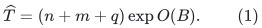

Deleting the rest of any disjoint family of already stored paths
touched by `S` is included. The proof of that interface counts flat
occurrences and actual deleted edge identities; (1) has no
unaccounted multiplicative `Gamma` or path-length factor.

This generic interface is supplied by the
[destructive-support construction, Sections 2–4](../../manuscripts/graph-backends/destructive-apsp-path-support-extractor.md),
using the [constructed APSP oracle](../apsp-frontier/proof.md).
Section 9.2 below instantiates its work and stretch parameters. The
short-path hitting and expander density conditions are separate input
promises and remain part of the resulting routing theorem.

Fix an integer short-path comparison bound `h_0>=1`, and put

<!-- math-display: f02abb29d60f06612fd27f55
R=\lceil\Gamma h_0\rceil.
 \tag{2}
-->
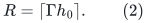

Only queries with answer at most `Gamma h_0` are accepted. Their
walk supports have at most `R` edges, and their extracted simple
paths have length at most `R`. A rejected numerical query certifies
that the current graph has no path of length at most `h_0` between
that demand's endpoints. This is the implication
`d<=h_0 => estimated distance<=Gamma h_0`, not the converse
implication for an accepted query.

## 2. The strong hitting assumption and the theorem

For an integer `b`, define the demand-path hypergraph `H_b` to
have left vertices `A`, right vertices the physical edges of `G`,
and one hyperedge `(a,E(P))` for each simple `s_a`--`t_a` path
`P` of length at most `b`.

Suppose the short-path hypergraph `H_(h_0)` satisfies

<!-- math-display: 6b0f009fc659428865d19fd8
\tau(E_S(H_{h_0}))\ge \Psi |S|
       \quad\text{for every }S\subseteq A,
 \tag{3}
-->
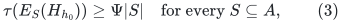

where the hitting set is allowed to use any physical edges of `G`.
Let `Delta>=4` be an integer satisfying

<!-- math-display: 927914a537af123d6c3242fa
\Psi\ge\Delta R^2.
 \tag{4}
-->
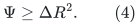

**Certified-layer theorem.** Under (1)--(4), the algorithm below
finds edge-disjoint simple paths satisfying all `q` demands, each
of length at most `R`, in time

<!-- math-display: 728ace2243eb7b038dac4454
(n+m+q)\exp O\left(B+
                   \frac{U\log(2+s)}{s}\right),
 \qquad s=\log\Delta.
 \tag{5}
-->
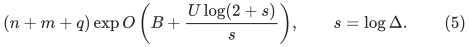

The improvement over the original signature bound
`(n+m+q) exp O(B+U/sqrt(log Delta))` exploits fixed surviving
layers and the geometric decrease of the prefix sizes at which
their children are created. The proof in Section 7.5 is independent
of `R`; path length enters the hitting assumption and output bound,
but not this outer iteration bound.

There is no requirement `Delta>=4 alpha` for an approximate
half-layer factor `alpha`. The proof uses (3) and the physical
certificates below directly. All stored paths are explicit, and
total path length in the final answer is at most `m`.

## 3. Alternating layers and the certified build operation

Maintain a partial routing `M`: a set of edge-disjoint simple paths
of length at most `R`, with at most one path per demand. The
corresponding hyperedges form a matching in `H_R`.

Let `Y_0` be the unmatched demand identities. For `i>=1`, a layer
`L_i=(X_i,Y_i)` has the following properties:

1. Every path in `X_i` serves a demand in `A(Y_(i-1))`, and a
   demand occurs in at most `Delta` paths in `X_i`. Here
   `A(Y_0)=Y_0`; for a set of matched paths, `A(Y)` denotes
   their demand identities.
2. Paths in `X_i` are pairwise edge-disjoint and avoid all
   physical edges in earlier `X_j` and `Y_j`.
3. `Y_i` is exactly the set of paths in `M` that intersect a path
   in `X_i`. Every path in `Y_i` intersects at most one path in
   `X_i`.

All `Y_i`, including the unmatched tokens `Y_0`, have distinct
demand identities across levels. The sets `X_i` are also
edge-disjoint across levels. A path in `X_i` is called free if it
has no blocking path in `M`.

### 3.1 Build a new layer from an empty set

Given the current prefix `L_0,...,L_ell`, build a new layer with
active identities `A(Y_ell)`. Start an oracle instance on `G`
with the forbidden prefix edges

<!-- math-display: b995411e18b08fbfba6e6bcf
F_0=B(X_{\le\ell}\cup Y_{\le\ell})
 \tag{6}
-->
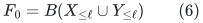

deleted; `B(Y_0)` is empty. Counters initially equal zero.
The graph instance and its original-edge seen registry are fresh for this
build. Consumption marks from an older build are not reused: the static
input graph is available again, subject only to the current forbidden
prefix. Reinitialization is included in the per-build bound (1).

For each active demand, repeatedly query while its counter is below
`Delta`. If a query is rejected, stop processing that demand. If a
query is accepted, do the following:

* extract the distinct support `S` and a simple path `P` in it;
* add `P` to the new set `X` and increment its demand counter;
* permanently delete every edge in `S` from this oracle instance;
* for every matching path `Q in M` touched by `S`, delete all
  of its remaining edges from the oracle instance.

Each matching path is processed at most once. The final `Y` is
the set of actual blockers of the selected paths `P`, not all
matching paths touched by their possibly larger supports.

The new layer is valid: deleting `S` makes selected paths
edge-disjoint, and deleting every matching path touched by `S`
ensures that no later selected path shares an actual blocker with an
earlier one. The procedure never takes a matching path itself. At
level one the active demands are unmatched; at a later level an
active demand's own matching path lies in `Y_ell` and has already
been removed in (6).

Thus the arbitrary-state exclusion procedure from the companion
extractor is not needed for these particular calls. It remains
useful for the standalone half-layer interface.

### 3.2 Fixed physical certificates

Retain two additional objects with the new layer:

* `F` is the set of active demand identities whose counters reached
  `Delta`.
* `C` is the set of physical edges permanently deleted during this
  call **after** the initial deletion of `F_0`. Matching-path
  deletions contribute their actual edge identities, not a mutable
  reference to the matching path.

The following facts hold:

<!-- math-display: 0088f9aadcb29cd2d2a9ed0a
|F|\le |X|/\Delta,\qquad B(X\cup Y)\subseteq C,
 \qquad |C|\le R^2|X|.
 \tag{7}
-->
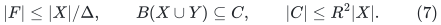

Here it is legitimate to exclude the initial forbidden set `F_0`
from `C`. If a current matching path `Q` meets an earlier `X_j`,
then `Q` belongs to the exact blocker set `Y_j`. If `Q` meets
an earlier `Y_j`, edge-disjointness of the matching forces it to
be that same matching path. Thus any matching path meeting `F_0`
is entirely contained in `F_0`. A matching path that touches a
new accepted support cannot be one of those paths. All its edges,
including every edge of any actual new blocker, are therefore
deleted after the initial prefix deletion and belong to `C`.

For the last inequality, one accepted support has at most `R`
edges and touches at most `|S|` matching paths, because `M` is
edge-disjoint. The union of `S` and those matching paths has size
at most

<!-- math-display: fbce95bcca05f99be7d680f6
|S|+(R-1)\,\#\{Q\in M:Q\cap S\ne\emptyset\}
 \le R|S|\le R^2.
-->
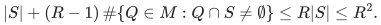

Repeated deletions only reduce the total. Every active identity
outside `F` has had a rejected query. The residual graph only loses
edges thereafter. Hence

<!-- math-display: 4dfdbb60f6d39a40a0a99f22
\text{every }h_0\text{-short path for }a\in A(Y_\ell)\setminus F
 \text{ meets }F_0\cup C.
 \tag{8}
-->
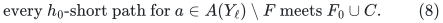

This is a statement about fixed sets of physical edges in the
original graph, and not about which paths remain in the matching.
The call performs at most `m` successful extractions, at most one
final rejection per active demand, and at most `m` permanent edge
deletions. Its time is bounded by (1).

Although the upper estimate in (7) contains `R^2`, an actual
certificate is a subset of the `m` input edges. It is constructed
from at most `m` physical deletions. Its materialization therefore
does not cost `m R^2`.

## 4. The algorithm: build, swap, discard

Initialize `M` empty, `Y_0=A`, and no positive-index layer. Fix
`mu=1/10`.

While `Y_0` is nonempty:

1. Build one new certified layer from the current last layer and
   append it.
2. While the last layer `L_t` has more than `mu |X_t|` free
   paths, choose one free path for each demand represented by at
   least one such path. If `t>1`, replace that demand's path from
   `Y_(t-1)` in `M` by the chosen free path and remove the old
   path from `Y_(t-1)`. If `t=1`, add the chosen paths to `M`
   and remove their identities from `Y_0`.
3. Discard layer `L_t` and its certificate. Repeat Step 2 with
   the new last layer if there is one.

There is **no superpose-build step**. A set `X_i` is fixed from
its creation until its layer is discarded. Its blocker set `Y_i`
can shrink, and will be updated to remain exact.

Each swap is feasible. The selected paths have distinct demand
identities, are pairwise edge-disjoint, and are free of every current
matched path in their edge coordinates. The old matching paths
sharing their left identities are removed before insertion.

Inserted paths from `X_t` avoid all physical edges of lower
`X_i,Y_i`, so they cannot create new blockers for a lower layer.
The only blocker removals are precisely the removed matching paths
in `Y_(t-1)`. This proves preservation of the layer invariants.

At the beginning of every new build, all existing positive-index
layers are noncollapsible. Consequently,

<!-- math-display: f52ca832e571502e573fb301
|Y_i|\ge(1-\mu)|X_i|=\tfrac9{10}|X_i|.
 \tag{9}
-->
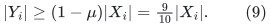

Indeed every nonfree selected path has at least one blocker, and
different selected paths have disjoint blocker sets.

## 5. Why the certificates remain valid

While layer `i` survives, the entire prefix up to `i-1` is fixed.
A collapse at a level greater than `i` may shrink `Y_i` (only
when that collapse is at `i+1`), but does not change any earlier
layer. A collapse that changes the prefix through `i-1` first
discards layer `i` and every higher layer.

It follows that the active set at the birth of layer `i`, the
forbidden prefix in (6), its counter-full set `F_i`, and its
physical hitting assertion (8) stay valid for its entire lifetime.
An old matching path that contributed physical edges to `C_i` may
later leave `M`; those physical edges still exist in the static
input graph and remain in `C_i`.

Moreover, `X_i` is fixed and `Y_i` only shrinks, so
`B(X_i union Y_i) subseteq C_i` continues to hold. No certificate
is interpreted through the identity of a retired matching path.
These observations are exactly why a physical certificate can
replace the repeated superposition operation in this construction.

## 6. Layer growth from the strong hitting condition

Consider a new layer `ell+1` just after it is built. Write

<!-- math-display: e14fab4cece97e5bc53cb352
W=|Y_{\le\ell}|,
 \qquad T=\sum_{i=1}^{\ell+1}|X_i|.
-->
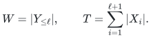

Because `Y_0` is nonempty, `W>0`. Assume for contradiction that

<!-- math-display: 9170069f61f792748396828f
|X_{\ell+1}|\le\Delta W/10.
 \tag{10}
-->
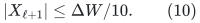

The old layers obey (9), and hence

<!-- math-display: dc6ff94d289ab1e71cd7ed62
T\le(\Delta/10+10/9)W.
 \tag{11}
-->
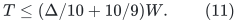

Remove from `A(Y_(<=ell))` all counter-full identities in the
sets `F_i`, and call the remaining set `S_*`. These active sets
have distinct demand identities across levels. From (7) and (11),

<!-- math-display: bac043a366def7691f983a28
|S_*|\ge W-T/\Delta
     \ge\left(\frac9{10}-\frac{10}{9\Delta}\right)W.
 \tag{12}
-->
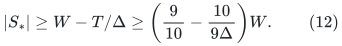

The set `C_* = union_(i=1)^(ell+1) C_i` hits every short
hyperedge incident to `S_*`. To see this, use (8) in the unique
layer whose active set contains the demand. Any earlier forbidden
prefix edges are also covered, because
`B(X_j union Y_j) subseteq C_j` for all earlier layers.
Therefore

<!-- math-display: e14e79dc24f2da641fec2a5d
\tau(E_{S_*}(H_{h_0}))\le |C_*|
       \le R^2T
       \le R^2(\Delta/10+10/9)W.
 \tag{13}
-->
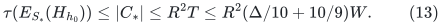

On the other hand, (3), (4), and (12) give

<!-- math-display: 843aa5c9c8b8143a9f637e0d
\tau(E_{S_*}(H_{h_0}))
       \ge R^2(9\Delta/10-10/9)W.
 \tag{14}
-->
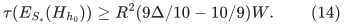

The lower coefficient in (14) exceeds the upper coefficient in
(13) whenever `4 Delta/5 > 20/9`, in particular for every
`Delta>=4`. This contradiction proves

<!-- math-display: a2ddf6f44681df33912511c2
|X_{\ell+1}|>\Delta |Y_{\le\ell}|/10.
 \tag{15}
-->
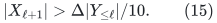

This inequality persists for the lifetime of a layer: its `X_i`
and its lower prefix stay fixed. It is an inequality about selected
paths and actual blocker counts; ghost edges are used only in its
proof.

## 7. Termination and the number of calls

The potential argument below is a specialization of the signature
method in BHHS Sections 5.4--5.5, with the superposition case removed.
The details are included so that the changed outer algorithm has its
own termination and time proof.

### 7.1 Depth

At the beginning of a build, (9) and (15) imply

<!-- math-display: 18111e74d6e68caef8c2dd7a
|Y_i|>\frac{9\Delta}{100}|Y_{<i}|.
-->
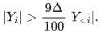

All sets `Y_i` use distinct demand identities, so their total
size is at most `q`. Thus the number `D` of surviving layers is

<!-- math-display: 705d7b055972a31c4ffda002
D=O(\log N/\log\Delta).
 \tag{16}
-->
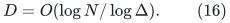

The temporarily appended layer increases this allowance by at most
one.

### 7.2 A strictly decreasing signature

At a main-loop boundary assign layer `i` the ordered pair

<!-- math-display: 3436e16511d7659237449ea1
\left(
 -\left\lfloor\log_{1.01}(5^{2i}|X_i|)\right\rfloor,
  \left\lfloor\log_{1.01}(5^{2i+1}|Y_i|)\right\rfloor
 \right),
 \tag{17}
-->
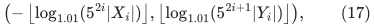

take `X_0=empty` with its first coordinate defined as zero, and
append an infinity sentinel after the last pair.

Signatures are used only at nonterminal boundaries. There
`Y_0` is nonempty, and each surviving positive-index layer has
positive `X_i,Y_i` by (9), (15). If `Y_0` becomes empty the
algorithm terminates immediately, without evaluating a logarithm
of zero. For nonempty demands, (3)--(4) also imply
`Delta R^2<=Psi<=m`, by applying (3) to a singleton and using
all physical edges as a hitting set. In particular `log Delta<=U`.

If a main iteration has no collapse, it appends a finite pair before
that sentinel, strictly decreasing the signature lexicographically.
Otherwise, let `t` be the smallest layer index collapsed in the
iteration. More than `mu |X_t|` free paths cover at least
`mu |X_t|/Delta` distinct demand identities. Using (15), the
swap therefore reduces `|Y_(t-1)|` by at least the fraction
`mu/10=1/100`. All earlier signature coordinates and `X_(t-1)`
are unchanged. Since `1/0.99 > 1.01`, its `Y` coordinate
decreases by at least one. The complete signature strictly decreases.

### 7.3 Counting signatures

The absolute coordinate values in (17) are nondecreasing. Within a
layer this follows from (9) and the factor five; between successive
layers it follows from (15), `Delta>=4`, and the next factor
five. Each coordinate is `O(D+log N)`. There are `O(D)`
coordinates, and their signs and order are prescribed.

They can therefore be encoded by an integer partition of total size
`O(D^2+D log N)`, with the fixed leading zero and the final
sentinel understood. The standard partition bound gives at most

<!-- math-display: dcc2d3169ca3ac72b810e591
\exp O\left(\sqrt{D^2+D\log N}\right)
      =\exp O\left(\frac{\log N}{\sqrt{\log\Delta}}\right)
 \tag{18}
-->
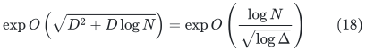

possible signatures. Thus there are at most this many builds. A
collapse discards one layer and every build adds one, so the total
number of collapses is at most the number of builds. The algorithm
must terminate with `Y_0` empty, because (15) permits another
nonempty layer whenever `Y_0` is nonempty.

### 7.4 A stronger count from the tree of layer lifetimes

Each created layer is a node whose parent is the layer immediately
below it when it is created. The unmatched set `Y_0` is the root.
Only the current last layer can collapse. Consequently a node has
at most one living direct child, and a child must collapse before
its parent can create the next direct child or itself disappear.
This describes a tree of layer lifetimes, of depth at most `D+1`.

Fix a positive-index layer `i` throughout its lifetime, and put
`W=|Y_{<i}|`. Its lower prefix is fixed and `W>0`. At its birth,
every matching blocker touches one of at most `R` edges of one
path in `X_i`. Therefore

<!-- math-display: 5b9ae33adb1684fd36399cd7
|Y_i|\le R|X_i|
       \le R\Delta |Y_{i-1}|
       \le R\Delta W.
 \tag{19}
-->
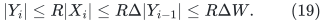

Each direct child `i+1` that collapses removes more than
`|Y_{<=i}|/100=(W+|Y_i|)/100` demand identities from `Y_i`,
by the same free-path and growth argument as in Section 7.2.
The child's birth growth remains valid until that collapse,
because its lower prefix, including `Y_i`, cannot change while
the child survives. Thus every completed child reduces
`z=W+|Y_i|` by a factor at most `0.99`. Initially
`z<=(1+R Delta)W`, and always `z>=W`. There are at most

<!-- math-display: d38734003d5198e4f08d6c20
O(\log(1+R\Delta))
 \tag{20}
-->
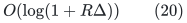

completed direct children. There can be one additional living
child. This extra one is counted in every finite execution prefix;
we do not assume termination in order to prove the bound.

At the root, each completed child reduces the positive unmatched
count by at least a one-percent fraction, or empties it. Hence the
root has at most `O(log(q+1))+1` created children in any finite
execution prefix. A bounded-depth tree with these branching bounds
has at most

<!-- math-display: bf2777ed055deae21fe795c9
(U+4)\,[C\log(2+R\Delta)]^{D+1}
-->
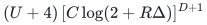

nodes for a sufficiently large absolute constant `C`. Its
logarithm is

<!-- math-display: fda58ee3fb8a2deb889f7f44
O\!\left(\log(U+4)+
       \frac{U}{s}\log(2+\log R+s)\right),
       \qquad s=\log\Delta.
 \tag{21}
-->
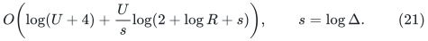

This is also a direct termination proof: every finite execution
prefix has a uniform bound on its number of created layers, and
every iteration creates a layer while `Y_0` remains nonempty.
Equations (18) and (21) are two valid coarse bounds. The following
weighted count improves them uniformly and proves (5).

### 7.5 A weighted count that removes the rank dependence

For a positive-index layer instance `i`, let
`W_i=|Y_<i|` throughout its lifetime. It is a positive fixed
integer at most `q`. When this layer creates a direct child,
it is noncollapsible and has passed its growth test. Hence that
child's prefix size satisfies

<!-- math-display: b7556af1f7efaa3e7563e950
W_{child}=W_i+|Y_i|
       \ge\kappa W_i,
 \qquad \kappa=1+9\Delta/100.
 \tag{21a}
-->
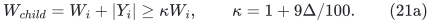

List the prefix sizes of this instance's children in creation
order as `z_1,z_2,...`. A child must collapse before the next
one is born, and that collapse removes at least one percent of
the then-current `W_i+|Y_i|`. Thus `z_(j+1)<=0.99 z_j`.
These statements hold for every finite execution prefix, including
its possible last living child.

Put `rho=0.99` and choose

<!-- math-display: ee481449d579b8827ff4baec
\lambda=100\frac{\log(2+s)}s,
             \qquad s=\log\Delta.
-->
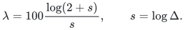

Assign the layer instance weight `w_i=W_i^(-lambda)`. Reversing
the geometric child-size list and using (21a) gives

<!-- math-display: 65628f6c3c8e0719d54a0ce7
\sum_{child}w_{child}
 \le\frac{\kappa^{-\lambda}}{1-\rho^\lambda}\,w_i
 \le\tfrac12 w_i.
 \tag{21b}
-->
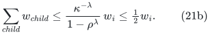

For explicit constants, `kappa>=Delta^(1/5)` for `Delta>=4`,
so `kappa^(-lambda)<=(2+s)^(-20)`. Also
`1-rho^lambda>=min{1/100,lambda/200}`. These inequalities
give the final factor one half for every `s>=log 4`.

The children of the root have prefix sizes equal to the successive
positive unmatched counts. Those counts also decrease by a factor
at most `rho` between children and are at least one. The sum
of the root-child weights is therefore at most
`1/(1-rho^lambda)`. Applying (21b) to the forest of positive
layer instances in any finite execution prefix bounds its total
weight by `2/(1-rho^lambda)`. Every node has weight at least
`q^(-lambda)`. Consequently its node count is at most

<!-- math-display: 7f9b3f4d361cb5d5f96b8810
\frac{2q^\lambda}{1-\rho^\lambda}
       =\exp O\!\left(\frac{U\log(2+s)}s\right).
 \tag{21c}
-->
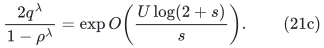

The prefactor is harmless: its logarithm is
`O(log(1+1/lambda))`, and `s<=U` implies that it is absorbed
by the displayed exponent. This finite-prefix bound proves
termination directly and establishes (5). No upper bound on a
layer's initial number of blockers, and therefore no factor
depending on `log R`, is needed in this stronger count.

## 8. Implementation cost and stored certificates

Each build costs (1), including creating the current forbidden
subgraph, indexing matching-path ownership of physical edges,
extracting the paths, and storing its physical certificate. Counters
are capped by `Delta`, but the call does not perform `q Delta`
queries: every success permanently consumes a fresh edge, so there
are at most `m` successes and at most `q` rejected queries.

At any moment the selected paths in all surviving `X_i` are
edge-disjoint, and the paths in `M` are edge-disjoint. Their
combined explicit representation has size `O(m+q)`. Even a direct
scan to find free paths and update blockers costs `O(m+q)` per
collapse, within (1). The certificates themselves use at most `m`
physical edge identities per layer, so all active certificates use
`O(mD)` space and can be discarded with their layers. Creating or
discarding them costs at most `O(m)` per build or collapse.

This proves (5), with all input, output, and ghost-storage work
included. It does not charge a numerical `R^2` upper bound as if
that many different edges had been materialized.

### 8.1 A certificate alternative without a hitting promise

The algorithm can also be made certifying on arbitrary inputs.
After every build, explicitly test (15), before performing any
collapse. If the test fails, return the sets `S_*` and `C_*`
constructed in Section 6. The old layers have passed their tests
and are noncollapsible, so (11)--(13) remain valid without assuming
(3). In particular `S_*` is nonempty and `C_*` hits every
`h_0`-short path for every demand in `S_*`. Moreover,

<!-- math-display: c8a1fac4294906ceaaea1029
|C_*|\le R^2(\Delta/10+10/9)W
       <R^2(9\Delta/10-10/9)W
       \le\Delta R^2|S_*|.
-->
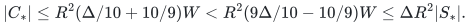

This is a witness that the `Delta R^2` strong hitting condition
fails. It is not a certificate that routing all demands is
impossible. If every growth test passes, Sections 7.1 and 7.4
apply to every execution prefix and force termination with a full
routing in the same time bound, by the finite-prefix count in
Section 7.5.

For a nonempty demand set, if `Delta R^2>m`, one may immediately
return any single demand and all `m` edges as such a witness.
Otherwise `log Delta<=U`, as required in the counts above. An
empty demand set is returned as an empty routing. The path hitting
property of a returned certificate is proved through the failed
oracle queries; no unperformed exhaustive enumeration of paths is
claimed. In the explicit-hypergraph specialization, that same
property can instead be verified by a single scan of its input
edge list; see [strong haxell matching proof](proof.md).

## 9. Expander consequence with explicit conductance dependence

Let `G` now be an undirected, unweighted, loopless multigraph on
`n>=2` vertices and `m>=1` physical edge identities. Degrees and
cut capacities count parallel edges with multiplicity. Suppose its
conductance is at least `phi>0`, its minimum degree is `delta>0`,
and at most `k` indexed demand endpoints occur at any vertex.

We may use a dyadic valid conductance lower bound in the interval
`[1/(4m),1]`. Indeed positive conductance implies connectivity, so
the actual conductance is at least `1/(2m)`. Replace a supplied
valid lower bound by the power of two obtained by rounding
`max{phi,1/(2m)}` downward. This replacement is still valid and
is at least half the supplied bound. Constant losses in the
following sufficient condition absorb that rounding. In this
section `phi` denotes the resulting dyadic bound. It has `O(log N)`
bits, and the comparison length below is polynomially bounded.

The short-path hitting statement needed here, in a form that also
covers parallel edges, is

<!-- math-display: e2beeb945892526ce478837c
h_0=\lceil32\log(2N)/\phi\rceil,
 \qquad \Psi=\phi\delta/(64k).
-->
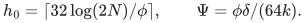

The next subsection proves this statement directly by an
original-volume pruning argument. It is the structural idea of
BHHS Lemma 4.2 with the volume dependence made explicit; no
pruning algorithm is run by the routing construction.

Consequently, a sufficient condition for the new theorem is

<!-- math-display: 3855871005c73e5c311ce50e
\boxed{\quad
 \phi^3\delta\ge C k\Delta\Gamma^2\log^2 N,
 \qquad \Delta\ge4,
 \quad}
 \tag{22}
-->
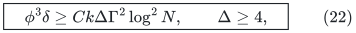

for a sufficiently large absolute constant `C`. The output paths
have length at most `O(Gamma log N/phi)`. The running time is
given by (5); in particular no factor polynomial in `1/phi` or
in `h_0` is hidden in the build cost. Under (22), `q=O(m)`, so
the leading input size can be written `O(m+n)`.

With `s=log Delta`, the quantitative interface is

<!-- math-display: b14a9004b5187dc8ef5a9585
\begin{array}{ll}
 \text{time:}&(m+n)\exp O\!\left(B+U\log(2+s)/s\right),\\
 \text{length:}&O(\exp(a)\log N/\phi),\\
 \text{density:}&\phi^3\delta/k
              \ge \log^2N\,\exp O(s+2a),
 \end{array}
 \tag{23}
-->
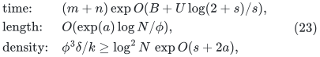

where `a=log Gamma` is a declared upper bound on distance
stretch. The sufficient density inequality uses constants large
enough to cover that declared bound.

### 9.1 A self-contained short-path hitting proof

Write `mu(v)=deg_G(v)` and `T=mu(V)=2m`. Fix a set `F` of
`f` physical edges with `f<=phi T/64`. Starting with `P=empty`
and `R=V`, repeatedly remove any nonempty set `A subset R`
such that

<!-- math-display: 19f9b60caf5b35573b6a91c5
\mu(A)\le\mu(R)/2,
 \qquad |E_{G-F}(A,R\setminus A)|<\tfrac\phi4\mu(A).
-->
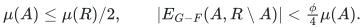

The procedure is used only to prove existence. Since the removed
sets are disjoint, every partial removed union satisfies

<!-- math-display: 3ce4de79396c56b6917db1c9
|\partial_G P|\le f+\tfrac\phi4\mu(P).
-->
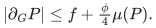

While `mu(P)<=T/2`, expansion of the original graph gives
`mu(P)<=D=4f/(3phi)`. In fact the process never crosses `T/2`.
At a first crossing, its preceding union has volume at most `D`,
and the new union has volume at most `T/2+D/2`. Its complement
therefore has volume at least `T/2-D/2`. Original expansion and
the preceding boundary upper bound would imply

<!-- math-display: 3c1e45c6f028cc4ee9971297
\phi(T/2-D/2)
 \le f+\tfrac\phi4(T/2+D/2),
-->
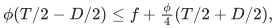

which rearranges to `f>=9phi T/44`, contradicting
`f<=phi T/64`. Thus at termination

<!-- math-display: 66e02608d5c203d12584e662
\mu(P)\le4f/(3\phi).
 \tag{24}
-->
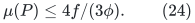

For every set of remaining vertices whose original volume is at
most `mu(R)/2`, the remaining graph `G[R]-F` has boundary at
least `(phi/4)` times that original volume. A breadth-first ball
therefore increases its original volume by a factor at least
`1+phi/4` per step until exceeding `mu(R)/2`: the original
degrees of its new vertices dominate the number of boundary edges.
Every nonempty ball starts with original volume at least one. In
at most `ceil(8 log(2m)/phi)` steps its volume exceeds half.
Any two such balls intersect, proving a remaining-graph diameter
bound at most `2 ceil(8 log(2m)/phi)<=h_0`. This argument uses
edge multiplicities throughout and does not require simplicity.

Now take any nonempty demand subset `A_*`. Greedily retain a
vertex-disjoint subfamily of `c>=|A_*|/(2k)` demand pairs. This
is possible because selecting one pair discards at most `2k`
remaining indexed pairs. Suppose `F` hits every `h_0`-short path
of every pair in `A_*`, but

<!-- math-display: 75a8c597064ae56fd16b0f5b
f<\phi\delta|A_*|/(64k)
   \le\phi\delta c/32.
-->
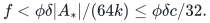

The `2c` distinct endpoints have total original volume at least
`2delta c`, so `delta c<=T/2` and `f<phi T/64`. Apply the
pruning argument. By (24),

<!-- math-display: 5ed0f0ff3b88d4436fabe33a
|P|\le\mu(P)/\delta<c/24.
-->
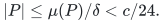

At least one retained pair has both endpoints outside `P`.
The diameter bound supplies an `h_0`-short path for that pair
avoiding `F`, a contradiction. This proves (3) with
`Psi=phi delta/(64k)` for every demand subset.

### 9.2 Plugging in the current separated hierarchy

The family in [apsp frontier proof](../apsp-frontier/proof.md) provides

<!-- math-display: 9c57e5e4c47cf8dc742a558a
B=O(U/t+t^3h),\qquad a=O(t^4h).
-->
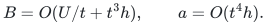

Choose `Delta` to be an integer power of two with
`log Delta=Theta(t log(t+2))`. Then the outer iteration term is
`O(U/t)` and does not change this work envelope. A sufficient
density condition is

<!-- math-display: 8e8839874506b2a0c22388a4
\phi^3\delta/k
                 \ge\log^2 N\,\exp O(t^4h).
 \tag{25}
-->
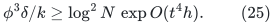

For `t=Theta(U^(3/14))` this gives time
`(m+n) exp O(U^(11/14))`, path lengths
`exp O(U^(6/7) h) log N/phi`, and the corresponding sufficient
density allowance `phi^3 delta/k >= log^2N exp O(U^(6/7) h)`.

For `t=Theta((U/h^2)^(1/4))` it gives time
`(m+n) exp O(U^(3/4) h^(1/2))`, path lengths
`exp O(U/h) log N/phi`, and sufficient density allowance
`phi^3 delta/k >= log^2N exp O(U/h)`.

These are disjoint-path routing results under the stated expander
and density assumptions. They are not general-graph exact matching
time bounds. The underlying destructive approximate packing result
itself does not require expansion.

## 10. Public comparison and why the outer proof is separate

The primary public reference is BHHS,
[*Disjoint Paths in Expanders in Deterministic Almost-Linear Time
via Hypergraph Perfect Matching*](https://arxiv.org/html/2511.02214v1),
SODA 2026. Its current arXiv history lists only v1. The paper already
states deterministic almost-linear routing under an
`n^(o(1))`-strengthened `phi^3 delta/k` condition. Thus the new
claim here is the explicit quantitative time/length/density tradeoff
and the constructive certificate route; the qualitative
almost-linear conclusion is not new by itself.

Several interfaces must be distinguished when making that comparison.
Its Definition 3.1 allows a selected path to intersect a matching
path, provided no two selected paths use the same blocker. Deleting
all of `M` at the beginning, as in its displayed Task 4.7, is a
stricter problem. Its Definition 5.9 also gives the added half layer
the full degree cap even when an existing layer already occupies
part of that cap. A residual-cap formulation needs additional care.
The construction in this note avoids these interfaces: it starts a
fresh layer, permits blockers, records physical certificates, and
performs no superposition.

For explicit running-time comparison, BHHS Lemma 4.11 retains
`poly(h_0)` and its Lemma 4.12 assumes `h_0=n^(o(1))`.
Its later substitution `h_0=18 log n/phi` therefore needs that
restriction or a separate accounting of conductance dependence when
read through those particular displayed primitives. Condition
`phi^3 delta >= n^(o(1)) k` alone does not force
`1/phi=n^(o(1))`. The present build cost (1) has no such length
multiplier. This is an explicit applicability advantage of the
proved interface, without asserting that every alternative public
implementation or parameter retuning has been exhausted.

The short-path hitting argument behind (22) is proved explicitly
in Section 9.1 and covers loopless multigraphs. The layer,
certificate, growth, termination, inventory, and time proofs for the
modified algorithm are supplied in Sections 3--8 above. BHHS is
credited for the alternating-layer/signature strategy and the
expansion-to-hitting approach; none of its questioned constructive
interfaces is needed for this modified outer algorithm.

**Attribution:** icekylinx and GPT-6 Astra Pro.
