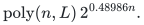

# Randomized exact Subset Sum counting

A cyclotomic trace recovers the complete indexed solution count from a
modified random-phase checksum estimator. Polynomial-order phase primes,
shifted-grid moment bounds and reusable alias extraction remove the source
algorithm's unique-witness decision interface. The construction applies to
arbitrary binary integer inputs, including signed and repeated items.

[Proof](proof.md) · [Exact parameter certificate](parameter-certificate.md) · [Sources](sources.md) · [Verification](verify/README.md)

**Objective and output**

Given `n` indexed binary integers and a target, return the exact number of
subsets with that sum. Success means equality with the integer count, not a
relative-error estimate. Count-preserving interval and product-activity
reductions are proved internally; they are not separate selected results.

**Randomness**

Randomized exact-answer algorithm with success probability at least `2/3`; time is bounded on every history, with polynomial overhead for confidence amplification. The cited source lemmas are accepted external mathematical inputs.

**Time**

The strongest certified bound is

<!-- math-display: 120b9645179c17d63acaa1af
\mathrm{poly}(n,L)\,2^{0.48986n}.
-->

Here `L` is the full encoded input length. For each fixed polynomial-bit
input convention the strict exponent margin absorbs the polynomial into
ordinary source-model word time with the same displayed exponent. This is
an exact-counting extension of a named source construction; it is not a
best-known decision-exponent claim. The numerical refinement is part of the
same construction, not a separate algorithmic contribution.

**Space**

The cap bounds stored arithmetic data by the time bound. No improved
simultaneous space exponent is asserted. Counts have at most `n+1` bits;
unsuccessful answers are clamped to their legal range. Trace and CRT work
uses polynomial-bit numbers, without an explicit cyclotomic-field data type.

**Parameters**

`n` counts indexed items; `L` includes their binary encodings and the target.
The large filtering modulus `P` and the polynomial phase prime `q` have
separate roles. Frequency enumeration remains indexed by `P`, while phase
arithmetic uses a circle of size `P*q`. Fixed effective startup cutoffs and
exponent slack are accounted for in the proof.

**Model and representation**

The filtering, checksum, deficiency, alias and finite-arithmetic lemmas from
the explicitly pinned OpenAI manuscript are accepted mathematical inputs.
The local argument checks how their phase-dependent steps change; the
source estimator's theorem statement alone is insufficient. The native
programs check finite reconstruction and the exact numerical ledger. They
do not implement the asymptotic filtering/alias engine.

**Lower-bound scope**

No optimality, historical priority or decision-time record is claimed.
The existing deterministic decision-and-witness Subset Sum algorithms have
a different output and randomness contract and remain incomparable.
Structured or modular exact counts are not treated as unrestricted integer
counts. Standalone threshold reductions and numerical substitutions are
internal proof components, not independent research entries.

**Review status**

**Ready for review.** Complete exact indexed Subset Sum counting extension, changed polynomial-order phase law, cyclotomic/CRT recovery, original all-sparse-support alias coverage rechecked at the selected parameters and strongest rationally certified parameter choice, assuming the explicitly named pinned filtering/alias source lemmas.

**Dependencies and scope.** The pinned external filtering, deficiency, alias and finite-arithmetic results remain accepted mathematical inputs; the local extension checks rather than assumes the modified phase distribution. Finite checks and exact numerical certificates have their stated scopes. No full exponential-time estimator implementation, proof-assistant verification, external review, historical priority or decision-exponent record is claimed.

The [verification note](verify/README.md) identifies executable coverage. This status does not claim external peer review or proof-assistant verification.

**Source**

Curated from the 2 November 2026 TCS checkpoint. Attribution: **icekylinx and
GPT-6 Astra Pro**. Apache-2.0 under the repository [license](../../LICENSE).
The [source map](sources.md) identifies the pinned external mathematical
lemmas, the changed phase law and the retained original member identities.
