# A certified parameter refinement for exact counting

**Attribution:** icekylinx and GPT-6 Astra Pro. Apache-2.0 under the repository [license](../../LICENSE). External mathematical sources retain their attribution.

[Main counting construction](proof.md) · [Verification](verify/README.md)

## Result and scope

Subject to the same named source lemmas as [the main counting proof](proof.md), exact
Subset Sum counting, its product-weighted variants, and the interval
corollaries admit a uniform bounded-error algorithm with bit time

<!-- math-display: de6ea7afacbdb0676c4b45ad
\mathrm{poly}(n,L)\,2^{0.48986n}.
\tag{1}
-->
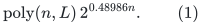

The running-time bound applies to every random history. For each fixed
polynomial input-bit convention, the ordinary word-operation bound is
`O(2^(0.48986 n))`, with the source word convention. Success means an exact
answer, with probability at least two thirds. The refinement does not
improve the simultaneous space exponent or derandomize the algorithm.

This is a modest numerical improvement, not a major algorithmic advance.
The structural contribution remains the exact-counting extension. Unlike
the exploratory optimizer outputs, the constants below have an exact
rational certificate and a complete parameter ledger.

The number in (1) is not asserted to be a best-known exponent for the
decision version of Subset Sum. The claim here concerns bounded-error
exact counting and a reproducible refinement of the particular pinned
construction; a faster decision algorithm does not by itself supply
its exact-counting extension.

The source is the pinned `openai/math` commit
`4eaee87548250b2682affda7d05d947c05554bae`, under
`preprints/Subset-Sum-in-Time-2-power-0-49n-October-4-2026/build/sections/`.
The relevant additional source is `numerical.tex`, blob
`d9b2531441fcd7ac10b434746088de7d6d4e7576`:

https://github.com/openai/math/blob/4eaee87548250b2682affda7d05d947c05554bae/preprints/Subset-Sum-in-Time-2-power-0-49n-October-4-2026/build/sections/numerical.tex

## 1. Fixed rational parameters

Keep the source's six-harmonic densities, its normalized power
`kappa=1.0315`, and its two Chernoff multipliers `8.5` and `8.3`. Replace
only the following fixed constants:

| Parameter | Exact value | Role |
|---|---:|---|
| `tau` | 0.48982 | Checksum sample and alias cap exponent |
| `eta` | 0.51785 | Large-prime exponent |
| `mu` | 0.0574 | Representation-block fraction |
| `gamma` | 0.4895 | Small-prime exponent per representation-block item |
| `delta` | 0.01019 | Low-deficiency threshold |
| `alpha` | 0.01046 | Useful-block deficiency fraction |
| `t` | 17 | Number of disjoint small restrictions in the deficiency argument |
| Preliminary cap | 0.48983 | Distinct-sum list cap exponent |
| `epsilon` | 0.00000001 | Source score-rounding allowance |

Every decimal denotes an exact rational. Put

<!-- math-display: c8fa1fb835693236324712fd
\Delta=\eta-\tau=0.02803,\qquad
 \Gamma=2\tau-\eta=0.46179,\qquad a=\Delta/\Gamma.
\tag{2}
-->
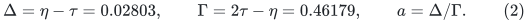

The use of `alpha` in the alias proof is distinct from the
pattern-dependent sampling fraction in the checksum proof.

## 2. Exact filtering certificate

The source defines `u,v` from the fixed densities and establishes inner
quadrature error bounds on a 64-point grid. These functions are unchanged
by the parameter choice (2). Reconstructing the 64-point values with
outward-rounded rational arithmetic gives

<!-- math-display: 6eb1f6e7f88e5054462b979a
\begin{aligned}
 \int M(x)^2 2^{8.5(\Delta-u(x))}\,dx
   &<1.43131509437785,\\
 \int M(x)^2 2^{8.3(a v(x)-u(x))}\,dx
   &<1.43134541010277.
\end{aligned}
\tag{3}
-->
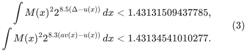

Both displayed upper bounds are strictly below `2^0.5175`.
The executable certificate is
`verify/check_improved_filter_certificate.py`; its exact
output is `verify/improved_filter_results.json`.

### Arithmetic reproduced by the checker

The checker uses integer/Fraction arithmetic throughout, rounding every
interval endpoint outward to a grid with 160 binary fractional bits.
It computes pi from the alternating arctangent series for
`pi/4=arctan(1/2)+arctan(1/3)`, evaluates the cosine grid by Taylor series,
and evaluates exponentials and logarithms by rational series with explicit
tail bounds. No floating-point value is used in an assertion.

With `F=2^r`, `G=2^s`, define the raw convolution quantities

<!-- math-display: ad485f0cc20ff1e52ad4d821
\mathcal P(x)=\int F(x+w)G(w)\,dw,
\qquad
\mathcal Y(x)=\int F(x+w)G(w)(r(x+w)+s(w))\,dw.
-->
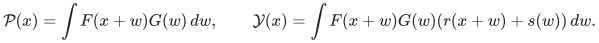

The checker directly evaluates their 64-point averages. It uses the
identities

<!-- math-display: d3654a9d4f70f4a8aff5bbd6
\begin{aligned}
 u&=(\kappa-1)\frac{\mathcal Y}{\mathcal P}
       +\log_2\mathcal P
       -\log_2 Z_{f,\kappa}-\log_2 Z_{g,\kappa},\\
 v&=(2-\kappa)\frac{\mathcal Y}{\mathcal P}
       -2\log_2\mathcal P
       +\log_2 Z_{f,\kappa}+\log_2 Z_{g,\kappa}.
\end{aligned}
\tag{4}
-->
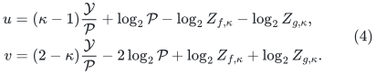

These avoid unnecessary normalizers, which cancel algebraically.
The source inner-quadrature estimates `|L-Lhat|<10^-7`,
`|B-Bhat|<2*10^-6`, and `|H-Hhat|<5*10^-9` imply

<!-- math-display: f333adf97349913bc139eea5
|u-\widehat u|<2\cdot10^{-7},\qquad
 |v-\widehat v|<3\cdot10^{-6}.
\tag{5}
-->
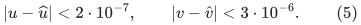

The checker inserts the unfavorable endpoints from (5) before summing
the node integrands.

### Analytic error bounds retained from the source

The source's analytic-strip estimates concern only the unchanged
densities. In its strip of half-width `0.38`, they give

<!-- math-display: 358efbc1c1e4f2058ee121c7
-\mathrm{Re}L<1.121,\quad |B|<13/0.46,\quad H<0.016.
-->
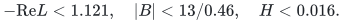

Substitution of (2) into the two new exponent bounds gives, respectively,
values below `17.46960282608696` and `16.97515916071394`. Both are below
`17.6`. Since `|2+2 cos z|<4.16`, the same source bound `2^20` for each
analytic outer integrand remains valid. Consequently the outer 64-point
quadrature error remains less than

<!-- math-display: ff8a9b4e3a040b1ee8ffdf4d
\frac{2^{21}}{e^{64\cdot0.38}-1}<0.00007.
\tag{6}
-->
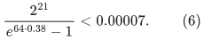

The checker verifies these inequalities exactly and includes (6) in (3).
Thus (3) is a rigorous enclosure, rather than a grid approximation.

For source auditing, the exact unchanged labels in `numerical.tex` are
`eq:analytic-trapezoid`, `eq:inner-quadrature-errors`,
`eq:node-score-errors`, `eq:shifted-l2`, `eq:Q-strip`, and `eq:B-strip`.
The last bound is followed immediately by `H<0.016`. They occur in the
subsections **Controlling the inner quadratures** and **An analytic strip
for the outer integrands**. The changed parameters enter only after these
bounds, when bounding the two outer exponents. That is the step explicitly
recomputed above. The finite-circle passage is the proof of
`lemma:finite-filtering` in `filtering.tex`; it is uniform convergence for
fixed smooth positive densities, not an additional numerical assumption.

Uniform finite-circle convergence gives finite-circle moment rates
below `0.5176` for all sufficiently large moduli. The shifted-grid argument
in [the main counting proof](proof.md), including the physical circle of size `Pq` and the
frequency circle of size `P`, then permits the rate `0.5177` in the
cyclotomic counting estimator. Its polynomially growing phase primes
eventually exceed the effective fixed constants in that argument.

The checksum mean-square-error exponent is at most

<!-- math-display: 4b456b4f3af6cb44b93c0d16
-\eta+0.5177+48\epsilon=-0.00014952<0.
\tag{7}
-->
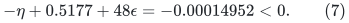

The source's subexponential number of patterns and polynomially many
target bins are absorbed by this strict gap. Also
`8.3*(4a+3)<30`, so its profile-rounding domination inequalities remain
valid with exactly the same rounding allowances.

## 3. Alias and deficiency ledger

For the representation block size `m=2 floor(mu n/2)`, the useful-block
requirements are

<!-- math-display: 4ba957f65b72eecb42cd637b
17\mu<1,\qquad \delta<17\mu\alpha,
 \qquad \gamma<\tfrac12-\alpha.
\tag{8}
-->
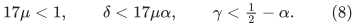

All are strict at the displayed rational parameters. The source all-sparse-support prime-distinction proof applies at the new
block fraction. Its union bound over sign assignments has exponent
`h(mu)+mu`, where `h` is binary entropy. The exact certificate checks
`h(0.0574)+0.0574<0.40`. With the source input guard
`b^(100000)<=2^n`, the sufficient prime-failure inequality is

<!-- math-display: ca9f39b0ce85d44d068fd9a0
h(\mu)+\mu+0.00001<\eta.
\tag{9}
-->
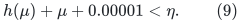

The source list-generation and pair-enumeration proof uses only the
symbolic entropy estimates and strict inequalities below; it does not
require its original decimal constants. Using the rigorously checked
bound `h(1/4)<0.81128`, the three relevant exponents are at most

<!-- math-display: 7bea9cdf4efbfd3d64adc0d2
\begin{aligned}
 g &=\mu+\tfrac14=0.3074,\\
 \ell&=\tfrac12+(0.81128-\tfrac12-\gamma)\mu
       =0.489770172,\\
 p&=1+(2\cdot0.81128-1-\gamma)\mu-\eta+0.00001
       =0.489797644.
\end{aligned}
\tag{10}
-->
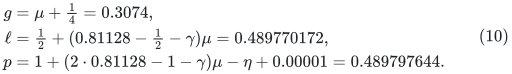

Each is strictly below `tau=0.48982`. The `0.00001` term in `p` explicitly
charges the input-bit guard in the prime-collision estimate. The trial
division prime-generation exponent is `eta/2=0.258925`, also smaller.
Polynomially many trials and the source's entry/pair caps therefore retain
uniform `o(1)` failure probabilities. Canonical subset deduplication and
the exact-integer alias exclusion remain unchanged.

If the expected half-set deficiency exceeds `delta n=0.01019 n`, the
source variance lemma and Chebyshev's inequality imply, with probability
`1-O(1/n)`, that both halves have deficiency at least `0.01018 n`.
Their distinct-sum list lengths are at most

<!-- math-display: 4b5013d9a399381ea35e682d
2^{(0.5-0.01018)n+1/2}\leq2^{0.48983n}
-->
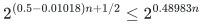

for sufficiently large `n`. Thus the preliminary count-preserving search
fits its new cap. Otherwise the low-deficiency hypothesis used in (8)
holds. Multiplicities are retained exactly as in [the main counting proof](proof.md).

## 4. Uniform implementation and transfer to exact counts

The checksum's capped work is

<!-- math-display: 5fd5035791cebf8ca335ba6f
2^{(\tau+20\epsilon)n+O(\sqrt n)}\mathrm{poly}(n),
\qquad \tau+20\epsilon=0.4898202.
-->
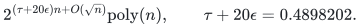

The preliminary cap is `0.48983`, and the alias cap is `0.48982`.
The source finite-arithmetic implementation therefore gives an effective
fixed cutoff and fixed constants `C,K` such that every guarded execution
uses at most

<!-- math-display: 0b7f384fb5f6adefb91ce474
C\,2^{0.48985n}(n+b+2)^K.
\tag{11}
-->
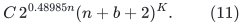

The following details account for failed executions as well as successful
ones. They are inherited from the source construction, with the displayed
caps substituted:

| Component | Bound or stopping rule |
|---|---|
| Preliminary distinct-sum search | Stops before a list exceeds its `0.48983` cap; exact multiplicities use at most `n+1` bits |
| Alias generation | Setup exponent `0.3074`; each emitted list and visited-pair counter stops at its `0.48982` cap |
| Checksum digit and table generation | `2^(tau n+O(sqrt(n)))` work before emitted entries; entry caps use the unchanged `epsilon` allowances |
| Direct checksum patterns | Stop before the source entry/match cap is exceeded |
| Sampled checksum patterns | Exactly `2^ceil(tau n)` match draws, or zero output when the stored match count is zero |
| Match indexing | Counts the implicit Cartesian product with `O(n)`-bit counters; no expanded match array or `P`-entry array is allocated |
| Uniform sampling | At most `n^3` rejected proposals per draw; failures abort the current invocation |
| Prime generation | At most `n^3` tested candidates per call; exact trial division has exponent at most `eta/2` |
| Complex arithmetic | Evaluate to error `2^(-2n^2)` and sum on the source common `n^2`-bit dyadic grid; intermediate operand lengths stay polynomial |
| Cyclotomic traces and CRT | Polynomially many calls and polynomial-bit counters; clamp failed/reconstructed answers to the legal output range |

The list-size and table-coverage failure estimates are unconditional. They
are not recomputed under a conditioned successful-prime distribution.
Prime, block, flip, and phase randomness have exactly the marginal laws
used in the source. The preliminary
outcome `CONTINUE` is also not used to condition a later correctness proof:
the two regimes are analyzed from the fixed input's expected deficiency,
and unused main-procedure randomness can be drawn independently even when
the preliminary procedure has already finished.

The cyclotomic trace and CRT procedures require polynomially many
invocations and inverse-polynomial absolute accuracy. They preserve
(11), after increasing the fixed polynomial and cutoff. The source
strict exponent gaps, the new gap (7), and the exact derivative bounds
already proved for the unchanged densities make these cutoffs effective.
No random-history expectation is substituted for (11).

For every fixed polynomial input-bit convention, the gap between
`0.48985` and `0.48986` absorbs all remaining fixed polynomial factors.
For arbitrary bit length, if the guard fails then

<!-- math-display: 4e6a925b0f5a7566d7bca4c4
2^{n/2}<2^{0.48986n}b^{1014},
-->
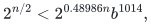

so exact counting meet-in-the-middle is covered by the fixed polynomial
in (1). Small `n` is covered by adjusting the absolute constant.

The phase-sum/cyclotomic reconstruction itself is unchanged, so there is
no new isolation assumption, no additional solution-multiplicity bound,
and no new numerical decision threshold. The deterministic interval and
finite-field activity reductions preserve the new exponent, since their
number of calls is polynomial in the input size for the stated regimes.

For completeness, confidence amplification is ordinary independent
repetition, not an assumption of independent conjugate phases. Within one
trace calculation the conjugates have uniform product marginals and a
union bound suffices; they need not be mutually independent. The counting
procedure already has an exact-answer probability at least two thirds
uniformly over all inputs after its fixed cutoff. Repeat it independently
`O(log(Q/epsilon))` times and return the median integer when a reduction
will make at most `Q` counting queries and requires total failure at most
`epsilon`. Conditional on an adaptively chosen next query, fresh random
bits retain the same uniform success guarantee. A Chernoff bound and a
union bound therefore cover adaptive reductions as well. Each repetition
has the deterministic history bound (11), so amplification changes only
the fixed polynomial factor. Exact counting outputs are first restricted
to their known legal range, keeping all failed-history output lengths
polynomial. Product-activity CRT reconstruction likewise uses its explicit
integer output-height bound.

## 5. What has and has not been verified

The exact checker verifies all new numerical constants, the changed
analytic exponent bounds, Taylor remainders, quadrature allowance, and
combinatorial exponent inequalities. It does not execute the source's
full exponential-time checksum algorithm. The theorem continues to
depend on the named source lemmas and the phase-law audit in the main
counting manuscript. External novelty of this parameter refinement has
not been established; it is recorded as a reproducible improvement of
the particular pinned construction.
